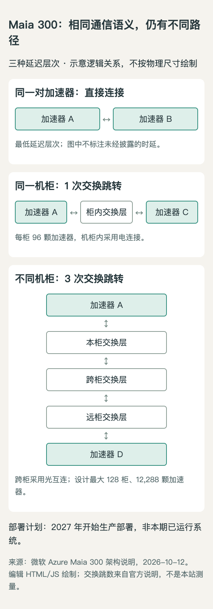
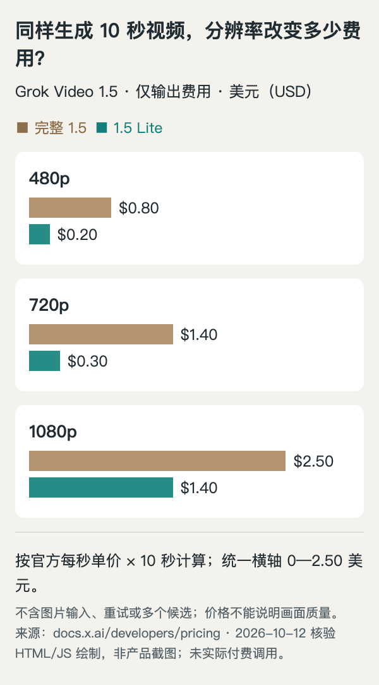

# AI 动态：5 条重点详解 + 10 条速读

本期 15 个独立事件，5 条重点详解 + 10 条速读。北京时间 22 点的发布前复查新发现 Maia 300，已补入首条；其余 14 条为近七天补充，原日期明确标注。新闻时间范围为 **2026-10-05—2026-10-12**，有明确时区者换算北京时间。各条凭新近实用或创新证据入选，缺少两类独立近期信号的内容不称“热门”。新闻约需 18—22 分钟。

[返回今日导读](00-今日导读.md)。

## 01 · Maia 300：把推理效率放到整机柜与网络里衡量

2026-10-12 北京时间 21:00｜新近创新｜验证：官方架构与部署计划，本站无硬件实测；热度待验证。

微软公布第三代 Maia 推理系统。最容易误读的是状态：Maia 200 已服务 Microsoft Copilot 等生产负载，Maia 300 则计划从 2027 年开始生产部署。此次是新一代架构与扩容计划，不是今天已经能购买的新 Azure 实例。

它面向长上下文、持续多步 Agent 和解码较重的任务。相比只提高计算峰值，设计着重减少数据搬运：计算 chiplet 使用台积电 N2P，内存控制与 I/O 分开实现；软件把数据放到更靠近使用它的计算区域。每颗加速器配置八组 HBM4，容量 288 GB、峰值带宽 18 TB/s，并支持更低精度的表示。

网络也是系统的一部分。一个机柜容纳 96 颗加速器，设计可由最多 128 个机柜组成 12,288 卡的 superpod。机柜内走电连接，跨机柜通过第二级光互连；同一套通信语义覆盖两层。它允许预填充与解码分开部署，并直接转移 KV 状态，但不同路径仍有不同延迟。

根据微软架构说明绘制的通信路径示意，表示逻辑交换跳数，不表示线路长度、延迟数值或实测带宽。原公告网络图仅提供[原图入口](https://azure.microsoft.com/en-us/blog/wp-content/uploads/2026/10/Top-tier-Scale-Up-Network.webp)；本图为编辑 HTML/JS 绘制，[可复现源码](code/maia-paths.html)（[架构来源](https://azure.microsoft.com/en-us/blog/deep-dive-into-azure-maia-300-architecture/)；[查看原尺寸](images/maia-paths.png)。）

官方宣称完整 96 卡配置的机柜级 token 吞吐最高为 Maia 200 的七倍，能效也有提升。这包含每柜加速器数量翻倍等系统变化，不能写成“单颗芯片快七倍”，更不能与未注明模型、精度和负载的 GPU 数字直接比较。相对领先 GPU 系统每兆瓦多产出 40% token，也是微软的预期，不是独立公开复跑的结论。

为什么现在值得看：推理成本不仅由模型参数和算力决定，内存局部性、KV 搬运及机柜供电可能共同决定有多少请求真正完成。阅读这类公告时，先分清每卡、每柜、每瓦三个分母，再看实际部署时间。[架构原文](https://azure.microsoft.com/en-us/blog/deep-dive-into-azure-maia-300-architecture/)、[部署计划](https://blogs.microsoft.com/blog/2026/10/12/microsoft-to-expand-azure-maia-system-to-multi-gigawatt-deployments/)。

## 02 · TRAE 中国版合并：Agent 与 IDE 共用一个工作入口

2026-10-09｜近期补充｜新近实用｜验证：官方公告与演示，本站未试用。

TRAE 中国版把原来的 Work 和 Code 合并到同一个客户端。变化涉及工作入口：Agent 模式适合跨项目、跨应用的任务，IDE 模式保留围绕代码仓库的编辑、运行与调试。用户可以从同一任务继续工作，官方同时介绍了桌面、网页和移动端之间的衔接。此次报道的是中国版产品合并，不能推及国际版的上线范围。

对正在做项目的人，可以把它理解为两种工作尺度。准备需求、整理资料、生成文档时，任务可能尚未落到某个仓库；开始修复函数或检查测试时，又需要文件树、差异与终端。合并后的价值在于让这两个阶段更容易接续，而不是证明 Agent 已经能自主完成完整项目。具体交付物仍需逐项验收。

公告展示的产物包括代码、HTML、演示文稿、文档、图像和视频，并将自动化、模板与助手集中到新的入口。这些是产品支持的工作形态，不能把“能产出文件”理解成每一种专业软件的编辑能力已经等价。正式项目还应检查源文件是否可继续修改、附件是否齐全，以及代码能否在自己的环境重现结果。

当前采用灰度推送。官方说明账号、历史记录及相关本地数据延续，但本期没有实测迁移，升级前仍可保留自己的项目副本。论坛里既有使用反馈，也有带积分奖励的征集活动；后者不能充当独立热度或用户满意度证据，因此本条不贴“近期热门”标签。

为什么现在值得看：如果原来分别使用 Work 做准备、Code 写实现，这次合并会直接改变日常操作路径。先在已获推送的账号上验证一个小任务的连续交接，比根据宣传中的能力清单切换整个工作流更有参考价值。[官方合并公告](https://forum.trae.cn/t/topic/183224)。

## 03 · Odyssey-3 新预览：让动作参与生成下一段世界

2026-10-08｜近期补充｜新近创新｜验证：官方研究说明与演示，尚无本期独立复现。

Odyssey 在 10 月 8 日公布 Odyssey-3 的新研究预览和评测细节。该系列在 9 月已经介绍过；本次新增的是可交互预览、训练说明及具体对照，不应写成系列首次问世。系统根据已有画面和动作继续生成视觉状态，支持第一、第三人称移动以及独立的摄像机控制。用户输入会改变后续画面，而非只决定从固定视频的哪一秒播放。

模型采用自回归扩散 Transformer，训练资料包含视觉观察、带时间信息的内容、动作关联的游戏过程及模拟数据。后训练再通过分布匹配和对抗蒸馏压缩生成步骤，以满足实时交互的延迟要求。这说明“画面好看”与“及时响应动作”是两项不同目标；持续生成还必须面对长时间一致性和动作效果是否稳定的问题。

先看上方当前场景，再看两个动作分支。图只解释动作会影响后续生成画面，不代表 Odyssey 的实际界面、运行画面或物理一致性结果。AI 生成概念示意；最终提示词见[附件](images/odyssey-prompt.txt)（[机制依据](https://odyssey.systems/meet-odyssey-3)；[查看原尺寸](images/odyssey-concept.webp)。）

官方给出的 PhysicsIQ 结果需要带着条件阅读。Pro 在视频到视频设置中的一项分数为 66.1，但使用 best-of-8；带提示增强的另一设置为 63.4。预览与 Pro 的分辨率也不同，比较不能省掉采样次数、提示处理和输入类型。把这些数字概括成“所有物理任务领先”会超出证据；内部 WorldMark 同样不是独立评测机构的结论。

本次对研究者更有用的问题是：世界模型能否在连续动作下保持场景结构，用户换方向时会不会失去物体身份，以及延迟降低后会牺牲哪些细节。公告的机器人等迁移示例可作为研究线索，不能据此宣称真实系统已能安全自主操作。公开预览也不等于开放模型权重。

为什么现在值得看：它把视频生成的评价对象推进到“动作—状态变化”的闭环。本期配图只解释这个关系，不复制官方实验，也不展示本站运行结果。[官方研究预览](https://odyssey.systems/meet-odyssey-3)。

## 04 · Grok Imagine Video 1.5 Lite：低价档与完整档要分开看

2026-10-08｜近期补充｜新近实用｜验证：官方能力与价格文档，本站未付费调用。

xAI 的 Imagine 文档将 Video 1.5 Lite 列为独立的视频生成选项。它面向文字或图片驱动的短视频，可生成带音频的结果，文档列出最高 1080p、最长 15 秒。这里采用文档更新日期，尚未核实精确首发时刻。需要把 Lite 的输入能力与完整的 Video 1.5 区分：完整档的多参考图片、声音参考等上限，不能直接移植到 Lite 的介绍里。

实际接入不是同步请求后立刻拿到 MP4。开发者提交生成任务，获得请求标识，再查询状态并取得成品。因此做批量素材测试时，除了单条生成价格，还要处理排队、失败、重试、下载与结果筛选。这些是集成流程的成本，本期没有测得等待时长，也没有对成功率作推断。

按此次核实的价目表，Lite 在 480p、720p、1080p 的视频生成费用分别为每秒 0.02、0.03、0.14 美元；完整 1.5 对应为 0.08、0.14、0.25 美元。下面只比较 10 秒生成的输出费用，图片输入另有计费，重试和生成多个候选也会改变总费用。分辨率升高带来的价格变化并非等比例。

按每秒单价乘以10计算，单位美元；仅输出费用，不含图片输入、重试和多个候选。数据为本期所见官方价目表，HTML/JS据实绘制；[源码和数据](code/grok-cost.html)（[价格来源](https://docs.x.ai/developers/pricing)；[查看原尺寸](images/grok-cost.png)。）

例如，先为同一个分镜制作多种低分辨率草稿，再对选中的方案生成高分辨率版本，可以帮助控制探索阶段的开销；这只是编辑建议，不是已经测得的最优方案。音画一致性、角色连续性和口型效果仍要用自己的输入核验，不能从“支持音频”推导出各种语言和人物都能稳定工作。

为什么现在值得看：这次档位变化让短视频试稿多了一个可比较的成本选项。选型时应把输入限制、输出质量和完整任务费用一起看。[能力文档](https://docs.x.ai/developers/model-capabilities/imagine)、[视频接口](https://docs.x.ai/developers/model-capabilities/video/generation)、[官方价格](https://docs.x.ai/developers/pricing)。

## 05 · Office 进入 Copilot：同一份文件继续编辑与协作

2026-10-09｜近期补充｜新近实用｜验证：微软官方演示与开放说明，本站未试用。

微软宣布把 Word、Excel 和 PowerPoint 的创建、编辑与协作能力带进 Copilot 应用。用户从 Chat 或 Cowork 发起任务，生成初稿后，可以在同一工作界面继续修改，而不是只得到一段聊天文字或一个下载链接。本次明确新增的是 Office in Copilot 面向 Frontier 客户的推送；此前新 Copilot 应用的发布与此次能力开放并非同一日期。

官方以把研究笔记整理成发布简报为例：Word 文件在对话旁打开，后续可以要求调整结构、增加对照表，也能直接使用编辑控件。对话上下文保留，文档中的协作则沿用评论、共同编辑和在线状态。多人修改落在同一个文件中，减少生成初稿与团队审阅之间反复导出副本的步骤。

文件保存在 OneDrive。Library 集中展示最近的 Word、Excel、PowerPoint 文件，以及页面和 AI 图像；重新打开后可以继续工作。公告强调格式、评论、共享权限、版本记录与组织安全标签的延续。这里的价值在于文件与权限体系的连续性，并不是给 Copilot 增加绕过组织权限的入口。

对用户而言，最值得验证的是自己的模板、复杂表格和多人审阅流程是否完整保留。官方展示了品牌模板、图表建议等后续工作，但没有证明任意复杂文件都能无损迁移；模型生成的计算、事实与文字也仍需检查。用户可以选择模型，或由 Auto 路由，实际可用选项依账号与开放范围而定。

为什么现在值得看：AI 办公的难点经常在初稿之后，修改与交付能否接续决定它能否进入真实团队工作。此次推送限定 Frontier 客户，不能写成所有个人 Copilot 用户已可使用。[微软公告](https://techcommunity.microsoft.com/blog/microsoft-copilot-blog/introducing-office-in-the-new-microsoft-copilot-app/4561230)。

## 06 · SpliceAI2：从位点判断走向更细的剪接影响预测

2026-10-08｜近期补充｜新近创新｜厂商研究与公开实现，本站未复现。

Illumina 发布 SpliceAI2，将变异影响预测细分到剪接位点、位点连接及转录本。官方在 Genomics England 研究数据上报告比其他剪接模型多识别 17% 的疾病相关变异；GTEx 中剪接位点使用量的量化改进为 34%，两者不能合成“诊断准确率提升”。具体输入包括变异 TSV 与参考基因组，推理需 CUDA；权重与预计算评分面向学术非商业研究，商业用途另许可。现在值得看的是更细的可检查输出，预测仍需实验解释。[官方发布](https://investor.illumina.com/news-releases/news-release-details/illumina-releases-spliceai2-help-advance-rare-disease-research)、[实现](https://github.com/Illumina/SpliceAI2)。

## 07 · Unity Gateway 增加请求标签与外部检查策略

2026-10-09｜近期补充｜新近实用｜验证：官方公告或研究说明，本站未运行。

Databricks 10 月 9 日让自定义服务策略检查调用方传入的请求标签，覆盖模型请求和 MCP 工具调用；10 月 7 日加入的外部策略则可将请求或响应送交第三方检查，并在对方拒绝时阻断。它们属于同一次治理能力跟进，合并报道。现在值得看的是团队可以把必要标签与内容检查放在公共网关，减少各应用重复实现；外部策略仍为 Beta，也意味着相关内容会进入所配置的检查服务。 [原始来源](https://docs.databricks.com/aws/en/release-notes/product/2026/october)。

## 08 · OpenAI API 用量层级由五档调整为三档

2026-10-06｜近期补充｜新近实用｜验证：官方公告或研究说明，本站未运行。

OpenAI 将 API 的用量层级整理为 Build、Launch、Grow 三档，取代原来的五级体系，并调整通过购买额度自动升级的路径。对应用维护者，值得立即核对的是组织当前层级、对应模型的请求和 token 限额，而不是仅改一个层级名称。此次是配额管理更新，不代表所有模型统一提速或降价；程序仍需处理限流与重试。价格、余额和速率上限是不同概念，应分别读取组织控制台及模型文档。 [用量分层文档](https://developers.openai.com/api/docs/guides/rate-limits/) · [10月6日更新日志](https://developers.openai.com/api/docs/changelog/)。

## 09 · ChatGPT 预告 College Planner，尚不能写成全面上线

2026-10-07｜近期补充｜新近实用｜验证：官方公告或研究说明，本站未运行。

OpenAI 预告 College Planner，计划先面向美国 10—12 年级、准备申请四年制大学的学生，整理学校要求、截止日期和申请任务。当前公告使用“即将”开放，后续扩展到其他路径与地区也属于计划。它现在值得关注的是从一次问答走向持续安排任务的产品方向；申请条件与时间仍需回查学校原始说明。本期只确认预告与首批范围，没有试用记录，也不把它写成已覆盖全球升学申请的服务。 [原始来源](https://openai.com/index/teens-learn-and-plan)。

## 10 · Earth AI 展示五类公共卫生研究验证

2026-10-06｜近期补充｜新近实用｜验证：官方公告或研究说明，本站未运行。

Google Research 公布 PDFM 地理嵌入在五类公共卫生任务中的合作研究。模型把聚合行为与环境信息压缩成地点表示，再接到已有统计或机器学习流程中。值得看的新增证据是跨地区、跨任务验证，而非另一个统一总分：例如心血管死亡数估计与传统人口统计输入的差异并不显著，优势在数据更新和可得性；其他任务的改善也依赖场景。结果用于研究和群体层面的建模，不能当作个人诊断能力。 [原始来源](https://research.google/blog/earth-ais-planetary-geospatial-foundation-models-for-global-public-health/)。

## 11 · Google 研究区分工作质量提高与技能真正增长

2026-10-07｜近期补充｜新近实用｜验证：官方公告或研究说明，本站未运行。

Google 介绍对 11 家机构、133 名专利律师进行的三个月随机试验：获得 AI 工具的一组在辅助起草任务中表现更好，但移除工具后的修改任务呈现资历差异。资深律师有所提高，初级律师平均技能增益不明确，分布同时出现更多高分和低分。现在值得看的是培训评估要单独设置“撤掉工具后还能否完成”的环节；这一特定职业、样本与工具下的结果，不能推广成所有新手都会退步或所有老手都会受益。 [原始来源](https://research.google/blog/does-better-work-always-mean-better-workers/)。

## 12 · NVIDIA 展示前沿 Agent 参与仿真制作的五种流程

2026-10-08｜近期补充｜新近实用｜验证：官方公告或研究说明，本站未运行。

NVIDIA 展示开发者使用前沿 Agent 配合 Omniverse、Newton、Warp 等工具完成仿真制作：从场景资产、脚本到碰撞与运动检查，人的判断仍在流程中。案例包括仓库、机器人和房间场景，属于可核验的开发演示，不是新通用机器人模型的发布。现在值得看的是语言模型开始承担仿真工程中的连接工作；演示中的成功率只对应指定模拟任务，不能换算成现实操作可靠性，也不能把几个示例概括为全自动仿真研发。 [原始来源](https://blogs.nvidia.com/blog/developers-simulations-frontier-ai-agents/)。

## 13 · Copilot 代码审查增加组织付费与外部许可控制

2026-10-09｜近期补充｜新近实用｜验证：官方公告或研究说明，本站未运行。

GitHub 允许组织把成员发起的 Copilot 审查费用记入仓库所属组织，而不消耗成员个人配额；组织需启用 AI Credits 付费使用，可设置预算。管理员还能限制是否允许外部或个人许可发起审查。现在值得看的是这会改变团队预算和权限配置，默认仍由成员额度计费，并非自动切换。原文标为 10 月 8 日，发布时区换算为北京时间 2026-10-09 03:43。本期仅核对配置说明，未改变任何组织设置。 [原始来源](https://github.blog/changelog/2026-10-08-copilot-code-review-new-organization-billing-options-and-controls)。

## 14 · a16z 宣布领投 TypeSafe AI

2026-10-10｜近期补充｜新近实用｜投资方公告，相关方主张；热度待验证。

a16z 宣布领投 TypeSafe AI，新增事实是投资消息，Jev 模型此前已经发布。公告关注让程序直接获得有类型的决策值，以较低延迟嵌入软件流程；这值得研究者关注结构化决策模型的产品需求。投资方关于增长、采用和成本的数字仍属相关方主张，本期不把它们当独立热度或性能验证，也不猜测融资额。原文日期为 10 月 9 日，所给 UTC 时间戳换算为北京时间 2026-10-10 00:28。 [原始来源](https://a16z.com/announcement/investing-in-typesafe-ai/)。

## 15 · OpenAI API 为符合条件的组织提供自助 HIPAA 支持入口

2026-10-05｜近期补充｜新近实用｜验证：官方公告或研究说明，本站未运行。

OpenAI API 更新日志记录：符合条件的组织管理员可在组织设置中接受标准 BAA，并启用 HIPAA 支持。现在值得看的是办理入口从人工流程向自助设置延伸，适用于有相关需求且满足资格的组织；它不代表账号默认合规，也不表示任何数据、模型和工作流都自动落入协议范围。本次帮助页访问受限，资格及完整条款未能进一步核验，因此只报道更新日志确认的入口，不提供法律判断或数据处理建议。 [原始来源](https://developers.openai.com/api/docs/changelog/)。
