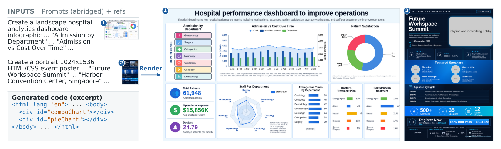

# 开放权重与实现：六项新近进展

本栏同时核对权重文件、代码与许可。六项均未在本站运行；“可下载权重”不等于训练数据完整开放。FrogNano 的权重许可标记存在冲突，NeuDecide 需要接受访问条件，Prism 仍是预览。只想做普通笔记本实验的读者，可先读 Paradee 的前处理限制，再决定是否下载。

| 对象 | 输入 → 输出 | 主要门槛 |
| --- | --- | --- |
| d3 | 文字/图像/视频 → 决策概率 | 26B 量级、远程实现、开发通道 |
| NeuDecide | 英语语音 + 工具定义 → 调用 | 受限权重、工具数与语音长度 |
| AesCode | 描述/参考图 → HTML/CSS | 8B 视觉模型和浏览器验收 |
| FrogNano | 仓库问题 → 候选补丁 | 许可标注冲突、Leaf 环境 |
| Paradee | 音素 → 单音色英文语音 | 前端映射、短文本、ONNX |
| Prism | 提示/参考图 → 联合音视频 | CUDA、高显存、基础权重 |

[返回导读](00-今日导读.md)。

## 01 · d3：多模态输入直接返回决策与概率

2026-10-10｜新近实用、新近创新｜作者评测，本站未运行；热度待验证。

d3 接收文字或 JSON，也能同时读图片、视频；用户声明要作出的决策，模型返回每个选项的概率，不生成一篇解释。适用场景是请求分流、材料分类或有限选项打分，输入到输出的边界比自由对话明确。多个问题可以放进一个请求，但模型卡说明各问题分别对输入执行前向计算，不能理解为问题数增加也没有计算开销。

它基于 Qwen3.8-27B，实际参数量 26.09B，包含 0.46B 视觉编码器。作者以已发布权重运行 Jev Decision Index 0.3 公共套件，报告 140,178 个请求全部有回答、得分 65.45。卡中的视频测试及吞吐延迟另属内部设置；仓库另一张图仍标内部总分 64.7，本期不把图和公共套件的数字拼在一起比较。

上手需要支持对应架构的 Transformers，当前示例固定 `transformers==5.17.0`，并使用 `trust_remote_code=True`。先检查远程实现，再加载权重；26B 量级不是普通笔记本的轻型部署。作者延迟是在单张 AMD MI325X、一次一个请求下得到，不能移用于消费显卡。Semantic Router 的 Engine 模式仍在开发通道，不应称稳定版已经原生支持。

为什么现在值得看：新权重把多模态理解接到有类型的决策接口，适合研究“哪些任务不需要长文本生成”。概率也不自动等于可靠置信度，应在目标数据上验证误判与拒绝策略。权重采用 Apache-2.0，训练数据完整开放程度未在本期核实。[模型卡、权重与接口](https://huggingface.co/vllm-sr/d3)。

## 02 · NeuDecide：从语音直接得到工具调用

2026-10-06｜近期补充｜新近实用｜官方实验与接口说明，本站未下载受限权重；热度待验证。

NeuDecide 把一段英语语音和允许使用的工具定义作为输入，直接生成工具名称与参数。传统方案先语音转文字，再把文字交给语言模型；它希望省去这段串联，适合短指令、设备控制和有明确操作集合的语音入口。模型只负责提出调用，执行工具仍属于应用代码。

模型约 55.5M 参数，量化 ONNX 组件约 43 MB，包括音频编码器、工具编码器和逐步解码器。文档支持 Python 3.10—3.13；完整取得模型后可在本地运行。限制也很具体：单段音频最多 30 秒、工具描述总长和输出长度有上限，建议工具数不超过 10 个。本次公开卡片可读，但权重及原始文件请求返回访问限制，需要用户在 Hugging Face 接受条件，不能写成无门槛匿名下载。

作者在 SLURP 的 10 工具设置中报告完整调用匹配率 37.5%，比较项 Voxtral Mini 3B 为 6.9%；这是一种特定任务和模板下的结果，37.5% 本身也说明它远非“听到就可靠执行”。噪音可能触发调用，应先做语音活动检测，并设计无动作出口。没有实测中文或任意工具组合的依据。

为什么现在值得看：它给端侧语音应用提供了可检查的小模型路径，尤其适合比较延迟、离线性与任务覆盖的取舍。模型卡标 Apache-2.0；访问条件、模型许可和下游工具的执行权限要分别核对。[模型卡与文件清单](https://huggingface.co/neuphonic/neudecide)。

## 03 · AesCode-8B：把视觉稿生成成可编辑代码

2026-10-07｜近期补充｜新近实用、新近创新｜官方示例与作者实验，本站未运行；热度待验证。

AesCode-8B 从提示词和可选参考图生成 HTML/CSS，面向海报、幻灯片和仪表盘等可编辑视觉产物。它基于 Qwen3-VL-8B，把文本、布局、表格图表与风格等评价拆成多个奖励通道，再用分组归一化的优化方式训练。和直接生成一张图片相比，结果能进入代码与浏览器编辑流程，但也要承担字体、布局和浏览器渲染的验证工作。

看左侧“输入—代码”再看右侧渲染结果：产物可进入代码编辑流程。这是微软 AesCode 仓库原图，MIT；仅引用输入输出示例，图中统计为合成内容，未裁切。字体细节可打开原图查看（[来源原图](https://github.com/microsoft/AesCode)；[查看原尺寸](images/aescode.webp)。）

论文关联实验对 300 个提示分别生成 3 次，不作候选筛选；在其设定中，综合分为 82.94，带参考图的基础模型为 51.93。这个数字依赖自建任务、评价器和采样参数，不是所有网页工程任务的成功率；风格维度依旧有明显改进空间。上图中的医院数据是作者生成效果示例，不能作为真实医疗统计。

部署需兼容 Qwen3-VL 的运行时，示例要求 Transformers 4.57 或更新版本；约 8B 权重的 BF16 原始存储量已在十余 GB 量级，视觉输入和长上下文还会增加内存需求。仓库给出 vLLM 配置与图片输入限制，不能仅凭参数量保证某张显卡一定能运行。

为什么现在值得看：10 月 7 日的发布提交提供了可检查权重，研究者可以围绕“结构正确但不好看”的生成结果设计多维奖励，而非只用一项视觉总分。模型标 Apache-2.0，代码采用 MIT，源码与权重的许可不同。[模型卡](https://huggingface.co/microsoft/AesCode-8B)、[代码和示例](https://github.com/microsoft/AesCode)。

## 04 · FrogNano：用合成仓库任务训练小型代码 Agent

2026-09-22｜近期补充（30 天内）｜新近创新｜模型卡与作者实验，本站未运行；热度待验证。

FrogNano 基于 Qwen3.5-4B，围绕仓库级修复任务进行强化学习。TaskPilot 生成、验证并按当前策略校准约 1,500 个软件工程环境，Leaf 提供读写文件、搜索与运行命令等五种工具。其研究价值在于：小模型的任务能力能否通过可执行测试反馈逐步提高，而不借用更强模型的完整解题轨迹。

在同一 Leaf 设置下，作者报告 SWE-bench Verified 的 Avg@3 从基础模型 39.4% 提升到第五轮后的 61.5%。这里是三次尝试的平均成绩，不能换成“允许三次中任意一次成功”的 Pass@3；模型卡另列的 Pass@3 为 71.0%，分母与统计意义不同。训练任务偏英语与 Python，测试通过也不等于修改完全正确。

权重约 4.66B，BF16 权重本身约 9.3 GB，运行状态、工具并发和接近 131K 的上下文还需额外内存。卡片没有给出经过验证的最低显卡配置。虽然继承的架构有视觉组件，这次后训练与评测都是文本编码任务，不宣称图像、视频已受支持。

许可存在本期实际发现的缺口：Hugging Face 前置元数据写 MIT，正文模型说明写 Apache-2.0；GitHub 代码 LICENSE 为 MIT。这里保留两种表述，不替上游裁决，也不将代码许可直接套到权重。正式复用前需得到明确的权重许可说明。

为什么现在值得看：作为近 30 天首次收录的研究补充，它适合用来拆解合成任务、工具环境与奖励的作用。更适合有隔离仓库和回归测试的实验，而非把生成补丁自动投入生产。[模型卡](https://huggingface.co/microsoft/FrogNano-4B-2609)、[Leaf 与代码](https://github.com/microsoft/FrogNano)。

## 05 · Paradee-8M：把单音色英文 TTS 压到小型 ONNX

2026-09-25｜近期补充（30 天内，权重上传日期；论文 10 月 5 日）｜新近实用｜作者实验，本站未运行；热度待验证。

Paradee 将 Kokoro 的单个英文音色蒸馏到约 8.07M 参数，量化 ONNX 文件约 9 MB。输入先经过文本与音素处理，再把音素编号、语速送入模型，输出 24 kHz 波形。它适合固定音色的本地提示、短文本朗读或端侧 TTS 原型，不是多语种、音色克隆模型。

作者用约 23.9 小时合成语音训练，在 200 条保留句子的实验中报告 WER 5.7%、UTMOS 4.41；这些数值依赖该测试集与自动评分方式。文档另有不同榜单成绩，不能混作同一次测试。性能也要区分运行时：作者 M4 Pro 单线程的 PyTorch 与已发布 ONNX 数字不同，ONNX 为约 18 倍实时，本期没有测得本机速度。

部署门槛不只看文件大小。音素映射应匹配训练使用的前端，换成浏览器里的发音工具也需要映射适配；错误音素不会因模型更小而自动纠正。输入长度有上限，长文章应合理切分，再处理停顿与拼接。单音色、英语范围及蒸馏后的表达损失，都应在实际用途前确认。

为什么现在值得看：这是近 30 天的新权重，而不是把历史知名 TTS 再推荐一遍；它提供了清楚的体积、前处理和推理格式，便于验证“更小能换来什么，又失去什么”。权重与实现采用 Apache-2.0，教师模型及音色素材的相关条款仍应同时保留。[模型卡与权重](https://huggingface.co/sahilmahendrakar/Paradee-8M-v1.0)、[实现](https://github.com/sahilmahendrakar/paradee)。

## 06 · Prism 预览：按视听内容动态选择稀疏注意力块

2026-10-05｜近期补充｜新近创新｜官方实现、预览权重与作者实验，本站未运行；热度待验证。

Prism 在联合音视频生成中采用动态稀疏注意力。高分辨率视频产生大量 token，如果对所有位置执行完整注意力，计算成本会迅速增加。它先划分较大的时空区域，再结合视觉特征的局部变化、音频到视频的注意力强度，为不同区域选择更合适的块形状和稀疏连接。

先看左下两路信号如何影响中央的块形状，再沿上方走到右侧的块选择；颜色代表形状配置，不代表实测质量高低。Prism 团队方法原图，MIT及随附依赖条款，未裁切；[许可说明](https://github.com/Tencent-Hunyuan/Prism/blob/main/LICENSE)（[来源原图](https://huggingface.co/FrancisRing/Prism)；[查看原尺寸](images/prism.webp)。）

与固定大小、固定稀疏率的切块相比，它希望把更多计算留给变化快、音画关联强的部分。作者报告相对完整注意力的训练加速，但这一结果不能直接当成任意 GPU、任意视频的推理倍速。预览 alpha、beta 两组 checkpoint 在 10 月 5 日上传，卡片的正式发布日期仍留着占位符，因此本期只确认“预览权重已上传”，不推断正式产品发布日。

仓库给出 720p、1080p 和 2K 训练、推理路径；环境要求 Python 3.10+、CUDA 12.4+、PyTorch 2.7.1、FlashAttention 与系统 ffmpeg。高分辨率路径依赖显存、CPU offload 或多 GPU FSDP，绝非手机或普通 CPU 的轻型模型。实际需同时准备 MOVA 基础组件与 Prism checkpoint，不能只下载一个文件就假定可运行。

为什么现在值得看：它将稀疏注意力的选择依据从单纯空间邻近扩展到视听耦合，代码和预览权重使这一设计可以被检查。Prism 自身采用 MIT，MOVA 等依赖维持原有条款；模型名中的“预览”应保留。[模型卡及文件](https://huggingface.co/FrancisRing/Prism)、[官方代码与许可](https://github.com/Tencent-Hunyuan/Prism)。
