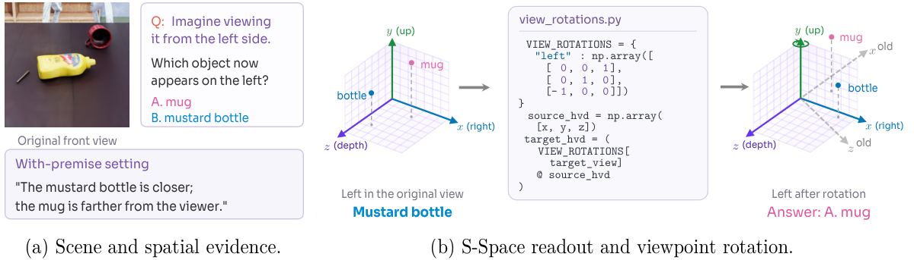
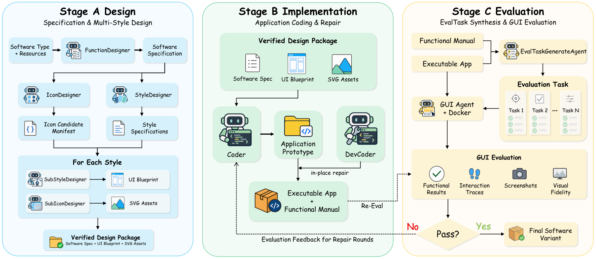
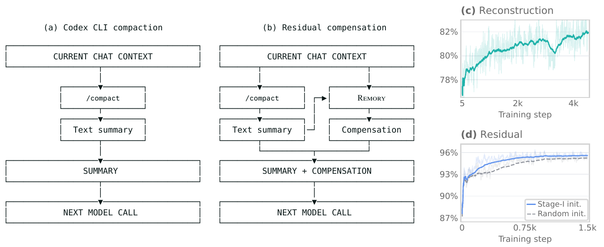
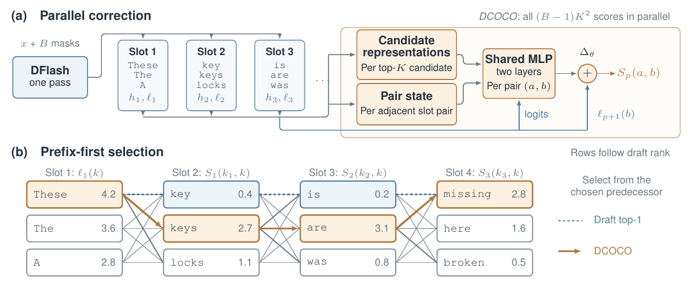
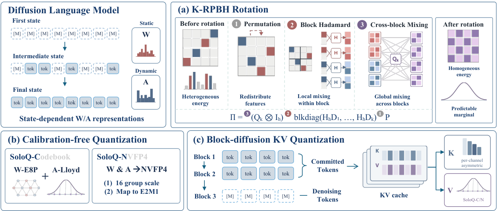

# 论文精选：把训练、记忆与推理的收益放回条件中

从 16 篇候选中选 6 篇，均为 **arXiv 预印本 v1**，日期覆盖 2026-10-05—10-09。比较池及未选理由见本期审计。以下依据原文方法与结果，不是本站复现实验；各篇属于新近创新，独立近期热度信号不足，热度待验证。

先读 S-Space 和 REMORY，理解“信息在哪里丢失”；再按工作方向选择 DiffusionART 的训练、SoftwareGym 的数据环境，或 DCOCO / SoloQ 的推理改进。每篇有站内阅读卡，许可允许的五篇另附未修改 PDF。[返回导读](00-今日导读.md)。

## 01 · DiffusionART：先形成奖励方向，再更新扩散模型

2026-10-08｜近期补充｜新近创新｜验证：论文原文方法、对照和实验条件。

扩散模型的强化学习通常在效率和稳定性之间取舍。DiffusionART 先分析一种隐藏的拉力：部分训练目标既想朝高奖励样本移动，又会被前向—反向一致性约束拉回，正负样本联合训练并未把这股力完全抵消。

它改成“先聚合，后更新”：对同一提示的一组样本计算奖励方向，再将这个方向分配给反向生成过程中的状态，构成回归目标。第二次更新用信任域掩码控制漂移。直觉上，是先决定一组结果整体应朝哪里走，再管住模型不要走得过远；论文据此减少对 EMA 调度的依赖，也不要求奖励模型可微。

实验覆盖图像与视频，包括 SD3.5、FLUX、HunyuanVideo 和 Wan 相关设置。在 HunyuanVideo-13B、视觉与运动质量奖励等权时，达到 NFT 和 Flow-GRPO-Fast 后期平均奖励水平所需 GPU 小时分别少 12.02、11.72 倍。这是“到达特定奖励”的成本，不是推理速度，也不保证人类偏好同步提升。小样本组与成对奖励实验则支持方法不必每个提示采很多样本。

为什么现在值得看：它把稳定性问题拆到了目标函数与更新方式，适合已有扩散微调代码的人检查损失设计。先在相同基础模型、奖励器和预算下复现，再谈迁移；论文图的再分发许可未明确，本期以文字步骤解释，保留原文图入口而不重绘实验图。

[原文](https://arxiv.org/abs/2610.12572) · [站内阅读卡](../../../../papers/frontiers/2610.12572/00-阅读卡.md)。

## 02 · S-Space：看见位置与算对视角是两回事

2026-10-09｜近期补充｜新近创新｜验证：论文原文方法、对照和实验条件。

同一张图片，模型可能知道杯子在哪里，却在“从另一侧看，哪个东西在左边”时答错。S-Space 尝试把这两个环节分开。作者从空间回答对对象 token 的梯度中找出水平、垂直和距离方向，再将高维表示投影到三个轴上；这些读出在一些非空间提示下仍保持可用。

证据不只是一张相关性图。研究在 Molmo2-ER、Qwen 系列模型和多个空间问答数据集上检查读出，并通过修改坐标表示观察回答如何变化；空间判断变化较大、非空间属性相对保留，为这个表示参与判断提供因果干预证据。不过这些轴的数值不是现实世界里的米，也不是完整三维重建。

Shi 等人，原文图 8，CC BY-NC-SA 4.0，未裁切。看中间旋转矩阵：提高后的答案来自外接确定计算，不是让模型重新自由回答；本学习站按非商业引用保留原图许可。（[来源原图](https://arxiv.org/abs/2610.13527)；[查看原尺寸](images/sspace.png)。）

最值得读的是 SpinBench 分解实验。无额外前提时，Molmo2-ER 直接回答的准确率为 60.96%；读出坐标，再用已知旋转和确定规则计算答案，可到 94.52%。这里增强的是外接诊断流程，不能说原模型已达到同一水平。实验提示瓶颈可能在空间变换，而不只是看不清物体。

为什么现在值得看：它提供了区分感知失败、计算失败和表达失败的工具。复现时应保持层位置、轴识别数据、视角设定和问题集合一致；论文里的抽象“左右”语言案例只是局部观察，不宜扩大解释。

[原文](https://arxiv.org/abs/2610.13527) · [站内阅读卡](../../../../papers/frontiers/2610.13527/00-阅读卡.md)。

## 03 · SoftwareGym：生成应用后，真的点一遍再拿来训练

2026-10-08｜近期补充｜新近创新｜验证：论文原文方法、对照和实验条件。

训练计算机操作 Agent 缺的不只是指令，还缺可以反复重置、真实执行的应用环境。SoftwareGym 先设计功能与不同风格的界面，再把设计实现为可运行应用；它并不在“代码成功生成”后停止，而是让 GUI Agent 实际操作，把失败返回给实现阶段修复。

Jin 等人，原文图 2，CC BY 4.0，未裁切。沿底部虚线看失败反馈回到代码阶段；最终通过条件来自 GUI 行为检查，不能只看程序是否能启动。（[来源原图](https://arxiv.org/abs/2610.12611)；[查看原尺寸](images/softwaregym.webp)。）

随后，任务从已被操作证据确认的功能中生成，并指定初始状态、目标和难度。作者据此合成 12 个类别的 182 个应用，平均 GUI 任务通过率 91.5%；这表示被测任务在这些环境中的功能可靠性，不代表每个应用不存在未测缺陷。

训练实验使用 Qwen3.5-9B，在 100 步、每题三次运行的协议下，OSWorld 的 Pass@3 从 41.39% 提升至 56.97%。训练不使用 OSWorld 同域数据，因此结果支持一定的迁移价值；但同表的同域训练基线为 61.48%，高于纯合成路径，不能说合成环境已经全面替代真实任务。混合数据也并非必然更好。

为什么现在值得看：论文把“可执行软件—已验证能力—训练任务”的依据接起来，读者可以追查轨迹究竟来自什么环境。做复现时应保留应用版本、验收条件、失败样本与 Pass@3 协议，避免把生成成功数量当成训练数据质量。

[原文](https://arxiv.org/abs/2610.12611) · [站内阅读卡](../../../../papers/frontiers/2610.12611/00-阅读卡.md)。

## 04 · REMORY：给文字摘要补一段连续记忆

2026-10-08｜近期补充｜新近创新｜验证：论文原文方法、对照和实验条件。

长任务的摘要可能保留了结论，却丢掉出处、失败路径或下一步还会用到的细节。REMORY 在文字摘要后追加一段连续记忆 token：记忆网络同时看到原历史与新摘要，学习把摘要没有充分表达的信息压进向量，而不是再写一篇更长的文字。

每 1,024 个来源位置先产生 64 个软 token，分层压缩将最终记忆限制在 4,096 个槽位。训练先做重建，再让“摘要＋记忆”的冻结模型尽量接近完整历史下的后续预测；未来回答不作为记忆编码器输入。它需要训练一个额外网络，并接触模型内部表示，不能仅在闭源聊天 API 前面加一句提示就复现。

Xia 等人，原文第 3 页图 3，CC BY 4.0；从原 PDF 忠实裁取整个图区，未改变曲线、数字或关系。左侧是摘要路径，中间多了以摘要为条件的记忆；右侧曲线是训练诊断，不是任务成功率。（[来源原图](https://arxiv.org/abs/2610.11287)；[查看原尺寸](images/remory.png)。）

在 SummHay 同一组 92 个查询上，作者以约 5.2% 的输入位置接近完整上下文的联合分，主要改善出处归属，内容覆盖变化较小。AutomationBench 的 Qwen3.8-27B 五次运行由 35.5±1.3 提升至 45.3±1.0；另外一些工具基准只跑一次，证据强度不同。图表中的外部前沿模型用各自流程，不能视为同条件横向对照。

为什么现在值得看：这为“摘要不是足够统计量”提供了可训练的补偿方式。复现除了任务成功率，还应看重复工具输出、来源追踪及总开销；论文按 token 换算的费用没有囊括记忆网络和所有工具，不能宣传成完整账单节省。

[原文](https://arxiv.org/abs/2610.11287) · [站内阅读卡](../../../../papers/frontiers/2610.11287/00-阅读卡.md)。

## 05 · DCOCO：并行草稿先保留候选，再修正相邻选择

2026-10-08｜近期补充｜新近创新｜验证：论文原文方法、对照和实验条件。

并行草稿模型一次预测多个位置，速度快，却容易把各位置分别合理的 token 拼成不协调的一句。DCOCO 的观察是：正确 token 往往仍在每个位置的前几个候选里，问题出在选择时没有利用前面最终选了什么。

它用一次 DFlash 前向保留候选及表示，再由共享小网络为相邻候选组合并行打分。计算分数是并行的，选出整条草稿时则从第一个位置往后走，每一步以已选前驱为条件；最后仍交给原验证器接受或纠正。不要把“并行评分”理解成所有依赖都消失。

DCOCO 作者，原文第 4 页图 2，CC BY 4.0；忠实裁取完整图区。橙线为条件选择，蓝色虚线为原草稿选择；词和分数是论文说明用例，非本站实测。（[来源原图](https://arxiv.org/abs/2610.12570)；[查看原尺寸](images/dcoco.png)。）

实验包括 Qwen3 系列和 Llama 3.1 共四类验证器、十个套件，区分温度 0 与 1、是否启用思考。默认性能比较在单张 B200、并发 1 下进行；论文另测并发 4—32。最高约 6.6 倍是相对普通自回归解码，另一个 6%—23% 则是高并发时相对最强比较项，两种分母不能互换。

为什么现在值得看：它把纠错放在候选集合上，尝试保留并行草稿优势而补上相邻条件关系。研究推理系统时，可以优先看接受长度与整套系统吞吐，而非仅看一个小模块快了多少。模型、草稿深度、训练数据与硬件栈应保持可比。

[原文](https://arxiv.org/abs/2610.12570) · [站内阅读卡](../../../../papers/frontiers/2610.12570/00-阅读卡.md)。

## 06 · SoloQ：扩散语言模型的量化不再依赖校准样本

2026-10-05｜近期补充｜新近创新｜验证：论文原文方法、对照和实验条件。

扩散语言模型在逐步去噪时，激活分布会随步骤变化，用少量固定样本校准的量化方案可能不稳。SoloQ 先把不均匀的表示变得更可预测：随机置换重新分配特征，块内 Hadamard 混合，再作跨块混合，最后按目标分布确定量化方式。

方法有两条实现路线。SoloQ-C 使用匹配的码本，SoloQ-N 面向 NVFP4 硬件格式。对按块生成的模型，它还区分正在去噪的活动块与已经提交的历史块：前者保持高精度，后者再压缩 KV 缓存。这样避免把仍在反复更新的状态过早固定到低比特表示。

SoloQ 作者，原文图 2，CC BY 4.0，未裁切。重点看右下角：已提交 token 与仍在去噪的 token 分开处理；左下两条量化路线有不同硬件条件。（[来源原图](https://arxiv.org/abs/2610.07121)；[查看原尺寸](images/soloq.png)。）

论文在 LLaDA、Dream、Fast-dLLM v2、Nemotron 等设置下比较准确率、内存与延迟，并和 RTN、AWQ、QuaRot、专门的扩散量化方法对照。最高 2.61 倍内存压缩、2.24 倍速度提升是指定模型与配置中的上界。C 版效率在 H200 测，N 版在 RTX Pro 6000 测，各自对照同硬件 BF16，不能将两张卡的结果混成统一加速率。

为什么现在值得看：它把扩散过程中的分布变化与缓存生命周期一起纳入量化设计，提供了避免校准集选择的另一条路线。复现应先验证目标运行时是否真的调用低比特 kernel，再记录整模型输出质量；只把权重文件变小并不等于推理已经变快。

[原文](https://arxiv.org/abs/2610.07121) · [站内阅读卡](../../../../papers/frontiers/2610.07121/00-阅读卡.md)。
