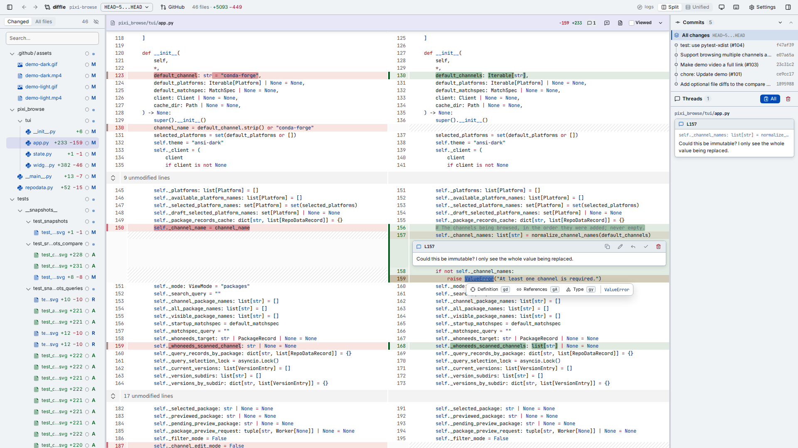
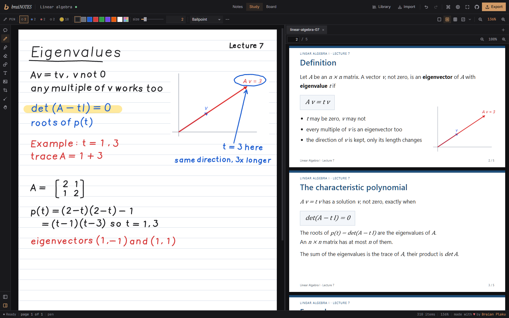
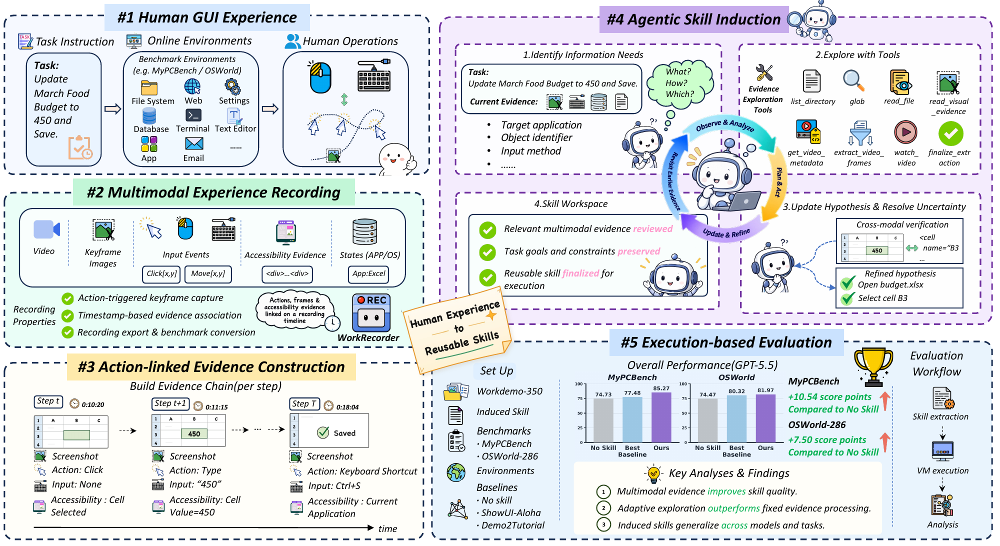

# 十个工具与公开实现：从日常输入到代理评测

本期按具体任务选择，不按累计 Star 排序。十项均未在本站安装或执行；下列功能依据作者演示、源码、版本与论文，热度均待进一步验证。代码许可不覆盖外部模型服务、账号额度或所有第三方素材。

| 要完成的任务 | 先看哪项 | 首要条件 |
| --- | --- | --- |
| 听写与会议转录 | BetterWispr | Mac、模型组件 |
| 审查生成的代码 | Diffle | Git 仓库、语言服务 |
| 边读论文边手写 | Brainotes | 浏览器、可靠备份 |
| 语音启动桌面任务 | Atticus | macOS 26、Claude Code |
| 研究生成式创作客户端 | ArtCraft | Rust、提供商账号 |
| 从操作示范提炼技能 | Work2Skill | 录制权限、视觉模型 |
| 动态构造修复任务 | SWE-Duel | Docker、模型端点 |
| 检查实时决策轨迹 | JevMan Benchmark | Node、兼容模型端点 |
| 评价 AI 编写的游戏程序 | AAArena | Linux 沙箱 |
| 研究外部反馈驱动的改进 | RSI-Anything | 各任务资产及算力 |

[返回导读](00-今日导读.md)。

## 01 · BetterWispr：听写之外，会议记录能区分说话人

2026-10-12 v0.1.5｜新近实用｜作者演示与版本记录，本站未安装；热度待验证。

BetterWispr 是 Mac 听写工具：按住快捷键说话，松开后把文字写入当前输入框。新版本把用途延伸到会议，下载约 21 MB 的说话人检测组件后，在会议结束时回看通话音频，将远端发言标成 Speaker 1、2 等；不是自动知道每个人的真实姓名。

为什么现在值得看：本周新公开的实现将本地听写、模型管理和会议转录放到同一入口，10 月 12 日的更新还有明确的新功能。可从 Releases 安装，基础要求 macOS 14+；模型与特定系统语音能力另有条件。Apple、Parakeet、Whisper 等本地路径要先下载对应组件，选云服务则需自己的账号与额度，不能将整个应用概括为永远免费离线。

HN 有具体讨论入口，但单条帖子不足以认定持续热门。首次使用宜录一小段两人交谈，确认说话人分离和转录质量，再处理长会议。[版本说明](https://github.com/opennookorg/betterwispr/releases/tag/v0.1.5)。

[规范仓库](https://github.com/opennookorg/betterwispr) · [Apache-2.0](https://github.com/opennookorg/betterwispr/blob/main/LICENSE)。

## 02 · Diffle：在差异视图里继续追踪符号

2026-10-06 v0.2.0｜近期补充｜新近实用｜版本说明与真实界面，本站未运行；热度待验证。

审查 AI 生成的补丁时，红绿差异只告诉人改了哪里，往往还要回 IDE 查类型和引用。Diffle 在浏览器里的 Git 差异视图加入 LSP 悬浮说明、定义与引用等能力，保留按文件和提交浏览的上下文。本次入选依据是 10 月 6 日的实质功能版本，不是随后的小修复。

这是 Diffle 仓库的界面原图（Apache-2.0）。先看文件树如何定位改动，再看差异行里的符号信息；仅展示操作界面，不证明补丁正确或本机已运行。未裁切（[来源原图](https://github.com/moritzwilksch/diffle)；[查看原尺寸](images/diffle.png)。）

最小路径是安装 `@moritzwilksch/diffle`，在目标仓库运行 `diffle working`。语言服务仍需按语言配置，读取 GitHub PR 则有相应认证条件；它不会替代运行测试或理解业务约束。可以先拿一个自己熟悉的补丁验证符号跳转，再用于较大的代理改动。

为什么现在值得看：它把“看改动”和“理解改动依赖”接得更近，特别适合每天审查多次自动生成补丁的开发者。[v0.2.0](https://github.com/moritzwilksch/diffle/releases/tag/v0.2.0) 和 [使用说明](https://github.com/moritzwilksch/diffle#readme) 提供了可复核入口。

[规范仓库](https://github.com/moritzwilksch/diffle) · [Apache-2.0](https://github.com/moritzwilksch/diffle/blob/main/LICENSE)。

## 03 · Brainotes：PDF 与手写笔记在同一个本地画布

2026-10-05 新项目｜近期补充｜新近实用｜作者界面与源码，本站未运行；热度待验证。

Brainotes 让 PDF 阅读、手写笔记和白板共处一个浏览器工作区。输入是一篇论文或课程讲义，输出可以是带笔迹的文档与可继续编辑的笔记备份，适合在触屏设备上画推导、补图解。它不依赖账号，也没有把“本地笔记”包装成云端 AI 推理服务。

这是作者仓库的原始示例界面（MIT），左侧保留阅读材料，右侧可继续手写推导；本期仅引用双栏阅读与笔记关系，未裁切，未将示例当作本站笔记（[来源原图](https://github.com/swimmingbrain/brainotes)；[查看原尺寸](images/brainotes.png)。）

数据使用浏览器 IndexedDB 保存；“在本地”仍不代表不会因清理站点数据而丢失。开始正式记录前，应试一次 `.brainotes.zip` 备份恢复和 PDF 导出。源码使用 Svelte 5 与 pnpm，按仓库开发命令即可建立自己的静态站点；离线使用需要资源先缓存。

为什么现在值得看：这是本周出现的具体学习工具，可把原文和手写思考留在同一视野。10 月 12 日的 Show HN 是发现线索，尚无第二类独立使用趋势；本文引用作者展示，没有实测笔迹延迟与跨设备恢复。

[规范仓库](https://github.com/swimmingbrain/brainotes) · [MIT](https://github.com/swimmingbrain/brainotes/blob/main/LICENSE)。

## 04 · Atticus：把常用 Mac 操作交给语音入口

2026-10-10 新项目｜新近实用｜作者说明与实现，本站未安装；热度待验证。

Atticus 给 Mac 增加语音操作入口。简单的系统命令走原生执行路径，复杂请求交给 `claude -p`；语音识别使用 Apple 的本地能力。这个分工值得看：不是每一次“打开应用”都要经过长链路代理，而真正需要推理的任务才进入模型调用。

目前要求 macOS 26，以及已经配置好的 Claude Code 和适用订阅；可选的屏幕理解还依赖 Peekaboo 与相应权限。上手从仓库安装说明开始，先阅读安装脚本、确认命令路由和授权范围，再试一个可撤销的小任务。源码开放不等于 Claude 推理免费，也不能把它描述成完全离线助手。

为什么现在值得看：它把最近的系统语音能力与编码代理结合成可检查的桌面实现，适合研究语音界面的响应分层。项目很新，本期没有长期稳定性或独立成功率证据，尚不适合据此判断可放心无人值守。

[规范仓库](https://github.com/SaarthurR/atticus-mac) · [MIT](https://github.com/SaarthurR/atticus-mac/blob/main/LICENSE)。

## 05 · ArtCraft：创作工作区新增 Rust 原生实现

原仓库始于 2022 年；2026-10-11 北京时间新增原生实现｜近期实质更新｜新近实用，本站未编译；热度待验证。

ArtCraft 原有工作区支持图层、场景和相机等创作控制。本次值得关注的是新加入的 `artcraft-native/`：以 Rust 和 egui 构建界面，复用 API 客户端，已实现图像、视频、音频创建及作品库；其他工具仍显示待推出并转到网页。不能把原产品所有功能都套到这个新实现上。

若研究客户端实现，仓库给出的启动方式是 `cargo run -p artcraft_native --release`。生成依赖 ArtCraft 或用户自己的外部提供商账号，模型、素材和服务费另有条款；本期没有购买服务或运行生成。稳定 Release 与主分支进展也要分开，9 月的安装包并不能证明已经包含 10 月的新客户端。

为什么现在值得看：这是成熟项目近七天内可核验的架构与许可变化，而非因为历史 Star 高再次推荐。源码重新采用 MIT OR Apache-2.0；本文选用 Apache-2.0 条款记录，第三方依赖保留 NOTICE。[原生实现说明](https://github.com/storytold/artcraft/tree/main/artcraft-native)、[新增实现提交](https://github.com/storytold/artcraft/commit/b5614ad333)。

[规范仓库](https://github.com/storytold/artcraft) · [Apache-2.0](https://github.com/storytold/artcraft/blob/main/LICENSE-APACHE)。

## 06 · Work2Skill：把一次 GUI 操作转成可复用技能

2026-10-09 论文、2026-10-12 公开实现｜新近实用、新近创新｜作者实验及源码，本站未运行；热度待验证。

只录一段操作视频，代理未必知道哪些步骤可以重复、哪些参数应该替换。Work2Skill 将 GUI 事件、画面与时间对应起来，再从这些证据中提炼技能说明。具体任务可以是演示一次表格整理，把操作步骤与关键画面留给后续代理，而不是只写一句笼统的“照着做”。

沿上部从操作记录读到证据与技能，下部是作者报告的任务结果（MIT 仓库原图），不是本站重跑数据。本文引用记录与技能的对应关系，保留完整图与原图数值；完整评测组件仍有缺口（[来源原图](https://github.com/china-qijizhifeng/Work2Skill)；[查看原尺寸](images/work2skill.png)。）

记录器支持 macOS 与 Linux X11，Linux 还涉及 AT-SPI；环境包含 Python 3.12、uv、ffmpeg、NexAU 和视觉模型端点。输入记录与 `task.json` 之后，才能进入证据提取和技能生成流程，模型服务与权限需自己配置。

为什么现在值得看：论文之后很快提供了可检查的操作采集与提炼实现。但仓库尚未包含完整 runner、评测器与扰动生成链路，不能据此声称已独立复现 64 个 MyPCBench 任务和 286 个 OSWorld 任务的全部结果。[论文](https://arxiv.org/abs/2610.12984)、[使用入口](https://github.com/china-qijizhifeng/Work2Skill#readme)。

[规范仓库](https://github.com/china-qijizhifeng/Work2Skill) · [MIT](https://github.com/china-qijizhifeng/Work2Skill/blob/main/LICENSE)。

## 07 · SWE-Duel：一边埋新缺陷，一边验证修复

2026-10-08｜近期补充｜新近创新｜作者实验与实现，本站未运行；热度待验证。

SWE-Duel 用对抗过程生成软件修复任务：红方在加入功能时引入隐藏缺陷，蓝方尝试修复，同时要求原有行为和新增功能继续通过测试。输入是代码仓库与任务配置，输出是缺陷、修复轨迹和可执行测试，适合研究编码代理如何应对新构造的问题。

项目提供四类运行框架、15 个仓库和五种语言的配置。最小准备包括 Python 3.12、Docker、Git；安装开发依赖后，还要完成目标仓库、容器和 doctor 检查。默认模型路径涉及 OpenRouter 等服务，产生调用费用；能看到任务代码不代表所有评估免费或无需环境准备。

为什么现在值得看：与静态题库相比，它公开了“造题—修复—测试约束”的实现，可用于研究任务分布与测试强度。但动态生成也不能证明绝对不存在数据污染，测试通过更不等于所有真实缺陷已解决。[论文](https://arxiv.org/abs/2610.12569)。

[规范仓库](https://github.com/sweduel/SWE-Duel) · [MIT](https://github.com/sweduel/SWE-Duel/blob/main/LICENSE)。

## 08 · JevMan Benchmark：让模型在实时游戏状态中决策

2026-10-07｜近期补充｜新近实用｜作者可回放演示及源码，本站未运行；热度待验证。

这个基准把类吃豆人的游戏状态发给模型，再把输出动作送回游戏。比最终分数更值得看的，是模型回复是否赶上决策时刻、逾期后用了什么回退策略，以及连续多步是否保持有效路线。回放可帮助读者将模型决策与真实执行分开观察。

使用需要 Node.js 22.18+，按 README 安装依赖并启动开发界面；运行模型评估需准备提供商凭据，或用 `npm run bench -- --endpoint ...` 连接自己实现的兼容本地端点。观看已有回放与重新发起实时模型调用是不同操作，后者可能计费。

为什么现在值得看：本周新公开的适配与轨迹机制，为研究短时决策提供了一个较直观的任务。社区排行榜是投稿结果，不是本站统一条件重跑；比较前需同时记录模型、延迟、回退规则和回合设置。其 AGPL-3.0 条款也比宽松许可有更具体的再分发要求。

[规范仓库](https://github.com/opper-ai/jevman-benchmark) · [AGPL-3.0](https://github.com/opper-ai/jevman-benchmark/blob/main/LICENSE)。

## 09 · AAArena：用归档人类程序评价 AI 写出的参赛程序

2026-10-08 论文｜近期补充｜新近实用、新近创新｜作者实验与公开实现，本站未运行；热度待验证。

AAArena 不只是让模型回答游戏规则，而是让代理写出可运行的参赛程序，再与人类归档程序对局。论文使用 12 类游戏、1,920 份人类程序；这样的输入输出适合检查长期策略、代码执行和规则理解，比单看生成代码的语法更接近实际行为。

本地入口 `python3 scripts/setup_local.py` 用于准备和检查游戏环境。要求 Linux x86、cgroup v2、systemd、用户命名空间和 bubblewrap，编译器及 Python 版本也需匹配；不要按普通 Mac 脚本理解。公开练习包只有部分对手，正式 1,920 份程序和认证评测服务的范围应分别核对。

为什么现在值得看：它公开了一种以历史人类程序作参照的编程评测方法，允许读者检查规则、沙箱和对局过程。评测同时受代理框架、搜索预算与模型影响，排名不能单独归因于基础模型。论文在此作为实现依据，不在六篇论文栏重复占位。[论文](https://arxiv.org/abs/2610.12341)。

[规范仓库](https://github.com/THU-CST-SAST/AAArena) · [MIT](https://github.com/THU-CST-SAST/AAArena/blob/main/LICENSE)。

## 10 · RSI-Anything：把候选预测与实际反馈分开迭代

2026-10-09｜新近创新｜作者论文与实现，本站未运行；热度待验证。

RSI-Anything 把策略改进写成一个有外部反馈的循环：先生成候选，世界模型预测其效果，再挑选候选实际执行；真实结果回流后，同时改进策略与世界模型。它希望减少盲目试错，但预测本身可能错，最终保留什么仍应看任务提供的检验信号。

重点看上半部分：预测后的候选还要实际执行，接受更新需要外部反馈。下半部分展示作者研究的任务领域，不表示本站或仓库已独立复现全部科学实验。Gen-Verse 原图（Apache-2.0），未裁切（[来源原图](https://github.com/Gen-Verse/RSI-Anything)；[查看原尺寸](images/rsi.png)。）

代码提供共享命令行与任务适配。最小探索可在 Python 3.10 环境安装项目后运行 `rsi tasks` 查看任务；真正复现实验还需对应资产、模型和 GPU 环境。公开目录能检查代码修复、GUI、实验规划等适配，不能将一个统一 CLI 说成已经完整复现论文涉及的所有科研方向。

为什么现在值得看：本周公开的实现把“自我改进”拆成可检查的候选、预测、执行和接受环节，适合研究反馈在哪里失真。论文结果来自作者设置，尤其涉及科学任务时，计算指标改善不等于得到经过独立实验确认的新发现。[论文](https://arxiv.org/abs/2610.13912)。

[规范仓库](https://github.com/Gen-Verse/RSI-Anything) · [Apache-2.0](https://github.com/Gen-Verse/RSI-Anything/blob/main/LICENSE)。
