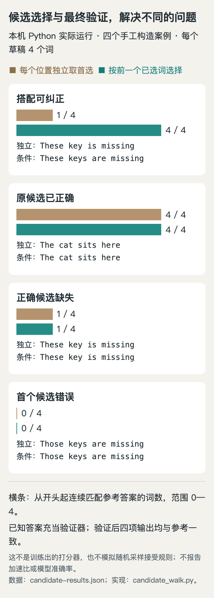

# 小实验：为什么草稿选择和最终验证必须分开

**已在本机运行；合成教学示例。** 本文借用今天 [DCOCO 论文](03-论文精选.md) 中“相邻候选关系有助于选择草稿”的直觉，不实现论文模型，不报告加速比，也不把手工打分当成训练结果。

## 从一个不协调的句子开始

假设并行草稿一次给出四个位置，每个位置都有候选。独立选第一名得到 `These key is missing`；第二个位置还有 `keys`，第三个还有 `are`。如果相邻候选的分数偏好 `These → keys` 和 `keys → are`，就可能走出更协调的句子。

这里的关键是条件发生了变化：选择下一词时，要看前一个实际选中的词。论文用学到的轻量打分器评价候选对，我们为了看清过程，直接手填分数。候选是人为划分的单词，甚至不是实际模型的 tokenizer 输出。

## 输入、代码与运行条件

只需要 Python 3.10+ 标准库，没有模型权重、网络调用或 GPU。下载 [完整脚本](code/candidate_walk.py)，在脚本目录运行：

```bash
python3 candidate_walk.py > candidate-results.json
```

核心选择过程如下，完整脚本还包含四组输入、参考答案和输出记录：

```python
edges = [{(a, b): scores.get(a + "|" + b, 0)
          for a in left for b in right}
         for left, right in zip(slots, slots[1:])]
result = [slots[0][0]]
for candidates, pair_scores in zip(slots[1:], edges):
    result.append(max(candidates,
                      key=lambda t: pair_scores[(result[-1], t)]))
```

先计算所有相邻候选对的分数，再从第一个位置向后选择。这里仍是条件贪心，不是遍历整条路径的全局最优算法。分数相同时 Python `max` 保留候选表中较前的项；本例输入顺序固定，因此结果可重复。

## 本机观察到了什么




本机脚本输出的合成案例图，横条表示从第一个词开始连续匹配参考答案的词数。HTML/JS读取实际结果绘制；分数、候选与参考均由编辑手工构造，不是论文数据或模型性能测量（[实际运行数据](code/candidate-results.json)；[查看原尺寸](images/candidate-results.png)。）


第一组能把连续匹配参考答案的前缀从 1 个词扩到 4 个词；第二组原本就对，仍为 4。第三组根本没有正确的 `keys` 候选，换选择方法也只能匹配第一个词；第四组第一个词就错，后续搭配再好，连续正确前缀仍为 0。

这四组是特意构造的解释案例，没有随机抽样，也不构成成功率统计。不能把其中一组的 1→4 说成“四倍推理速度”，更不能用四个例子推断任意语言模型的平均接受长度。

## 验证器没有被替代

脚本中的教学验证器拿着已知参考答案：保留匹配前缀，遇到第一个不匹配位置后回到参考答案。四项最终结果一致，是这一构造的直接结果，不是发现了更强的验证算法。

真实投机解码必须由目标模型执行相应的验证与修正；温度大于零时还涉及接受概率和校正采样。本脚本没有实现这些规则，也没有测 GPU 调度、打分器开销或多并发吞吐。它能说明的是：改善候选选择可以增加某些例子的接受前缀，但不能创造候选集中没有的正确内容，更不能替代最终验证。

本次执行环境：Python 3.14.3，macOS-27.0-arm64-arm-64bit-Mach-O。实际结果保存在 [JSON](code/candidate-results.json)，图表保留了 [可复现 HTML/JS](code/candidate-results.html)。记录时间以 JSON 的 `generatedAt` 为准。

方法依据：[DCOCO 原文](https://arxiv.org/abs/2610.12570)。[返回导读](00-今日导读.md)。
