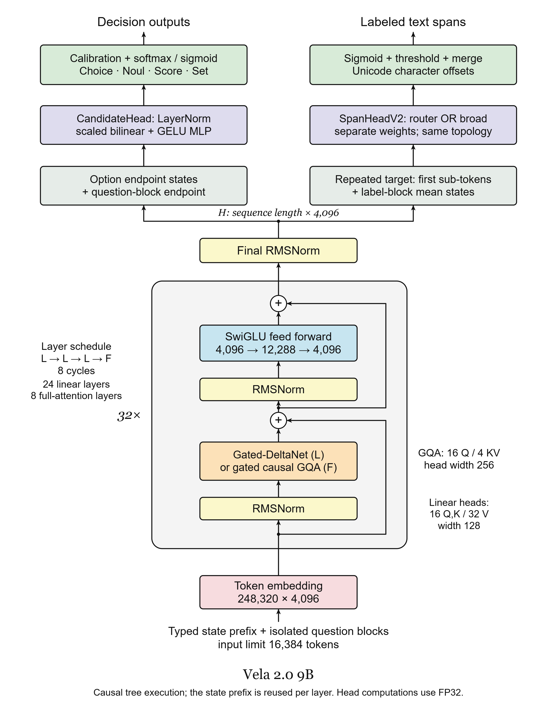
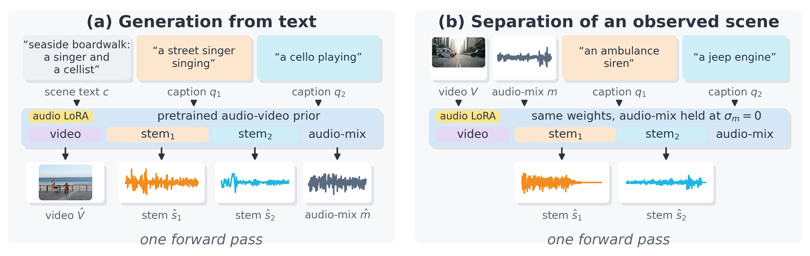

# 开放权重与实现：决策、片段定位和音视频处理

六项按用途选择；模型文件存在不等于完整训练数据开放。以下性能均来自作者，未在本站复现。

| 任务 | 模型 | 主要门槛 |
| --- | --- | --- |
| 给定选项的批量判断 | H2O Lightning | 4B 权重与适配层 |
| 路由与原文片段定位 | Vela 2.0 | 骨干、抽取头与偏移协议 |
| 文字方言识别 | LIDstral | CPU，固定类别 |
| 转写的说话人标签后处理 | DiarizationLM 社区权重 | 已有转写、标签与迁移后处理 |
| 音视频分轨 | SepGen | LTX 基座、大显存与社区许可 |
| 大候选集直接决策 | AutoTrust JEV-35B | 新 MoE 骨干、服务脚本及内存 |

## 01 · H2O Lightning 4B：把分类问题压成一次决策

日期：HF 建库 2026-10-02（UTC），近期补充；本次核对到 10 月 10 日的公开修订。标签：新近实用；验证：模型卡实验与代码说明，本站未运行，热度待验证。

给一封邮件和几个处理选项，模型直接输出选择或分数，比先让聊天模型写一段理由、再解析答案更容易接进批处理。Lightning 基于 Qwen3.5-4B，支持 Choice、Noul（是／否）与 Score，也能接受图文输入；它通过一次前向计算完成决策，并不提供自由写作能力。它适合有明确候选答案的工单分流、内容判别，无法自动补齐你没有定义的选项。

作者公开的文本协议得分为 205/231，另一个原始 LoRA 运行是 204/231，不能混用。8 个图像例子全部答对只是一组小样本，不能推成通用视觉准确率。为什么现在值得看：近期开放了权重、适配代码和具体任务演示，读者可以检查“直接决策”是否能替换自己反复生成 JSON 的环节。

权重及适配器为 Apache-2.0。按模型卡固定修订和 vLLM 0.30 适配层再运行；作者展示过 32GB RTX PRO 4500 与 80GB H100 环境，这不是已核实的最低显存。批量邮件处理的耗时为作者演示，本站未测速度或成本。

[模型卡与公开文件](https://huggingface.co/h2oai/h2o-lightning-4b)。
## 02 · Vela 2.0 9B：决策之外，把需要处理的文字圈出来

日期：2026-10-06 官方发布；HF 建库记录为 10 月 2 日。标签：新近实用／新近创新；验证：作者实验与实现，本站未运行，热度待验证。

同一段客服输入既要路由，又要找个人信息，用普通分类器只能告诉你“有风险”。Vela 2.0 在 Choice、Noul、Score 之外加入 Span 与 Set，返回标签、概率及原文区间。每个问题的计算块共享输入前缀，但相互隔离；抽取头利用标签描述和再次读取的目标文字，为“词 × 标签”打分，再合并相邻词。它能告诉应用应该处理哪一段，而不只是给整句一个分数。

作者在相同测试行上比较上一代专用模型：9B 的未见攻击家族 AUC 为 0.989，8K 文档个人信息 F1 为 0.940。开放抽取的 ACL-Verbatim word-F1 只有 24.5，不能拿前一个个人信息分数保证任意标签抽取。模型返回的字符偏移还必须与前端字符串的计数方式一致，今天的实践专门验证这个接口问题。

名称虽为 9B，卡片报告参数约 7.9B；上下文 16,384 token，权重、两个抽取头及自定义代码公开，Apache-2.0。完整 FP32 参数约 32GB，运行还需额外内存；CUDA 示例对骨干使用 BF16、抽取头保持 FP32，CPU 路径不能照抄成 FP16。采用 `trust_remote_code` 前应先审阅并固定代码版本。[官方方法与实验](https://vllm-sr.ai/blog/vela-2-0-open-foundation-routing-models)。

[模型卡与公开文件](https://huggingface.co/vllm-sr/Vela-2.0-9B)。

读图：Vela 团队的结构图。共享骨干提供表示，router 与 broad 抽取头有不同训练目标；返回区间不意味着每种开放标签都同样准确。来源模型卡 Apache-2.0，原图未修改。（[来源原图](https://huggingface.co/vllm-sr/Vela-2.0-9B)；[查看原尺寸](images/vela-architecture.png)。）

## 03 · LIDstral-Arabic：先辨认阿拉伯语方言，再决定处理路径

日期：HF 2026-10-08 建库，10 月 9 日可见发布提交；不能据此确定更早的对外开放时刻。标签：新近实用；验证：官方模型卡实验，本站未运行，热度待验证。

输入一段阿拉伯语文字，输出 51 个类别上的概率，适合在搜索、语音转写后的处理流程中增加方言路由。它把 FastText 的分类信号交给小型 MLP，再进行逐类概率校准；不是需要大显卡的聊天模型，也不生成翻译。模型提供 `lid_ova_full.bin`、`mlp_stacker_ln.pt` 和校准文件，CPU 即可按示例组合运行。

官方在 84,870 条样本上评估；其中 Darija 的 F1 为 88.67，比较项 LahjatBERT 为 72.65、GlotLID 为 71.28。这说明特定方言任务值得复核，不能推出所有短句、混合语种或业务文本都可靠。分类器总要在既定类别中分配概率，应用仍需设置低置信度回退。

权重与代码按 Apache-2.0 提供。页面仍有“private repo”的旧措辞，但本次 HF API 显示仓库公开、非 gated，并列出上述文件；这里按实际可访问状态记录，保留文档矛盾。为什么现在值得看：新近公开的小模型能独立承担路由工作，减少把每一条语言识别请求都交给大模型的需要。

[模型卡与公开文件](https://huggingface.co/mistralai/LIDstral-Arabic)。
## 04 · DiarizationLM 社区权重：给转写结果重新分配说话人

日期：2026-10-07 北京时间上传 GGUF 与 BF16 权重（UTC 10 月 6 日）；框架论文发表于 2024 年，本次新增的是 Gemma 4 适配权重。标签：新近实用；验证：维护者模型卡实验，本站未运行，热度待验证。

先由语音识别和说话人分离系统产生带 speaker 标签的文本，再让这个模型修正标签边界，最后把修正后的归属迁回原转写。它不直接听音频，也不是新的通用 ASR。训练目标保留长发言中的声学锚点，重点纠正一至五个词的短回应，减少多人会议里整段说话人身份漂移。

维护者在 USM + turn-to-diarize 基线上报告 Fisher 的说话人归属词错误率 WDER 从 5.32% 降到 2.99%；ICSI 只从 14.70% 到 14.10%，且测试仅三场会议。效果大小、样本数和电话／会议场景必须一起看，不能用 Fisher 的收益担保任意录音。它仍会继承上游转写错误。

本次真正可访问的是 diarizers-community 仓库，卡片明确“不是 Google 官方支持的产品”；搜索中的 google 原地址返回 401，不作为可用入口。卡片称 4B dense，但 HF 权重统计总参数约 80 亿、BF16 文件约 16GB，GGUF 约 5.3GB；不要按名字低估内存。仓库 LICENSE 为 Apache-2.0，使用 Transformers 或 llama.cpp，并保留 `transfer_llm_completion` 后处理。为什么现在值得看：这是把已有转写接到可检查后处理的一条新路径，适合先在少量已标注会议上复测。

[模型卡与公开文件](https://huggingface.co/diarizers-community/DiarizationLM-Gemma-4-E4B-v1)。
## 05 · SepGen：同一套音视频先验，生成与分离两条声轨

日期：2026-10-08 论文与公开实现；两份适配器的 HF 建库记录为 10 月 5 日。标签：新近创新／新近实用；验证：作者论文实验与演示，本站未运行，热度待验证。

视频里同时出现警笛和发动机，SepGen 接收原片段及两段声音描述，输出两条分离的 WAV 声轨。反过来，输入场景和两种声音的描述，它还能联合生成视频、混合声音及可编辑的分轨。核心做法是在 LTX-2.5 的联合音视频先验上训练音频 LoRA；这里将 Separation 与 Generation 两份适配器视为同一系列，合计一项。

它对视频编辑有明确用途：单独调低背景声，不必把整段声音一起处理。不过图中的一次联合前向计算属于采样步骤内的结构示意，完整生成仍要多步去噪，不能解读成一轮调用立即出片。公开库给出推理路径，部分训练材料与评测整理仍待补齐。

上手需 Linux、FFmpeg、NVIDIA GPU 与 LTX-2.5-22B 基座；作者在 48GB RTX A6000 上演示，下载基座和附件约数十 GB，单段处理可能耗时数分钟。两份 LoRA 各约 327MB，不能据此估计整套显存。

基座及派生权重受 LTX-2.x Community License 的用途与商业门槛约束，不能当作 Apache/MIT 的无附加条件开源。[生成权重](https://huggingface.co/AviadDahan/SepGen-Generation)与[实现及许可](https://github.com/AviadDahan/SepGen)可分别检查。

[模型卡与公开文件](https://huggingface.co/AviadDahan/SepGen-Separation)。

读图：Aviad Dahan 等人的 SepGen 方法总览。左侧联合生成，右侧固定已有混合音视频、求两条声轨；两边共用先验，完整推理包含多步采样。引用论文 CC BY 4.0 图示，原图未修改；图像许可不等于模型许可。（[来源原图](https://huggingface.co/AviadDahan/SepGen-Separation)；[查看原尺寸](images/sepgen.png)。）

## 06 · AutoTrust JEV-35B：新的 MoE 决策权重与量化取舍

日期：2026-10-11 权重仓库创建。标签：新近实用；验证：作者公开套件实验与演示，本站未运行，热度待验证。

[10 月 7 日介绍的 JEV-27B-VL](../2026-10-07/02-开源模型.md)是上一版本。本次独立的新权重改为 Qwen3.5-35B-A3B 混合专家骨干，约 35B 总参数、每 token 激活约 3B，支持一次读取最多 256 个选项。它不是原模型的小修复：候选排序与分类接口仍相似，骨干、公开评测和内存方案已经变化。AutoTrust 与 TypeSafe 的闭源 Jev 是不同团队。

作者用 Decision Index 0.3 的公开 37 项、140,178 个可计分请求自测，得分 59.73；上一版公开部分为 53.64。这不是包含私有测试的完整榜单成绩。24 项领先，GSM8K、ANLI 等仍落后；作者重建的视觉比较 71.94 对 71.67 接近噪声范围，不能写成视觉全面升级。

主权重为 BF16、Apache-2.0，约 72GB 下载；作者另提供同系列 NVFP4，权重占用从约 66.5GiB 降到 23.3GiB，公开分数从 59.73 到 59.18。这里只合计一项，量化数值是作者报告，显存还要加运行时与缓存。应使用仓库匹配的 vLLM 服务脚本，先固定版本再用真实选项复测。为什么现在值得看：对已有大批候选排序任务，新骨干和量化路径给出了可量化的质量—内存比较，而非只换模型名称。

[模型卡与公开文件](https://huggingface.co/autotrust/JEV-35B)。
