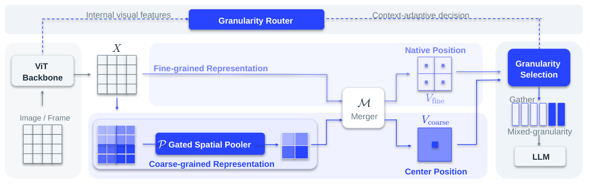
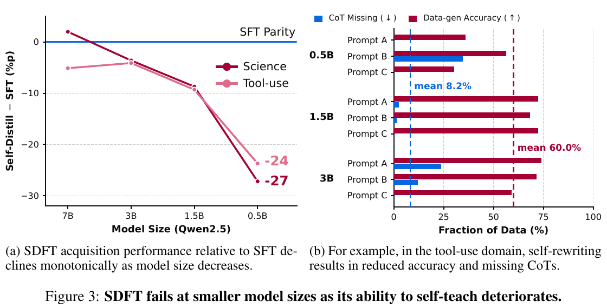
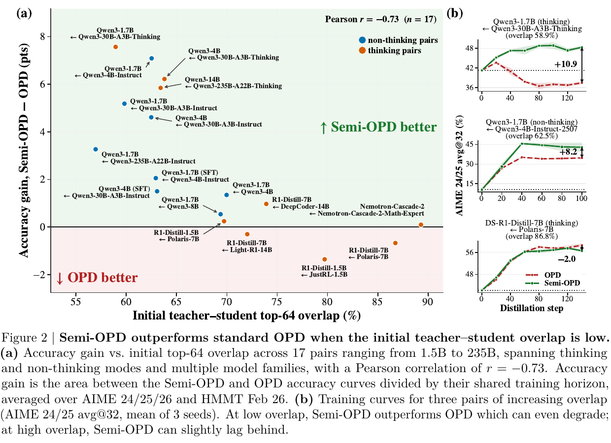
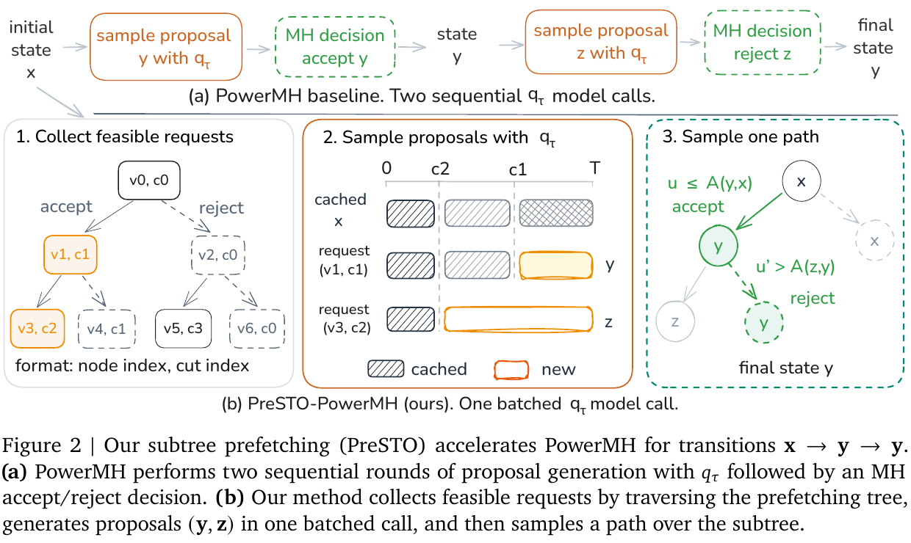

# 六篇论文：节省计算，也要说清保留了什么

先比较 14 篇近期候选，再选六篇。均为 arXiv 预印本；以下结论来自论文实验或论证，本站未复现，独立热度证据不足，按新近创新选题。

## 01 · VisionWeave：让视觉 token 自己选择保留粗看还是细看

首发：2026-10-06，v1，预印本。标签：新近创新；验证：论文原文，未独立复现，热度待验证。

一张图里，文字密集的表格和大面积背景不该得到同样多的表示。VisionWeave 在视觉编码中保留细粒度表示，并用门控池化构造粗粒度表示，再由路由器按内容选择。一个局部单元可以留下四个细表示，也可以选一个粗表示；二者共享对应的 MRoPE 空间坐标，避免压缩后位置关系失真。它通过分阶段自蒸馏学会取舍，而非对所有图片直接砍掉固定比例 token。

作者在 Qwen3.5-4B 与 Qwen3.8-27B 上验证，27B 训练超过 3 万 A100 GPU 小时。在八个视觉基准的汇总中，平均节省 43.0% 视觉 token，保留原模型 98.9% 的相对表现。这里的分母是原模型表现，不是答对率；也不能把 token 节省直接写成 GPU 总成本节省。对照中的 FastV† 是适配后的版本，比较时要连同插入位置和预算看。

系统实验使用 SGLang、两张 A100 80GB、BF16 与张量并行，长视频采样及并发固定后，吞吐从约 0.90 升至 2.07 请求／分钟。2.3 倍属于这套工作负载；密集文档需要留下更多细节，压缩幅度会改变。为什么现在值得看：新方法把可变视觉粒度训练进模型本身，兼顾内容和服务系统；代价是训练投入不小，不能当成无需训练的通用插件。公开仓库可读，但尚未核实其适用开源许可，本文只按论文讨论方法。

[论文原文](https://arxiv.org/abs/2610.07987) · [站内阅读卡](../../../../papers/frontiers/2610.07987/阅读卡.md) · [站内 PDF](../../../../papers/frontiers/2610.07987/2610.07987v1.pdf)。

读图：Yuan Feng 等，论文方法原图。先看上方如何形成粗、细两种候选，再看路由选择；空间坐标仍与原图对齐。CC BY 4.0，原图未修改。（[来源原图](https://arxiv.org/abs/2610.07987)；[查看原尺寸](images/visionweave.png)。）

## 02 · SynthSelf：用更强的同族模型生成小模型学得进去的答案

首发：2026-10-09，v1，预印本。标签：新近创新；验证：论文原文，未独立复现，热度待验证。

持续微调不仅要学到新任务，还希望保留原来的能力。直接喂入风格差异很大的强模型答案，会改变学生的输出分布；让很小的学生自己生成监督，又容易得到错误或缺步骤的数据。SynthSelf 用较大的同系列模型重写正确答案，再通过可验证的答案筛选，得到接近学生分布的离线监督数据，最后执行普通监督微调。

论文用 Qwen2.5-Instruct 的 0.5B、1.5B、3B 学生，在四类新领域和十四项保留能力上比较 SFT、SDFT、DFT、ASFT，以及相同对齐模型下的离线／在线蒸馏。汇总的新能力分数为 56.4，SFT 为 52.2；保留分数约 41.7—41.8，原始模型为 42.8、SFT 为 40.5。改善不等于完全没有遗忘，也不表示每个任务都获益。

作者报告，同族对齐模型的数据生成 FLOPs 可比采用更大的异族教师少约 62.9%—76.9%；这是监督数据生产环节，不能写成整套训练省七成。更强、参数更多的教师也不必然最适合某个学生。

为什么现在值得看：它给资源有限的小模型后训练提供了可检查的选教师思路。复现关键是同时核对答案正确性、目标文本分布和保留任务，而非只看新任务分数。方法仍依赖正确答案或验证器；论文主要考察一个持续学习阶段，不能推出长期反复更新都稳定。

[论文原文](https://arxiv.org/abs/2610.13113) · [站内阅读卡](../../../../papers/frontiers/2610.13113/阅读卡.md) · [站内 PDF](../../../../papers/frontiers/2610.13113/2610.13113v1.pdf)。

读图：SynthSelf 作者图 3。左图展示研究动机：0.5B 自蒸馏在指定科学与工具任务中明显落后 SFT；右图展示自生成监督的缺失与错误。保留全部坐标、图例及图注，从原 PDF 第 4 页裁取图区，CC BY 4.0。（[来源原图](https://arxiv.org/abs/2610.13113)；[查看原尺寸](images/synthself-figure3.png)。）

完整原页见上方站内 PDF；图区裁切不改动数据。
## 03 · Semi-OPD：蒸馏训练不一定每一步都要重新采样

首发：2026-10-08，v1，预印本。标签：新近创新；验证：论文原文，未独立复现，热度待验证。

在线蒸馏通常让当前学生不断生成新轨迹，再由教师给出监督，计算开销很大。Semi-OPD 只在训练前用初始学生采样一次，并保存教师的 token 概率；此后反复用这些轨迹。它仍在每一步用当前学生参数重算学生概率与优势，因此不是把所有训练信号都冻结。

作者比较 17 对教师与学生，规模从 1.5B 到 235B，包含思考、非思考模式及不同系列。在 DAPO 数学训练、AIME 2024/25/26 和 HMMT Feb 2026 评测中，14 对表现优于常规 OPD；其余设置有约 0.1—2.6 个百分点差距。摘要中的最高 13.6 增益采用共享训练时域内曲线差面积的归一化口径，不是所有模型最终准确率都上涨 13.6 点。

一个有用的诊断是训练前教师、学生的 top-64 输出集合重叠率：重叠低时，反复追随当前学生轨迹可能更容易偏离教师，离线轨迹反而稳定。论文给出相关系数 −0.73，但只有 17 对配置；它提供选择方法的线索，不能把某个重叠率当作通用阈值。

为什么现在值得看：昂贵的 rollout 可以成为需验证的选择，而非蒸馏的默认前提。复现应固定教师、学生、数据量和采样预算，同时画学习曲线；高重叠模型对仍可能更适合 OPD，作者结果不能替代自己任务上的对照。

[论文原文](https://arxiv.org/abs/2610.11291) · [站内阅读卡](../../../../papers/frontiers/2610.11291/阅读卡.md) · [站内 PDF](../../../../papers/frontiers/2610.11291/2610.11291v1.pdf)。

读图：Semi-OPD 作者图 2。横轴初始 top-64 重叠率，纵轴为学习曲线差面积除以共同训练时域；绿色区域表示该口径下 Semi-OPD 更好。右侧三个例子说明并非全部获益。保留完整图区与图注，裁自 PDF 第 2 页，CC BY 4.0。（[来源原图](https://arxiv.org/abs/2610.11291)；[查看原尺寸](images/semiopd-figure2.webp)。）

完整原页见上方站内 PDF；图区裁切不改动数据。
## 04 · ReHarness：遇到新任务时，回头修订旧经验

首发：2026-10-08，v1，预印本。标签：新近创新；验证：论文原文，未独立复现，热度待验证。

Agent 把每次失败写成“以后应该怎样”的经验，下一次直接检索，可能把某次碰巧正确的规则越记越牢。ReHarness 在检索到相关反思后，先回查原来的任务与轨迹，针对当前任务修订那条旧经验，再将新任务的结果写入记忆。关键差别是记忆可以被证据纠正，而不仅是越积越多。

论文冻结 Claude Opus 4.8、GPT-5.5 和 Gemini 3.7 Flash，在三组持续学习／记忆基准上比较 Top-K 反思检索和完整原始历史等方法。汇总的平均归一化增益为 0.240，Top-K 为 0.168，Full Raw 为 0.164；这些是跨任务归一化指标，不能翻译成成功率提高 24%。流程检索前五条相关经验，以 Qwen3-8B 表示做匹配。

修订也有代价。在 Claude 的 CL 条件下，作者报告 ReHarness 约花费 254 美元，Top-K 约 85 美元，未缓存的 Full Raw 约 314 美元。它比一种基线便宜、比另一种贵，不能概括成“记忆优化同时降本”。模型版本、缓存和任务长度变化都会改变费用。

为什么现在值得看：对长期运行的研究助手，错误经验如何撤回与如何存入同样重要。论文给出提示与流程，本站没有独立复现；长期记忆是否遗漏反例、修订是否过拟合新任务，仍需跟踪。arXiv 许可仅为非独占分发，本站只保存阅读卡和原文链接，不再分发 PDF 或原图。

[论文原文](https://arxiv.org/abs/2610.12668) · [站内阅读卡](../../../../papers/frontiers/2610.12668/阅读卡.md)。
## 05 · LatentGRM：先压缩评判过程，再按需还原解释

首发：2026-10-07，v1，预印本。标签：新近创新；验证：论文原文，未独立复现，热度待验证。

一个奖励模型如果为两个答案写很长的逐条比较，评判本身就会变成训练瓶颈。LatentGRM 先按评分规则把显式评判轨迹切成语义段，再把各段压成少量潜在表示；第二阶段训练判断器沿这些表示给出偏好。需要审查时，另用 LTI 模块离线还原轨迹，因此线上决策与完整文字解释分开进行。

作者在 35,612 条 OpenRubrics 数据上，使用相同 Qwen3-4B／8B 基座与显式 RubricRM 对照。八类任务、每项五次投票的汇总中，8B 为 69.0 对 68.1，4B 为 67.8 对 67.0，一些 Chat 子任务反而下降。成绩接近且耗时减少比单独的总榜名次更有意义。

论文报告轨迹位置数压缩约 8.87—9.23 倍；指定四领域、八 GPU、vLLM 与匹配投票数条件下，运行加速约 6.11—6.95 倍。控制到相同 50 步时只有约 1.017 倍，说明主要收益来自少生成步骤，而非每一步突然便宜。解释模块在 607 条教师衍生轨迹上的高重建指标，也不能证明任意自主潜在推理都完全忠实。

为什么现在值得看：它提供了减少判分开销、又保留事后检查入口的新取舍。复现时应分别测判断质量、总步数、实际吞吐与解释忠实度，避免把四件事混成一个“更可解释且更快”的结论。[作者实现](https://github.com/EADMO/LatentGRM)可检查，本站未运行。

[论文原文](https://arxiv.org/abs/2610.09788) · [站内阅读卡](../../../../papers/frontiers/2610.09788/阅读卡.md) · [站内 PDF](../../../../papers/frontiers/2610.09788/2610.09788v1.pdf)。

读图：LatentGRM 作者方法图。上半部是训练，下面才是推理；右下解释器从保存的轨迹离线重建，不必每次在线写出长解释。CC BY 4.0，原图未修改。（[来源原图](https://arxiv.org/abs/2610.09788)；[查看原尺寸](images/latentgrm.png)。）

## 06 · PreSTO：提前批量计算可能用到的采样分支

首发：2026-10-09，v1，预印本。标签：新近创新；验证：论文原文，未独立复现，热度待验证。

Metropolis–Hastings 采样每一步都先生成候选，再决定接受或拒绝，模型调用很难并行。PreSTO 把接下来可能出现的接受／拒绝路径组织为子树，提前批量生成一部分候选，然后仍按原来的接受规则走一条路径。预测器和动态规划决定有限预取预算放在哪些分支；没走到的分支会浪费计算，但走到的分支可以直接复用。

理论上，在论文给出的条件下，这种调度保留原采样器的转移核。它不意味着有限步链已精确达到目标平稳分布，也不是替换接受准则来换速度。方法作用于现有的 PowerMH、EntropyCut 和 MultiTryMH 等采样器。

实验组合为五个模型、七个数据集、三种采样器，共 105 组；主配置每个任务取前 20 个提示、100 个 MH 步、单个 1024 token 块。三种采样器的中位加速约为 1.71、1.91、2.33 倍，不能不带条件外推到服务端端到端吞吐。MultiTryMH 的比较还包含对已有 logits 的复用。

质量等价性检验中，38 组有 29 组满足预设的 0.2 标准差等价界限，9 组结论不确定，不能写成所有任务已证明无损。为什么现在值得看：它展示了如何在保持抽样逻辑的条件下换一种执行顺序；复现要同时记录额外 KV 存储、预取命中率和模型调用开销。[实现](https://github.com/Nan-Jiang-Group/PreSTO)与论文一起读，本站未运行。

[论文原文](https://arxiv.org/abs/2610.13171) · [站内阅读卡](../../../../papers/frontiers/2610.13171/阅读卡.md) · [站内 PDF](../../../../papers/frontiers/2610.13171/2610.13171v1.pdf)。

读图：Nan Jiang、Panagiotis Theodoropoulos、Wei Deng，图 2。上排两次顺序提案，下面先批量计算可能的提案，再按相同接受／拒绝规则选择路径。保留图注及全部连接，裁自 PDF 第 4 页，CC BY 4.0。（[来源原图](https://arxiv.org/abs/2610.13171)；[查看原尺寸](images/presto-figure2.png)。）

完整原页见上方站内 PDF；图区裁切不改动数据。
