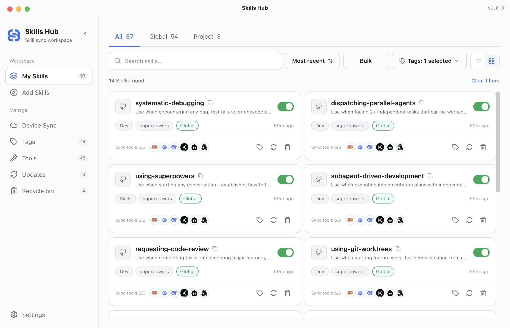
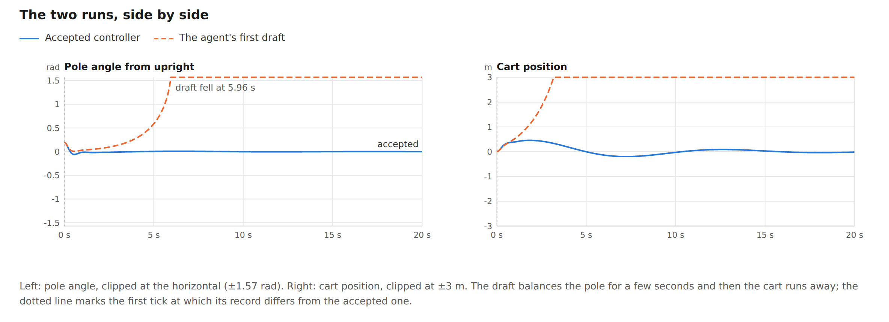
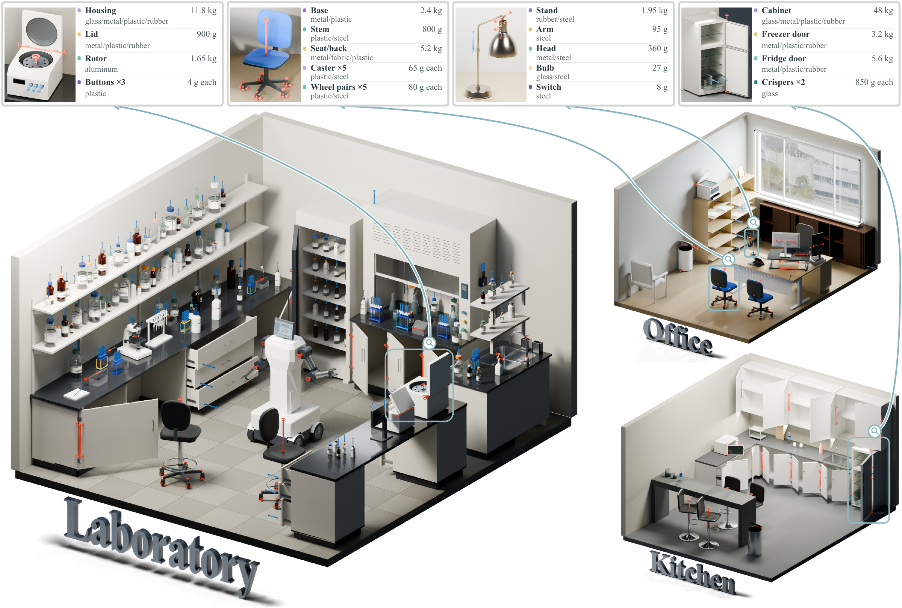
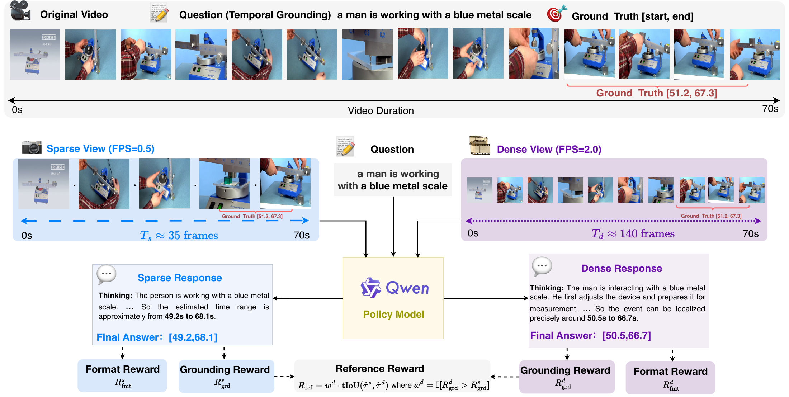

# 十个工具与公开实现：从开发诊断到研究评测

以下是新近实用或创新候选，本站核对了规范仓库、许可、实现入口与作者示例，未安装或运行这些项目。单个帖子及总 Star 不足以标成“热门”。

| 你要做什么 | 可以先看 |
| --- | --- |
| 诊断本地模型请求 | LLMxRay |
| 管理技能包与版本 | Skills Hub |
| 约束代码执行并回放 | Plimsoll |
| 嵌入式离线语音 | Babytalk |
| 约束助手输出风格 | Claude Terse |
| 构建交互式代码评测 | SWE-TaskFlow |
| 比较 GPU 内核技能迁移 | MetaKernelBench |
| 生成可动的三维资产 | Artisan |
| 评估稀疏视频证据 | SAVER |
| 分析查询数据分布 | RCQ-Map |

## 01 · LLMxRay：看清本地 Agent 把时间花在哪里

日期与版本：v0.7.2；原仓库建于 2026-03-11。标签：新近实用。

给正在使用 Ollama 的编程工具换一个本地代理地址，就能观察提示词结构、缓存前缀、工具调用和耗时。10 月 12 日的 v0.7.2 带来 Live 观察路径，使它从单独的聊天实验界面扩展到已有工作流；这才是本次选题的新增事实。

从仓库启动 Node/npm 项目，通常由 11435 端口代理到 Ollama，5174 提供界面；仍需自行准备 Ollama 与模型。默认保留计数和时间，原始文本落盘需显式开启。作者展示过大型工具清单的缓存分析，本站仅核对实现和演示，未跑模型。速度颜色也不能当作 token 正确概率。适合先定位请求膨胀、冷启动或缓存问题，再决定是否换模型；没有获得连续使用增长或独立性能复现，热度待验证。

[规范仓库](https://github.com/LogneBudo/llmxray) · [Apache-2.0](https://github.com/LogneBudo/llmxray/blob/master/LICENSE)。
## 02 · Skills Hub：把技能包更新和多工具同步放进一个界面

日期与版本：v1.0.0；原仓库建于 2026-01-25。标签：新近实用。

10 月 11 日的 1.0.0 将批量更新、固定提交的技能集合与安装确认结合起来。输入 GitHub、GitLab 或 Gitee 的仓库地址，选择技能及目标工具，输出对应目录中的安装副本；现有同步目标设置会保留，部分更新失败也能分别处理。它适合同时维护多个编程助手的用户。

优先下载系统对应的桌面版本，开发构建才需要完整工具链；Linux 包需注意 Ubuntu 24.04／glibc 2.39 条件。集合安装代码会按仓库与提交去重，并检测名称及目录版本冲突，这比直接把整个目录复制到各处更可审查。截图与功能是作者演示，本站未安装。同步成功不能证明技能内容可信，安装前仍应阅读它要求访问的文件和执行的命令；近期社区帖子只是一个热度信号。

[规范仓库](https://github.com/qufei1993/skills-hub) · [MIT](https://github.com/qufei1993/skills-hub/blob/main/LICENSE)。

读图：qufei1993 项目 README 的真实界面。卡片下面显示各工具同步状态，顶部可筛选并批量处理；它展示的是管理状态，不是技能质量评分。MIT，原图未修改，本站未安装。（[来源原图](https://github.com/qufei1993/skills-hub)；[查看原尺寸](images/skills-hub.webp)。）

## 03 · Plimsoll：让 Agent 执行留下可核查的边界和回执

日期与版本：v0.20.0／v0.21.0；原仓库建于 2026-09-10。标签：新近实用。

Agent 交来一段代码，Plimsoll 先按所需隔离等级选择执行路径，再把调用、资源限制与结果写成记录。10 月 9 日新增框架适配与 protocol 3 的请求绑定回执，适合把已有 Agent 接到可检查的执行环境。源码会核对响应回传的请求 ID；不匹配时不能把结果当成这次调用的证明，更不能据此盲目重试有副作用的操作。

可从 Go 客户端或 Python／TypeScript 适配器接入，服务端源码要求相应 Go 工具链，容器路径还需 Docker。外部凭据经 broker 授权，具体隔离强度依赖部署所选的进程、容器、内核或虚拟机配置；记录并不等于远程硬件认证。作者提供控制器执行对照和回放例子，本站未运行；它的价值在于让失败原因和执行边界可追踪，热度待验证。

[规范仓库](https://github.com/plimsollmark/plimsoll) · [Apache-2.0](https://github.com/plimsollmark/plimsoll/blob/main/LICENSE)。

读图：Plimsoll 作者的控制器演示。橙色首稿约 5.96 秒失稳，蓝色修订维持平衡；纵轴包含原图注明的截断范围。这里只引用作者回放例子说明记录的用途，不是本站实验，也不证明所有 Agent 都会改善。Apache-2.0 原图。（[来源原图](https://github.com/plimsollmark/plimsoll)；[查看原尺寸](images/plimsoll.png)。）

## 04 · Babytalk：在 ESP32 上做离线英文语音输入输出

日期与版本：原仓库 2026-09-26；近期补充，10 月 9 日 Show HN 讨论。标签：新近实用。

一块 ESP32-S3/P4 加麦克风与扬声器，可以在设备侧完成英文识别和语音播放，不必每次上传云端。公开 C 实现提供模型内存映射、SRAM／PSRAM 分配及运行路径，另有 MicroPython、AtomVM 接口。它属于近 30 天的新实现，不能把 10 月 9 日讨论日期写成项目首发。

按文档准备 Linux 或 WSL、ESP-IDF 5.5.1、uv 与适配开发板，建议至少 16MB Flash 和 8MB PSRAM。作者的量化识别模型约占 6MB Flash，但完整系统还要留运行内存。默认模型干净语音 WER 8.2%，嘈杂样本升至 58.1%，所以更适合受控的近距离交互，不能据此承诺复杂环境语音助手效果。代码 MIT；识别权重与语音合成组件另有许可。本站未烧录硬件，热度待验证。

[规范仓库](https://github.com/tlack/babytalk) · [MIT](https://github.com/tlack/babytalk/blob/main/LICENSE)。
## 05 · Claude Terse：把简洁写作规则做成可重复检查的插件

日期与版本：原仓库 2026-09-23；近期补充。标签：新近实用。

如果编程助手的回答反复铺垫，Terse 把输出样式、每轮简短提醒和评分脚本放进可查看的插件。输入仍是正常开发问题，输出目标是更短的答复；它没有替换模型，也不改变项目的事实来源。为什么现在值得看：近 30 天新工具提供了规则文件和测量方法，用户能直接检查哪些写法被算作冗余。

按仓库的 Claude Code 插件安装路径启用即可；上下文状态栏为可选组件，不必一起修改。作者在真实代码库的少量提示上报告字数和花费下降，不同表格使用 12 或 20 个提示，不能合并成一次大规模评估。评分脚本只能检查部分表面形式，隐喻和语气还依赖模型评判；输出更短也未必更准确。本站阅读了实现，未安装插件，未验证中文写作或费用收益，热度待验证。

[规范仓库](https://github.com/lowenbjer/claude-terse) · [MIT](https://github.com/lowenbjer/claude-terse/blob/main/LICENSE)。
## 06 · SWE-TaskFlow：让代码修复评测包含任务中途的追问

日期与版本：10 月 11 日公开实现；论文 10 月 7 日。标签：新近实用／新近创新。

普通修复基准给出一个 issue 后就等最终补丁，SWE-TaskFlow 还会在过程中加入必须理解仓库才能回答的问题。公开代码把任务输入变成多轮提示、问题与可执行的答案证据；验证器检查证据是否依赖仓库、结果是否确定、是否改变仓库状态，并可要求修复前后都有效。

从 `uv sync` 配环境，再设置 LiteLLM 代理和所需模型接口；完整修复执行还要准备 SWE-bench 容器与数据。仓库提供生成、校验、评分路径，论文使用的全部 Harbor 调度层没有一并包含。作者在 700 个任务上研究交互成本与解题表现，不能把新增问答分数当作修复成功率。本站仅核对实现；它适合研究“会修代码”和“能解释正在做什么”的差距，热度待验证。

[规范仓库](https://github.com/JetBrains-Research/SWE-TaskFlow-Generation-Public) · [Apache-2.0](https://github.com/JetBrains-Research/SWE-TaskFlow-Generation-Public/blob/main/LICENSE)。

读图：JetBrains Research 的任务流原图。左侧每个 issue 对应一个提示；右侧展示五轮提示中修复、解释、新功能、重构和测试等任务类型如何衔接。它说明任务流的组成，带宽不是成功率。Apache-2.0，原图未修改，本站未运行。（[来源原图](https://github.com/JetBrains-Research/SWE-TaskFlow-Generation-Public)；[查看原尺寸](images/swe-taskflow.svg)。）

## 07 · MetaKernelBench：检查内核优化经验能否跨实现迁移

日期与版本：10 月 6 日实现；论文原日期 10 月 4 日。标签：新近实用／新近创新。

对同一个计算问题分别用 CuTe 和 TIRx 优化，把一端得到的自然语言经验交给另一端，能否更快或更稳？MetaKernelBench 固定问题与对照路径，输出每次试验的正确性、速度和经验迁移记录。新的公开实现让“这个技巧似乎有用”可以变成配对实验；作者也观察到迁移后退步，不能只展示成功例子。

完整基准有 74 个问题、6 类算子，当前仓库随附 32 个；另外 42 个需从 NVIDIA SOL ExecBench 按其独立评测条款获取，不能直接再分发。运行依赖 Python 3.12、Modal/B200 环境与所选模型服务；可先 dry-run 检查执行计划和依赖，避免直接启动付费算力。本站未运行 GPU 测试。核心代码 Apache-2.0 不覆盖外部数据，热度待验证。

[规范仓库](https://github.com/YIGE24/MetaKernelBench) · [Apache-2.0](https://github.com/YIGE24/MetaKernelBench/blob/main/LICENSE)。
## 08 · Artisan：把文字物体描述变成带关节的仿真资产

日期与版本：10 月 9 日仓库与论文。标签：新近实用／新近创新。

输入一段物体描述，可附参考图，Artisan 通过设计、编码和审查步骤生成程序化 CAD，再检查运动与碰撞，输出可供查看的带关节资产。相比只生成外观网格，它把“抽屉能否拉开、门轴在哪里”也纳入生成任务，适合机器人仿真场景搭建和程序化建模研究。

README 的最小路径面向 Linux x86 的 Ubuntu/Debian，安装链包含 CadQuery、Blender、MuJoCo 等组件，并需要模型 API。默认单案例预算设置约 15 美元，是软件预算上限配置，不是本站花费或成功保证；本站未安装，也未调用收费服务。作者示例里的质量、材料与关节属于生成资产属性，不是实物测量。代码 Apache-2.0，第三方依赖与素材需另读说明；这次入选依据是新实现与可检查产出，热度待验证。

[规范仓库](https://github.com/physicalvision/artisan) · [Apache-2.0](https://github.com/physicalvision/artisan/blob/main/LICENSE)。

读图：physicalvision 团队的官方示例。红色关节标记说明资产可运动，上方质量与材料是模型生成的资产属性，不是现实称量结果。Apache-2.0 仓库原图，仅说明方法输出，本站未复现。（[来源原图](https://github.com/physicalvision/artisan)；[查看原尺寸](images/artisan.webp)。）

## 09 · SAVER：在固定抽帧预算下复核视频推理

日期与版本：仓库 10 月 7 日；论文 10 月 8 日。标签：新近实用／新近创新。

SAVER 用看得更密的视频回答指导稀疏观察，公开初版提供权重链接与评测代码，训练代码仍待发布。当前可做的任务是把视频和问题输入固定 FPS 的脚本，得到回答、指标、实际帧数与运行配置，再用同样采样预算比较原始模型。这样能分辨收益来自方法还是多看了帧。

需要 Linux/CUDA、相应 Qwen 视觉依赖、模型和基准视频；可以先选择一个任务并设 `EVAL_LIMIT=10`，或用 `DRY_RUN=1` 只检查命令。源码把每次运行分配独立目录，并记录 FPS 与帧数，便于核对条件。核心代码 Apache-2.0，权重、基准视频与第三方模块的条款分别适用。本站未做视频实验，不把公开评测入口说成完整训练复现；新近实用／创新，热度待验证。

[规范仓库](https://github.com/lmsdss/SAVER) · [Apache-2.0](https://github.com/lmsdss/SAVER/blob/main/LICENSE)。

读图：SAVER 作者方法图。70 秒示例分别以 0.5 与 2 FPS 观察，得到约 35 与 140 帧；较密观察提供参考信号，目标是改善较稀疏输入。图示是作者案例，不能当作本站新测结果；引用 CC BY 4.0 论文的方法图，原图未修改，原视频素材权利不转移。（[来源原图](https://github.com/lmsdss/SAVER)；[查看原尺寸](images/saver.webp)。）

## 10 · RCQ-Map：检查评测题和真实查询的构成差别

日期与版本：仓库 10 月 7 日；本次读取到 10 月 9 日提交。标签：新近实用。

把一组查询整理为 CSV，RCQ-Map 按统一指南输出用途、上下文需求等 24 个标注字段，再派生论文报告的统计口径。工具可以将评测集的查询构成与作者收集的真实查询分布比较；这是数据集覆盖分析，不能用来证明模型诊疗能力或直接生成临床决定。

核心 Python 3.10 工具可先检查 schema、指南与 dry-run 计划；实际自动标注还需配置模型服务。参考库从 127,833 条原始记录中保留 127,625 条可用查询，正文比较时要分清分母。源码明确标注字段与报告字段的映射，一些需要临床判断的维度一致性较低；换标注模型也要重验。本站未上传任何临床数据，未调用服务。Apache-2.0 代码使分析流程可检查，新近实用，热度待验证。

[规范仓库](https://github.com/nyuolab/RCQ-Map) · [Apache-2.0](https://github.com/nyuolab/RCQ-Map/blob/main/LICENSE)。
