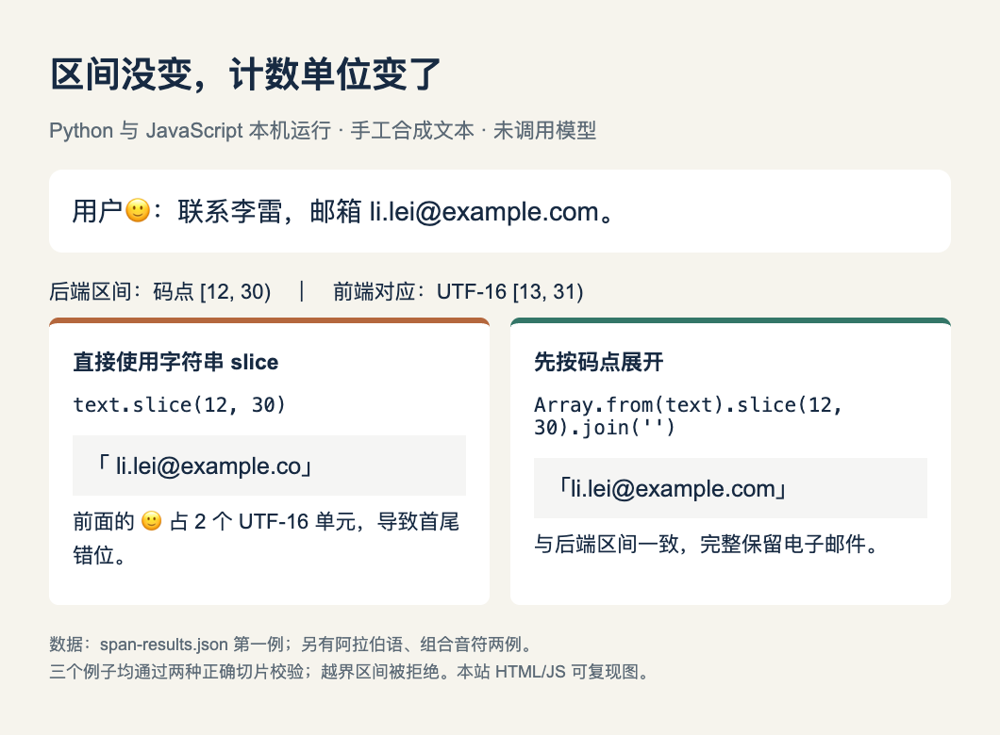

# 小实验：模型给了区间，网页为什么高亮错一位？

状态：**已在本机运行验证**。这次只验证文本区间协议，数据全部手工合成，没有加载模型、访问 API 或使用真实个人资料。Vela 模型卡明确规定 Span 的 `start`、`end` 是 Unicode 码点下标，左闭右开；Python 的字符串切片与此一致，JavaScript 的普通字符串切片则按 UTF-16 单元计数。

## 从一个有 emoji 的例子开始

输入 `用户🙂：联系李雷，邮箱 li.lei@example.com。`，Python 找到邮箱区间为 `[12, 30)`。同一段原始文本到了网页，直接 `text.slice(12, 30)` 得到 ` li.lei@example.co`：开头多了空格，末尾少一个字母。

原因是 🙂 在 Unicode 中是一个码点，在 JavaScript 字符串里却占两个 UTF-16 单元。这里的正确 UTF-16 区间是 `[13, 31)`。对高亮、脱敏或证据引用而言，这不是外观小问题：索引错位会让该处理的字符留在外面。



读图：第一例实际输出；左边展示错误切法，右边展示正确切法。图由本期 [HTML 源码](code/span-results.html) 根据 [实际运行 JSON](code/span-results.json) 制作，未绘制模型准确率或速度。[查看原尺寸](images/span-results.png)。

## 两种小规模实现

最直观的切法先把字符串展开为码点数组：

```javascript
const points = Array.from(text);
const selected = points.slice(start, end).join('');
```

如果后续组件仍需要 UTF-16 下标，可以把两端各自映射过去：

```javascript
const points = Array.from(text);
const start16 = points.slice(0, start).join('').length;
const end16 = points.slice(0, end).join('').length;
const selected = text.slice(start16, end16);
```

附带实现先检查下标是否为整数、是否负数、是否反向或越界。对于很多区间和长文本，反复切前缀会浪费工作，应一次构造码点到 UTF-16 的前缀映射；这个最小示例以容易核对为主。

## 如何复现与实际结果

依赖只用 Python 3 标准库和 Node.js 标准库；本次 Node 为 22.22.3。将本期目录作为工作目录执行：

```bash
python3 code/span_offsets.py
node code/span_offsets.mjs
```

[Python 输入生成](code/span_offsets.py) · [JavaScript 校验](code/span_offsets.mjs) · [输入数据](code/span-inputs.json) · [结果 JSON](code/span-results.json)。

| 合成文本类型 | 码点区间 | 对应 UTF-16 区间 | 两种正确实现 |
| --- | --- | --- | --- |
| emoji 前缀与邮箱 | [12, 30) | [13, 31) | 均匹配完整邮箱 |
| emoji 前缀与阿拉伯语 | [11, 14) | [12, 15) | 均匹配 علي |
| 组合音符、emoji 与邮箱 | [8, 27) | [9, 28) | 均匹配完整邮箱 |

三例的直接字符串切片都错位，两种修正均通过断言；对单个 emoji 请求码点 `[0, 2)` 的越界情况被拒绝。这里没有评测 Vela 的抽取质量，也没有证明所有 Unicode 展示问题都已解决。

## 仍要保留的条件

发送给模型的文本和前端高亮的文本必须相同。去空格、换行替换、HTML 实体解码或 Unicode NFC 归一化都可能改变下标。码点也不等于人眼看到的字素簇：一个带组合音符的字、家庭 emoji 都可能包含多个码点。阿拉伯语的双向显示次序也不能直接当作逻辑索引。

因此先确认接口的单位与目标字段，保存同一份原文，再做显示转换；不要只用纯英文测试这个接口。[Vela 官方区间协议](https://huggingface.co/vllm-sr/Vela-2.0-9B)。
