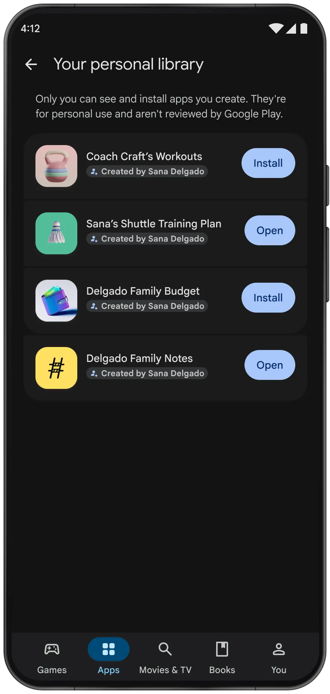
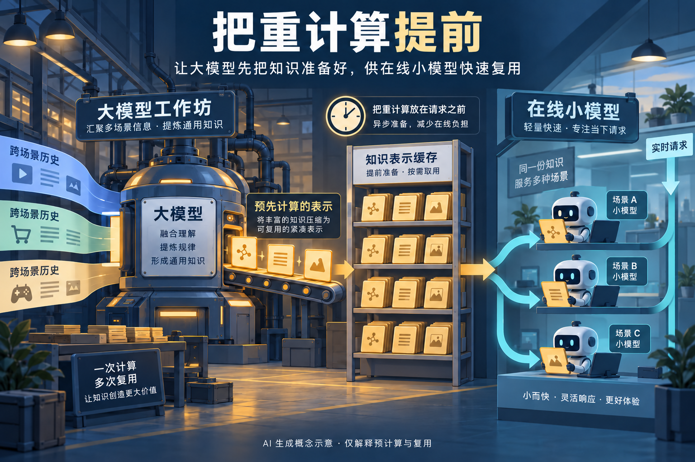
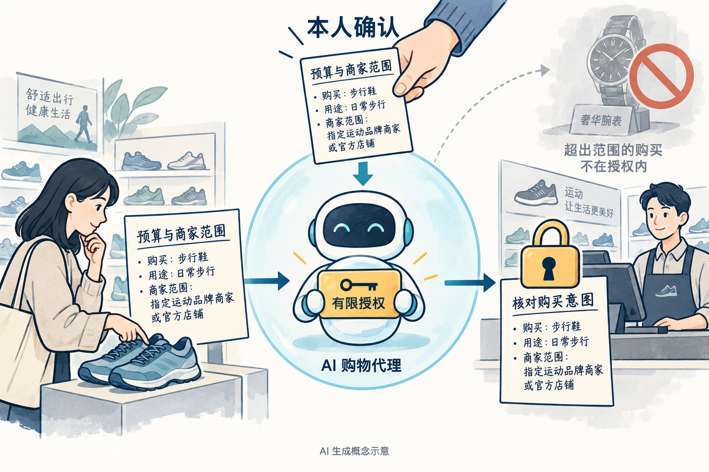

# AI 动态：5 条重点详解 + 10 条速读

本期关注能力怎样交付给人使用：更广的模型入口、个人应用分发、端侧软件，以及支付与推荐系统中的控制边界。以下日期按来源精度保留；只给出日历日期的公告，不推断小时。第 1—5 条详细解释，第 6—15 条速读。

## 01 · Gemini 4 Argon 扩大开放：重点是哪些入口现在可用

Google 宣布扩大 Gemini 4 Argon 的开放范围：开发者可通过 Gemini API、AI Studio 等入口接入，Gemini 应用里的 Pro、Ultra 用户也进入本次开放范围；Antigravity、搜索和 Android Studio 的接入各有自己的账号条件。它值得重看，是因为研究演示正在变成更多人能尝试的工作流；这并不表示所有地区、账号与产品入口同时获得相同功能。

对写代码的读者，变化更容易用“拿着整个项目完成任务”来理解。官方案例涉及跨文件修改、工具调用和执行验证，而非只生成一段代码。Google 报告了 ADK 内部的准备工作和冷启动导入优化，但这是厂商自己的案例，项目规模、测试约束与人类参与方式都会影响结果，不能照搬成任意仓库的收益保证。

另一个看点是从视频演示走向机器人任务的研究流程：先理解观察到的行为，在模拟环境里验证，再尝试现实动作。公告中的投掷类演示说明了一个具体流程，尚不能证明机器人已能可靠处理任意家庭任务。需要机器人控制的读者，仍要单独检查硬件接口、模拟误差与真实环境失败处理。

实际选择入口时，建议先确定要得到什么：个人问答用应用入口，程序调用核对 API 的模型名、额度和计费，开发自动化则看工具权限与回滚方式。先用一个有固定输入、可验收输出的小任务比较，再决定是否迁移工作流；长上下文能够装进材料，也不等于材料都会被正确使用。

这是对[10 月 1 日受控开放报道](../2026-10-01/01-AI动态.md)的后续，新增事实是开放入口与使用范围，不重复把同一模型当作第二次首发。本文未调用该模型，不把内部案例写成本机实测。

日期：2026-10-13。新近实用；验证程度：官方公告或作者案例，热度待验证。[原始来源](https://blog.google/innovation-and-ai/models-and-research/gemini-models/introducing-gemini-4-argon/)。

## 02 · Google Play 为个人生成的 Android 应用提供私有入口

Google 将 AI Studio 生成 Android 应用与 Google Play 的个人应用库连接起来。符合开放条件的用户可以把为自己做的小工具送到自己的手机，不必先建立面向公众的开发者发布流程。本次在包括美国在内的部分市场逐步推出，要求年满 18 岁并使用相应 Google 账号；不能据此假定中国区或每个账号都能立即使用。

它适合的场景是范围很小、需求很个人的工具，例如只给自己记录训练次数或整理家中物品。重要变化在分发：从“浏览器里有一份生成结果”，变为手机上有可管理的个人应用入口。生成代码的正确性、数据保存的位置和设备权限，仍需要用户逐项确认。

这里有两个容易混淆的边界。官方展示的个人应用提示明确说这类应用没有经过 Google Play 审核；公开发布则仍需专业开发者账号，并经过通常的质量与安全审查。对亲友分享被放在未来几个月的计划里，不是本期已开放的能力。

读图时看中间的个人库和底部提示即可：界面证明的是个人应用的管理入口，不是对应用质量的认证。尝试时可以先用不需要联系人、照片或支付权限的简单项目，检查卸载、更新和数据导出路径，再加入更多功能。

同一公告还介绍了商店内的应用问答与发现功能，本期合并报道，避免把一次 Play 更新拆成多条新闻。为什么现在值得看：它改变了个人生成软件的交付方式；本文核验到的是官方演示与推出说明，尚无本站安装体验。

中文读图：个人库让应用回到自己的手机；底部提示说明这不等于公开商店审核。Google 官方演示界面，未改动；按其产品视觉资料的教育及新闻使用规则引用。（[来源原图](https://blog.google/products-and-platforms/platforms/google-play/google-play-updates-october-2026/)；[查看原尺寸](images/play-personal-library.webp)。）

日期：2026-10-13。新近实用；验证程度：官方公告或作者案例，热度待验证。[原始来源](https://blog.google/products-and-platforms/platforms/google-play/google-play-updates-october-2026/)。

## 03 · RTX 本地 AI 更新：把今日软件与未来硬件分开看

NVIDIA 集中更新了围绕 RTX 的本地 AI 软件。对已有兼容设备的用户，最直接的变化来自 Broadcast 2.3、PAIR 以及创作工具的集成，而非必须先购买新机器。Broadcast 新版涉及离线文件处理、语音配置与工具接口；PAIR 则结束测试阶段，围绕本地模型下载和运行提供跨平台入口。具体功能仍要核对显卡、驱动与软件版本。

这份公告把“现在能装”和“接下来会来”的内容写在一起，阅读时尤其要看时间。RTX Spark 笔记本安排在 10 月 16 日；Nemotron 3.5 Bolt 的两个版本分别列出 10 月 15 日和 23 日。它们在公告日都不能算作已经交付，本期也不将未来权重填进开源模型栏。

| 对象 | 公告中的状态 | 使用前最该确认什么 |
| --- | --- | --- |
| Broadcast 2.3、PAIR 正式版 | 10 月 13 日推出 | 系统、驱动、具体功能支持范围 |
| Nemotron 3.5 Bolt 74B-A9B / E4B | 计划 10 月 15 日 / 23 日 | 权重是否实际发布及许可 |
| RTX Spark 笔记本 | 计划 10 月 16 日 | 具体机型与供货地区 |
| 部分 Agent 和创作软件集成 | 月底或后续版本 | 不把预告当作当前安装能力 |

一个现实的尝试顺序是：先选你已有的任务，例如会议音频处理或本地创作，再看相关插件是否已发布；最后才评估显存和硬件需求。公告中的性能来自指定模型与设备，不足以证明普通笔记本能获得同样效果，也不应把某个解码环节的提速套到整个制作流程。

为什么现在值得看：端侧模型的价值越来越取决于模型管理、音视频工具和调用接口能否接起来。本文只报告已经说明的发布日期和条件，未安装这套软件；项目栏另选独立的 Windows 模型管理工具，不在此重复展开。

日期：2026-10-13。新近实用；验证程度：官方公告或作者案例，热度待验证。[原始来源](https://blogs.nvidia.com/blog/local-ai-rtx-spark-laptops-software-updates/)。

## 04 · Meta GEM：把大推荐模型的知识提前准备给在线系统

Meta 公开 GEM 广告推荐系统的新一轮扩展。问题并不是“能不能把模型继续放大”，而是用户打开信息流时，系统能否在很短的等待预算内完成排序。GEM 用较大的中心模型汇总跨场景信号，再将有用表示交给较小的在线模型，让训练侧和提前准备的计算服务实时请求。

在模型内部，Kunlun 的交互模块、混合专家等设计增加了可处理的组合关系；CompSkip 则减少部分训练计算。另一条路径 LoopFM 将中间知识压缩成可复用的历史用户表示。这些表示并非普通文档摘要，而是下游推荐模型能够继续使用的数值信息。

Solaris 处理更靠近请求到来的部分：利用异步、推测式计算，提前准备用户与广告的交互表示；未命中时还需要相应的替代与回退路径。因此，“提前计算”不能简单等同于“所有结果都离线算好”。缓存新鲜度、覆盖率与实时特征仍会决定效果，下面的工作坊只是理解预计算与复用的概念图。

官方给出的 Facebook 结果是转化率相对提高 18.9%、点击率相对提高 12%；Instagram 使用另一组结果，不能相加，也不能泛化到所有广告场景。文中还报告训练效率与计算规模的变化，但这些均来自 Meta 自己的部署和实验，本站没有独立审计其线上实验。

为什么现在值得看：这给研究读者一个比“模型越大越好”更具体的问题——哪些信息可以提前计算，哪些必须等请求到来才计算？如果做自己的推荐或检索系统，应先量出延迟预算与数据更新速度，再考虑复用表示；这里公开的是系统方法，不是能直接下载部署的 GEM 产品。

中文读图：左侧强调集中学习，中间强调异步准备，右侧强调在线取用；这是 AI 生成的概念示意，并非 Meta 官方架构图，也未展示全部实时特征和回退逻辑。（[事实依据](https://engineering.fb.com/2026/10/13/ml-applications/generative-ads-model-gem-scaling-frontier-ads-ai/)；[查看原尺寸](images/gem-concept.webp)。）

日期：2026-10-13。新近创新；验证程度：官方公告或作者案例，热度待验证。[原始来源](https://engineering.fb.com/2026/10/13/ml-applications/generative-ads-model-gem-scaling-frontier-ads-ai/)。

## 05 · Amex 为代理购物提出可核对的用户意图凭据

American Express 提出 Intent Intelligence 框架，为代理代人购物建立更明确的授权依据。用户先确认预算、商户偏好等意图，经身份确认后形成相应的 Intent ID 和意图证明令牌；代理使用受限制的数字凭据执行，发卡机构能够把交易与已确认的意图联系起来。

理解这个设计，可以设想一个“买一双不超过预算的跑鞋”的任务。搜索、比较和推荐都不等于付款授权。真正要核对的是最终商户、金额以及动作是否落在用户批准的范围里；如果代理改变了选择，就需要判断原批准是否仍覆盖新的交易。这个跑鞋例子是本文解释场景，不是已上线商户的测试记录。

框架试图让用户意图、代理操作与支付系统之间留下可识别的联系，以支持授权判断和后续争议处理。它并不自动保证代理理解正确，也不能单凭一个令牌就解决商户欺诈、商品质量或错误推荐。不同参与方需要共同实现接口和检查规则。

为什么现在值得看：做购物 Agent 时，模型“理解了要求”和系统“获得了可验证授权”是两个需要分别设计的环节。当前官方在推进相关集成，不能把框架发布写成所有 Amex 商户已经支持代理支付，更没有经独立验证的欺诈率改善数字。概念图用边界外的另一件商品提醒读者：授权应绑定具体约束，而非给代理无限消费权限。

中文读图：先看人确认的约束，再看代理持有的有限权限；图中的购物物件仅为解释场景。AI 生成概念示意，不是 Amex 产品截图或本站支付实测。（[事实依据](https://www.americanexpress.com/en-us/newsroom/articles/innovation/intent-intelligence-framework-agentic-commerce.html)；[查看原尺寸](images/intent-concept.webp)。）

日期：2026-10-13。新近实用；验证程度：官方公告或作者案例，热度待验证。[原始来源](https://www.americanexpress.com/en-us/newsroom/articles/innovation/intent-intelligence-framework-agentic-commerce.html)。

## 06 · Facebook 让用户用自然语言调整信息流偏好

Meta 开始推出 Your Algorithm，用户可从 Feed、Reels 的菜单表达想多看或少看的内容，并进一步说明偏好。相比只按一次“不感兴趣”，自然语言能表达更具体的范围。它适合修正眼前的推荐体验，但不能据此认为用户已经掌握全部排序参数，也不保证每个地区同时获得功能。现在值得看的是推荐反馈接口的变化；这是官方推出说明，尚无本站账号体验。

日期：2026-10-13。新近实用；验证程度：官方公告或作者案例，热度待验证。[原始来源](https://about.fb.com/news/2026/10/introducing-your-algorithm-facebook/)。

## 07 · Anthropic 公开蒸馏攻击防护：减少可被批量收集的训练价值

Anthropic 介绍对模型蒸馏攻击的防护，包括识别批量收集行为，以及降低输出对攻击者训练的价值。研究中的防护效果依赖攻击方式、输出策略与评测条件，不能读成所有模型窃取问题已经解决。对提供模型 API 的团队，新近价值在于把滥用检测和输出设计放在一起考虑，并检查它们是否伤害正常使用。文中数据属于公司自己的实验，未获本期独立复现。

日期：2026-10-12（近期补充）。新近创新；验证程度：官方公告或作者案例，热度待验证。[原始来源](https://www.anthropic.com/research/distillation-defenses)。

## 08 · Higgsfield 与 OpenAI 展示更长视频制作工作流

OpenAI 的客户案例介绍 Higgsfield 如何把模型、工具和三维场景等环节组合，维持较长视频中的连续性。这里的“超过十分钟”是制作工作流能够组织的成片长度，不能改写成模型一次原生生成十分钟视频。面向创作者，它值得看的是跨镜头的一致性管理；语音到电影等愿景也不能全部列成当前可用功能。依据为官方合作案例，本站未制作样片。

日期：2026-10-13。新近实用；验证程度：官方公告或作者案例，热度待验证。[原始来源](https://openai.com/index/higgsfield-longer-videos-voice/)。

## 09 · Voice Standard Bench 比较的是转写之后的语言任务

AssemblyAI 发布 Voice Standard Bench，将真实语音转写材料交给语言模型，比较摘要、抽取、纠错与口述整理等任务，并覆盖不同音频长度。它评估的是转写之后的语言处理，不是声学识别本身的错误率。作者使用模型评审并结合延迟、成本，这适合帮助团队规划自己的评测维度；服务商的榜单仍需用自身噪声、口音与字段要求复核，不能视为独立采购结论。

日期：2026-10-13。新近创新；验证程度：官方公告或作者案例，热度待验证。[原始来源](https://www.assemblyai.com/blog/voice-standard-bench)。

## 10 · Character.AI 进入 Chapter 11 程序，平台仍在运营

Character.AI 公告自愿进入 Chapter 11 程序，并推进出售流程；公告时平台仍在运行，订阅也没有因公告立即停止。对使用其角色和内容的用户，眼下需要区分法院程序、潜在出售和实际停服三个状态。公司给出的时间预期不等于交易已经完成，若流程未达成预期也存在业务收缩风险。新进展来自公司公告，本期不推断买方、成交结果或后续服务承诺。

日期：2026-10-12（近期补充）。新近实用（行业与落地进展）；验证程度：官方公告或作者案例，热度待验证。[原始来源](https://blog.character.ai/an-update-on-character-ai/)。

## 11 · 微软分享生产网络 Agent 的分层控制方式

微软工程案例介绍如何让 Agent 参与生产网络事件处理：保留操作人的身份，限定工具接口，在代码里执行写操作审批，并把反复出现的工作固化为可检查的流程。语言模型可帮助提取线索，但关键动作不能只靠提示词约束。现在值得看的是公开的生产设计经验，适合检查自己的运维 Agent；它不是一个已面向所有用户开放的自动运维产品，文中也没有可直接套用的普遍收益数字。

日期：2026-10-13。新近创新；验证程度：官方公告或作者案例，热度待验证。[原始来源](https://commandline.microsoft.com/ai-agent-copilot-autopilot-layered-model-production-network-incidents-on-call-engineers/)。

## 12 · IFS Intelligence 把企业数据与批准后的动作接起来

IFS 发布 Intelligence，围绕业务数据查看、任务执行、后台工作与工作流搭建提供组件。读者最应关注的是数据权限和动作审批能否继承原有业务规则，而不是仅看能否自然语言提问。官方说明当前可用范围依赖相应软件与 AI 执行条件，不能当成每位客户自动获得无限调用。新近价值是把企业问答延伸到受控行动；目前核验到的是厂商发布与功能说明，未有本期独立部署验证。

日期：2026-10-13。新近实用；验证程度：官方公告或作者案例，热度待验证。[原始来源](https://www.ifs.com/ja/insights/news/ifs-launches-ifs-intelligence)。

## 13 · NVIDIA 扩展法国 AI 生态投资，累计承诺不能当作新融资额

NVIDIA 宣布面向 Doctolib、Entalpic、Genesis AI、Pigment 等公司的投资计划，涉及应用与研发生态。公告中的接近 100 亿美元指更广泛的欧洲累计承诺，不能写成这次法国新增融资总额，各公司的实际金额也没有因此得到确认。文中一些硬件计划面向 2028 年。现在值得看的是资金和计算平台的布局方向；“计划投资”“未来供货”均不等于已经完成交付。

日期：2026-10-12（近期补充）。新近实用（行业与落地进展）；验证程度：官方公告或作者案例，热度待验证。[原始来源](https://blogs.nvidia.com/blog/france-ecosystem-agentic-computing/)。

## 14 · Industrial Next 展示工厂机器人换任务的流程

Industrial Next 在本次 Disrupt 展示机器人根据视觉与任务上下文切换工序的思路；现场报道还提到与 BMW 技术办公室的评估关系。这家公司的新事实是公开演示与评估进展，不是今天才成立，也不表示 BMW 已全面部署。对制造场景，值得跟进的是换任务所需的人类示范、夹具和验证成本，而非只看“几分钟”口号。官网能力说明与[现场报道](https://techcrunch.com/2026/10/13/industrial-next-wants-factory-robots-to-switch-tasks-in-minutes-not-weeks/)相互补充，本站未验证工业可靠性。

日期：2026-10-13。新近实用（行业与落地进展）；验证程度：官方公告或作者案例，热度待验证。[原始来源](https://industrialnext.ai/)。

## 15 · Flox 把视觉识别接到野生动物驱避设备

Flox 在 Disrupt 介绍铁路、机场和道路附近的野生动物驱避方案：传感器触发摄像头，设备识别动物，再选择声音等干预方式。团队在[现场报道](https://techcrunch.com/2026/10/13/flox-intelligence-is-building-ai-to-keep-wildlife-away-from-trains-airports-and-roads/)中称设备已部署于多个地区，并正启动新一轮融资；这不是已经完成融资的公告。公司成立于 2020 年，本次关注的是新披露的落地状态。实际防撞收益、误报和生态影响仍需场地验证，不能仅凭设备数量推出安全效果。

日期：2026-10-13。新近实用（行业与落地进展）；验证程度：官方公告或作者案例，热度待验证。[原始来源](https://floxintelligence.com/)。
