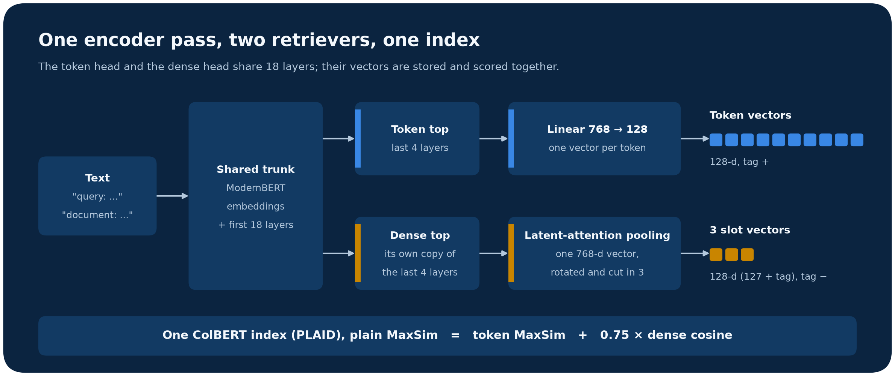
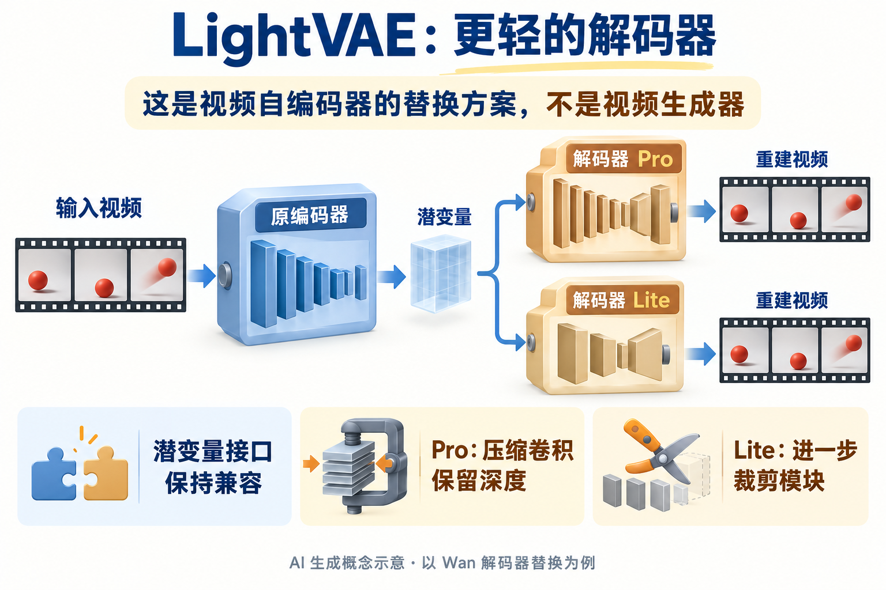

# 开放权重与实现：六种不同的任务入口

这里沿用“开源模型”栏目名，但逐项区分开放权重、自定义许可和代码许可。本期未下载或运行这些大模型，能力数字来自作者模型卡或实验；仅核验到权重文件存在，不等于已验证每个文件能够加载。六项均按新近实用或创新入选，近期热门所需的独立信号不足，热度待验证。

| 对象 | 输入 → 输出 | 首先检查 |
| --- | --- | --- |
| LFM2.5-24B-A2B | 指令、工具上下文 → 推理与动作建议 | LFM 自定义许可、显存与格式 |
| UIBK-Embedding-v1 | 英文查询和文档 → 检索向量 | PyLate、长文档索引成本 |
| D3 Flash | 文本 / 图像 / 视频 → 分类或评分 | 自定义加载代码、GPU |
| LightVAE | 视频潜变量 → 重建帧 | 与原 VAE、ComfyUI 节点匹配 |
| MixLID | 混合语言文本 → token / span 语言标签 | 语言范围与歧义词 |
| Humaneness Voice Converter | 源语音 + 目标参考音频 → 转换语音 | 参考语音权利、GPU 与评测边界 |

## 01 · LFM2.5-24B-A2B：把稀疏激活用于本地 Agent

这个版本有约 24B 总参数、每次约 2.45B 激活参数，以短卷积和注意力混合结构控制推理成本。小激活量并不等于只需存放 2.45B 参数：部署仍要考虑全部权重、缓存与运行时开销。作者提供多种量化或导出格式，选择时应对照自己设备的推理后端。

为什么现在值得看：10 月 13 日作者公开了这一 24B MoE 版本的工作流与评测，它适合研究本地工具调用和多步任务。模型默认会产生推理过程；需要大量外部知识的任务仍应连接检索。LiveClaw 等成绩是作者在指定设置中的比较，本文不将它换算成普通笔记本上的响应时间，也不把它称为已有独立复现的领先方案。

最小路径是先选官方列出的 GGUF、MLX 或其他兼容导出，再运行一个允许只读工具的小任务。许可为 [LFM Open License 1.0](https://huggingface.co/LiquidAI/LFM2.5-24B-A2B/blob/main/LICENSE)，并非 OSI 开源许可；年收入超过 1000 万美元的商业主体需另核商业授权条件。验证程度：模型卡、权重目录与作者实验，本站未推理。

公开日期线索：2026-10-12（模型仓库创建日期；不是后续卡片修改日期）。[模型卡与权重](https://huggingface.co/LiquidAI/LFM2.5-24B-A2B)。

## 02 · UIBK-Embedding-v1：把整段语义与细粒度匹配存进同一索引

常见检索系统用两套表示：整段向量抓主题，token 向量找具体实体与短语。UIBK 在一个 ModernBERT 派生编码器中保留两种能力，并将整段表示编码为额外向量，交给同一个晚交互索引。实际转换包含旋转、截取和标记维度，不能简单当成未经缩放的原始余弦值直接相加。

为什么现在值得看：10 月 12 日作者介绍的实现减少了维护两套索引和查询时融合的负担。模型总规模约 179M，文档最长 2048 token、查询最长 256；它仍有多向量索引的存储成本，并不是单向量搜索的完全等价替换。按模型卡使用 PyLate / PLAID，可从几十篇英文文档开始比较检索结果。

作者在 BEIR 报告平均 nDCG@10 为 59.79，对照 LateOn 的长文档设置为 57.69；两者参数量、蒸馏与提示训练也有差别，训练中还包含部分 BEIR 数据集，不能称为纯粹架构消融或全零样本结果。验证程度：原卡与作者实验；Apache-2.0 权重。

中文读图：看右端如何合并表示，再回看编码器顶部的两个分支；统一索引不表示两个分支没有额外参数。因斯布鲁克大学 Data Science 团队模型卡原图，Apache-2.0，未裁切。（[来源原图](https://huggingface.co/DataScience-UIBK/uibk-embedding-v1)；[查看原尺寸](images/uibk.png)。）

公开日期线索：2026-10-10（模型仓库创建日期；不是后续卡片修改日期）。[模型卡与权重](https://huggingface.co/DataScience-UIBK/uibk-embedding-v1)。

## 03 · D3 Flash：为分类与评分任务保留概率输出

D3 Flash 面向选择、二分类和评分，不以聊天长文为主要输出。输入可包含文字、图片或抽帧视频，输出是相应决策概率；这适合给内容路由、质量判断或业务筛选提供一个可阈值化的信号。概率仍需在自己的样本上校准，不能直接当作真实发生频率。

为什么现在值得看：新的开放权重将多种判别任务放进同一接口。模型卡支持一次请求提交多个评分问题，但每个问题仍有独立前向计算，不能把接口合并写成免费并行推理。作者给出的短延迟使用单张 MI325X 等指定条件，不是 CPU 或消费级电脑成绩。

上手依赖 PyTorch、模型卡指定的 Transformers 5.17 以及自定义模型代码，约 8.39B 的总规模也要求先规划 GPU 内存。先固定十几个带人工标签的样本，检查输出字段和阈值，再扩大测试。许可 Apache-2.0；验证程度为模型卡与作者基准，本站未加载权重。

公开日期线索：2026-10-11（模型仓库创建日期；不是后续卡片修改日期）。[模型卡与权重](https://huggingface.co/vllm-sr/d3-flash)。

## 04 · LightVAE：只替换视频自编码器，别把它当完整生成模型

LightVAE 压缩视频 VAE 的卷积结构，并在 Lite 版本进一步裁剪模块。Wan 的原编码器可以继续使用，解码器负责把潜变量还原成帧；Pro 保留深度，Lite 更偏速度。它解决的是编码或解码环节的成本，不能把这一环节的提速当成整条扩散生成管线的等比例提速。

为什么现在值得看：新权重覆盖 Wan2.1、Wan2.2 和 MiniMax-H3，提供 Python 与 ComfyUI 导出。最容易踩的坑是格式：带 `-comfy` 后缀的文件要用作者的 `Load LightVAE (TLR)` 节点，不能丢给标准 Load VAE；Wan2.2 的 14B 与 5B 也使用不同 VAE。H3 音频 VAE 的连线保持原样。

作者重建对照使用 H200、PyTorch 2.11、CUDA 12.8、BF16，并给出视频尺寸、预热和计时次数。本文没有在其他硬件复测。权重卡标 Apache-2.0，但代码仓库当前未找到独立 LICENSE，代码再分发和第三方底座许可需另核；本栏据开放权重收录，不将整个仓库统称 Apache 授权。

中文读图：先看被保留的编码器和潜变量接口，再比较两种解码器的压缩取舍。AI 生成概念示意，以 Wan 为例；没有性能数字，也不是重建效果实测。（[事实依据](https://huggingface.co/lightx2v/LightVAE)；[查看原尺寸](images/lightvae-concept.webp)。）

公开日期线索：2026-10-10（模型仓库创建日期；不是后续卡片修改日期）。[模型卡与权重](https://huggingface.co/lightx2v/LightVAE)。

## 05 · MixLID：在一句混合语言文本里标出语言片段

MixLID 基于 mmBERT-small 做 token 级语言识别，覆盖 111 种语言，并区分数字、标点和符号。输入一句混有中文、英文和其他语言的文本，可以得到带字符范围的 token 标签和合并后的片段，便于多语言清洗、分段或后续语音处理。

为什么现在值得看：它直接处理代码切换文本，而不只是给整段文字贴一个语言名。模型卡的整句“置信度”来自标签投票占比，不是校准后的分类概率；短词、姓名和多语言共有词仍容易歧义。作者的 CodeMixBench 比较使用规定的三组语言配对，并排除若干歧义类别，不能泛化到所有 111 种语言组合。

最小路径是按卡片环境加载权重与分词器，先对几句人工标注文本核对字符偏移和片段边界。参考环境包含 PyTorch 2.9.1、Transformers 4.57；需审阅自定义加载代码。MIT 许可，验证程度为作者卡片示例与实验，本站未运行模型。

公开日期线索：2026-10-12（模型仓库创建日期；不是后续卡片修改日期）。[模型卡与权重](https://huggingface.co/nlpai-lab/MixLID)。

## 06 · Humaneness Voice Converter：转换声线时检查情绪与身份的取舍

这组权重输入源语音和目标声音参考，输出转换后的语音，不是从文本直接合成声音。模型卡示例要求源片段约 1—30 秒、目标参考约 5—10 秒，并以 24 kHz 音频输出。适合研究说话内容、情绪表达和目标声线能否被分别控制，使用前须确认参考音频与声音使用权。

为什么现在值得看：作者公开了转换流程、控制属性和检查点，同时展示了一种值得警惕的取舍：部分情绪或质量代理指标改善，目标说话人相似度却从 0.821 降到 0.773。测试仅由精选源片段与两个目标声音构成，其中包含训练人物重叠；这些不是严格说话人留出测试，也不是大规模人工 MOS。

运行依赖已有 CUDA 音频环境与相关上游组件，默认研究路径要自行改成实际文件。本文没有执行声音转换。新增权重为 CC BY 4.0，上游 Chatterbox 保留 MIT 归属，外部评估模型和数据另有条件；多候选筛选还会增加计算成本。

公开日期线索：2026-10-11（模型仓库创建日期；不是后续卡片修改日期）。[模型卡与权重](https://huggingface.co/laion/Humaneness-Voice-Converter)。
