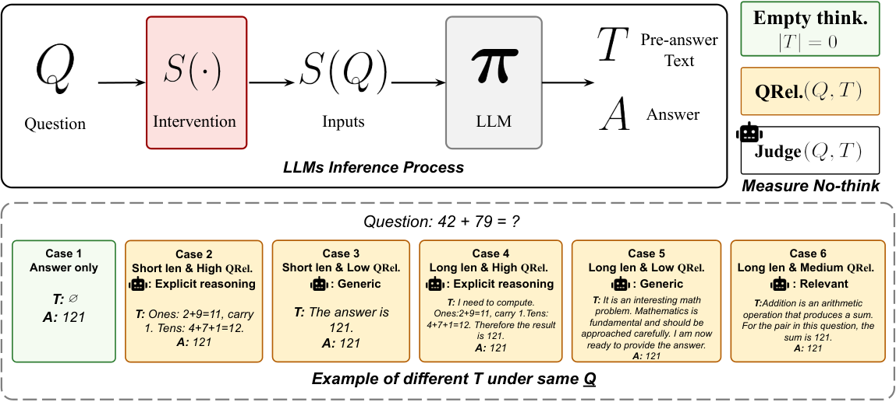
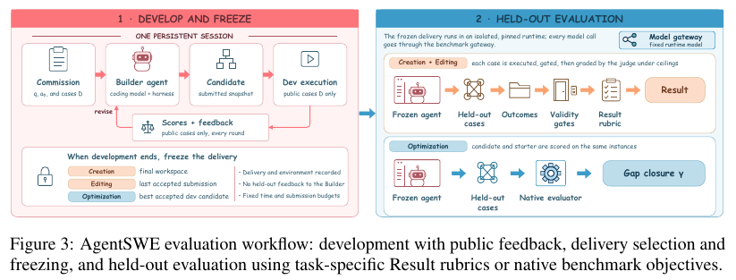
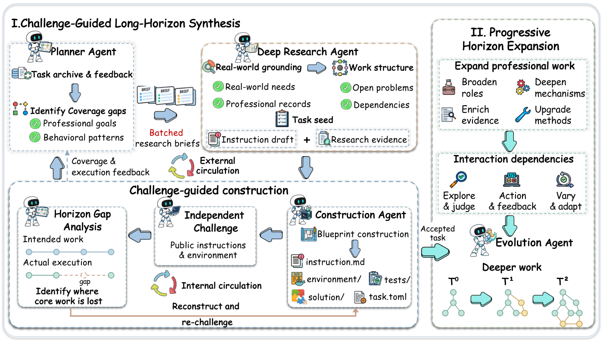
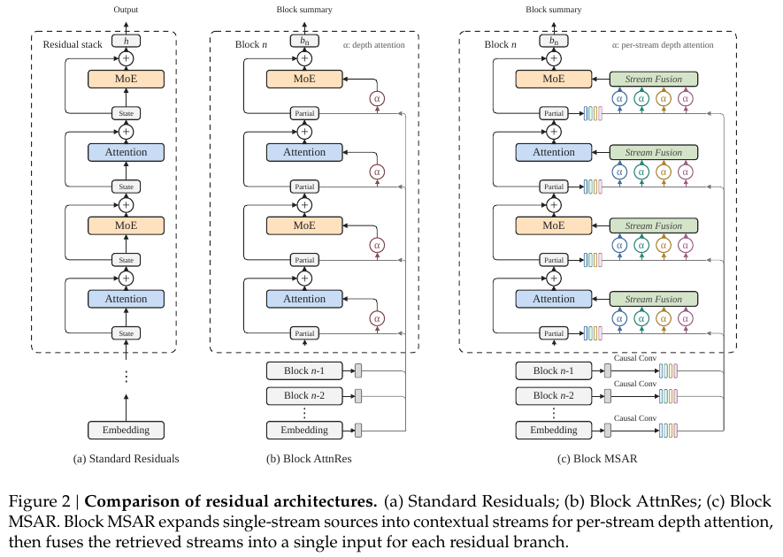
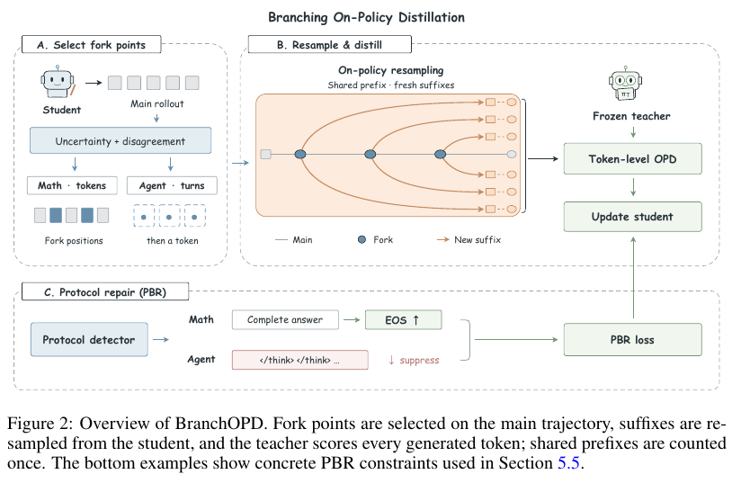
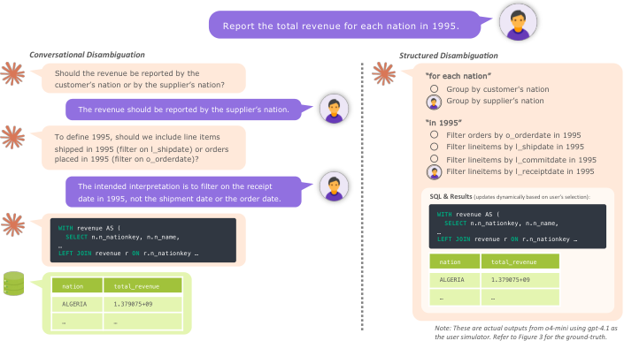

# 六篇论文：从输出约束到训练与交付验收

比较了 14 篇近期候选后，选出以下六篇。日期为 arXiv 首次提交日期，均处于近 7 天窗口；本站读过入选论文的核心方法、结果和局限，未复现实验。Hugging Face 关注数只作为发现线索，本期没有足够的第二类独立近期信号，因此不标“近期热门”。入选依据为新近实用或新近创新。

## 01 · Thinking Inertia：关掉思考开关，不等于没有可见推理

论文把“不要思考”拆成可观察的输出行为。空前缀率 ETR 检查最终答案之前是否真的没有文字；QRel 衡量前缀与问题的相关性；EIR 再用评审模型判断是否出现明确推断。三者不能互换：一句套话可以不含推理，一个很短的等式也可能已经展示推理；这里不测模型内部隐藏计算。

中文读图：左边的空前缀、相关说明和明确推断是不同输出类别；同样短的回答可能属于不同类别。 作者 Lei, Dianqiao, Lin, Kevin Qinghong, Lu, Pan, Torr, Philip, Zou, James；Figure 3；CC0。原图完整保存，未裁切或修改数字、图例与关系。（[来源原图](https://arxiv.org/html/2610.11765v1)；[查看原尺寸](images/thinking.png)。）

作者对六个模型、六种干预设置和三类答案空间做比较，发现开放式问题更难做到只给答案。DeepSeek-V4-Flash 在其原生关闭思考的开放题设置里，EIR 仍达 99.9%。在支持完全关闭的五个模型上，严格限制的开放题会出现约 40% 的空前缀率，同时伴随约 15 个百分点的准确率损失；不同模型与任务不能合并为一个普遍常数。

评测以 GPT-5.5 等评审为主，并用另一评审及人工样本做稳健性检查。人工核验包含 600 个样本，明确推理的二元判断有很高一致率，但这仍不能把模型评审等同于无误的真值。为什么现在值得看：它提醒做低延迟推理或答案格式评测的人，分别记录可见输出、任务正确性与控制条件。预印本，本站未复现实验。

日期：2026-10-08 · 新近实用 / 新近创新 · 作者实验，热度待验证。[arXiv 原文](https://arxiv.org/abs/2610.11765) · [站内阅读卡](../../../../papers/frontiers/2610.11765/00-阅读卡.md) · [站内 PDF](../../../../papers/frontiers/2610.11765/2610.11765v1.pdf)。

## 02 · AgentSWE：交付一个 Agent，比现场跑通一个示例难得多

AgentSWE 让编码 Agent 构建、修改或优化另一个 Agent，然后冻结交付物与运行环境，在看不到的测试任务上验收。它避免把“构建者会做一道题”误当成“构建出的系统能持续完成同类任务”。25 个任务分成创建、编辑和优化三类，包含公开开发反馈与独立留出测试。

中文读图：先看左侧开发反馈循环，再看中间的冻结步骤；右侧留出测试的反馈不会再回流给构建者。 作者 Wang, Jiahao, Qian, Hongjin, Hu, Yuyang, Zhang, Jiajun, Liu, Zheng；Figure 3（PDF 第 7 页，裁切保留图与图注）；CC BY 4.0。裁切仅去除页边及相邻正文，完整页面见站内 PDF，图中数字与关系未改动。（[来源原图](https://arxiv.org/html/2610.13361v1)；[查看原尺寸](images/agentswe.png)。）

同一固定运行模型网关帮助控制交付 Agent 的基础能力，开发阶段与正式验收严格分开。50 次创建任务运行的平均分是 11.2 / 100，20 次为零分，最好的构建者平均 19.1；这些是任务评分，不能改写成通过率。尤其值得看的是开发反馈很高、留出测试却明显下降的情况，它暴露了对示例、环境和工具调用约定的过拟合。

这是一个特定任务集合、特定构建与运行协议下的预印本结果，不足以证明所有 Agent 开发都不可行。复现时应同时保留交付快照、依赖、模型网关、开发轮数和评分规则；只重跑成功截图无法检验泛化。为什么现在值得看：当团队开始让 Agent 写 Agent，验收对象必须是冻结后的可交付系统，而不是构建过程中的对话。本站未运行该基准。

日期：2026-10-09 · 新近实用 / 新近创新 · 作者实验，热度待验证。[arXiv 原文](https://arxiv.org/abs/2610.13361) · [站内阅读卡](../../../../papers/frontiers/2610.13361/00-阅读卡.md) · [站内 PDF](../../../../papers/frontiers/2610.13361/2610.13361v1.pdf)。

## 03 · Terminal-Horizon：先排查任务捷径，再增加终端轨迹难度

这项研究为长时序终端 Agent 构造训练任务。方法不只是让任务更长：先从真实工作流形成环境，再让独立挑战者尝试发现捷径，例如环境里残留了答案或预计算文件；修复这些问题之后，才扩大依赖步骤与验证要求。挑战者不能读取隐藏答案，评分要求也应当来自公开任务说明。

中文读图：挑战与修复位于扩大任务复杂度之前；重点看反馈回到哪里，避免把更长的轨迹直接当作更好的数据。 作者 Zou, Shun, Ma, Ziyu, Zou, Yi, Wang, Yong, Chen, Lin, Chen, Zehui, Chen, Guanhua, Chu, Xiangxiang, Zhao, Feng；Figure 2；CC BY 4.0。原图完整保存，未裁切或修改数字、图例与关系。（[来源原图](https://arxiv.org/html/2610.13166v1)；[查看原尺寸](images/terminal.webp)。）

作者构造 1535 个环境、约 3000 条轨迹，对 Qwen3.5-27B 进行三轮监督微调。报告的 Terminal-Bench 2.1 成绩由相同基础模型的 46.82 提高到 60.67，增加 13.85 个百分点。训练使用 262144 上下文和 144 张 H20 等条件，这不是一台笔记本可以照搬的小实验。

为什么现在值得看：它把“数据量扩展”与“环境不能泄题”放在同一个构建循环里。成绩仍是作者实验，合成和审计成本也没有消失；更长轨迹可能包含低价值绕路，不能仅以 token 数量判断训练质量。适合先借鉴任务挑战与环境清理流程，再决定是否投入训练；本站没有进行训练或基准复现。

日期：2026-10-09 · 新近实用 / 新近创新 · 作者实验，热度待验证。[arXiv 原文](https://arxiv.org/abs/2610.13166) · [站内阅读卡](../../../../papers/frontiers/2610.13166/00-阅读卡.md) · [仓库归档 PDF](https://raw.githubusercontent.com/wuwudeqi/github-learning-site/main/docs/frontiers-source-audits/2026-10-14-evidence/2610.13166v1.pdf)。

## 04 · MSAR：从多条深度信息流取回表示，再合成一次输入

MSAR 在残差连接中增加多条信息流。直觉上，深层模块不必只接收一路历史汇总，而可以从不同尺度的深度上下文中取回表示，再融合成该分支的一次输入。实现使用因果深度卷积形成多种尺度，并保留分块摘要，避免把所有层的全部中间状态无限堆起来。

中文读图：左侧逐层传递，中间按深度取回，右侧把单一路径扩成多路后再次融合；关注右侧绿色融合模块。 作者 Qin, Xiaohan, Zhang, Xiangdong, Dai, Tuo, Zou, Sunan, Wu, Huaijin, Yang, Yebin, Xia, Zhuo, Yao, Lin, Liu, Yuliang, Yan, Junchi；Figure 2（PDF 第 7 页，裁切保留图与图注）；CC BY 4.0。裁切仅去除页边及相邻正文，完整页面见站内 PDF，图中数字与关系未改动。（[来源原图](https://arxiv.org/html/2610.13630v1)；[查看原尺寸](images/msar.png)。）

论文在 18B、28B MoE 设置中比较标准残差与 Attention Residuals。28B 的 12 项任务平均分分别为 MSAR 52.4、AttnRes 49.4、标准结构 44.6；参数和训练 FLOPs 也有小幅变化，因此应连同预算读取。图中右侧先做每条流的深度注意力，再融合，不能理解为简单把四份模型输出平均。

作者给出的 1.58 倍等损失缩放效率来自特定计算口径，排除了语言模型输出头等部分，不能直接改写为真实训练墙钟提速 1.58 倍。为什么现在值得看：它探索在有限残差存储下提供更丰富的跨层信息，而非只加宽主干。预印本、作者训练结果，本站未复现；真正落地仍要测内存、内核和端到端吞吐。

日期：2026-10-09 · 新近实用 / 新近创新 · 作者实验，热度待验证。[arXiv 原文](https://arxiv.org/abs/2610.13630) · [站内阅读卡](../../../../papers/frontiers/2610.13630/00-阅读卡.md) · [站内 PDF](../../../../papers/frontiers/2610.13630/2610.13630v1.pdf)。

## 05 · BranchOPD：在学生不确定的位置分叉，复用前面的轨迹

BranchOPD 在学生生成的主轨迹中，结合不确定性与师生分歧选择分叉点，从这些位置重新采样后续路径，再由冻结教师提供 token 级蒸馏信号。共享前缀只计算一次损失；交互任务还要恢复对应环境。所有续写仍来自学生，不是简单拼入教师答案。

中文读图：A 选择分叉点，B 从共享前缀生成新后缀；底部 PBR 是独立的协议修复分支，因此读成绩必须同时看消融。 作者 Chen, Dongyang, Liu, Shudong, Li, Shubo, Tang, Duoxun, Liang, Jinwei, Wu, Zehuan, Lu, Lewei；Figure 2（PDF 第 4 页，裁切保留图与图注）；CC BY 4.0。裁切仅去除页边及相邻正文，完整页面见站内 PDF，图中数字与关系未改动。（[来源原图](https://arxiv.org/html/2610.13481v1)；[查看原尺寸](images/branchopd.png)。）

Qwen3-4B-Base 的数学比较中，论文报告平均 @16 从普通 OPD 的 25.82 到 44.37；这里是多次采样的平均成绩，不是 pass@16。尤其要看消融：加入协议修复 PBR 的对照已到 38.94，所以不能把全部 18.55 分提升都归给分叉本身。

ALFWorld 和 WebShop 中，学生生成 token 分别相当于七条独立轨迹的 19.1% 和 31.2%，但这个账不包含教师打分、反向传播和环境回放等全部成本。为什么现在值得看：它用更有针对性的续写替代重复从头生成，适合研究数据预算如何分配；工程收益要用完整成本表复核。预印本与作者实验，本站未训练。

日期：2026-10-09 · 新近实用 / 新近创新 · 作者实验，热度待验证。[arXiv 原文](https://arxiv.org/abs/2610.13481) · [站内阅读卡](../../../../papers/frontiers/2610.13481/00-阅读卡.md) · [站内 PDF](../../../../papers/frontiers/2610.13481/2610.13481v1.pdf)。

## 06 · ARCS：先把 SQL 歧义变成可回答的选择，再生成查询

自然语言问题里的“最近”“最好”或字段名称，可能对应多种 SQL 含义。ARCS 先识别歧义，再把它组织成有限选项或可输入的值与运算符；用户可以拒绝错误的歧义假设。这样避免在多个歧义的笛卡尔积里反复追问，也保留必要的开放输入。

中文读图：留意结构化选择怎样限定澄清范围，同时允许用户表达原选项没有覆盖的意思；这不保证歧义识别本身正确。 作者 Hu, Yihao, Feng, Yanlin, Otani, Naoki, Bhutani, Nikita；Figure 1；CC BY 4.0。原图完整保存，未裁切或修改数字、图例与关系。（[来源原图](https://arxiv.org/html/2610.09396v1)；[查看原尺寸](images/arcs.png)。）

作者比较 23 个模型，多数设置使用零温度，并以模拟用户进行主要评测，另有小规模主观负担研究。o4-mini medium 的结构化消歧执行准确率为 42.44，对话式为 43.73；相应努力代理指标约为 18 与 34。准确率并未全面反超，价值是较少交互负担下的取舍，而不是宣称结构化界面永远更准。

努力指标由输入输出 token 加权构成，不等于人类真实耗时；歧义召回不足时，再好的界面也问不到关键问题。为什么现在值得看：它给 Text-to-SQL 产品一个可实现的中间层——把猜测显式交给用户确认。预印本与作者实验，本站未复现；实际部署还需检查数据库权限、字段说明和真实用户能否理解选项。

日期：2026-10-07 · 新近实用 / 新近创新 · 作者实验，热度待验证。[arXiv 原文](https://arxiv.org/abs/2610.09396) · [站内阅读卡](../../../../papers/frontiers/2610.09396/00-阅读卡.md) · [站内 PDF](../../../../papers/frontiers/2610.09396/2610.09396v1.pdf)。
