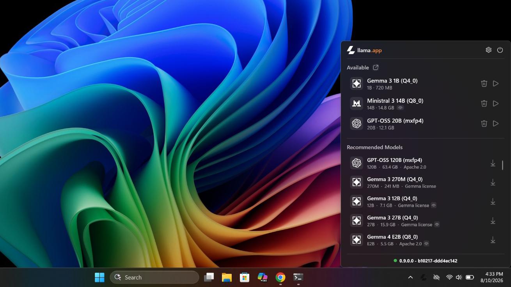
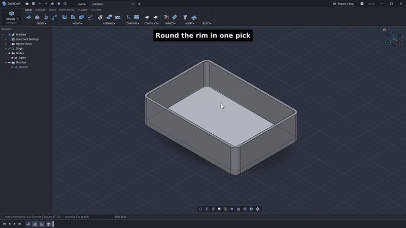
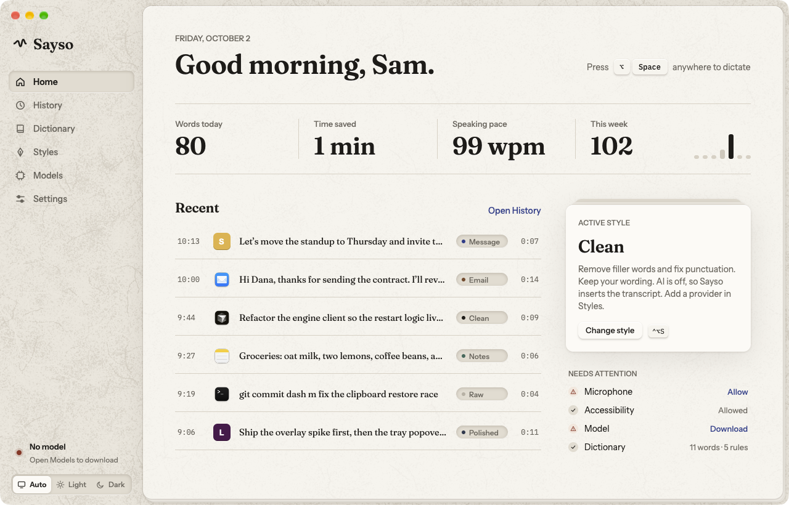

# 十个工具与公开实现：从代码检索到可调试工作流

候选来自代码托管与版本记录、作者公告 / Hugging Face、Show HN 和开发者社区。比较 16 项后收录 10 项。以下均属新近实用或新近创新，热度待验证；没有足够的独立近期信号就不称“热门”。已核验 README、许可、维护和相关代码，**本期没有安装或运行这些项目**，示例与界面来自作者。

| 你的任务 | 可先查看的项目 | 最小输入 → 输出 |
| --- | --- | --- |
| 在陌生仓库找实现 | ColGrep Agent | 仓库和问题 → 文件与行号 |
| 在 Windows 管理本地模型 | Llama-Windows | GGUF 模型 → 本地服务与聊天入口 |
| 为领域语音改进识别 | NVIDIA Speech Skills | 领域语料 → 逐级优化流程 |
| 让 Agent 做参数化 CAD | Solidcraft | 尺寸和操作 → 可编辑实体 |
| 按应用风格整理口述 | Sayso | 麦克风 → 相应风格文字 |
| 让 Agent 保留项目记忆 | IHMT-MEMORY | 资料和代码 → 持久检索片段 |
| 编程制作数学动画 | ManimGX | Python / JS 场景 → 动画 |
| 定位自动化任务失败 | Preloop | 工作流与执行上下文 → 可调试运行 |
| 建立 Agent 训练 / 评测环境 | Karotte | 环境与任务 → 隔离轨迹和评分 |
| 从外部助手访问工作管理 | Paperclip | 授权身份和请求 → 受权限约束的动作 |

## 01 · ColGrep Agent：让本地代码检索继续追问到行号

ColGrep 在本地索引代码，再让小模型围绕检索结果继续调查，输出文件和行号。适合“这项配置在哪里生效”这类跨文件问题，比只返回相似片段更接近可检查的答案；最终仍要打开代码核实调用关系。

仓库始于 1 月，本次值得看的是 10 月 12 日公开的 Agent 用法，而不是历史 Star。按文档先初始化索引，再安装约 2.5 GB 的配套模型并运行 Agent 模式；它依赖 Rust / CPU 检索路径和模型运行环境。源码中的调查循环复用索引，并提供只读工具，但读到的仓库内容仍属于不可信输入。

当前维护中，最近 Release 为 v1.8.5。本文核对了相关 Agent 实现，没有运行作者的问答基准；私有代码是否完全留在本机，还应检查自己选择的模型与运行配置。

新进展日期：2026-10-12。[源码](https://github.com/lightonai/next-plaid) · [Apache-2.0](https://github.com/lightonai/next-plaid/blob/main/LICENSE) · [本次依据](https://huggingface.co/blog/lightonai/colgrep-agent)。

## 02 · Llama-Windows：把 GGUF 搜索、下载与本地服务接起来

这个 Windows 托盘应用管理 llama.cpp 模型服务，并提供快捷聊天入口。v0.12 增加的 Hub 搜索降低了寻找和下载 GGUF 的手动步骤；代码会按 GGUF 标签筛选仓库并处理下载、访问失败等状态，文件能搜到不等于当前机器有足够内存运行。

仓库 6 月已有，本次对应 10 月 10 日 v0.12 与 13 日作者介绍。最小路径是按 Release 安装适合 Windows 11 x64 / Arm64 的包，再挑一个符合内存预算的模型；从源码构建还需要 .NET 10 等开发依赖。本项目 MIT，下载的模型各自另有许可。

下图来自 README 的较早 v0.9 界面，只说明托盘到聊天的基本路径，不能当作本次新搜索功能截图。验证程度为作者界面、版本记录与 HubClient 代码，本站未在 Windows 安装。

中文读图：观察本地服务与聊天入口如何相接；这是作者 README 的 v0.9 演示界面，早于本次 v0.12，未声称展示新增搜索页。ggml-org，MIT，原图未改动。（[来源原图](https://github.com/ggml-org/Llama-Windows)；[查看原尺寸](images/llama-windows.png)。）

新进展日期：2026-10-10。[源码](https://github.com/ggml-org/Llama-Windows) · [MIT](https://github.com/ggml-org/Llama-Windows/blob/main/LICENSE) · [本次依据](https://huggingface.co/blog/huggingface/llama-windows)。

## 03 · NVIDIA Speech Skills：先尝试便宜的领域适配，再决定微调

这组语音技能把领域识别优化分成逐级路径：先检查词表增强、语言模型等较轻改动，仍不足时才进入微调。输入是领域音频、转写和验证集，输出应包括可比较的识别结果，适合研究专业术语识别而不想一开始就重训的人。

新近价值来自 10 月 13 日公开的配套流程与示例。作者的空管语音例子中，领域 WER 大幅下降，但通用英语 WER 从 3.50 到 3.63，提醒读者保留域外回归集。它不是一份脱离环境就能执行的提示词：还依赖 NeMo Speech 的配套技能、Linux / GPU 和数据准备。

代码采用 Apache-2.0，文档另有 CC BY 4.0。已查看技能路由文件，把它作为待分析资料而非本机指令执行；本站未训练，也不把作者单一领域结果推到所有口音。

新进展日期：2026-10-13。[源码](https://github.com/NVIDIA/skills) · [Apache-2.0](https://github.com/NVIDIA/skills/blob/main/LICENSE-APACHE) · [本次依据](https://huggingface.co/blog/nvidia/fine-tune-asr-with-nvidia-nemotron-speech-skills)。

## 04 · Solidcraft：让 CAD 操作留在可编辑的参数模型里

Solidcraft 是用 Rust 构建的参数化 CAD 工具，提供草图约束、拉伸等操作和 MCP 接口。具体场景是给电路板做外壳：输入板子尺寸、孔位和壁厚，得到还能继续改参数的实体，而不是只能观看的渲染图。

仓库创建于 10 月 7 日 UTC，v0.9.0 在北京时间 10 月 14 日发布，涉及文件格式和模型动作改进。已查看作者的外壳 MCP 脚本，它按步骤调用操作并单独控制视角；这比一句自然语言成功截图更容易检查，但本站没有运行 CAD 内核或验证制造公差。

最小路径是按项目说明运行桌面工具，再在复制的示例模型上试一项尺寸修改；源码开发需要 Rust 等构建依赖。近期版本迭代快，文件格式也在变化，工作文件应先备份。作者的性能比例只适用于其测试模型，本文不作为普遍速度承诺。

中文读图：重点看壳体仍是可继续选择和编辑的几何对象；作者 demo-0.8.gif 第 8 秒的忠实帧，画面标记 v0.7，属于本次 v0.9 升级前的基础操作示例。bherbruck，Apache-2.0；未改动界面。（[来源原图](https://raw.githubusercontent.com/bherbruck/solidcraft/main/docs/screenshots/demo-0.8.gif)；[查看原尺寸](images/solidcraft-frame.png)。）

新进展日期：2026-10-14。[源码](https://github.com/bherbruck/solidcraft) · [Apache-2.0](https://github.com/bherbruck/solidcraft/blob/main/LICENSE-APACHE) · [本次依据](https://github.com/bherbruck/solidcraft/releases/tag/v0.9.0)。

## 05 · Sayso：按当前应用和网站整理口述文字

Sayso 把语音输入转成可插入当前应用的文字，并能按应用或网站匹配整理风格。写邮件与记临时笔记可以采用不同规则；源码中网站规则优先于应用规则，并在网站匹配里选择更具体的条件。

10 月 7 日起的风格规则与随后版本是本次关注点，项目创建于 10 月 2 日。可选本地识别，但如果选择云端整理模型，相关文本会进入所选服务，不能只凭“本地语音”就认定整条链路离线。作者说明 macOS、Windows 与 Linux 支持范围不同，GNOME / KDE 的 Wayland 自动风格还有限制。

先按系统安装并下载识别模型，用一段不敏感口述检查插入位置和风格，再接云端服务。历史录音保留策略也要主动检查。GPL-3.0；下图是作者界面，本文未录音、未安装。

中文读图：先确认模型与输入配置，再看历史记录；图里的示例不是本站录音结果。watzon / Sayso README 原图，GPL-3.0，未改动。（[来源原图](https://github.com/watzon/sayso)；[查看原尺寸](images/sayso.webp)。）

新进展日期：2026-10-07。[源码](https://github.com/watzon/sayso) · [GPL-3.0](https://github.com/watzon/sayso/blob/main/LICENSE) · [本次依据](https://github.com/watzon/sayso/releases)。

## 06 · IHMT-MEMORY：把长期记忆和代码片段作为本地工具返回

IHMT-MEMORY 用本地层次结构保留资料，向 MCP 客户端暴露记忆检索和项目代码查找工具。输入项目路径与问题，工具返回文件、符号及行号，帮助 Agent 少读整份文件；返回片段是否足够解释调用关系，仍要由任务本身验证。

仓库创建于 9 月 30 日 UTC，本次为北京时间 10 月 13 日社区发布线索的近期补充（原记录为 10 月 12 日 UTC）。已检查 MCP 服务：项目映射可显示符号范围，检索遇歧义时返回候选，代码索引按校验信息同步。这些是实现路径，不是节省 token 的独立实测。

需要 Python 3.10 以上、项目依赖以及支持 MCP 的客户端，先从可公开的小目录建立索引。项目 MIT，仍很年轻；作者的跨客户端说明不等于各操作系统都已测试，尤其不要把未验证的 Windows 支持当作保证。

新进展日期：2026-10-13（北京时间）。[源码](https://github.com/gonzaroman/IHMT-MEMORY) · [MIT](https://github.com/gonzaroman/IHMT-MEMORY/blob/main/LICENSE) · [本次社区发布](https://news.ycombinator.com/item?id=50058903)。

## 07 · ManimGX：用 GPU 渲染编程数学动画，先核 API 与打包许可

ManimGX 用 Rust / wgpu 渲染数学动画，提供 Python、JavaScript 和浏览器路径。已查看线性映射示例：代码定义矩阵、坐标网格与向量，输出随矩阵变化的几何动画，适合制作可解释的数学片段。

本次依据 10 月 7 日首个 v0.1.0 Release，而非把后续小修复包装成新发布。它实现的是类似 Manim 的接口子集，已有复杂场景不一定能原样迁移。最小路径是选相应包和示例，在支持的 GPU 后端渲染短片，再检查文字、字体与输出编码。

必须区分许可：项目源码为 MIT，但含 FFmpeg / x264 的原生 wheel 或可执行分发带有 GPL-3.0-or-later 条件；浏览器包另看其依赖组成。作者在 M4 Pro 的有限场景比较不能当作所有场景的固定加速倍数。本站未渲染该项目。

新进展日期：2026-10-07。[源码](https://github.com/academa-labs/manimgx) · [MIT](https://github.com/academa-labs/manimgx/blob/main/LICENSE) · [本次依据](https://github.com/academa-labs/manimgx/releases/tag/v0.1.0)。

## 08 · Preloop：让自动化任务的失败上下文可以被调试

Preloop 运行兼容 GitHub Actions 风格的工作流，并以隔离执行环境和调试接口帮助定位失败。输入工作流、目标与依赖，输出带上下文的执行记录；适合研究 Agent 怎样检查自动化任务，而非只反复重跑命令。

项目 6 月创建，10 月 10 日 v0.34 的实质变化是用 SQLite / Postgres 等数据库作为控制面状态依据。作者 DAP 示例中，错误来自目标配置，调整目标后重新运行通过，不能把这段演示写成系统自动修复了源代码。

先准备文档要求的容器或虚拟化环境，跑小型示例工作流再接真实项目；源码开发包含 Rust 等依赖。MIT、当前维护中。本文查看版本和调试示例，未启动虚拟机，也没有验证与所有 GitHub Actions 的完全兼容。

新进展日期：2026-10-10。[源码](https://github.com/preloopdev/preloop) · [MIT](https://github.com/preloopdev/preloop/blob/main/LICENSE) · [本次依据](https://github.com/preloopdev/preloop/releases/tag/v0.34.0)。

## 09 · Karotte：把任务环境、轨迹和评分放进隔离的运行单元

Karotte 为 Agent 训练与评测组织任务环境、执行轨迹和评分器。它让任务准备与 Agent 行动分开，结束后再处理评分，有助于发现后台进程、文件类型或沙箱边界造成的评测捷径。

仓库 9 月已有，本次看的是 10 月 7 日正式开源介绍。最小路径是准备 Python 3.12 / uv 和对应容器后端，运行一个内置环境，再查看轨迹与输出；macOS 和 Linux 的隔离后端不同，模型 API 调用也可能产生服务费用，本文没有运行或购买调用。

核心为 MIT，模板有 MIT-0 等独立许可。作者示例中的简易字符串评分只能说明接口，不足以证明生产评分器可靠；若评测代码任务，应检查执行结果和测试约束。近期价值在可复用的环境骨架，验证程度为文档与代码，未独立复现作者的大规模运行主张。

新进展日期：2026-10-07。[源码](https://github.com/preferencemodel/karotte) · [MIT](https://github.com/preferencemodel/karotte/blob/main/LICENSE) · [本次依据](https://github.com/preferencemodel/karotte)。

## 10 · Paperclip：新增外部助手 MCP 入口，沿用登录人的权限

Paperclip 本次新增实验性的外部助手 MCP 入口，使外部 Agent 能以已登录人的身份访问相应工作管理能力。源码里的设备登录与代理调用路径把授权身份传递到服务器，适合研究怎样把现有权限体系接给外部助手，而不是另造一个无边界的万能令牌。

[10 月 7 日](../2026-10-07/04-开源项目.md)已经介绍过该项目；本次仅因 v2026.1012.0 的新接口再次收录，发布日期换算为北京时间 10 月 13 日。先按文档完成服务器、Node / pnpm 环境与登录，再配置外部助手，仍要检查能操作的范围。

版本说明指出旧工作进程与新锁协议不兼容，升级需先停止旧进程；本文没有升级任何现有服务。MIT，实验性入口应先在测试环境使用。验证程度为 Release 与 CLI 实现，未做多用户授权实测。

新进展日期：2026-10-13。[源码](https://github.com/paperclipai/paperclip) · [MIT](https://github.com/paperclipai/paperclip/blob/master/LICENSE) · [本次依据](https://github.com/paperclipai/paperclip/releases/tag/v2026.1012.0)。
