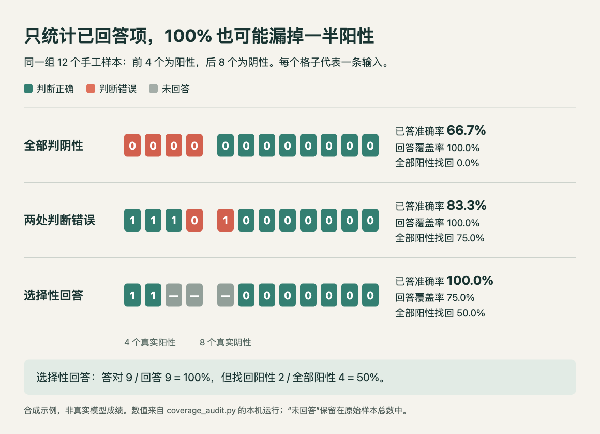

# 小实验：把未回答的样本留在评测账本里

同一组输入，只统计“系统愿意回答的部分”，准确率可能很好看，却没有回答很多真正困难的样本。这个小实验用 12 条手工二分类样本说明分母的影响。**代码已在本机运行；预测数组是合成数据，不是真实模型输出，也没有调用 API。**

## 先固定账本

四条阳性、八条阴性。第一种策略全部判阴性；第二种策略错一条阳性、错一条阴性；第三种策略对三条输入不回答，其余都答对。拒答本身可以是合理设计，但必须同时报告覆盖率，不能静默删掉后再与全量回答系统比较。

常规 precision 关注“判为阳性的样本里有多少是真的”，recall 关注“所有真实阳性里找回了多少”。定义可参阅 [scikit-learn 官方指标说明](https://scikit-learn.org/stable/modules/model_evaluation.html#precision-recall-and-f-measures)。本实验额外报告“全部原始阳性找回比例”，把未回答阳性也留在分母，避免与过滤后的条件 recall 混淆。



中文读图：先看第三行前四个格子，两个阳性被留空；再看右侧的 100% 与 50%，分母分别是已回答项和全部阳性。HTML/JS 根据真实脚本输出绘制，数据为明确标注的合成示例；[查看原尺寸](images/coverage-result.png) · [图表源码](code/coverage-chart.html) · [原始结果 JSON](code/coverage-results.json)。

## 可以直接重跑的代码

下载 [完整 Python 脚本](code/coverage_audit.py)，放在自己的实验目录后运行：

```bash
python3 coverage_audit.py
```

只依赖 Python 标准库；本次运行版本为 3.14.3，不需要 GPU、模型权重或服务密钥。脚本会在同一目录写出 `coverage-results.json`。核心计算保留了原始样本总数：

```python
covered = [(y, p) for y, p in zip(truth, prediction) if p is not None]
correct = sum(y == p for y, p in covered)
tp = sum(y == p == 1 for y, p in covered)
coverage = len(covered) / len(truth)
accuracy_on_answered = correct / len(covered) if covered else None
positive_capture_over_all = tp / sum(truth) if sum(truth) else None
```

| 合成策略 | 回答覆盖率 | 已回答项准确率 | 全部输入中答对比例 | 全部阳性找回比例 |
| --- | ---: | ---: | ---: | ---: |
| 全部判阴性 | 100% | 66.7% | 66.7% | 0% |
| 两处判断错误 | 100% | 83.3% | 83.3% | 75% |
| 选择性回答 | 75% | 100% | 75% | 50% |

完整脚本还验证空回答集合的指标为 `null`、无阳性预测的 precision 为 `null`，不把无法定义的比例悄悄写成零。这里的断言检查的是指标边界与分母，不能替代真实分类器评测。

## 用到真实任务时还缺什么

换成真实预测前，保留样本 ID、任务类别、拒答原因和失败日志，并固定测试集；不能在看过测试答案后选择阈值。业务可能更重视少误报或少漏报，仍要另外指定代价和验收线。12 条合成数据只解释计算口径，不足以估计泛化能力、置信区间或校准质量。
