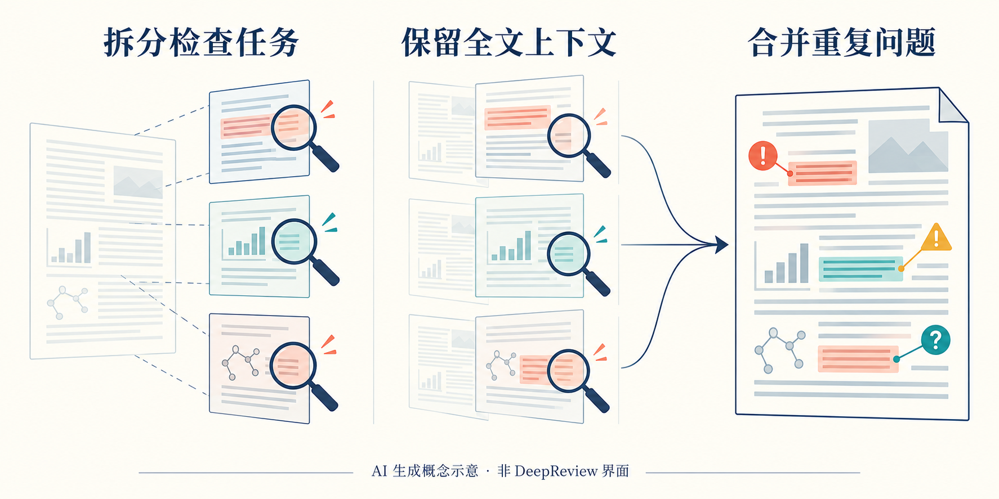
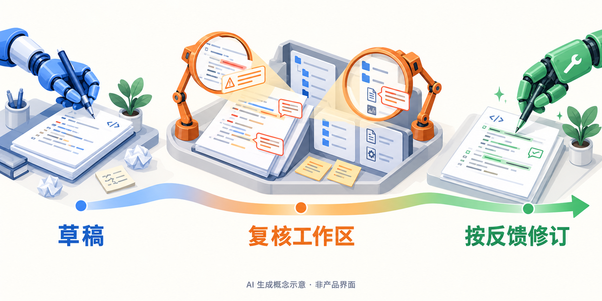

# AI 动态｜把能力变化落实到可检查的流程

本期为 **5 条重点详解 + 10 条速读**。新闻原始日期覆盖 2026-10-13—2026-10-14；只有日期的公告保留日精度，不猜测首发时刻。本期不以官方宣传或单一榜单认定热门，逐项标明验证程度。

## 01 · Grok Voice 3.0：语音更自然，业务任务仍要单独评估

日期：2026-10-14。

xAI 发布 Grok Voice 3.0，沿用实时语音 API，公告价格仍为每分钟 0.08 美元。使用 `grok-voice-latest` 的应用会跟随最新版本。对已经接入的团队，这是一项需要重新跑回归用例的后端变化：模型听起来更自然，不代表原有工具调用、打断处理和失败恢复都会保持同样行为。

本次改进集中在自然对话、全双工互动和企业流程。全双工可以直观理解为双方不必严格轮流说完一句话，系统要在用户插话、停顿或改口时继续判断该听还是该答。xAI 报告的全双工成功率和首段音频延迟属于特定测试结果，实际电话链路还会叠加网络、工具服务与业务系统的时间。本站没有接通电话或运行该 API。

公告引用的 Artificial Analysis 10 月 13 日语音指数中，Voice 3.0 为 86.9，上一代为 81.3。但同一公告列出的 τ-Voice 业务任务结果是 71.6，低于对照 GPT Live 1 Astra Medium 的 74.5。前者与后者回答的是不同问题：用户对自然对话的偏好，和代理能否完成带约束的业务任务，不能混成一个“全面领先”结论。

例如，客服要先核对订单、再解释退款规则、最后调用系统，最需要检查的是模型是否在缺少订单信息时追问、是否正确传参，以及失败后有没有重复操作。公告列举了企业部署和客服处理情况，它们可以帮助选择试点场景，但仍是厂商汇总的案例，不能直接作为你自己业务的成功率。

为什么现在值得看：这是可接入的语音版本更新，适合语音 Agent 开发者重新检查质量与任务完成率的取舍。标记为**新近实用；验证程度：官方公告及其引用评测，本站未运行；热度待验证**。目前确认的是托管 API，不是开放权重模型。

[官方原文](https://x.ai/news/grok-voice-3)。

## 02 · DeepReview 开放技术文档检查：每个局部任务仍保留全文

日期：2026-10-14。

Google Research 介绍并开放 DeepReview，让作者上传技术文档，获得针对推理、论证和表达问题的检查意见。公开入口提供每周两次免费使用；需要更多用量时可使用自己的 Gemini API key。初始支持 PDF 和纯文本，多文件材料属于后续方向。它适合投稿前自查或技术报告复核，不能把输出当成会议审稿决定。

方法的关键是分工方式。系统先按语义结构划分检查任务，再按问题复杂度分配计算；不同检查过程可以并行，但保留全文作为上下文。这样，检查某个公式时仍能看到前文定义，检查实验结论时也能回看设定。最后再做全局整理，合并重复意见、区分问题严重程度，并使用搜索帮助核实需要外部依据的内容。

读图：中间的淡色整页表示全文仍可见；并行的是检查职责，不是把上下文割裂。图中符号只表示问题类型，不对应真实检测结果（[AI 生成概念示意，非产品界面](https://research.google/blog/analyzing-technical-documents-with-deep-review/)；[查看原尺寸](images/deepreview-concept.webp)。）

该系统来自 Paper Author Tools 的持续试用。官方提到多个会议周期累计有一万六千多份自愿提交材料；这说明系统接触过较多作者反馈，并不意味着这些会议把它用于正式评审，更不表示它发现的每个问题都正确。新系统使用 Gemini 4 Argon，具体能力还应通过自己的文档、小规模人工复核来判断。

对于一篇方法论文，最有用的操作不是让它“评价是否顶会水平”，而是逐项追问：定理条件有没有在实验中满足、基线是否获得同样信息、消融有没有支撑结论。把每条反馈落回原文页码和公式，才能区分真正错误与误解。搜索得到的外部材料同样需要核对。

为什么现在值得看：技术写作检查有了明确的公开入口和任务组织方式，标记为**新近实用；验证程度：官方系统说明与试点反馈，本站未上传测试；热度待验证**。官方称上传内容不用于训练，并披露保留安排；提交未公开稿件前仍应逐项查看当下服务条款与保密约定。

[官方原文](https://research.google/blog/analyzing-technical-documents-with-deep-review/)。

## 03 · HydraFusion 增加 Max：让复核真正查看代码工作区

日期：2026-10-14。

GitHub 更新 Copilot 的 HydraFusion，并增加 Max 选项。这套研究预览会在编码任务中组合不同模型，当前池包含 Opus 5.5、GPT-6 Astra、GPT-6.1 Sol 和 GPT-6 Luna；具体安排随任务变化。Max 使用更高的推理投入，面向难题，不能由名字推断它同时更便宜或更快。

本次值得注意的是“复核能看到什么”。如果第二个模型只阅读第一个模型的总结，错误可能被总结掩盖；新的 Critique 路径让复核者检查真实工作区，并可并行提出批评。这里的工作区包括代码和相关修改痕迹，复核者需要据此判断实现是否满足请求，而不是仅对一段解释投票。

读图：复核同时面对代码草稿和仓库文件；修订环节使用检查意见。它概括可选的审查与修订模式，不表示 HydraFusion 每次都固定执行三步（[AI 生成概念示意，非产品界面](https://github.blog/changelog/2026-10-14-hydrafusion-updates-and-new-max-option)；[查看原尺寸](images/hydra-concept.webp)。）

另一条 Cascade 路径可以按任务加入判断和修复步骤。官方还调整了草稿与复核阶段的推理预算：把较高投入放到审查阶段，是在“先尽快提出可检查的实现”和“再花更多计算找问题”之间分配资源。多模型组合的价值要靠新增发现的问题来衡量，模型数量本身不是正确性保证。

可把它用于需要同时修改调用方、配置和测试的维护任务：先看补丁是否覆盖请求，再看复核是否发现漏改的依赖关系。仍要保留项目测试和人工验收，尤其关注复核意见是否被实际修复、修复有没有引入新差异。公告没有给出适用于所有仓库的独立成功率，本站也没有用它提交代码实验。

为什么现在值得看：它改变的是编码代理的审查流程和可选计算预算，标记为**新近实用、新近创新；验证程度：官方发布说明；热度待验证**。入口包括 VS Code、Copilot 应用和 CLI，处于研究预览；Pro、Pro+、Business、Enterprise 的使用还受相应策略控制，不能把预览写成所有账号默认可用。

[官方原文](https://github.blog/changelog/2026-10-14-hydrafusion-updates-and-new-max-option)。

## 04 · NEURA 发布 Neuron AI：把不同机器人放进同一感知动作框架

日期：2026-10-14。

NEURA Robotics 发布 Neuron AI，提出将感知、语言、动作和记忆结合的 PLA 模型。输入不只是相机画面，还包括三维视觉、触觉、声音和机器人自身状态；输出要服务于机器人执行动作。它试图处理的现实问题是：同一任务换到不同机型、夹爪或现场后，原有动作程序往往不能直接复用。

官方称系统覆盖五种机器人形态，训练材料来自真实机器人、仿真和人类示范。这里的“统一”更适合理解为共享能力与适配流程，而不是任意机器人装上软件就能掌握全部技能。机器人尺寸、动力学、传感器和接触条件会改变执行结果，部署仍需要具体设备与现场验证。

在 GTC Berlin 展示中，4NE1 完成了约十一分钟的多步骤衣物处理任务。演示有助于理解持续操作需要把识别、拿取和后续动作连起来；但这不是独立测评，也不能据此宣称机器已能处理所有家庭洗衣流程。新闻里的一个连续演示，与包含失败次数、重试成本和不同环境的测试集，是不同强度的证据。

产品方向还包括客户微调和通过 Neuraverse 管理机器人的技能。对制造或服务场景，值得追踪的是新增技能需要多少数据、怎样确认旧技能没有退化，以及换环境后的恢复成本。官方强调 Time-to-Skill，即把任务教会机器人的时间；目前仍需要公开、可比较的测量条件，才能判断实际缩短了多少。

为什么现在值得看：这是具身系统的新平台发布，直接关联多模态模型如何进入动作闭环，标记为**新近实用、新近创新；验证程度：官方说明及现场演示，未独立复现；热度待验证**。本次没有确认可下载的开放模型权重或通用消费者入口。研究读者可借它观察共享模型、客户适配和设备控制之间的边界，不宜把宣传中的“认知”当作已被单独测量的能力。

[官方原文](https://neura-robotics.com/neura-robotics-introduces-neuron-ai/)。

## 05 · cuPotential 进入早期访问：芯片材料计算的加速要对齐基线

日期：2026-10-14。

NVIDIA 与半导体产业伙伴公布面向设计和制造的 AI 计算进展，其中 cuPotential 是本次明确的新工具：用于加速原子相互作用计算的 CUDA 库，当前处于早期访问。原子级模拟涉及材料结构与能量等计算，适合讨论 AI 与数值方法怎样共同缩短研发迭代，而不是把它理解为一个自动画芯片的聊天模型。

公告给 cuPotential 的数字是：在早期测试中，相对已经过 GPU 优化的计算仍获得额外约 2–3 倍加速。这一基线非常重要。若原系统已经在 GPU 上运行，新库争取的是剩余瓶颈；它与“把 CPU 程序搬到 GPU 后快多少”不能直接相乘，也不能套用到整条工艺研发流程。

同一公告还介绍 Synopsys、Lam Research 等合作进展，但它们使用不同计算模块和基线。例如 cuEST 对应的量子计算流程、cuDSS 的稀疏求解，以及 Lam 使用 NanoVDB 的刻蚀模拟，不是同一个基准。数字写在同一篇发布稿里，不代表可以拿来组成一张统一的厂商性能排名。

对于科研读者，实际可迁移的思路是先拆分工作量：一轮材料或工艺探索中，哪些时间花在原子相互作用，哪些花在求解、数据准备和实验验证。只有确定库覆盖的部分，局部提速才能转换为合理的端到端预期。若加速部分只占一小段，总耗时改善自然会更有限。

为什么现在值得看：它展示了 AI 基础设施向科学计算内核延伸的具体接口，标记为**新近实用；验证程度：官方合作公告与早期测试，本站未运行；热度待验证**。cuPotential 是早期访问，部分伙伴集成仍有后续时间安排；本期没有把规划中的功能写成现成下载包，也没有将厂商测得的峰值当成任何实验室都能复现的速度。

[官方原文](https://nvidianews.nvidia.com/news/nvidia-and-semiconductor-leaders-advance-ai-across-chip-design-and-manufacturing-for-ai-defined-labs)。

## 06 · Earth AI 增加地理空间代理，开放范围仍是实验入口

日期：2026-10-14。

Google 把天气、洪水、遥感与地图工具接到地理空间代理中，允许围绕具体问题规划查询，并结合用户的 CSV、GeoJSON 等资料。任务会涉及工具选择、空间工作区和来源归属，而不是仅让语言模型描述地图。当前展示的是实验性的 Ask Google Earth 与 A2A API 兴趣登记等入口。为什么现在值得看：把“某地区发生了什么”变成可追踪的数据查询链；**新近实用，官方研究说明，本站未试用，热度待验证**。

[官方原文](https://research.google/blog/putting-earth-ai-to-work-geospatial-agents-for-our-planets-biggest-challenges/)。

## 07 · Anthropic 在新加坡扩展团队，并明确区域推理入口

日期：2026-10-14。

Anthropic 开设新加坡办公室并与当地政府签署 MOU，合作范围包括模型评估、安全测试和采用研究。公告还说明受监管组织可通过 Amazon Bedrock 使用区域内推理。这里需要区分已经存在的服务入口和 MOU 计划：交流、能力建设及后续合作并不等于全部已经落地。为什么现在值得看：亚洲团队评估服务时，计算位置和部署渠道比办公室数量更直接；**新近实用，官方公告，未验证账号可用性，热度待验证**。

[官方原文](https://www.anthropic.com/news/singapore-office-opening)。

## 08 · Deezer 计划让用户从搜索中排除完全由 AI 生成的音乐

日期：2026-10-13 · 近期补充。

Deezer 宣布 AI 音乐搜索开关，计划在 2026 年底前全球推出。对象是被识别为完全由 AI 生成的歌曲、专辑及相关艺人搜索结果，不宜扩大成“清除所有使用 AI 辅助制作的音乐”。为什么现在值得看：生成内容的标识开始进入用户可控制的检索流程；**新近实用，官方产品计划，尚未确认已上线，热度待验证**。近期补充，不能把公告日期写成功能已经开放的日期。

[官方原文](https://newsroom-deezer.com/2026/10/deezer-ai-music-toggle/)。

## 09 · Claude 将补充美国中期选举信息入口

日期：2026-10-14。

Anthropic 说明，将在本月稍晚为美国 Claude.ai 用户接入 Democracy Works 的州和地方选举信息，并安排选举夜计票相关信息。它与此前已有的 TurboVote 提示不是同一项新增功能。为什么现在值得看：高时效问答需要连接可追溯的数据源，而非只靠模型记忆；**新近实用，官方安排，本站未验证上线状态，热度待验证**。接入来源不自动证明每一次回答都准确或中立，用户仍应核对正式选举机构信息。

[官方原文](https://www.anthropic.com/news/2026-us-midterms)。

## 10 · Pylon 把支持工单接到 Devin，结果仍回到人工审查

日期：2026-10-13 · 近期补充。

Pylon 发布 Devin 集成：团队可按工单标签或手动流程，把问题上下文交给 Devin 检查代码、日志、复现问题并提出 PR，再将会话与修复进度回写工单。完整会话需要对应服务条件，不要把免费代码搜索等同于全部功能免费。为什么现在值得看：支持信息与代码调查之间少了一次人工搬运；**新近实用，官方自用案例，本站未运行，热度待验证**。PR 仍应经过审查和合并流程；近期补充。

[官方原文](https://www.usepylon.com/blog/pylon-x-devin)。

## 11 · NVIDIA 承诺五年提供英国 AI 安全研究算力

日期：2026-10-13 · 近期补充。

NVIDIA 宣布未来五年提供价值 2.5 亿美元的计算资源，支持英国代理安全与网络安全研究，涉及高校研究项目和本地计算合作伙伴。这里是算力支持承诺，不能写成当天已支付同等现金或研究结果已经完成。为什么现在值得看：安全评估也需要长期计算预算与真实系统试验；**新近实用，官方合作计划，未独立核验实际资源交付，热度待验证**。近期补充。

[官方原文](https://nvidianews.nvidia.com/news/nvidia-commits-250-million-to-advance-uk-agentic-safety-and-security-research-over-the-next-five-years)。

## 12 · GitHub Actions 预览锁文件，连传递依赖一起固定

日期：2026-10-14。

Actions 工作流锁文件进入公开预览。通过 `gh actions-lock` 可把直接及传递使用的 Action、可复用工作流解析到提交，写入 `.github/workflows/actions.lock`，YAML 中仍可保留容易阅读的标签。Dependabot 可在升级时同步更新锁文件。为什么现在值得看：代理大量修改 CI 时，固定实际执行版本有助于复查差异；**新近实用，官方发布说明，本站未启用，热度待验证**。锁定版本提高可复现性，不等同于已完成依赖安全审计。

[官方原文](https://github.blog/changelog/2026-10-14-github-actions-workflow-lockfiles-in-public-preview)。

## 13 · Third Moment 案例：长任务的外层控制比单次提示更关键

日期：2026-10-14。

OpenAI 的 Third Moment Research 案例介绍了大量并行、持续一天以上的代理任务。团队通过外层程序安排审查、重试、停止条件和人工介入；案例中的程序提速还包含缓存与内存布局优化，不能全归因于换模型。为什么现在值得看：研究自动化需要把过程状态和验收条件写进系统；**新近实用，客户案例，未独立复现，热度待验证**。公开材料展示工程路径，不构成通用性能保证。

[官方原文](https://openai.com/index/third-moment-research/)。

## 14 · Block 案例：让安全调查留下可以逐条复核的查询证据

日期：2026-10-14。

OpenAI 介绍 Block 将 AI 用于安全调查和代码修复的实践。案例强调回放历史遥测、保留原始查询与证据，并由人员审核结果和修复部署。文中效率数字属于客户自身流程，不能直接迁移到其他日志规模、权限或告警质量。为什么现在值得看：自动调查的交付物应包含可重查的证据链；**新近实用，官方客户案例，本站未复现，热度待验证**。它并未取消人工审查。

[官方原文](https://openai.com/index/block-ai-powered-security/)。

## 15 · Danaher 与 NVIDIA 连接仪器、边缘计算和科学模型

日期：2026-10-14。

Danaher 宣布与 NVIDIA 合作，把实验仪器和自动化工作流连接到边缘计算、数据处理及科学模型，涉及 DGX Spark、RAPIDS、BioNeMo，并探索仿真工具。最初面向选定仪器和场景，不是一个已经适用于所有实验室的通用自治产品。为什么现在值得看：模型能力正在与真实测量设备的输入输出对接；**新近实用，官方合作公告，本站未验证，热度待验证**。不能把研发周期缩短的愿景当成已完成的对照实验。

[官方原文](https://investors.danaher.com/2026-10-14-Danaher-Collaborates-with-NVIDIA-to-Advance-Autonomous-Science)。
