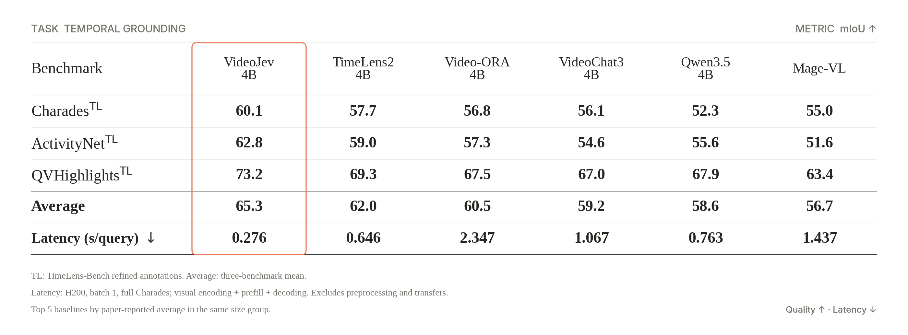
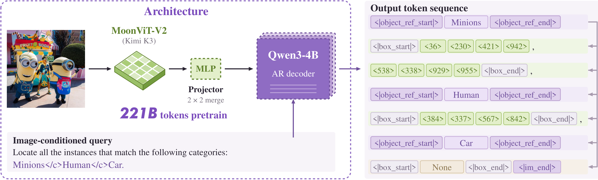

# 开源模型｜先看输入输出，再看开放条件

本栏沿用“开源模型”导航名称，六项中包含带限制的开放权重，**不等于六项都是宽松开源**。均已检查模型卡、文件清单与许可；没有在本机下载大权重或运行推理。

|任务|候选|主要门槛|
|---|---|---|
|视频区间与选项评分|VideoJev-4B|GPU 与视频推理扩展|
|多机器人动作/世界建模|GreenWAM|机器人环境、上游模型与 GPU|
|多说话人流式语音|Drama 3|大权重、推理服务与商业许可|
|CPU 文档识别|Indra OCR|ONNX/PDF 组件与权重使用条件|
|图像目标定位|GroundingPI|指定推理栈、上游条款|
|有限候选决策|pplx-decider v1.1|约 49 GiB 权重及额外运行内存|

## 01 · VideoJev-4B：直接给视频片段和答案选项打分

VideoJev 以 Qwen3.5-4B 为基础，把视频定位和选择题转换成候选评分。输入视频、问题以及候选区间或选项，输出区间分数或选项概率；它适合“在视频哪一段发生了某动作”这类任务，并非开放式长对话模型。权重仓库创建于 2026-10-10，论文在 2026-10-13 公开，属于本周的新实现与方法证据。

模型使用共享评分头，并利用缓存减少重复查询的视频计算。模型卡的三项时间定位测试平均 mIoU 为 65.3，同组对照 TimeLens2-4B 为 62.0。mIoU 比较预测时间段与真实时间段的重叠程度，不能解释为“65.3% 的视频问题全部答对”。

Zhu Yuhan 团队模型卡原表，Apache-2.0。先看三项任务，再看平均值；延迟条件为 H200、batch=1、完整 Charades，计入视觉编码与推理，排除预处理及传输，不能代表手机速度（[来源原图](https://huggingface.co/ZhuYuhan/VideoJev-4B)；[查看原尺寸](images/videojev.png)。）

文档环境包含 Python 3.12、PyTorch 2.8/CUDA 12.8、Transformers 5.14.1，以及视频解码和注意力扩展。定位分数使用 sigmoid，选择题使用 softmax；使用时应保持候选构造与训练任务一致。为什么现在值得看：视频检索可以减少不必要的文本生成，**新近实用、新近创新；验证程度：作者实验与模型卡，本站未推理；热度待验证**。

[模型卡与文件](https://huggingface.co/ZhuYuhan/VideoJev-4B)。

## 02 · GreenWAM：用共享动作槽连接多种机器人

GreenWAM 的新权重于 2026-10-14 出现，提供面向 RoboTwin、LIBERO、CALVIN、WorldArena 等环境的检查点。它把世界预测与动作输出放进共享框架，用 79 个解剖式动作槽描述不同机器人，目标是减少每换一种机体就完全重建动作表示的成本。输入观察、指令和状态，输出可供特定机器人任务使用的预测或动作；共享表示仍需要机型适配。

作者报告 RoboTwin 2.0 的 clean 与 randomized 成绩分别为 86.98、48.10，平均 67.54。这个差距比只列平均值更有信息：外观和环境扰动仍会显著影响行为。LIBERO 97.4 等结果属于另一套测试，不能和前者直接排名。

它以 Cosmos 系列为基础，还依赖对应视频自编码器、tokenizer 和机器人环境。运行门槛包括 GPU、场景数据以及控制接口，不能只下载一个文件就接到实体机器人。权重为 OpenMDW 1.1，代码及上游组件许可需分别核对。为什么现在值得看：多机型动作表示有公开实现可研究，**新近创新；作者模拟实验，本站未运行，热度待验证**。主要价值是检查泛化条件，尚不是跨设备即插即用承诺。

[模型卡与文件](https://huggingface.co/SberRoboticsCenter/GreenWAM)。

## 03 · Drama 3：流式多说话人语音，先核对新许可

Drama 3 权重仓库创建于 2026-10-01，本期作为近期补充；2026-10-13 的论文与许可文本提供了新的架构和使用边界。模型采用约 35B 总参数、3B 激活参数的混合专家结构，支持带说话人标签的长文本与分块流式输出。稀疏激活有助于控制每步计算，但总权重的存储和加载成本仍然存在。

作者用 H200、英文 SeedTTS、预编码参考音频测试：并发 1 时首段音频延迟中位数 88.9 ms，并发 64 时变为 450.9 ms，95 分位为 1020.1 ms。预编码参考音频意味着并未从用户上传文件的第一刻开始计时；不要把这些数字写成任意设备的端到端体验。部署说明基于 SGLang Omni，依赖相应推理栈。

需要特别看实际 LICENSE：2026-10-13 的 Fish Audio Community License 1.0 包含研究、非商业与商业条件；商业使用涉及年营收低于 50 万美元的门槛，提供托管服务仍需另行书面许可。模型卡元信息与完整许可有不一致时，应以具体许可文本为核查对象，本期不将它标成宽松开源。

为什么现在值得看：多说话人流式合成与并发延迟有具体材料可分析，**新近实用、新近创新；验证程度：官方模型卡与论文实验，本站未生成音频；热度待验证**。音色使用还需取得相应授权。

[模型卡与文件](https://huggingface.co/fishaudio/drama-3)。

## 04 · Indra OCR：面向 CPU 的轻量文档提取链

Indra OCR 于 2026-10-10 建立权重仓库，提供以 CPU 为目标的 OCR 与文档提取组件。输入图片或 PDF，输出文本、Markdown，或带框和阅读顺序的 JSON。PDF 若已有文字层，会先复用它，只对需要识别的区域运行 OCR；这让它更接近文档处理链，而非一个端到端大视觉语言模型。

宣传中的 1M 参数是主要识别模型，不是所有组件加起来都只有 1M。当前约 18 MB 的包包含多个 ONNX 模型。环境为 Python 3.10 以上、ONNX Runtime、OpenCV 和 PDF 渲染依赖，不要求 PyTorch。默认关闭数学识别；手写体、竖排文本和复杂合并单元格仍有明显边界。

官方 2937 页测试的 headline 分数为 62.1，对照 PPStructure V3 为 58.4，但其中纯文本子项反而是 41.3 对 55.6。因此它不是每个维度都更好。高核数机器的每秒页数还排除了加载和预热，不应套到普通笔记本。

代码 Apache-2.0，模型权重采用带附加条件的 OpenRAIL-M，免费范围涉及研究、个人用途和融资/营收门槛，并限制竞争性服务；不能把代码许可套到权重。为什么现在值得看：CPU 文档处理有了小体积的新选择，**新近实用；官方实验与文档，本站未运行，热度待验证**。

[模型卡与文件](https://huggingface.co/datalab-to/indra-ocr)。

## 05 · GroundingPI：把图像中的目标转成坐标 token

GroundingPI 原始权重日期为 2026-09-30，本期是近 30 天的近期补充；公开代码与项目页在 10 月初陆续完善。它结合 MoonViT-V2 视觉编码器、连接层和 Qwen3-4B 解码器，把图像与文本描述转换为点或框。输出坐标离散为 0—999 的 token，接入实际图片时仍需换算回像素。

GroundingPI 团队原始结构图。左侧是图像与文字共同输入，右侧同一类别可以输出多个框或 None；坐标不是鼠标动作。引用结构图说明方法，示例素材权利归相应权利人，原创代码/图示遵循仓库许可（[来源原图](https://huggingface.co/GroundingPI/GroundingPI)；[查看原尺寸](images/groundingpi.png)。）

对于 GUI 研究，它能提供“点击对象在哪里”的候选位置，但没有自动完成点击、确认结果或恢复失败。文档的服务路径涉及 Linux、Python 3.12、vLLM 0.18 系列及特定 Transformers 分支，列出的硬件覆盖服务器加速卡；不能假设任意本地安装都能直接工作。

原创部分声明 Apache-2.0，同时保留 Kimi K3 上游许可。模型榜单名次只是一次观察，缺少独立使用趋势，本期不据此认定热门。为什么现在值得看：位置输出与通用文本生成的边界很清楚，适合复查定位模型如何接入 Agent；**新近实用，官方文档与示例，本站未推理，热度待验证**。

[模型卡与文件](https://huggingface.co/GroundingPI/GroundingPI)。

## 06 · pplx-decider v1.1：更新的是决策评分头，不是聊天模型

v1.1 权重发布于 2026-10-05，本期标记近期补充。[10 月 2 日模型栏](../2026-10-02/02-开源模型.md)介绍过 v1；本次再次收录的理由是明确的新权重和评分提升，而非给同一系列换个名字。作者报告 Decision Index 从 56.4 提高到 61.56，这是其组合评测指标，不能视作所有分类任务统一提高了五个百分点。

模型以 Qwen3.8-27B 为基础，调整注意力可见性，并使用决策头给候选输出打分。输入上下文、问题和有限选项，返回候选决策；它不以逐 token 生成长回答为主要目标。公开文件包含约 49 GiB 级别的权重，Python 3.12 的示例还需为上下文和缓存留出额外空间。

图像场景尤其要注意预处理：训练使用的图像面积上限与部分默认处理配置不同，直接使用更大的默认分辨率可能构成分布外输入。权重许可为 Apache-2.0；仓库元数据为公开，但旧说明仍残留私有访问字样，本期没有下载全部大文件验证所有分片。

为什么现在值得看：检索排序、路由和有限选项判断可考虑专门的决策接口，**新近实用；作者评测与文档，本站未推理，热度待验证**。只有先固定候选集和评估任务，指标提升才有明确含义。

[模型卡与文件](https://huggingface.co/perplexity-ai/pplx-decider-v1.1-27b)。
