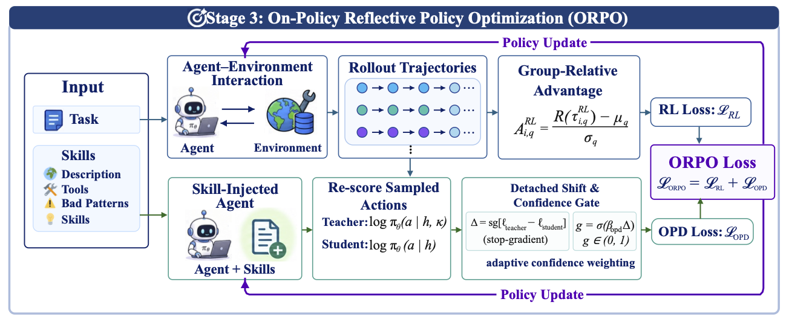
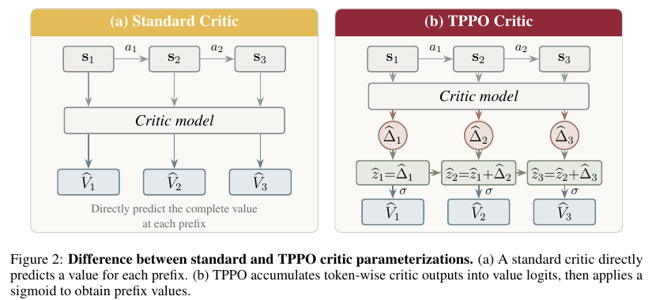
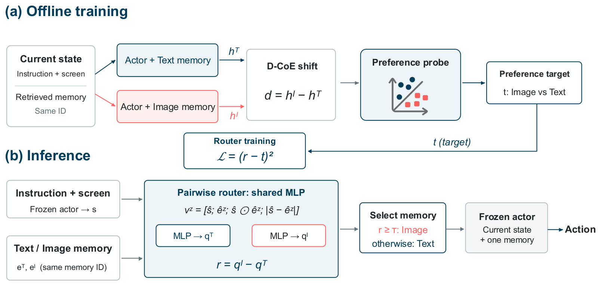

# 论文精选｜从方法改动追到实验条件

本期比较 14 篇候选后选出六篇：错误恢复、代理外围流程、价值学习、精确稀疏筛选、环境生成与记忆模态。六篇均按预印本处理，结果来自作者实验，本站没有进行重型训练或 GPU 复现。

## 01 · Agent-Reflex：教 Agent 从工具错误中恢复

原始日期：2026-10-13，v1 预印本。

工具返回格式不对、结果缺字段或环境状态改变时，只会沿着原计划继续的 Agent 很容易扩大错误。Agent-Reflex 把“先判断出了什么问题，再选择恢复技能”作为训练对象，建立 557 个 MCP 环境，采集工具返回与错误，并将可验证的扰动分成八类。

方法有三个环节：从错误中归纳反思技能，用监督数据练习修复、恢复和纠正，再通过带噪环境中的 on-policy 训练加强行为。文中的 ORPO 指 **On-Policy Reflective Policy Optimization**，不是另一个常见同名偏好优化算法。教师结合技能提示重新评价学生已经采取的动作，并按置信度调节学习信号。

RUC-NLPIR 团队仓库 Figure 3 原图，MIT。图展示第三阶段 ORPO，不能当作全部三个阶段；关注教师看到的技能信息与学生实际执行动作之间的区别（[来源原图](https://github.com/RUC-NLPIR/Agent-Reflex)；[查看原尺寸](images/reflex.webp)。）

作者以 Qwen3-8B 为基础，在 BFCL、ACEBench、ToolSandbox、τ² 和 Vita 等任务上评估。噪声条件下的平均成绩为 29.1，对照 NoisyAgent 为 25.9，未做相应训练的基座为 12.3；不同任务差异很大，例如 τ² 为 45.9，Vita 仅 12.3。消融在相同 100 步 RL 预算下比较，有助于辨别技能与优化环节的作用，但成绩仍来自作者实验。

为什么现在值得看：2026-10-13 的新预印本给出可检验的错误恢复训练路径，**新近实用、新近创新；已读方法、实验与消融，本站未训练，热度待验证**。人工噪声不能代表所有真实 API 故障；复现时应单独统计错误检测、恢复动作和最终任务完成率，不能只看平均分。

[论文原文](https://arxiv.org/abs/2610.17953) · [站内阅读卡](../../../../papers/frontiers/2610.17953/00-阅读卡.md)。

## 02 · Harness²：同时改进当前任务流程和下一次的经验

原始日期：2026-10-09，v1 预印本。

模型不变，工具说明、执行步骤和工作目录约定仍会影响任务表现。Harness² 把这些围绕模型的执行安排称为 harness，并设计两层循环：内层针对当前任务提出方案、探测效果、组合方案；外层从执行经历中更新可供后续任务使用的经验库。

内层的 Propose 阶段产生任务通用约束或领域做法，Probe 比较候选方案与当前基线，Compose 把有用部分组合起来。它并不能在测试时读取标准答案，因此判断也可能出错。外层不是重训执行模型，而是调整之后如何生成、测试和选择这些流程安排。

Google Research 等作者 Figure 3，CC BY 4.0。先看当前任务如何试验 harness，再看回到经验库的外层箭头；两个层次都可能增加计算与判断误差（[来源原图](https://arxiv.org/abs/2610.14224)；[查看原尺寸](images/harness2.png)。）

论文冻结 Gemini 3.5 Flash、GLM-5 等执行器，在 OpenCode 或 Codex 环境下比较，并用 Opus 4.8 作为编辑器，结果取三次运行。WorkplaceBench 中 GLM-5/OpenCode 从 64.2 提升到 75.7；Gemini/OpenCode 从 72.4 提升到 77.5。增加候选数还能改变结果，因此提升不能解释为“同样成本下只改一句提示”。JobBench 也有改善，但没有消除模型与任务差异。

为什么现在值得看：2026-10-09 的预印本让“代理外围流程值得优化”变成可比较的方法，**新近创新；作者实验，已核对执行器、编辑器与预算条件，本站未复现，热度待验证**。代价包括编辑器调用、候选试跑及经验维护；没有标准答案的自评也可能把偶然成功写进后续经验。

[论文原文](https://arxiv.org/abs/2610.14224) · [站内阅读卡](../../../../papers/frontiers/2610.14224/00-阅读卡.md)。

## 03 · TPPO：学习价值怎样变化，而不只逐点猜价值

原始日期：2026-10-12，v1 预印本。

推理任务常常只在最后给出对错奖励。PPO 的 critic 要根据一个未完成的前缀估计最终成功概率，再由价值差异分配学习信号。问题是：分别预测每个前缀的数值，可能把一个真正有帮助的推理步骤判断成负变化。

TPPO 改变 critic 的参数化方式：每个位置产生一个标量增量，在 log-odds 空间累加后经过 sigmoid，得到前缀价值。直觉上，它让相邻状态之间的更新成为模型直接学习的结构。论文给出二元终局奖励下的概率推导，但也明确，学到的增量不保证等于真实似然比。

作者 Figure 2，CC BY 4.0；从原 PDF 第 5 页忠实截取完整图与图注。关注右侧累加而非三个孤立分数；未修改公式、箭头或标签（[来源原图](https://arxiv.org/abs/2610.16794)；[查看原尺寸](images/tppo-method.png)。）

训练仍使用终局对错，critic 采用二元交叉熵，价值用于 GAE 和 PPO 更新。作者使用约三万条 Polaris 数据，训练最长 8192 token，数学评估可到 24k；比较必须同时看采样数。n=8 时，Qwen3-8B-Base 的域内平均从 PPO 的 37.5 到 TPPO 的 45.9，域外从 67.6 到 69.7。其他配置并非每一项都最优；只替换损失或只改累计结构的消融也不足以复制完整收益。

为什么现在值得看：2026-10-12 的新方法提供一个可替换的价值建模方式，**新近创新；已读推导、核心实验和消融，本站未训练，热度待验证**。论文另用约 590 万条 Monte Carlo 续写做诊断；“训练不增加额外 rollout”不能误读为整项研究没有诊断成本。

[论文原文](https://arxiv.org/abs/2610.16794) · [站内阅读卡](../../../../papers/frontiers/2610.16794/00-阅读卡.md)。

## 04 · DoSA：证明进不了 Top-K 的候选，可以少算

原始日期：2026-09-26，v1 预印本，近期补充。

稀疏注意力只访问少量 key，但为了找到这些 key，索引器可能仍要对每个候选计算完整分数。DoSA 的切入点是：排除一个候选不一定需要知道它的精确得分，只要能证明它的上界低于一个可靠阈值。

方法先从种子候选中获得真实 Top-K 阈值的下界；再用部分头的精确结果、正贡献的界和负贡献的保守处理，计算候选的分数上界。如果上界仍不足以过线，就可以排除。剩余候选才完成全部头的计算，并进入精确选择。这里的无损来自数学条件和数值处理，不能简单删除小权重头来冒充。

Meng 与 Fang，Figure 2，CC BY 4.0；从 PDF 第 3 页忠实截取完整图与原图注。按 ①—④ 读，灰色区域表示省去的计算；种子初始化和最终 Top-K 在原图中省略（[来源原图](https://arxiv.org/abs/2610.13990)；[查看原尺寸](images/dosa-method.png)。）

作者在 GLM-5.2 与 DeepSeek-V3.2 的长上下文中，对比 SGLang 0.5.18 和 LiteTopK。覆盖英文、中文与代码，索引器最大加速为相对 SGLang 的 2.74 倍；端到端首 token 时间最大改善为 1.94 倍。两者分母不同，不能把局部索引速度写成生成全过程吞吐。实验涉及 128k 到约 1M 上下文及多卡配置，解码阶段的改善也较小。

为什么现在值得看：这是精确候选筛选的可复用思路，**新近创新；已读证书条件、实现说明和实验，本站未运行，热度待验证**。arXiv 编号虽然是 2610，页面原始提交日期实际为 **2026-09-26**，本期明确列为近期补充。论文 CC BY 4.0，但关联代码仓库未见明确 LICENSE，不能把论文许可套到代码；低精度保守界与回退路径也是复现重点。

[论文原文](https://arxiv.org/abs/2610.13990) · [站内阅读卡](../../../../papers/frontiers/2610.13990/00-阅读卡.md)。

## 05 · Tev：先造可验证的世界，再生成长程任务

原始日期：2026-10-13，v1 预印本。

长程 Agent 训练不只缺题目，还缺能自动判断“做到哪一步”的环境。Tev 从潜在世界状态生成工作流，再渲染成文件或界面材料，通过可逆的破坏操作制造任务。系统保留隐藏的正确状态与验证器，代理只看到公开任务，因此可以比只在最后判对错更细地给出进度信号。

它用工作流依赖关系组织步骤，设计基于进度势函数的奖励 PPRS，并对渲染和恢复过程做一致性检查。这种做法的实用点是让任务生成、答案和中间进展来自同一个已知世界；限制也在这里：生成器覆盖不了的真实混乱，不会自动进入训练分布。

Tev 作者 Figure 3，CC BY 4.0。读图时分清代理可见的任务与隐藏的判分信息；原图下方留白保留，没有删改流程或标签（[来源原图](https://arxiv.org/abs/2610.18868)；[查看原尺寸](images/tev.png)。）

论文构建 1170 个环境、覆盖七类领域，训练 Qwen3.5-9B 和 Qwen3.8-27B 等模型。小模型使用的是 264 任务子集，不能与完整训练混为一谈。27B 模型在 ALE-CM 的 pass@5 从 0.17 到 0.28，对照 Claude Fable 5 为 0.33；这说明训练有收益，仍存在能力差距。部分 Terminal-Bench 子集仅 22 或 18 题，且筛选有特定条件，不宜泛化成全榜成绩。

为什么现在值得看：2026-10-13 的预印本给出环境与密集奖励共同设计的路线，**新近实用、新近创新；核心方法与实验已读，本站未训练，热度待验证**。训练涉及多节点高端 GPU、较长上下文和工具调用预算；验证器泄漏、合成任务的代表性与真实迁移，比单个平均分更需要检查。

[论文原文](https://arxiv.org/abs/2610.18868) · [站内阅读卡](../../../../papers/frontiers/2610.18868/00-阅读卡.md)。

## 06 · SwitchMem：同一条 GUI 记忆，该给文字还是截图

原始日期：2026-10-13，v1 预印本。

检索到了正确的历史经验，仍要决定以什么形式交给 GUI Agent。文字简洁，但可能丢失布局关系；截图保留位置，也可能带来过期界面干扰。SwitchMem 固定检索到的记忆身份，学习在文字和图像表示之间选择，避免把“检索哪一条”和“怎么表示”两个问题混在一起。

训练时对同一状态分别加入文字与图像记忆，观察冻结执行器内部表示的变化，训练偏好探针，再把偏好变成轻量路由器的学习目标。推理时路由器只选择一种表示，再让原执行器行动。它不是每个动作都同时跑两次大模型，所以训练与部署成本应分开核算。

作者方法原图，CC BY 4.0。上半部分是离线构造偏好，下半部分才是推理；同一 memory ID 的限制使比较更聚焦于表示形式（[来源原图](https://arxiv.org/abs/2610.17928)；[查看原尺寸](images/switchmem.png)。）

实验冻结 Qwen3.5-9B，以 Qwen3-VL embedding 检索 top-1 经验。AITW 的步骤指标从仅图像 49.300、仅文字 48.760 提高到 51.420；LearnGUI 结果为 38.131；MobileMiniWoB 的任务成功率为 63.043。前两项的动作/步骤分数不是整条任务成功率，不能混成一个百分比排名。作者还做了匹配选择比例的随机路由对照与迁移测试。

为什么现在值得看：2026-10-13 的新预印本把记忆格式选择变成可学习模块，**新近创新；方法、基线、指标定义与消融已读，本站未复现，热度待验证**。需要访问隐藏状态，未必能直接套在封闭 API；Android 及模拟任务结果也不等于实体手机、所有新系统或 iOS 都已验证。

[论文原文](https://arxiv.org/abs/2610.17928) · [站内阅读卡](../../../../papers/frontiers/2610.17928/00-阅读卡.md)。
