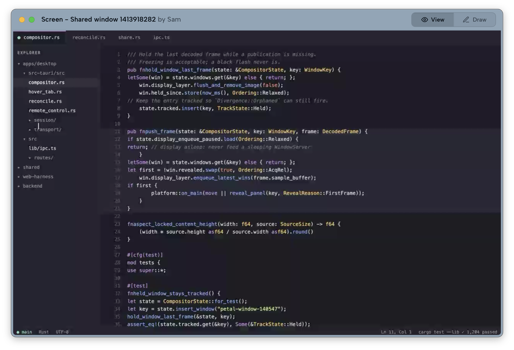
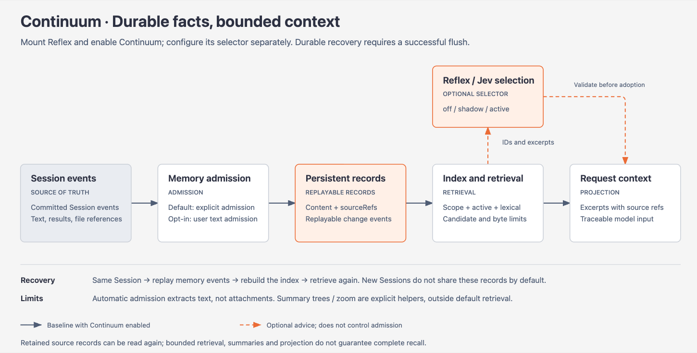
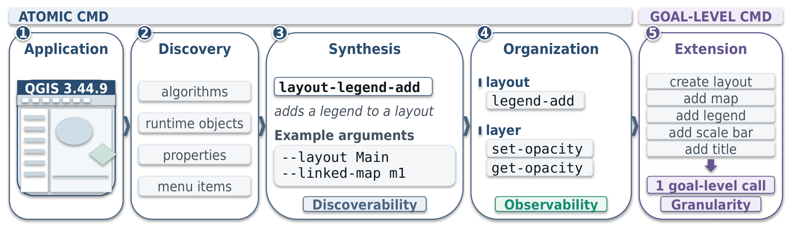

# 开源项目｜先从手头任务选择

这些条目因近期发布或实质进展入选，未用总 Star 代替热度证据。已检查规范仓库、许可、版本和上手材料，**本期没有安装或运行这十个完整项目**；截图和成绩均说明作者来源。

|任务|项目|本次新增事实日期|
|---|---|---|
|代码库定位|Graphicle|2026-10-14|
|远程结对与多窗口协作|Petal|2026-10-13|
|代码补丁规模分析|Parsimony|2026-10-11|
|桌面任务状态与记忆|APUS Reflex Agent|2026-10-14|
|视频超分辨率|FlashVSR+|2026-10-14|
|安全编码评测|LSC-Bench|2026-10-10|
|为桌面工具生成语义命令|ANIS|2026-10-11|
|三维城市中的视觉定位|Urbex|2026-10-13|
|本地资料阅读与笔记|Opensidian|2026-10-09|
|自蒸馏训练对照|VRSD|2026-10-12|

## 01 · Graphicle：先在本地构建代码与文档索引

Graphicle 在 2026-10-14 发布 v0.1.0，面向“这段逻辑在哪里、哪些文件相关”的代码检索任务。它把代码关系、文档和会话存入本地索引；`context` 返回带文件与行号的上下文，不依赖模型 API，`ask` 才按配置调用 OpenAI、Anthropic 或本地 Ollama。

macOS/Linux 可从官方 Homebrew tap 开始。`setup` 会配置项目说明、钩子和会话采集，文档提供备份及撤销路径，先在测试仓库体验更容易看清实际改动。作者有一次大仓库索引对照，但尚不能推广为所有语言和磁盘环境的固定倍数。为什么现在值得看：新 CLI 把检索证据落到行号；**新近实用，已读实现说明与官方基准，本站未安装，热度待验证**。

[规范仓库](https://github.com/Graphicle-AI/graphicle) · 核心许可：[Apache-2.0](https://github.com/Graphicle-AI/graphicle/blob/main/LICENSE)。

## 02 · Petal：把远程共享内容变成独立窗口

Petal 原始仓库创建于 2026-08-27；本次依据 2026-10-13 的原生窗口合成进展和 10 月 14 日 Show HN 讨论入选。它让每个共享窗口成为接收端可独立摆放的窗口，适合一边看对方代码、一边在本地查资料。远程控制需要对方同意；AI 助手是可选功能，涉及共享窗口内容与模型服务。

Kiruna Labs 官方 README 窗口原图，Apache-2.0。重点看远程内容具有独立标题栏和控件；画面内代码与测试文字属于作者截图，非本站运行结果（[来源原图](https://github.com/kiruna-labs/petal)；[查看原尺寸](images/petal.webp)。）

macOS 13 以上可试官方应用；Windows 仍属早期且安装包未签名。源码构建的 macOS SDK 要求高于运行系统要求，还涉及 Node、Rust 和 LiveKit。为什么现在值得看：窗口合成改变实际结对操作；**新近实用，官方界面及文档，本站未运行，热度待验证**。Show HN 的单次讨论不能替代独立使用验证。

[规范仓库](https://github.com/kiruna-labs/petal) · 核心许可：[Apache-2.0](https://github.com/kiruna-labs/petal/blob/main/LICENSE)。

## 03 · Parsimony：比较补丁增量时，先对齐解决的任务

Parsimony 原始仓库日期为 2026-09-21；10 月 11 日发布的 DeepSWE Go 队列修正了语法处理并重建完整比较集合。它读取已有代理补丁，按 AST 单位统计新增、删除和净变化，输出规模比较，适合检查两个同样通过任务的方案是否引入了不同复杂度。

它并不重新证明补丁正确：任务成功标签来自原基准。相对指标还要求同一道题有足够其他模型成功，不能把不同题目的简单平均直接排名。基础脚本需 Python 3.12；JS/TS 和 Go 分析分别还有 Node 或解析器编译依赖。为什么现在值得看：带版本的多语言分析使“代码更少”有了可审查的分母；**新近实用，源码及作者结果已核对，本站未跑完整队列，热度待验证**。小补丁也可能只是遗漏必要逻辑。

[规范仓库](https://github.com/La5u/Parsimony) · 核心许可：[MIT](https://github.com/La5u/Parsimony/blob/main/LICENSE)。

## 04 · APUS Reflex Agent：给长期任务保留状态与记忆入口

仓库创建于 2026-10-09，近期开发者预览及 10 月 14 日的记忆索引整合是本次新增事实。它提供桌面 Agent、长期目标与记忆路径，尝试把会话中产生的信息变成后续可检索资料，适合研究“任务中断后如何继续”的产品流程。

APUS AI Lab 官方记忆流程图的忠实渲染，MIT。顺着上方主链阅读：保存记录不等于全量进入上下文；检索仍有候选数和字节上限。持久恢复需要 flush，同一会话恢复与新会话默认隔离也有区别（[来源原图](https://raw.githubusercontent.com/APUS-AI-Lab/APUS-Reflex-Agent/main/docs/dev-continuum-reflex-integration/apus-continuum-memory-flow.en.svg)；[查看原尺寸](images/apus-memory.png)。）

[原始 SVG](images/apus-memory.svg)。

上手需要选择完整或 Lite 路径、配置模型服务，并满足对应客户端系统要求。macOS 预览要求 15 以上，包采用临时签名，未称已完成 Apple 公证。仓库当前公开，但 README 仍有私有安装入口措辞，不能据此保证所有安装包都可匿名获取。为什么现在值得看：状态、会话与记忆开始落在公开实现中；**新近实用，文档与提交核验，本站未安装，热度待验证**。示例场景不等于端到端实测，外部记忆也不是无限上下文。

[规范仓库](https://github.com/APUS-AI-Lab/APUS-Reflex-Agent) · 核心许可：[MIT](https://github.com/APUS-AI-Lab/APUS-Reflex-Agent/blob/main/LICENSE)。

## 05 · FlashVSR+：为显存有限的视频超分提供新实现

FlashVSR+ 论文于 2026-10-13 公开，代码在次日发布。输入低分辨率视频，输出放大后的帧序列；混合局部/全局注意力与一步生成是核心取舍，适合做视频修复或超分研究的对照实现。作者展示了细节质量与速度，但生成式放大可能补出并不存在的细节。

官方路径为 Linux、Python 3.10 和 CUDA，需要下载模型及 TCDecoder 等组件，24 GB RTX 4090 的 4K 条件属于作者配置。画面尺寸应满足 128 的整除要求；消费级卡可按文档选择 Triton，分段解码选项也不代表输入视频始终逐帧流式读取。为什么现在值得看：新实现给出有限显存的可执行路线；**新近实用、新近创新，作者实验与代码说明，本站未运行，热度待验证**。代码与各模型权重许可分开核对。

[规范仓库](https://github.com/OpenImagingLab/FlashVSR_Plus) · 核心许可：[Apache-2.0](https://github.com/OpenImagingLab/FlashVSR_Plus/blob/main/LICENSE)。

## 06 · LSC-Bench：同时检查功能通过与安全通过

项目仓库创建于 2026-09-19，10 月 10 日的新论文与基准材料将它带入本期。LSC-Bench 将 150 个场景组织为 450 个任务，覆盖七种语言和多种任务粒度，分别检验功能和安全。作者结果中，功能通过比例明显高于两者同时通过，适合研究代码 Agent 是否为了完成需求留下安全缺口。

最小路径应先在隔离环境跑一个 oracle 任务，确认判分链工作，再接模型。依赖 Python 3.12、Harbor 和 Docker；完整镜像约 58 GB，部分工具测试需要容器网络能力。核心许可是 Apache-2.0，任务中的上游工程仍有各自许可。为什么现在值得看：有公开实现把两个验收维度分开；**新近实用，论文及运行配置核验，本站未执行测试载荷，热度待验证**。基准分数不等于生产系统已通过安全审计。

[规范仓库](https://github.com/alibaba/last-secure-code-benchmark) · 核心许可：[Apache-2.0](https://github.com/alibaba/last-secure-code-benchmark/blob/main/LICENSE)。

## 07 · ANIS：从桌面软件 SDK 合成 Agent 可调用的命令

ANIS 仓库于 2026-10-10 建立，次日论文公开。它从已安装应用的 SDK 和运行对象发现能力，筛选语义相关操作，合成并验证命令，再生成文档与技能入口；后续还可把多步操作组合成目标级命令。输入是应用和任务需求，输出是可调用的命令接口，适合已有 SDK、但缺 Agent 友好入口的软件。

Co-evolve Lab 官方 overview 原图，MIT。左侧是发现现有能力，中间是验证后的原子命令，右侧才是多步组合；并非直接从截图猜测任意应用功能（[来源原图](https://github.com/co-evolve-lab/ANIS)；[查看原尺寸](images/anis.png)。）

Linux 路径需 Python 3.10 以上、目标应用及编码代理；合成阶段会接触应用和文件，应在可回滚的环境中检查。作者八类应用平均结果有改善，但 FreeCAD 等单项未胜过 SDK 基线。为什么现在值得看：公开方法尝试降低接口整理成本；**新近实用、新近创新，作者实验，本站未执行合成，热度待验证**。

[规范仓库](https://github.com/co-evolve-lab/ANIS) · 核心许可：[MIT](https://github.com/co-evolve-lab/ANIS/blob/main/LICENSE)。

## 08 · Urbex：让代理主动换视角搜索三维城市

Urbex 仓库创建于 2026-10-02，新论文于 10 月 13 日公开。代理围绕文字目标主动选择鸟瞰、缩放和斜视角，在城市三维场景中继续搜索，最后输出定位结果。它不把所有目标预先切成实例供检索，适合研究主动观察怎样减少大场景中的搜索成本。

作者给出 Colab 单查询入口，完整训练则依赖 Python 3.11、CUDA 12.8、Megatron 和注意力扩展，默认多卡配置不能当作普通笔记本要求。SensatUrban 等原始点云需遵循各自数据获取和使用条件，仓库没有统一重新分发全部上游材料。为什么现在值得看：新公开实现连接视角选择与空间定位；**新近创新，论文、代码和示例核验，本站未推理，热度待验证**。只对已加载场景工作，不是实时地图服务。

[规范仓库](https://github.com/AMAP-ML/Urbex) · 核心许可：[Apache-2.0](https://github.com/AMAP-ML/Urbex/blob/main/LICENSE)。

## 09 · Opensidian：本地 Markdown 库新增 PDF 嵌入等能力

Opensidian 原始项目创建于 2026-08-29；本次选择的是 10 月 9 日 v0.6.1 的 PDF 嵌入、图谱控制与实时预览进展，10 月 12 日 v0.6.2 又补充工作区保存等改进。它读取本地 Markdown vault，适合将论文 PDF 与研究笔记放在同一工作区，但兼容 vault 不代表兼容全部 Obsidian 插件。

现成发行包面向 Linux x86，源码采用 Rust/Tauri，需相应 WebKitGTK 环境；未确认同等成熟的 Mac 发行包。拖入图片会移动原文件，PDF 则复制，试用时宜使用资料副本。为什么现在值得看：近期版本补上了真实阅读工作流；**新近实用，版本记录与说明核验，本站未安装，热度待验证**。程序为 GPL-3.0-or-later，主题等素材可能有独立条款。

[规范仓库](https://github.com/jpzk/opensidian) · 核心许可：[GPL-3.0-or-later](https://github.com/jpzk/opensidian/blob/main/LICENSE)。

## 10 · VRSD：约束能看到参考答案的蒸馏教师

VRSD 仓库创建于 2026-09-25，10 月 12 日论文公开了新的自蒸馏方法。教师可以看到额外参考信息，学生只能看到原问题；方法通过教师侧系统提示抑制直接利用特权答案的捷径，再把分布用于学生训练。它是训练实现，不是给任何线上模型加一句提示就自动获得提升。

公开脚本基于 verl/SDPO，环境涉及 Python 3.12、PyTorch 2.7.1、CUDA 12.6、vLLM 0.10 和 Ray。作者说明的显存、检查点存储达到多卡和数十 GB 级别；部分数据集还需按平台条件获取。为什么现在值得看：给“教师更强却不一定教得更好”提供了具体干预；**新近创新，作者 3 模型×4 任务实验与实现核验，本站未训练，热度待验证**。11/12 项改善也意味着存在未提升配置，不能承诺普遍有效。

[规范仓库](https://github.com/lijiazheng99/VRSD) · 核心许可：[Apache-2.0](https://github.com/lijiazheng99/VRSD/blob/main/LICENSE)。
