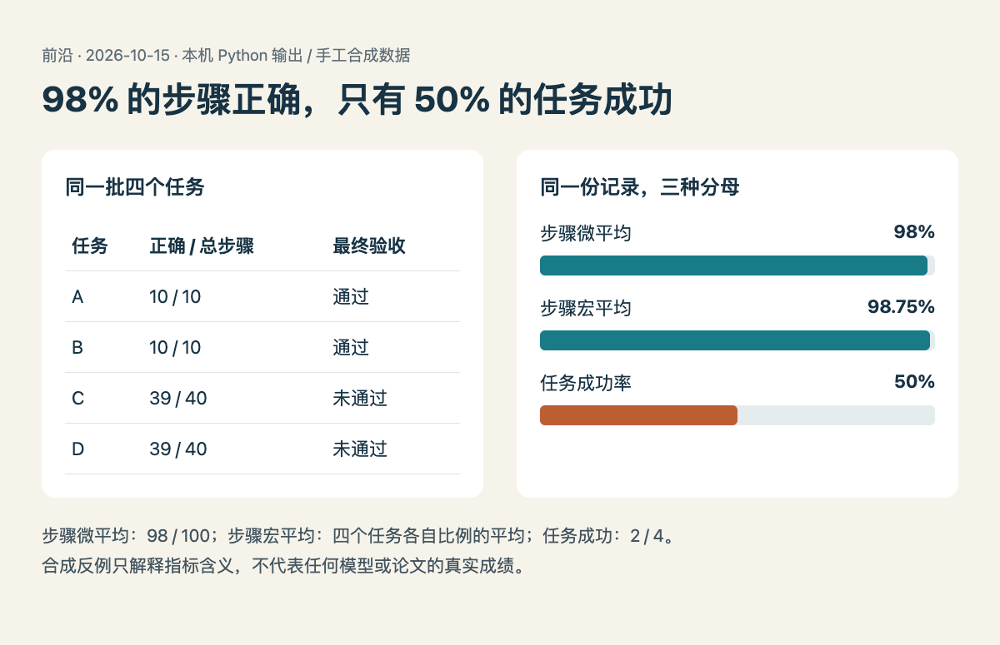

# 技术实践｜给每个百分比写上分母

状态：**已在本机 Python 3.14.3 运行，使用四条手工合成记录，没有调用模型，也没有复现本期任何论文的成绩。** 代码只使用标准库，输出 JSON，随后由 HTML/JS 渲染图表。

## 一个容易混淆的场景

假设有四条工作流，前两条各 10 步，全部正确且通过最终验收；后两条各 40 步，其中 39 步正确，却都因为剩下的一步没有完成任务。这是为解释指标而设计的反例，真实评测中应由独立验收器提供 `task_success`，不要从步骤准确率推断。

把全部步骤合在一起，正确数是 98，总数是 100，所以步骤微平均为 98%。先算每个任务自己的比例再平均，得到 98.75%。但最终只有两个任务通过，任务成功率为 50%。三个数字都算对了，回答的问题却不同。



读图：左侧保留每条原始记录，右侧展示同一数据的不同汇总。橙色条的分母是任务，蓝色条的分母是步骤或逐任务比例。制作方式为 HTML/JS，数据来自本机脚本输出；无生成式模型参与。[原尺寸](images/metric-results.png) · [数据](code/metric-results.json) · [可复现图表源文件](code/metric-results.html)。

## 最小实现与复跑

在仓库根目录运行：

```sh
python3 content/frontiers/2026/10/2026-10-15/code/metric_denominators.py
```

核心计算为：

```python
correct = sum(r["correct_steps"] for r in rows)
steps = sum(r["total_steps"] for r in rows)
micro = correct / steps
macro = mean(r["correct_steps"] / r["total_steps"] for r in rows)
success = sum(r["task_success"] for r in rows) / len(rows)
```

[完整脚本](code/metric_denominators.py)还检查重复任务 id、零分母、越界计数和成功字段类型。本机已确认三个解析值，并实际触发一次零分母输入，得到预期拒绝；结果保存在 JSON 的 `checks` 中。数据编码和均值函数参照 [Python json 文档](https://docs.python.org/3/library/json.html)与 [statistics 文档](https://docs.python.org/3/library/statistics.html)。

## 用到真实评测时还缺什么

微平均会让较长任务贡献更多步骤；宏平均给每个任务相同权重，但仍不代表完成率。若步数取决于模型自己选择的操作，分母甚至会随策略变化，因此不能仅凭少走几步就认定更可靠。

这个小实验没有处理重试、超时、缺失运行或置信区间。真实比较应保存任务集合、运行种子、预算、失败与缺失原因，再明确统计单位。至少让每张表中的百分比都能回答：数的是什么，除以多少，哪些记录没有进入分母。
