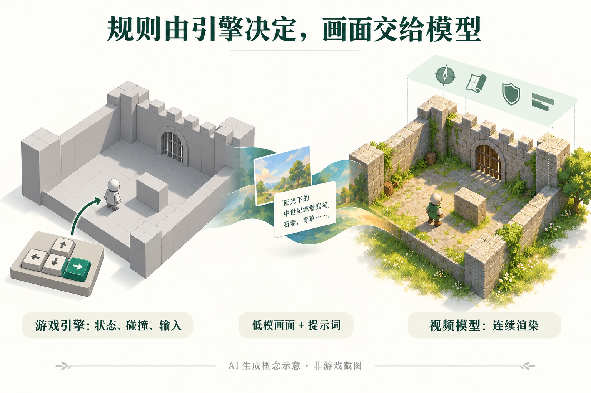

# AI 动态

本期 **5 条重点详解 + 10 条速读**。主要事件原日期为 2026-10-13 至 2026-10-15；较早事件标注近期补充。权重、代码、数据和托管服务的开放范围分别核对。

## 01 · Meta 开放 Muse Spark Open：大模型权重也需要算完整部署账

日期：2026-10-15（来源标注日期；不补猜时刻）。

Meta 发布 Muse Spark Open，提供 816B 总参数、每 token 激活约 42B 参数的原生多模态模型，支持 1M token 上下文。此次新增的是可获取的权重及推理生态，而不只是在线聊天入口。对于希望控制数据、修改推理流程或研究长程 Agent 的团队，这让模型本身成为可检查、可部署的对象；“开放权重”仍应与采用宽松开源许可证区别开来。

混合专家模型每次只调用部分参数，能减少单步计算，却不意味着只需把那部分参数放进内存。完整权重、量化格式、上下文缓存、并发和通信都会影响机器需求。Meta 展示的本地配置是两台各配 512GB 内存的 M5 Ultra Mac Studio，不能据此说普通笔记本就能运行完整模型。1M 上下文上限也不等于所有硬件配置都能经济地跑满。

官方演示包括制作 iOS 应用，以及操纵 DaVinci Resolve 完成视频编辑。这些例子说明模型被放进了实际工具链，但仍是厂商演示，本站没有复现；工具权限、错误恢复和最终成品都需要另行评估。公告还给出内核优化与端到端性能数据，两者测试范围不同，本期不将内核最大加速比当成全部工作流收益。

开发者可关注 SGLang、vLLM、TensorRT-LLM、Transformers、MLX、llama.cpp 等适配入口，以及合作推理服务的上线范围。权重使用 Muse Model License；本次直接读取 Hugging Face 模型卡和许可文件遇到访问限制，因此不对全部商业条款作延伸承诺，实际下载前应在官方入口查看对应许可。

为什么现在值得看：这是新近开放的超大规模多模态部署选择，适合有多机资源、需要自管推理的研究团队。**新近实用；依据官方公告与演示，本站未部署，热度待验证。** 社区讨论已有关注，但缺少连续增长和独立使用证据，不据总讨论数断言已经广泛落地。

[官方来源](https://research.meta.ai/blog/muse-spark-open)。

## 02 · FLUX 3 Image Klein：多参考图编辑与位置控制进入同一模型

日期：2026-10-15（来源标注日期；不补猜时刻）。

与 [10 月 3 日的 FLUX 3 Image 在线模型](../2026-10-03/01-AI动态.md) 相比，这次新增可自行部署的 Klein 权重。Black Forest Labs 发布 FLUX 3 Image Klein，把文生图、最多十张参考图的编辑和边界框布局控制放在一个 5.6B 生成模型中，输出最高支持 4K。这里的 5.6B 指生成器，不包含整套文本编码、提示词扩写与图像编解码组件；判断能否本地运行，不能只把参数量乘以两个字节。

对创作者而言，有用的变化是可以把“用哪些素材”和“物体放在哪里”分别表达。例如保留房间结构，把一把椅子放进指定矩形区域，或让第二张参考图中的主体进入第一张图的场景。官方仓库提供输入、指令与输出对照，下面保留原图，便于检查背景保持和局部修改，而不是只看一张漂亮成品。

Black Forest Labs 仓库编辑示例原图，仓库文档采用 Apache 2.0；模型权重另受 FLUX Kommunity License 约束。先看上下对应区域，再看最右侧两张参考图如何合成；这是官方示例，非本站运行（[来源原图](https://github.com/black-forest-labs/flux-3-image-klein#editing-examples)；[查看原尺寸](images/flux-editing.jpg)。）

版本选择有明确分工：蒸馏版采用 16 步、无需 CFG，偏重生成和编辑时延；Base 采用 50 步、CFG 3.5，面向微调与研究。官方仓库特别要求使用配套 prompt upsampler，因为训练时使用了它生成的描述，直接跳过可能降低效果。Python 3.12、匹配的 PyTorch/CUDA、权重与辅助模型，都是上手成本的一部分。

官方称 INT8 路径可适配部分 8GB 显卡，但 BF16/FP8 权重大小并不代表运行峰值显存。不同 GPU 的生成时间也对应不同步数和本地流程，不能与 API 响应时间混算。API 公告中的 0.009 美元是每张 1K 图像的起价，不是“一千张图片”的价格。

为什么现在值得看：**新近实用；已核对官方公告、推理仓库和成对示例，本站未推理，热度待验证。** 代码为 Apache 2.0，权重采用 FLUX Kommunity License；官方说明年收入低于 500 万美元的主体可按该许可商用，其他主体需要商业许可。下载端直接读取许可受限，具体适用范围仍应以可接受的正式条款为准。

[官方来源](https://bfl.ai/blog/flux-3-image-klein)。

## 03 · Nemotron 3.5 Super VL 与 Bolt：文档理解和桌面推理各走一条路

日期：2026-10-15（来源标注日期；不补猜时刻）。

NVIDIA 同时扩展 Nemotron 家族：Super VL 面向复杂文档、多模态 Agent 和数据中心推理，Bolt 面向桌面环境。本期把它们作为一次家族发布介绍，避免把同一公告拆成多条。核心选择不是简单比较参数大小，而是先确定任务究竟需要图表理解、长流程工具调用，还是有限内存中的本地响应。

Super VL 的 120B 模型提供开放权重，公告同时介绍训练数据和配方。它关注的输入包括扫描文档、表格、图表及交错图文：例如把报告中的表格和相邻说明一起读懂，再交给检索或分析流程。开发者仍需处理页面预处理、输出格式、引用定位和错误检查；模型能读图不等于整套企业文档系统已经搭好。

Bolt 则采用原生低比特路线，74B-A9B 的 24GB 版本已提供，强调把模型放进桌面资源约束。原生 2-bit 设计不应被理解为“任意模型随便压成两位都一样好”。运行还涉及上下文缓存、服务进程与并发，因此 24GB 这一版本名不等于所有任务的总显存上限，也不保证任意 24GB 显卡都有相同性能。

公告列出 llama.cpp、Ollama、LM Studio、Unsloth、vLLM 等生态入口。更小的 E4B 4GB 版本计划于 10 月 23 日提供，当前不能写成已经可下载。相关 RTX Spark 活动的开始时间是 10 月 16 日，活动预告、模型权重和设备供货状态也需要分开判断。

为什么现在值得看：**新近实用；依据官方发布说明及其测试，本站未部署，热度待验证。** Super VL 与 Bolt 让团队可以分别评估文档任务能力和本地资源预算。官方展示的吞吐、并发和延迟改善依赖各自服务栈与测量条件，本期不把其中的最大倍数当成跨模型、跨硬件的普遍优势。复现时优先记录输入页数、上下文长度、精度、批量及端到端时延。

[官方来源](https://blogs.nvidia.com/blog/nemotron-3-5-super-vl/)。

## 04 · Matrix-Game 4.0：游戏引擎管规则，视频模型管画面

日期：2026-10-15（来源标注日期；不补猜时刻）。

Matrix-Game 4.0 开放场景化视频渲染器、游戏代码和配套资源，并新增 RTX 5090 优化推理路径。它没有把碰撞、玩家位置和规则都交给视频模型猜测：可执行游戏先推进世界状态，输出低多边形画面，因果视频模型再将它连续重绘；HUD 与声音作为单独的展示层与帧对齐。

这种分工有一个直接价值：玩家离开画面后，物体状态仍由引擎保存，而不是只寄存在生成的视频里。官方项目页还展示由 Coding Agent 修改规则、根据引擎状态写动态提示词的设想与示例；当前可运行仓库以具体场景、固定或动态提示配置为准，不能把项目页所有能力当成一键可用的通用游戏开发平台。

AI 生成概念示意，依据官方代码与模型卡；两幅场景只解释状态和外观的分工，不是实际游戏截图，不表示完整网络结构或画质保证（[机制依据](https://github.com/SkyworkAI/Matrix-Game/tree/main/Matrix-Game-4)；[查看原尺寸](images/matrix-concept.webp)。）

目前发布 Medieval Castle、Ancient Egypt 和 City Racing 三类场景，单场景 checkpoint 约 5B 参数；共享编码器与资源单独下载，并可按 manifest 校验大小和 SHA256。模型不是直接装入通用 Diffusers 就能运行的管线，训练代码与数据也没有随此版本提供。代码采用 Apache 2.0，游戏素材和上游组件保留各自许可。

推理需要 Linux、NVIDIA GPU 和 Python 3.12；浏览器演示还依赖原生游戏、GStreamer 与 MediaMTX。5090 预设已有，5080/5070 版本仍属下周计划。官方 A100 80GB、864×480、单步配置给出约 38–39 FPS 的特定测量；命令里的 `--fps 40` 是采集节奏，不是浏览器显示帧率或按键到画面的延迟承诺。

为什么现在值得看：**新近实用、新近创新；已读官方实现说明、模型卡和示例，本站未运行，热度待验证。** 它提供一个研究可执行状态与神经渲染如何配合的起点。目前服务只支持单用户、单场景模型进程，尚不能据此推断多人云游戏的可扩展性。

[官方来源](https://github.com/SkyworkAI/Matrix-Game/tree/main/Matrix-Game-4)。

## 05 · Ling-3.1-flash 开放权重：混合注意力与部署配方一同落地

日期：2026-10-14（来源标注日期；不补猜时刻）。

近期补充。Ling-3.1-flash 的官方权重在 10 月 14 日上传，本期关注的是本地部署入口，与 [10 月 3 日的 API 上线](../2026-10-03/01-AI动态.md) 是不同新增事实。它采用 560B 总参数、每 token 激活 25B 参数的混合线性 MoE 架构，支持 1M token 上下文，模型卡标注 MIT 许可。

模型包含 63 个 KDA 层与 9 个 Gated MLA 层。可以先用一个直觉理解：有的层把历史信息持续汇入紧凑状态，有的层保留对更完整上下文的注意力访问；两类机制承担不同的信息处理角色。这个组合试图兼顾长序列的计算成本与检索能力，不能仅凭层数比例推出具体提速或准确率。

AI 生成概念示意，依据 Ling 模型卡。并排画法用于比较两类记忆方式，不是实际网络连接图；模型实际层数与交替关系以模型卡为准，也不表示原始输入被删除（[机制依据](https://huggingface.co/inclusionAI/Ling-3.1-flash)；[查看原尺寸](images/ling-concept.webp)。）

对开发者更具体的变化是配套 SGLang day-0 镜像及推理参数。官方示例使用 8 张 H200、TP8 与 EP8，或 4 张 GB300；同时提供 MTP 推测解码和 Hopper 优化说明。总参数仍然影响权重存储与跨卡通信，不能因为每次激活 25B 就按普通 25B 模型准备单卡环境。

模型卡报告办公、搜索、软件工程和其他专业任务的改善，并介绍基于 Pi 扩展的 LingCode。后者用于长时间、数百轮工具交互及上下文压缩，但作者只表示考虑将来开源；当前公开权重不等于 LingCode 已经开放。模型卡内的部分评测图使用内部图片地址，本次无法读取，因而不转述图中具体排名或分数。

为什么现在值得看：**新近实用；已核对权重提交记录、架构表和官方部署说明，本站未部署，热度待验证。** 有大规模算力的团队可以测试自管推理与工具调用；资源有限的读者则适合先研究混合注意力和服务栈配方。更长的上下文上限不替代任务级验证，还需要检查长文本中的证据定位、工具失败恢复和实际成本。

[官方来源](https://huggingface.co/inclusionAI/Ling-3.1-flash)。

## 06 · OpenAI Rosalind 学术计划向符合条件的美国实验室开放

日期：2026-10-15（来源标注日期；不补猜时刻）。

官方 RSS 标记 10 月 15 日 19:00 UTC，即北京时间 10 月 16 日 03:00。符合条件的美国大学研究实验室可申请最多 30 个 ChatGPT Business Standard 席位，最长 12 个月、费用为零，需通过可信访问审核；API 使用不包含在内。没有机构 Enterprise 安排的实验室由负责人申请，已有安排的按机构渠道办理。**新近实用；官方计划说明，本站未申请，热度待验证。** 现在值得看的是研究工具的可用范围发生变化，而非所有学校、地区或科研 API 都变成免费。官方实验室案例属于使用介绍，不是独立对照实验。

[官方来源](https://openai.com/index/introducing-the-rosalind-academic-plan/)。

## 07 · Anthropic 扩大独立评估者的内部访问范围

日期：2026-10-15（来源标注日期；不补猜时刻）。

Anthropic 为六名 METR 员工提供硬件、办公与接近内部评估团队的访问条件，范围不含客户数据、法律特权材料和模型架构。METR 可发布风险评估，Anthropic 无权否决；仍有预先界定的有限删节机制。**新近实用；官方制度说明，热度待验证。** 研究者值得关注的是评估者能看到什么、能公布什么；更深入的访问不自动证明模型安全，最终仍要看独立报告与限制说明。

[官方来源](https://www.anthropic.com/news/an-update-on-independent-evaluators)。

## 08 · GitHub AI Scan 进入 PR 正式可用阶段

日期：2026-10-15（来源标注日期；不补猜时刻）。

AI Scan 为 PHP、Bash、HCL、Dockerfile 等 CodeQL 未覆盖的语言或文件补充 AI 扫描。相比 [9 月 17 日取消 CodeQL 配置依赖](../../09/2026-09-17/01-AI动态.md)，本次变化是进入正式可用阶段。启用后可在 PR 中给出带 AI 标记的告警，但这些告警属于建议，不能阻止合并；fork PR 和 Dependabot PR 暂不支持。**新近实用；官方发布说明，本站未运行，热度待验证。** 公共仓库与私有仓库的资格不同，后者需要 Code Security 或 Advanced Security；不要求 Copilot 许可，但会涉及 AI credits，适合先在有人工审阅的流程中试用。

[官方来源](https://github.blog/changelog/2026-10-15-ai-scan-for-pull-requests-generally-available)。

## 09 · GitHub Agentic Autofix 正式开放：修复后再跑 CodeQL

日期：2026-10-15（来源标注日期；不补猜时刻）。

Agentic Autofix 可把默认分支的代码扫描告警交给 Copilot，检查相关文件、修改并重新运行 CodeQL，最后生成待审阅的草稿 PR；最多可把 25 条告警合并处理。它与 PR 上的 AI Scan 是不同入口；[9 月 26 日](../../09/2026-09-26/01-AI动态.md) 介绍的是 Memory 接入，本次为正式可用。**新近实用；官方工作流说明，本站未运行，热度待验证。** 当前需满足 Enterprise Cloud、安全产品、组织开关及计费配置等条件，消耗 AI credits 和 Actions 分钟；自动给出补丁不免除功能回归与安全审阅。

[官方来源](https://github.blog/changelog/2026-10-15-agentic-autofix-for-code-scanning-alerts-general-availability)。

## 10 · Copilot 预告 11 月 16 日淘汰部分旧模型

日期：2026-10-15（来源标注日期；不补猜时刻）。

GitHub 计划于 11 月 16 日淘汰部分 Copilot 模型：Claude Opus 4.8/5 的迁移方向为 Opus 5.5，GPT-5.6 Terra 的推荐替代包括 GPT-6.1 Sol 与 GPT-6 Luna；个人年度订阅有针对 Opus 4.8 的例外。**新近实用；官方预告，热度待验证。** 目前不是已经下线。团队应趁窗口期检查模型策略、固定模型名与提示词回归，尤其是自动化任务，不要等默认模型变化后才发现输出和成本不同。

[官方来源](https://github.blog/changelog/2026-10-15-upcoming-deprecation-of-selected-github-copilot-models-in-mid-november)。

## 11 · Adobe 与 NVIDIA 扩大创作工具和 Frame.io 的加速合作

日期：2026-10-15（来源标注日期；不补猜时刻）。

双方公布 Photoshop、Premiere、Substance 与 Frame.io 等工作流的 GPU 加速进展。Frame.io 涉及解码、预处理、向量生成及搜索代理，而非只换一个聊天模型；公告中的速度改善来自选定工作负载。**新近实用；官方演示和测试，本站未验证，热度待验证。** 创作者现在值得检查自己的软件版本与显卡支持，而不能把“最高倍数”套给所有视频。Brand Concierge 的相关企业方案仍计划在今年稍后提供。

[官方来源](https://nvidianews.nvidia.com/news/adobe-and-nvidia-expand-collaboration-to-speed-agentic-creation)。

## 12 · Volvo 与 NVIDIA 规划下一代辅助驾驶技术栈

日期：2026-10-15（来源标注日期；不补猜时刻）。

Volvo 与 NVIDIA 扩展合作，下一代平台规划采用 Hyperion 传感与计算、Halos OS 和 Alpamayo Stack，面向高速、城市道路和停车等连续驾驶场景。**新近实用；官方合作规划，热度待验证。** 对研究者而言，值得观察的是模型、传感器、操作系统和安全工程如何组成产品；公告中的逐步走向 eyes-off、mind-off 是未来目标，不能写成当前车型已具备、已经获批或可立即使用的自动驾驶能力。

[官方来源](https://nvidianews.nvidia.com/news/volvo-cars-and-nvidia-expand-partnership-to-advance-safe-automated-driving)。

## 13 · 欧洲 AI 科研计划增加开放课程与算力合作入口

日期：2026-10-15（来源标注日期；不补猜时刻）。

NVIDIA 宣布参与欧盟 AI in Science Enablers 相关工作，提供开放学习资源，并与法国、西班牙、瑞典等科研算力生态合作。课程、国家设施和云合作分别有自己的入口与资格，不能理解为所有科研人员都能免费获得任意 GPU。**新近实用；官方项目说明，热度待验证。** 现在值得看的是培训和计算资源的连接方式；“在建”超算与已交付容量必须区分，研究计划仍需核对所在机构的实际申请渠道。

[官方来源](https://blogs.nvidia.com/blog/ec-scientific-computing-pledge/)。

## 14 · Google 展示 Argon 机器人流程：高层规划仍需动作与验证器

日期：2026-10-13（来源标注日期；不补猜时刻）。

近期补充。Google 展示 Gemini 4 Argon 在机器人任务中的使用，包括 Spot 的操作技能、机械臂视觉与空间网格，以及真实场景到 MuJoCo 仿真的对齐。此次关注 10 月 13 日公开的机器人工作流，与 [10 月 14 日介绍的模型访问范围](../2026-10-14/01-AI动态.md) 区分。**新近实用；官方演示与实验，本站未复现，热度待验证。** 关键是把高层推理接到明确的动作原语、状态观察和验证器；一个视觉推理分数不能证明模型能直接控制任意机器人，更不能替代现场安全控制。

[官方来源](https://developers.googleblog.com/gemini-4-argon-for-robotics)。

## 15 · Anthropic 介绍 Scion：AI 编码带来新的源码管理瓶颈

日期：2026-10-13（来源标注日期；不补猜时刻）。

近期补充。Anthropic 介绍内部 Scion 系统：在线客户端按需取文件，提交、合并与历史查询集中到服务端，配合分层缓存，减少庞大单仓的反复复制。文章 10 月 13 日发布，15 日补充前人工作的说明，不将修订日当首发。**新近实用；官方生产案例，本站未验证，热度待验证。** 它适用于该公司高频 CI 和 Agent 工作负载；尚不是对外开放产品，也不能据内部收益推断普通团队应替换 Git。

[官方来源](https://www.anthropic.com/engineering/redesigning-source-control-at-anthropic)。
