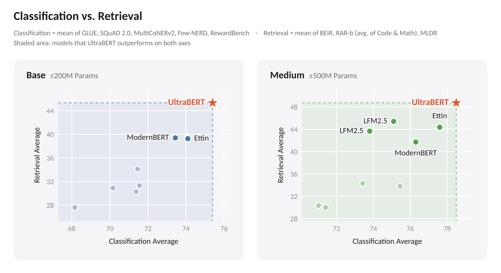

# 开源模型

六项按任务选择，包含宽松许可模型与明确标注的受限开放权重。本站本期没有运行这些模型；“官方实验”与“本机实测”分开。原始日期为 9 月 28 日至 10 月 14 日，超过七天的条目标为近期补充。

## 01 · UltraBERT：长文本编码器，也要分清分类与检索

原始日期：2026-10-10。开放条件：Apache 2.0。

UltraBERT 提供原生 32K 上下文的英文编码器，主条目为 380M，同系列还有较小版本与专门的 embedding 版本，本期合并介绍。模型卡区分 5% 与 50% 掩码预训练头：面向分类和面向检索的选择不同；专门调好的检索向量模型也不等于直接拿通用 encoder 的平均池化。

为什么现在值得看：10 月 10 日首次上传，10 月 15 日新增 50% 掩码头文件，**新近实用；官方实验与部署说明，本站未微调，热度待验证**。官方以匹配的微调搜索比较任务表现；32K passkey 成绩说明特定检索测试能力，不能替代复杂文档理解。

DMIS Lab 模型卡原图，仓库标注 Apache 2.0。横轴和纵轴是不同任务集合的平均值，右上角表示两类任务都较好；成绩来自各任务微调，不能视为零样本向量检索结果（[来源原图](https://huggingface.co/dmis-lab/UltraBERT-380M)；[查看原尺寸](images/ultrabert-evaluation.webp)。）

开放权重和自定义实现采用 Apache 2.0。模型卡要求 Transformers 5 系列，测试版本为 5.16.1，并需审阅 `trust_remote_code` 加载的实现。长序列批量仍受显存限制；先用小批次短文做任务微调与测量，再逐步加长，不能从 380M 参数直接推定 32K 的运行内存。

[模型卡与文件](https://huggingface.co/dmis-lab/UltraBERT-380M)。

## 02 · QUAN-Transcribe：把越南语转写做成专门模型

原始日期：2026-10-14。开放条件：Gemma 使用条款。

这个 356M 转写模型采用 EmbeddingGemma 2 音频编码器与六层 CTC 读出器，主要面向越南语，输出为小写、无标点、数字写成词的文本。已有同权重分块处理路径，适合研究批量录音转写，而不是直接把输出当成排好版的会议纪要。

为什么现在值得看：**新近实用；10 月 14 日公开，模型卡提供训练条件、测试集与推理代码，本站未运行，热度待验证**。作者报告约 2800 小时训练音频及平均 WER 6.87%，另有单 H100 的高吞吐数字；后者属于特定精度与解码配置，不能写成普通笔记本的交互延迟。

上手需先接受上游 EmbeddingGemma 2 条款，再按作者 QUAN-Transcribe 仓库安装和传入音频。模型继承 Gemma 使用条件，并非 Apache/MIT 权重；代码仓库本次未查到单独 LICENSE，因此只将它作为模型的官方推理参考，不额外宣称代码可任意再分发。识别之外的断句、大小写和数字还原需另做验证。

[模型卡与文件](https://huggingface.co/qnguyen3/QUAN-Transcribe-1.0)。

## 03 · Duyu-small：土耳其语和英语短句的端侧识别

原始日期：2026-10-11。开放条件：Apache 2.0。

Duyu-small 把土耳其语、英语和混合短句转成带大小写与标点的文本，发布 ONNX 图和不依赖 PyTorch 的引擎。19.3M 是每帧活跃参数，实际存储为 49.3M；三次共享细化和稀疏声学记忆让两种计数不同，不能只报较小数字。

为什么现在值得看：**新近实用；10 月 11 日新模型，官方有量化与识别实验，本站未运行，热度待验证**。INT8 文件集约 56MB，4-bit 约 34MB。作者在 62 段开发音频、四线程笔记本 CPU 上报告 INT8 实时系数 0.07、4-bit 为 0.13，说明更小不一定更快；这是作者小样本结果，不是本机测速。

权重、ONNX 与引擎标注 Apache 2.0。最小依赖为 numpy、onnxruntime、sentencepiece，读取常见音频还需 FFmpeg；输入为 16kHz 单声道。英文 FLEURS WER 22.88，明显弱于该表中的 Whisper-base；完整上下文编码与无 KV cache 的解码器更适合短轮次，不宜当成长录音或完整流式识别方案。

[模型卡与文件](https://huggingface.co/KaanAydinli/Duyu-small)。

## 04 · LemonDecider：让模型直接给出候选决策

原始日期：2026-10-05。开放条件：Apache 2.0。

近期补充。LemonDecider 于 10 月 5 日上传权重，使用 Qwen3.5-4B 文本视觉骨干和固定类别读出，一次前向给出选择、布尔或分数结果；它不是先生成一段解释再从文字里猜答案。输入需要明确候选集合，输出也有专门的 unknown 语义。

为什么现在值得看：**新近实用；模型卡和实现给出输入格式、未知项及训练记录，本站未运行，热度待验证**。可用于把文本或图像映射成结构化判断，再交给业务流程处理。候选概率会对已知项重新归一化，unknown 另列；因此不能只看到几个候选的概率加起来为一，就认为模型没有拒答可能。

代码和权重标注 Apache 2.0，需要自定义模型实现、左侧 padding，最长 8192 token，超长请求应拒绝而非静默截断。作者 574 条内部开发集的 77.35% 准确率不是通用业务保证；训练记录中的温度拟合也不等于当前服务默认已经完成校准。部署前应以自己的标签、分布与拒答成本重新检验。

[模型卡与文件](https://huggingface.co/inclusionAI/LemonDecider)。

## 05 · Drex v1.5：开放权重的决策模型，许可与分数都要细看

原始日期：2026-09-28。开放条件：Nace AI Open RAIL-M（修改版）。

近期补充。Drex v1.5 原始权重记录为 9 月 28 日，10 月 9 日补充推理实现与平台集成说明；本期首次收录，不能把 15 日标签修改当新发布。它将请求映射成有类型的选择和分数，提供 Python、llama.cpp、Ollama 等路径，默认上下文 16K，扩展上限不等于全长度已做充分任务验证。

为什么现在值得看：**新近实用；有公开实现、运行配方及作者测试，本站未运行，热度待验证**。公开 Decision Index 结果为 58.08，但相近模型落在作者所述的 0.9 分并列区间内，不宜据细微差异写成稳健第一。游戏测试也有固定任务与对局条件，不能推出所有决策任务都优于生成模型。

约 8.95B 的 BF16 权重本身接近 18GB，Q8 文件约 9.5GB，运行还需缓存等空间。权重采用修改版 Open RAIL-M：商业收入、融资门槛及竞争用途等有限制，资料和代码另按各自许可；它是**受限开放权重，不是宽松开源模型**。使用前必须核对完整条款，尤其不能沿用历史卡片中的 MIT 标记。

[模型卡与文件](https://huggingface.co/nace-ai/drex-v1.5)。

## 06 · AuroraIMG-6M：一套能看懂的小型图像生成实验

原始日期：2026-10-11。开放条件：Apache 2.0（权重）。

AuroraIMG-6M 的 6.82M 参数包含文本编码器、去噪器和 VAE，全部从头训练，输出只有 64×64。它用小型 U-Net 做潜空间 flow matching，搭配联合训练的文本编码器，适合作为研究极小生成模型的可读样本，而不是高质量图片工具的替代品。

为什么现在值得看：**新近实用、新近创新；10 月 11 日公开，模型卡提供训练配方、引导强度扫描与能力边界，本站未推理，热度待验证**。下面的官方同提示、同种子对照能直观看到强引导与细节缺失同时存在；不要把放大的低分辨率图误当成高清生成。

AuroraAI-Research 模型仓库原图；仓库标注 Apache 2.0，保留原图仅用于解释该模型的 CFG 对照。自上而下 CFG 为 1、2、3、5；这张示例图不是推荐 CFG 6 的测试图，也不是本站生成结果（[来源原图](https://huggingface.co/AuroraAI-Research/AuroraIMG-6M)；[查看原尺寸](images/aurora-cfg.webp)。）

使用 Diffusers 自定义 pipeline 与 PyTorch，可选 CPU；需要审阅远程实现。作者在原生 64×64 上报告 GenEval 0.1387，计数、位置与多属性明显薄弱；FID/CLIP 内部会放大图像，不能直接与高分辨率模型横比。权重为 Apache 2.0，CC12M 中原始训练图片仍有各自权利条件，权重许可不替代数据许可。

[模型卡与文件](https://huggingface.co/AuroraAI-Research/AuroraIMG-6M)。
