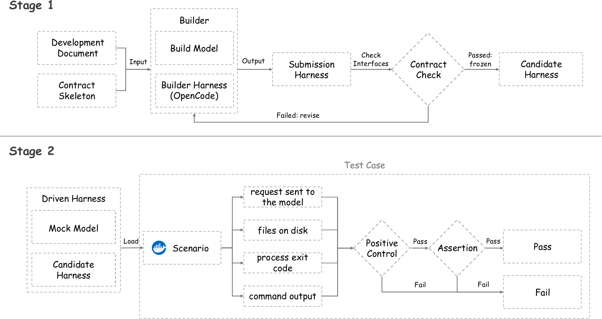
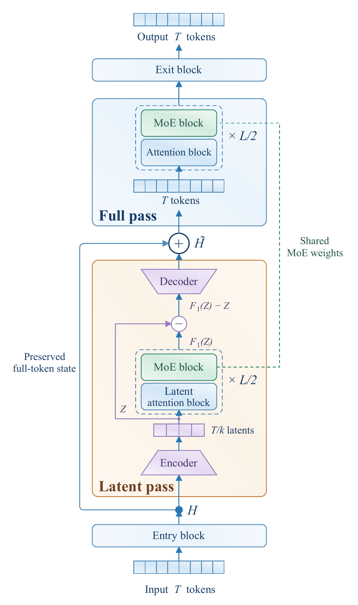
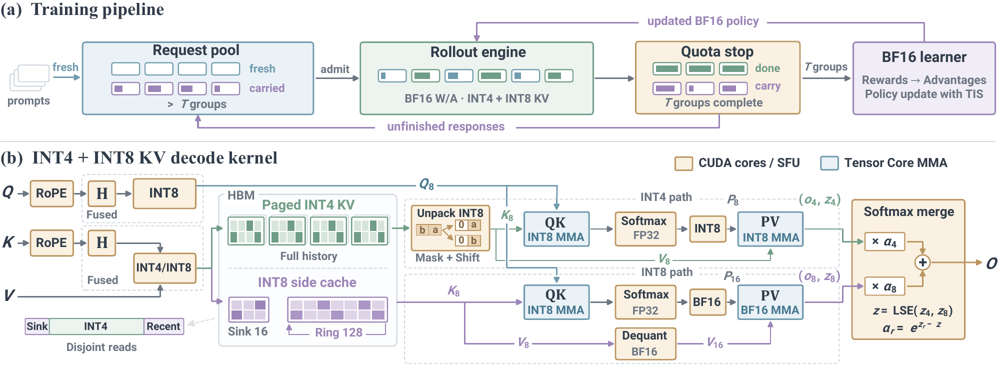

# 论文精选

从 14 篇候选中选择六篇，覆盖 Agent 测试、强化学习、循环架构、知识写入和计算效率。原始日期为 2026-10-10 至 2026-10-14；均按预印本处理。已读核心方法与实验，未将论文分数当作本站复现。

## 01 · Doc2Harness：工具没有越界，可能只是根本没工作

原始日期：2026-10-14；预印本 v1。

Doc2Harness 检查模型能否根据开发文档实现可靠的 Agent 外围系统。实验先固定 OpenCode 1.17.0 作为构建环境，给模型两小时、24 轮和最多三次形式检查机会；约 70 行接口骨架规定输入输出。形式检查只确认接口可用，不把它当成行为正确的证明。

随后冻结产物，用脚本化 mock model 驱动它在隔离场景中运行。328 个测试从发送给模型的请求、磁盘文件、进程退出码和命令输出四个通道观察实际效果。其中 130 个测试包含阳性对照：例如禁止访问越界文件之前，先确认允许的文件确实读得出来，防止一个永远报错的工具“通过”安全测试。

Ge 等，Figure 2 方法总览原图，CC BY 4.0；从作者 TeX 附图忠实渲染。先看 Stage 1 的形式检查，再看 Stage 2 的 Positive Control 门控，两者评估的不是同一种正确性（[来源原图](https://arxiv.org/abs/2610.20344)；[查看原尺寸](images/doc2harness.webp)。）

作者比较 19 个模型、每个三次构建。GPT-6 Astra 总体最高为 53.05；另一些模型在正常功能上较强，边界行为却明显掉队。这里评的是生成的 harness 在该测试套件中的符合程度，不是普通软件工程榜单，也不是这些模型面对所有攻击的安全率。

为什么现在值得看：**新近实用、新近创新；2026-10-14 预印本，已读核心方法、结果与测试设计，本站未复现整套基准，热度待验证**。有价值的是能把规格、形式检查与行为测试拆开；限制是固定构建预算、有限规格以及相关测试项。本期技术实践只演示阳性对照这一思想，不借用论文分数。

[站内阅读卡](../../../../papers/frontiers/2610.20344/00-阅读卡.md) · [论文原始记录](https://arxiv.org/abs/2610.20344)。

## 02 · 自蒸馏的现实检查：收益要和训练时间一起读

原始日期：2026-10-14；预印本 v1。

这项研究在四类文本 Agent 环境中比较十种自蒸馏方法与 GRPO，采用 Qwen3.5 的 2B、4B、9B 三个规模，共 12 个设置、132 次训练运行。每次训练 100 步；评估的八个 rollout 随机种子不能误写成每个配置重复训练了八次。这样读，实验覆盖与统计不确定性才不会被夸大。

作者把教师重打分、策略蒸馏等方法适配到统一环境，分别比较固定更新步数与时间预算。在平均成绩上，PCSD 为 54.26，对照 GRPO 为 49.68；但 PCSD 在 12 个设置中是六胜、五负、一平，没有在每个单独任务上领先。平均收益不能替代逐任务判断。

计算成本改变了结论的实际含义。120 个相对 GRPO 的比较中，112 个耗费更多训练时间，其中 58 个同时成绩更低；领先方法的平均配对时间比也约为 1.17 和 1.19。限制到 GRPO 时间预算后，部分优势反转。想复现时应同时报告更新步数、rollout 数、教师调用和真实墙钟时间。

为什么现在值得看：**新近实用；2026-10-14 预印本，已读统一评测设置、结果和等时间分析，本站未训练，热度待验证**。它提供的是特定模型家族、四类任务和有限训练长度下的比较，不证明所有自蒸馏无效；方法适配、超参数与更长训练仍可能改变结果。论文的非独占分发许可不足以确认本站可再分发 PDF，因此保留阅读卡与原文入口，未复制论文插图。

[站内阅读卡](../../../../papers/frontiers/2610.19789/00-阅读卡.md) · [论文原始记录](https://arxiv.org/abs/2610.19789)。

## 03 · LatentLoop：第一次少看几个位置，第二次再看完整序列

原始日期：2026-10-14；预印本 v1。

重复使用中间层可以增加模型的计算深度，但每次都处理完整序列也会增加开销。LatentLoop 在 MoE 中间块的两次访问之间做区分：第一次把邻近位置压缩到更短的潜在序列，第二次恢复完整 token 序列；共享 MoE 参数，同时为注意力访问作相应设计。

第一遍产生的是增量，经过解码和受约束的写回位置加到保留的完整状态上。因果约束尤其关键：压缩相邻位置后，不能把尚未允许看到的信息写回更早位置。论文讨论了成对压缩、残差尺度与可学习写回系数，不能将它简化为随便删掉一半 token。

He 等，Figure 3 架构原图，CC BY 4.0；从 TeX 附图忠实渲染。由下向上读：左侧蓝线保留完整状态，绿色虚线表示共享 MoE 权重；紫色减号取的是第一遍变化量（[来源原图](https://arxiv.org/abs/2610.19975)；[查看原尺寸](images/latentloop.webp)。）

实验比较 1.3B、3B、7B 规模的 15 个预算点，匹配参数、单步计算、KV 和总训练 FLOPs。拟合前沿在 NLL 1.988 处，所需计算相对 MoE Base 减少约 19%，相对直接循环的 MoE Loop 减少约 7.9%。这是特定拟合目标下的训练计算比较，既不是所有预算点都节省同样比例，也不是实际推理时延下降 19%。

为什么现在值得看：**新近创新；2026-10-14 预印本，已读预算匹配、因果写回与下游实验，本站未训练，热度待验证**。九个下游基准的平均改善支持继续研究，但幅度与任务有关；残差为什么按这种方式分配仍未被完全解释。其复现价值在于严格对齐比较预算，而不是只报更深的“有效层数”。

[站内阅读卡](../../../../papers/frontiers/2610.19975/00-阅读卡.md) · [论文原始记录](https://arxiv.org/abs/2610.19975)。

## 04 · Cortex：把上下文知识写进新参数，同时检查旧能力

原始日期：2026-10-14；预印本 v1。

Cortex 想把当前上下文中的信息变成后续无需重带原文的模型能力。方法生成前瞻查询和回答，让能看到上下文的教师指导看不到上下文的学生；训练信号包括输出分布差异和对齐的隐藏状态，而非只背下一段标准答案。

它有两条路线：Synaptic 新增前馈层 LoRA，Structural 新增非线性通道；旧参数冻结，每次更新只训练新部分。冻结参数不保证旧行为不变，因此方法还用历史查询重新生成回答进行回放，检查新旧知识的相互影响。结构增长本身也会带来累积的存储与计算成本。

作者在事实、API、Agent、个性化和行为抑制等场景，覆盖多个模型规模。50 次 zsRE 顺序编辑、Qwen2.5-14B、三随机种子的设置中，Structural 的 CR 为 88.9%、RR 为 99.8%。这两个量分别涉及上下文收益保留和原能力保留，不能作为两个普通正确率抄进排行榜。迁移指标仍明显弱于直接提供上下文，说明写入并不等于充分理解并灵活调用。

为什么现在值得看：**新近创新；2026-10-14 预印本，已读更新目标、顺序编辑与回放消融，本站未训练，热度待验证**。关闭回放后，后续更新会明显侵蚀早期效果；结果依赖查询生成和任务分布，也不等同于人脑记忆机制。本次未确认 PDF 的站内再分发许可，阅读卡链接原文，不复制其方法图。

[站内阅读卡](../../../../papers/frontiers/2610.20399/00-阅读卡.md) · [论文原始记录](https://arxiv.org/abs/2610.20399)。

## 05 · KV4-RL：压低采样缓存精度，保留更敏感的位置

原始日期：2026-10-10；预印本 v1。

KV4-RL 压缩的是强化学习采样过程中的 KV cache，而不是把模型权重和训练梯度全部变成 4-bit。主体历史采用 INT4，最开始的 16 个位置和最近 128 个位置另用 INT8 保护；键与查询在 RoPE 后作 Hadamard 变换，配合分组量化与专门内核。

注意力执行时，受保护位置与其他位置分开读取，再用区域 softmax 统计合并，避免重复计算同一位置，也不需要把全部历史先恢复成高精度。训练侧保持 BF16，并结合部分 rollout 调度和重要性处理。因此它是数值设计、内核和采样调度一起改变，不能只打开一个 INT4 开关期待同样结果。

Park 等，Figure 5 原图，CC BY 4.0；从 TeX 附图忠实渲染。先看下方 Sink 16 与 Ring 128，再看右侧合并；BF16 learner 表示训练计算仍保持原精度（[来源原图](https://arxiv.org/abs/2610.14448)；[查看原尺寸](images/kv4rl.webp)。）

四张 H200、Qwen3 4B/8B、数学 GRPO 的实验中，8B rollout 加速约 1.80 倍，而完整迭代加速约 1.27 倍，计时不含初始化、评估和保存等环节。六个数学基准的平均分接近 BF16，但个别任务有下降；每配置一次训练、多个评估随机种子，也限制了结论的统计强度。

为什么现在值得看：**新近实用、新近创新；2026-10-10 预印本，已读精度保护、实验和计时边界，本站未运行，热度待验证**。复现应同时看平均质量、最弱任务和总训练时间；目前证据主要来自稠密 Qwen 数学训练，不能直接推广到 MoE 或长程工具 Agent。

[站内阅读卡](../../../../papers/frontiers/2610.14448/00-阅读卡.md) · [论文原始记录](https://arxiv.org/abs/2610.14448)。

## 06 · COUNT：把语料计数放进主机内存，给模型补一条输入

原始日期：2026-10-14；预印本 v1。

COUNT 重新利用语料中的 n-gram 统计：给定当前前缀，从 CPU 主机内存中的固定表查找常见后续 token，再从模型已有输出矩阵取相应行，以计数分数加权，作为额外输入加到 token embedding 上。它没有新增需要学习的参数，但确实增加了一张可能很大的外部统计表。

与单纯在输出概率上融合计数相比，这个输入会经过后续 Transformer 层，使模型能在内部结合统计线索和上下文。作者还比较从头学习的 n-gram embedding，并测试替换领域计数表。这样的结构让领域数据能够影响预测，但迁移效果仍须逐任务评估。

Magnusson 等，Figure 1 原图，CC BY 4.0。左侧虚线分开主机与GPU内存；右侧紫色百分数是达到相同验证损失所需的额外基线计算，不是生成速度或准确率提升（[来源原图](https://arxiv.org/abs/2610.20456)；[查看原尺寸](images/count.webp)。）

实验覆盖 60M 至 1B 模型、Dolma 3 语料和不同数据/参数比；计数表从约 17.1GB 到 797GB。作者拟合验证损失前沿，得到相当于标准模型多用约 46–89% 训练计算的收益。训练吞吐约为基线的 93.1–97.8%，并非完全没有运行代价；领域替换在损失上有收益，准确率并非全部一致改善。

为什么现在值得看：**新近实用、新近创新；2026-10-14 预印本，已读方法、匹配比较、领域实验与吞吐结果，本站未训练，热度待验证**。对于 GPU 显存紧、主机 RAM 较宽裕的实验环境，这是一种值得核算的取舍；不能把“零新增可学习参数”误写为“零额外内存”，也不能忽略计数表构建、传输和数据来源。

[站内阅读卡](../../../../papers/frontiers/2610.20456/00-阅读卡.md) · [论文原始记录](https://arxiv.org/abs/2610.20456)。
