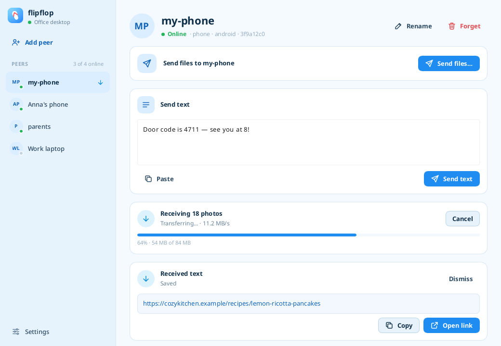
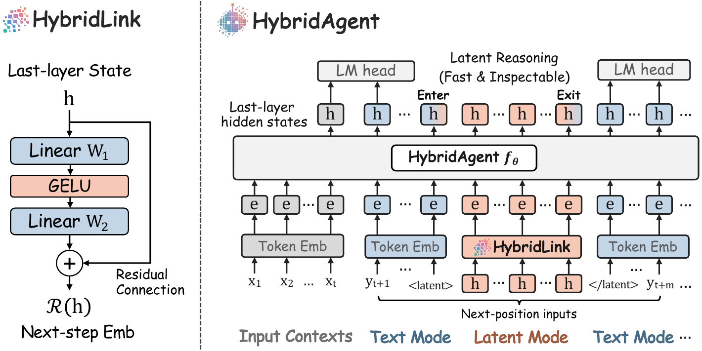
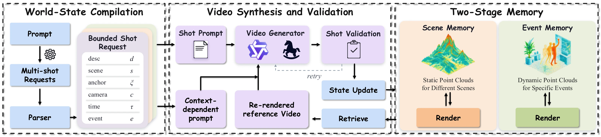

# 开源项目

以下十项按具体任务选择；全部是官方文档、代码或作者实验核验，**本站本期未安装或运行这些项目，热度待验证**。成熟项目只因近期实质更新入选，不以总 Star 作为理由。

| 任务 | 工具 |
| --- | --- |
| 跨界面继续同一段编码工作 | opencode |
| 在自己的设备之间传文件、链接和短消息 | flipflop |
| 快速试验一个有状态的小工具界面 | ito |
| 让网页说明与 Markdown 文档共用内容逻辑 | proa |
| 查看已有 Markdown 笔记、双链和嵌入 PDF | opensidian |
| 测试共享状态、审批和锁的竞争问题 | CLASHarness |
| 研究潜在推理与文本工具调用如何衔接 | HybridAgent |
| 区分任务完成与用户仍不满意的对话 | tau-emotion-bench |
| 降低对话推荐奖励对单一偏好的依赖 | ReMaRk |
| 把剧本转换成有连续状态的分镜视频 | ATAS |

## 01 · OpenCode 2.0：终端、网页和桌面共用一个服务

本次实质进展：2026-10-14。

OpenCode 2.0 将终端、网页和桌面客户端连接到同一个自动启动的后台服务。开发者可以在不同界面继续同一工作，新的客户端包也能发现服务并调用 API；Code Mode 则允许用 JavaScript 组合 MCP 和 OpenAPI 工具调用。

为什么现在值得看：**近期实质更新、新近实用；官方发布说明与实现，本站未运行**。旧项目始于 2025 年，本次是 10 月 14 日的 2.0 服务架构与插件能力更新。上手先升级到最新 1.x，再执行 `opencode upgrade --major`；需自行配置模型后端。1.x 插件、服务 API 和部分配置位置有不兼容变化，不能无备份直接套旧配置。

Hacker News 10 月 14 日讨论在本次观察中为 850 分、370 条评论，只构成一个社区信号，仍标注热度待验证。新 SDK 尚在开发；后台任务与子代理能并行做事，也需要预算、权限和结果复核。

[规范仓库与上手说明](https://github.com/anomalyco/opencode) · [MIT](https://github.com/anomalyco/opencode/blob/dev/LICENSE) · [版本与维护记录](https://github.com/anomalyco/opencode/commits/dev)。

## 02 · Flipflop：跨设备发文字和文件，支持离线待发

本次实质进展：2026-10-15。

Flipflop 是跨设备发送文本、链接和文件的应用。10 月 15 日 v0.0.6 增加 Browser Link：同一 Wi-Fi 上的另一台设备可以在浏览器接收，不必先安装客户端；离线发送队列可以跨重启保留，等对端上线再发送。

为什么现在值得看：**近期实质更新、新近实用；官方发布说明和界面演示，本站未安装**。项目始于 9 月 5 日，这次新增的是接收路径和队列持久化。可先下载适合平台的版本，配对自己的设备，再用无敏感内容的小文件核对收发；源码构建需 Rust，Android 构建还需 SDK/NDK。Browser Link 的同网条件不能和完整客户端的远程传输能力混为一谈。

软件采用 GPL 3.0；分发修改版本需遵守相应义务。截图来自维护者的演示环境，并非本机传输成功记录。

维护者仓库截图（GPL 3.0），用于解释设备、消息和文件的关系；图中是公开演示数据，并非本机测试（[来源原图](https://github.com/andunieee/flipflop/blob/master/docs/screenshot.png)；[查看原尺寸](images/flipflop-screen.webp)。）

[规范仓库与上手说明](https://github.com/andunieee/flipflop) · [GPL-3.0](https://github.com/andunieee/flipflop/blob/master/LICENSE) · [版本与维护记录](https://github.com/andunieee/flipflop/commits/master)。

## 03 · Ito：用同一套 Lua 状态写终端与浏览器界面

本次实质进展：2026-10-14。

Ito 提供类似声明式 UI 的 Lua 组件：状态变化驱动文字、按钮、布局等更新。10 月 14 日实现 WebAssembly Canvas 后端，与终端路径共享控件和焦点逻辑，并增加可组合的图片视图；这比只给终端组件换皮更接近跨环境复用。

为什么现在值得看：**新近实用、新近创新；公开实现和官方在线示例，本站未运行**。仓库于 10 月 5 日建立。最小体验可在 [官方工作台](https://uji.sh/ito/) 输入 Lua 组件代码，观察状态和布局变化；本地源码以 Rust/Cargo 构建，终端图片还取决于 Kitty 等协议支持。

MIT 许可。当前是早期工具；网页与终端有字体、输入和图形能力差异，不能假设所有组件显示完全相同。适合验证交互原型，完整业务应用还要自行处理持久化、错误和部署。

[规范仓库与上手说明](https://github.com/uji-labs/ito) · [MIT](https://github.com/uji-labs/ito/blob/main/LICENSE) · [版本与维护记录](https://github.com/uji-labs/ito/commits/main)。

## 04 · Proa：同一份组件数据，输出 HTML 和 Markdown

本次实质进展：2026-10-12。

Proa 是 Rust 内容组件工具，重点是把同一份类型化组件与数据渲染成不同目标：网页用 HTML，文档用 Markdown。10 月 12 日首次将库和 CLI 发布到 crates.io；10 月 10 日还增加跨渲染目标的缺失内容检测，能暴露“网页有、文档漏掉”的分支。

为什么现在值得看：**近期实质更新、新近实用；公开代码和官方示例，本站未运行**。项目始于 9 月 12 日，不能把 15 日的营销页面提交当成新产品。可安装 `cargo install proa-cli --locked`，以一个接收姓名的 Greeting 组件观察双目标输出；当前文档要求较新 Rust，贡献与样式测试还涉及 Node 22。

Apache 2.0。浏览器交互可通过少量 RSJS 岛挂接，但它不是把任意既有网页自动无损转换为 Markdown 的工具。多目标内容仍要编写合适的适配；本期不引用作者不同工作负载下的微基准作为实测收益。

[规范仓库与上手说明](https://github.com/Proa-Labs/proa) · [Apache-2.0](https://github.com/Proa-Labs/proa/blob/main/LICENSE) · [版本与维护记录](https://github.com/Proa-Labs/proa/commits/main)。

## 05 · Opensidian：把本地 Markdown 库做成可浏览的桌面知识库

本次实质进展：2026-10-12。

Opensidian 面向 Linux 本地 Markdown 库，提供双链、反向链接、图谱和搜索。10 月 9 日至 12 日的 0.6.x 更新扩展 PDF 嵌入与拖入、大库渲染，以及窗口、图谱布局和书签恢复；本次收录的是这组实际工作流变化，项目本身始于 8 月。

为什么现在值得看：**近期实质更新、新近实用；版本说明与实现，本站未安装**。可用 AppImage、Flatpak、RPM 或 DEB 版本打开一份笔记副本，检查 wikilink 和 PDF 路径。拖入图片会在成功复制后删除原文件，拖入 PDF 则复制，操作语义不同，试用前应保留源资料。

GPL 3.0。它不保证兼容所有 Obsidian 插件；Landlock 隔离是可选且默认关闭，不能把“纯本地”直接等同于所有文件操作都有沙箱保护。

[规范仓库与上手说明](https://github.com/jpzk/opensidian) · [GPL-3.0](https://github.com/jpzk/opensidian/blob/main/LICENSE) · [版本与维护记录](https://github.com/jpzk/opensidian/commits/main)。

## 06 · CLASHarness：让多代理冲突变成可检查的任务

本次实质进展：2026-10-14。

CLASHarness 把多代理共享资源冲突组织成可执行场景。输入场景和工具操作后，评测器核对状态、资源与最终目标，而不只让另一个模型主观打分。10 月 14 日论文及公开任务说明提供 600 个场景，适合检验代理能否在审批、锁和并发变化中保持一致。

为什么现在值得看：**新公开的可复用方法、新近实用；公开代码及作者实验，本站未运行**。仓库始于 9 月 16 日，本次新增论文和可下载场景。Python 3.11 以上可用，作者测试 3.13；本地安装后，生成脚本支持 `--provider mock --image_provider mock --chart_provider template`，可先无 API 生成样例再看状态与日志。

Apache 2.0。真实模型和图像生成另需服务及费用；mock 只验证流程，不代表智能体成绩。论文的可检查场景保证也不等于真实多用户系统中所有冲突都被覆盖。

[规范仓库与上手说明](https://github.com/google-research/CLASHarness) · [Apache-2.0](https://github.com/google-research/CLASHarness/blob/main/LICENSE) · [版本与维护记录](https://github.com/google-research/CLASHarness/commits/main)。

## 07 · HybridAgent：把连续隐藏状态接进可观察的工具操作

本次实质进展：2026-10-13。

HybridAgent 用 HybridLink 将模型的末端隐藏状态映射回输入表示，使部分推理在连续状态中推进，动作与回答仍以文本形式呈现；工作记忆同时保留两类信息。仓库 10 月 9 日建立，10 月 13 日论文公开，并提供训练、批量推理和轨迹检查实现。

为什么现在值得看：**新公开的可复用方法、新近创新；公开实现与作者实验，本站未训练或推理**。用批量推理入口读取问题 JSONL，可得到回答、轨迹与工具统计。依赖 Python 3.11、CUDA/PyTorch 与对应 checkpoint；搜索任务需 Tavily 等服务，示例训练配置需要多卡，不能当作轻量笔记本应用。

代码 MIT，权重与服务另核对各自条件。检查器显示的 pseudo-text 是隐藏状态的投影，不是模型真实生成的一段自然语言理由；读图时尤其不要把潜在步骤当成可直接审计的逐句解释。

Together AI 仓库原图（MIT）。先看 HybridLink 如何把隐藏状态送回下一步，再看文本动作如何连接工具；图中的潜在链不是逐句可读的推理记录（[来源原图](https://github.com/togethercomputer/HybridAgent)；[查看原尺寸](images/hybridagent.webp)。）

[规范仓库与上手说明](https://github.com/togethercomputer/HybridAgent) · [MIT](https://github.com/togethercomputer/HybridAgent/blob/main/LICENSE) · [版本与维护记录](https://github.com/togethercomputer/HybridAgent/commits/main)。

## 08 · τ-emotion-bench：把用户情绪变化纳入工具型代理评测

本次实质进展：2026-10-14。

这个评测实现将可控情绪的用户模拟器与 Tracer 工具工作流结合，覆盖 10 个领域、175 个工具，公开 580 个测试任务和 2723 个训练任务。输入对话任务及数据库状态，输出工具轨迹与最终任务结果，其中 UNSATISFIED 的 -1 与普通失败 0 分开。

为什么现在值得看：**新公开的可复用方法、新近实用；10 月 14 日研究发布，公开代码和作者实验，本站未运行**。仓库始于 9 月 17 日。最小准备为 Python 3.12/3.13 和 uv；先阅读一个任务和结果模式，再配置代理与用户模拟模型密钥，运行真实评测会产生服务开销。

Apache 2.0。可控模拟器有利于对照，却不等于真实人的心理反应；这不是情绪诊断工具，也不能用一个总分替代成功率、成本与不满意类型的分项分析。

[规范仓库与上手说明](https://github.com/sahsaeedi/tau-emotion-bench) · [Apache-2.0](https://github.com/sahsaeedi/tau-emotion-bench/blob/main/LICENSE) · [版本与维护记录](https://github.com/sahsaeedi/tau-emotion-bench/commits/main)。

## 09 · ReMaRk：用多名真实回应者构造推荐奖励

本次实质进展：2026-10-13。

ReMaRk 将同一推荐请求的多名人类回应汇集为相关项目集合，再让训练奖励对这个集合计分；请求的抽样保持均衡。它调整的是奖励数据如何构造，不是提出另一种 GRPO 优化器。10 月 13 日公开论文、数据和 23 个检查点，代码仓库始于 9 日。

为什么现在值得看：**新公开的可复用方法、新近实用；公开实现与作者实验，本站未训练**。输入为推荐对话 JSONL，产出奖励样本、模型与评测结果。Python 3.11、CUDA 与指定 TRL/vLLM/DeepSpeed 环境是前置条件；评测示例为单 GPU，训练为 4 GPU。论文用达到既定基线的训练步数比较效率，不能直接写成 GPU 成本等比例下降。

代码 Apache 2.0，数据 CC BY-NC 4.0，商业数据用途不能沿用代码许可；RankGRPO 的部分解析器与目录数据仍需自行取得。

ReMaRk 仓库原图（Apache 2.0）。左侧单回应者只能提供一组偏好，右侧合并多个回应者的相关项目；这解释的是奖励数据来源，不代表每位用户都会喜欢并集里的每项（[来源原图](https://github.com/LiXin97/ReMaRk)；[查看原尺寸](images/remark.svg)。）

[规范仓库与上手说明](https://github.com/LiXin97/ReMaRk) · [Apache-2.0](https://github.com/LiXin97/ReMaRk/blob/main/LICENSE) · [版本与维护记录](https://github.com/LiXin97/ReMaRk/commits/main)。

## 10 · ATAS：让多镜头视频记住场景几何与角色状态

本次实质进展：2026-10-14。

ATAS 从剧本和可选角色定义出发，先建立场景，再逐镜头生成、检查并登记状态：静态几何与随时间变化的记忆分开维护，减少后续镜头把位置关系重新发明。10 月 14 日论文公开，仓库自 12 日已有客户端与几何模块的实际代码。

为什么现在值得看：**新公开的可复用方法、新近创新；公开代码、工作流与作者实验，本站未生成视频**。`atas run --screenplay … --characters … --story-id …` 产出视频、清单和报告；可先用计划模式检查输入与分镜，再执行重型步骤，断点恢复避免重复已完成任务。

代码 MIT。需要 Python 3.12、FFmpeg，几何任务约 20GB 显存及 Pi3X、SAM3 等权重；LLM 和视频服务另需账号及费用，不能把开源代码理解成免费生成。记忆与审核降低部分漂移，不保证长期视频始终一致。

ZIP Lab 仓库工作流图（MIT）。沿主线看“先读记忆、生成、验证、再登记”；静态场景和随时间变化的状态分别保存。密集标签可打开原尺寸查看，图示是作者系统而非本站运行结果（[来源原图](https://github.com/ziplab/ATAS)；[查看原尺寸](images/atas.webp)。）

[规范仓库与上手说明](https://github.com/ziplab/ATAS) · [MIT](https://github.com/ziplab/ATAS/blob/main/LICENSE) · [版本与维护记录](https://github.com/ziplab/ATAS/commits/main)。
