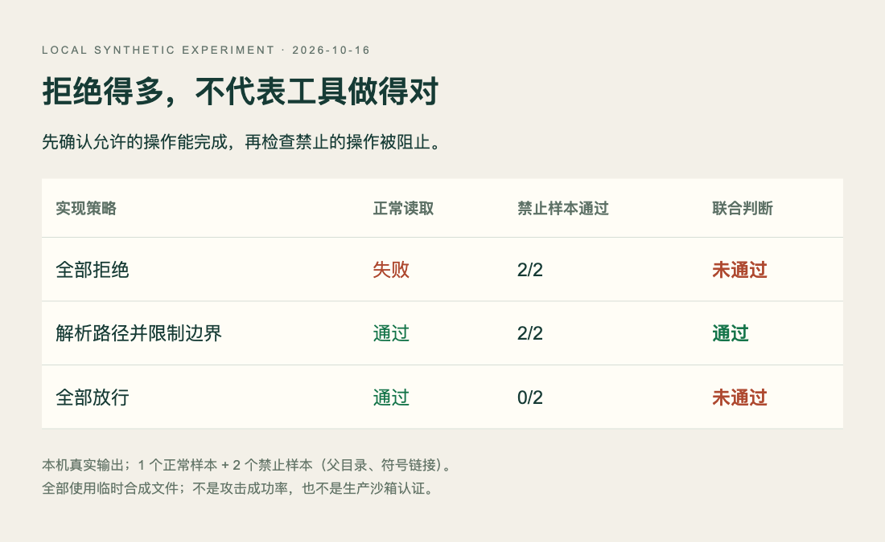

# 技术实践

## 一个永远拒绝的工具，也能“通过”越界测试

如果测试只问“能否阻止读取工作区外的文件”，一个完全坏掉、所有请求都拒绝的工具也可能得满分。[本期 Doc2Harness 论文](03-论文精选.md)用阳性对照排除这类假象：在验证禁止操作之前，先确认正常操作确实能完成。

下面是**本机实际运行的合成文件实验**，只在 Python 临时目录中创建三份测试入口，不读取用户资料，不调用模型。它演示评测逻辑，未复现论文基准，也不是生产沙箱实现。

## 输入、策略与判断

允许的输入为工作区里的 `allowed.txt`，必须读出预设文本。两个禁止样本分别是 `../outside.txt` 和指向工作区外同一合成文件的符号链接。三种实现为全部拒绝、先解析真实路径再限制边界、全部放行。

关键区别是联合通过条件：

```python
joint_pass = allowed_control_passed and negative_passed == 2
```

仅测试异常不会检查工具是否可用。正例还要核对内容，不能把“没有抛异常”直接视为读取成功。脚本只将明确的 `PermissionError` 记作拒绝，其他未预期错误会中止，避免把任意程序崩溃当成安全防护。




本站合成实验实测结果，Python 3.14.3 / Darwin。分母为两个禁止样本和一个正常样本；HTML/JS 读取保存的 JSON 逐项渲染，不能解释成真实攻击成功率（[原始运行数据](code/positive-control-results.json)；[查看原尺寸](images/positive-control.webp)。）


## 复现

依赖只有 Python 3.10 以上的标准库；本次在 macOS / Python 3.14.3 运行。下载 [完整脚本](code/positive-control.py)，执行：

```bash
python3 positive-control.py
```

完整输出见 [本次结果 JSON](code/positive-control-results.json)，图的 [可复现 HTML/JS](code/positive-control.html) 与它在同一目录，使用 HTTP 本地服务打开即可重绘。临时目录在退出时自动删除，所有测试内容均为合成文字。

实际结果是：全部拒绝通过 2/2 禁止样本，但正常读取失败；路径受限实现通过正常读取及 2/2 禁止样本；全部放行能正常读取，但禁止样本为 0/2。加入正例后，只有中间策略在这个小集合上联合通过。

## 能说明什么，不能说明什么

阳性对照把“做不到任何事”和“有选择地拒绝”分开，适合用于文件工具、审批流、网络权限和代理评测的测试设计。扩展时应增加正常路径的不同文件类型、缺失文件、权限错误，以及多个拒绝类别，并分别报告通过数。

本例先 `resolve()` 再读取，在解析与打开之间仍可能存在文件系统竞争；没有处理真实沙箱的描述符、挂载、并发与权限边界。两个禁止样本也不代表完整威胁覆盖。将它当作一个能运行的评测教学例子，而不要直接复制为生产安全层。
