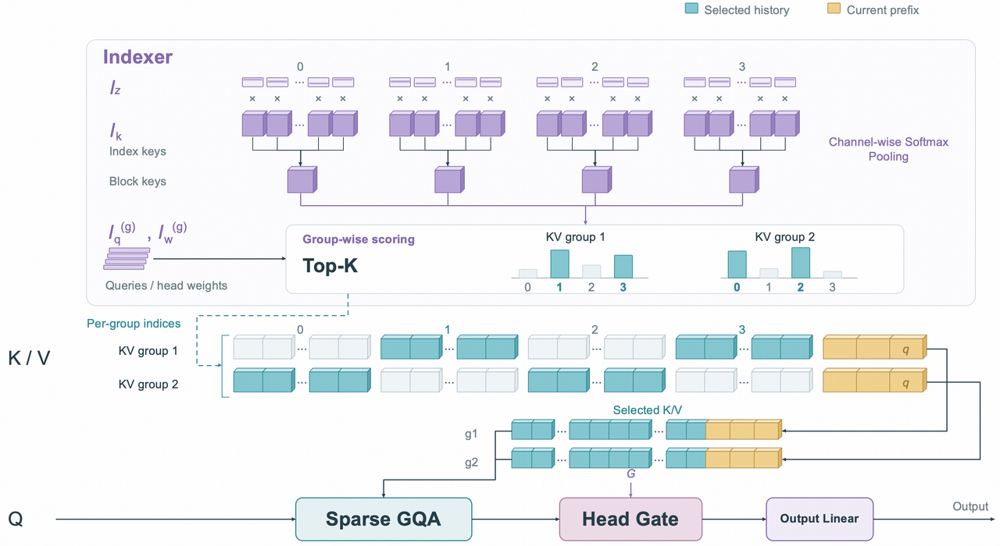
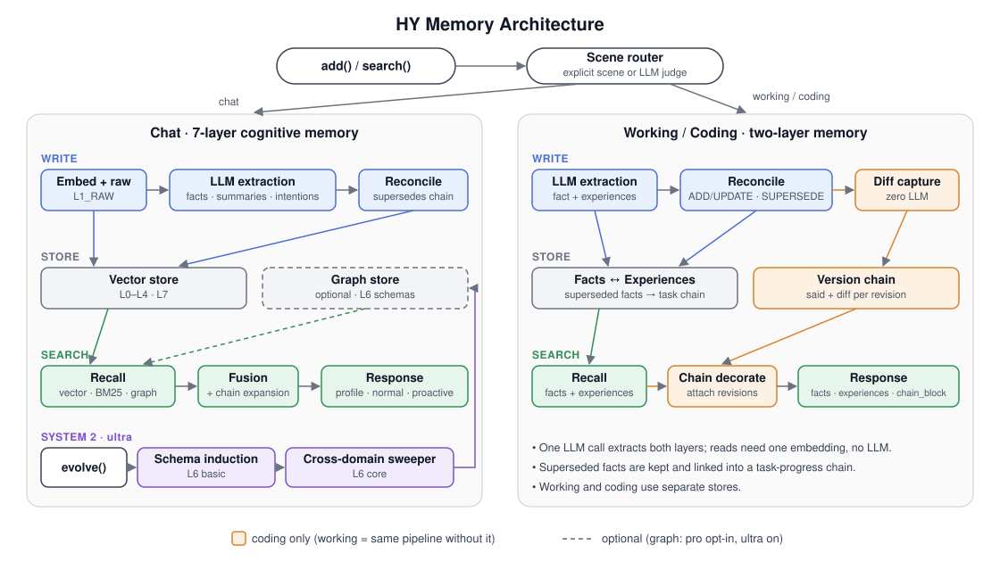

# AI 动态

本期 **5 条重点详解 + 10 条速读**。公告日期集中于 2026-10-15—10-16，先查近24小时，再扩至72小时；日期精度不足时保留原始日期。两类候选池均已检索，本期以新近实用或创新入选，没有把单一榜单或厂商宣传当成已验证热度。阅读全文约20—25分钟。

## 01 · Beam 开放权重：从预告走到可部署的完整模型

原始公告日期：2026-10-16（来源日期精度；未猜测具体时刻）。

Reflection 10 月 16 日宣布 Beam 正式可用，开放 Beam-1.0-501B-A23B 权重。这次新增事实是模型、量化版本和使用入口落地；[10 月 7 日本站报道的预告](../2026-10-07/01-AI动态.md)不能重新算一次发布。它是一款总计约 5010 亿参数、每个 token 激活约 230 亿参数的混合专家模型，支持约百万 token 的上下文，主要面向英文文本与代码任务。[官方公告](https://reflection.ai/blog/beam-is-available)

“激活 230 亿”描述每次计算参与的参数量，不表示把它装进一张能放下 230 亿参数的显卡就能运行。完整专家权重仍要存储、分布和调度，长上下文也会额外消耗缓存。官方提供 BF16、FP8、NVFP4 及用于加速解码的辅助权重，部署路径涉及 Transformers、SGLang、vLLM；研究者应按实际格式核算显存、并行通信和服务吞吐。

对开发者，值得关注的另一部分是 Mirror 编程工具的工作方式：执行动作前可以审阅与批准，运行中可以查看进展，中断后可以恢复，并通过隔离工作目录处理代码任务。例如让它修改一个已有项目时，先检查计划与改动，再决定是否执行外部命令，是官方流程支持的使用场景，并非本站运行结果。不能把这些外围控制自动理解为模型不会出错。

本次权重采用 Apache 2.0；模型卡和量化文件让研究团队有机会在自己的环境中比较工具调用、长文本阅读与代码表现。官方称已有数十家合作伙伴参与，这属于厂商披露，不能替代独立采用统计。发布稿同时提到训练相关配方将在之后数日补充，因此本期不把它们写成已经完整公开。

为什么现在值得看：**新近实用；官方发布与模型卡核验，本站未部署，热度待验证**。开放权重把“能不能研究”变成了实际问题，但如此大的模型仍有明显硬件门槛；应先确认所需框架版本和许可，再用自己的任务测质量与成本。[模型卡与文件](https://huggingface.co/reflection/Beam-1.0-501B-A23B)。

[原始来源](https://reflection.ai/blog/beam-is-available)。

## 02 · Step-5-Preview 开放权重，并解释稀疏注意力如何节省长上下文计算

近期补充；原始公告日期：2026-10-15（来源日期精度；未猜测具体时刻）。

阶跃星辰公开 Step-5-Preview 权重与技术说明，提供约 6000 亿总参数、270 亿激活参数的模型，支持文本和图像输入以及百万级上下文。此前已有 API 入口，本次报道的是权重开放与训练、注意力设计的技术披露，与[9 月 21 日介绍的 API 预览](../../09/2026-09-21/01-AI动态.md)区分，不把旧 API 发布再算一次。仓库同时提供不同精度版本，使用者要区分模型能力、文件格式和服务端实际支持。[技术说明](https://platform.stepfun.ai/blog/inside-step-5-preview)

长上下文最直接的问题是：每个新位置若都查看所有旧位置，计算和存储开销会增长。Step 的设计在局部滑动窗口与全局稀疏注意力之间分配工作。多数层先处理附近信息，部分层再从更广的历史中挑选需要读取的位置；这里的“稀疏”是有选择地访问，并不是把长文任意截短。

技术稿特别讨论了按 KV 组进行选择、以八个 token 为一个块建立索引，以及让相邻位置共享一部分候选集合。这样做既要顾及信息是否被保留，也要顾及 GPU 能否高效执行：理论上少读几个位置，若访问过于零碎，也未必换来真实速度。读这篇说明时，最好把注意力选择规则与实际内核效率放在一起理解。

StepFun 技术说明图 2，保持原图，限于本段方法解读引用；模型自定义许可并非博客图片的通用授权。上半部先给块打分，两个 KV 组选出的蓝色历史块可以不同；下半部仍读取原始 K/V，黄色当前前缀受因果可见性约束。[原图出处](https://platform.stepfun.ai/blog/inside-step-5-preview) · [查看原尺寸](images/step5-sparse-gqa.png)。

训练稳定性是另一个解释点。官方披露隐藏状态保持较高精度，并对异常梯度尖峰作限制；这些是配方中的具体取舍，不是对所有混合专家模型都成立的通用结论。论文式技术说明和模型卡提供复核线索，但本站没有在同等硬件、数据或训练预算下重现这些结果，也不将作者的工程收益套到普通笔记本环境。

为什么现在值得看：**新近实用、新近创新；官方模型卡与技术说明核验，本站未部署，热度待验证**。权重采用 StepFun Model License 1.0，须阅读其中的商业与署名条件，不能直接写成标准 Apache 2.0。适合有多卡基础设施的团队研究长文与多模态任务；参数规模、缓存及推理框架兼容性仍是实际门槛。[权重入口](https://huggingface.co/stepfun-ai/Step-5-Preview)。

[原始来源](https://platform.stepfun.ai/blog/inside-step-5-preview)。

## 03 · Hy-Memory 2.0：把记忆模型、管理框架和应用放到同一条工作链

原始公告日期：2026-10-16（来源日期精度；未猜测具体时刻）。

腾讯混元发布 Hy-Memory 2.0，围绕长期记忆提供模型、框架和应用三个层次。新增的 Hy-Memory-30B-A3B 是约 300 亿总参数、30 亿激活参数的记忆专用模型；框架负责组织、检索和管理信息，应用层再把记忆带进对话、工作和代码场景。把三者分开看，才能避免把“有一段历史记录”误认为已经有可靠的长期记忆。[官方介绍](https://memory.hunyuan.tencent.com/)

典型输入是一段持续发生的交互：用户修改偏好、补充项目事实，或者否定以前的决定。系统需要判断哪些信息值得留下、哪些应被更新，再在后续任务中召回相关内容。对研究者，这比把全部聊天记录重新塞进上下文更有分析价值，因为记忆写入、冲突处理、检索和使用可以分别检查。这个场景用于说明用途，本站没有接入真实个人记录。

腾讯混元仓库架构原图，Apache 2.0。左边是聊天的七层记忆，右边是工作/编程的事实与经验两层结构；先看写入如何整理事实，再看检索如何带回回答，编程分支另保留修改链；图展示设计关系，不是部署成功或效果保证（[来源原图](https://github.com/Tencent-Hunyuan/Hy-Memory)；[查看原尺寸](images/hy-memory.svg)。）

官方还提供 MemHub 应用入口与跨工具记忆使用方式；本次核对的 MemHub 位于 Hy-Memory 仓库子目录，不是另一个已经验证的独立仓库。尝试时应先检查数据存放位置、服务配置与模型依赖，再用非敏感样例观察记忆是否被正确更新。共享记忆有助于减少重复交代背景，也会扩大错误事实的影响范围，因此需要可查看、可纠正的记录。

效果方面，发布材料把记忆模型在多个系统和任务上的结果并列比较。其汇总平均值较高，但并非每一个子任务都领先；模型实验与使用另一种基础模型、评判模型的框架实验也不是同一套条件。不能把一张综合表理解为“所有 Agent 接入后都会更好”，更不能把作者测试当成本机复现。

为什么现在值得看：**新近实用、新近创新；官方架构、代码与实验说明核验，本站未运行，热度待验证**。模型与框架提供开放材料，便于围绕“写错、漏取、过期信息未覆盖”设计更细的测试。模型卡采用 Apache 2.0，但外部模型服务、用户数据和集成工具仍各有条件。[代码与 MemHub](https://github.com/Tencent-Hunyuan/Hy-Memory) · [模型卡](https://huggingface.co/tencent/Hy-Memory-30B-A3B)。

[原始来源](https://memory.hunyuan.tencent.com/)。

## 04 · ChatGPT Slides 开始推出：从材料生成到直接编辑演示文稿

原始公告日期：2026-10-16（来源日期精度；未猜测具体时刻）。

OpenAI 在 10 月 16 日的 ChatGPT 发布说明中介绍 Slides：用户可以从一段对话、文件、大纲或参考演示文稿开始，生成并继续编辑幻灯片。发布范围是具有 Space 的合资格 Pro、Business 和 Enterprise 用户，正在网页与桌面端逐步推出。这里的“开始推出”不等于所有账号、所有工作区此刻都已经拥有入口。[官方发布说明](https://help.openai.com/en/articles/6825453-chatgpt-release-notes)

这次变化的重点是编辑链路。官方说明支持直接修改文本、图片、形状和图表，也可以继续用对话要求调整；图片可使用上传素材或生成内容。对于已经有材料的人，比较合理的起点是先给出目标读者、页数和大纲，再检查每页是否忠于原始文件。生成一套页面只是第一步，关键仍是能否把论证、数据和视觉表达逐项改到准确。

一个具体场景是把读论文时积累的笔记整理成组会汇报：输入方法摘要、实验表和希望讨论的问题，先生成结构，再逐页核查条件与结论。这个场景是基于官方支持的输入输出能力作出的使用说明，本站没有生成并验收这样的真实文件；也没有证据证明它能够自动识别所有错误引用、遗漏的实验条件或误导性图表。

协作与交付也在此次说明中：可实时协作、评论、直接演示，网页端可以导出 PowerPoint、PDF 或 Google Slides；桌面端在安装相应应用时还可打开 PowerPoint 或 Keynote。导出格式并不自动保证复杂排版完全一致，字体、图表和对象编辑能力仍应在目标软件中检查，特别是准备提交或公开演讲的材料。

为什么现在值得看：**新近实用；官方发布说明核验，本站未实测，热度待验证**。它让从资料到演示、再到手工修改成为连续工作流程。当前应把账号资格、逐步开放和导出后验收视为上手条件；官方没有在这条说明中给出可直接比较的质量基准，因此不写“替代专业设计”或固定节省多少时间。

[原始来源](https://help.openai.com/en/articles/6825453-chatgpt-release-notes)。

## 05 · GPT-Live-1.1 更新语音体验，重点仍是持续聆听与自然轮次

近期补充；原始公告日期：2026-10-15（来源日期精度；未猜测具体时刻）。

OpenAI 更新 GPT-Live-1.1 与 GPT-Live-1.1 Quip。10 月 15 日的 ChatGPT 发布说明提到更自然的口音表现、搜索时更简短的语音提示，以及新增多种语言声音。系统卡说明，1.1 接替 GPT-Live-1，Quip 接替 mini；Plus 及更高等级默认使用 1.1，其他用户默认使用 Quip，具体入口仍受产品和账号范围影响。[系统卡](https://deploymentsafety.openai.com/gpt-live-1-1/avoiding-deceptive-interactions-with-users)

这类模型采用全双工交互，也就是不必严格等用户整句结束后才开始处理回应。它可以持续接收声音，结合停顿、打断和语速变化决定继续听还是回答。全双工是模型家族延续的交互方式，不能误写成 1.1 才首次拥有；本次更新应聚焦官方列出的声音、口音和提示方式变化。

AI 生成的概念示意。看中间一格：用户补充信息时，回应可以让出空间；波纹不表示实测时延，也不代表每次打断都成功（[生成提示词](code/live-image-prompt.txt)；[查看原尺寸](images/live-concept.png)。）

例如讨论代码问题时，用户可能在系统回答途中补充“这里其实是异步请求”。持续聆听让新信息有机会进入当前对话，而不是强迫双方完成固定轮次。这个例子解释交互目标，并非本站对该版本的测试；网络、收音、噪声和多人同时说话仍会改变体验，不能从“自然”推出准确率或延迟的数值。

安全材料同时区分声音交互与其他能力：语音模型延续既有的系统级防护和评测，某些任务能力来自被调用的其他模型或工具，不能把这些能力全部归入语音模型自身。系统卡中与旧版本的比较也使用了当时最新版本，不能随手拿首发数字拼成一次严格对照。

为什么现在值得看：**新近实用；官方发布说明与系统卡核验，本站未实测，热度待验证**。需要语音工作流的读者可以关注轮次、打断和语言声音选择，但仍应逐项验证自己的使用场景。官方列出法语、德语、印地语、日语、韩语、墨西哥西班牙语及英语新声音，地区与账号可用性需以实际界面为准。[更新记录](https://help.openai.com/en/articles/6825453-chatgpt-release-notes)。

[原始来源](https://deploymentsafety.openai.com/gpt-live-1-1/avoiding-deceptive-interactions-with-users)。

## 06 · Jais 3 发布六种规模，扩大阿拉伯语开放模型选择

近期补充；原始公告日期：2026-10-15（来源日期精度；未猜测具体时刻）。

IFM 与 MBZUAI 发布 Jais 3，覆盖 0.9B 至 375B 的六种规模，包括混合专家版本，按 Apache 2.0 开放权重与代码，并提供检查点、训练材料和数据样本。它面向标准阿拉伯语、方言和 Arabizi，不能把部分英文 Agent 测试成绩当作全阿拉伯语能力。**新近实用；官方发布核验，本站未部署，热度待验证**。为什么现在值得看：团队可按资源选择规模，并检查公开配方；数据样本不等于全部训练数据。

[原始来源](https://ifm.ai/blog/jais3/)。

## 07 · GPT-6 Pro 的聊天、工具与并行 Agent 体验更新

原始公告日期：2026-10-16（来源日期精度；未猜测具体时刻）。

OpenAI 表示 GPT-6 Pro 在聊天页响应更快，改进插件与工具使用，并增加多个 Agent 并行工作时的进度和已完成任务视图。更新正向合资格 Pro 用户逐步开放，受管理工作区仍涉及管理员设置。**新近实用；官方说明，本站未实测，热度待验证**。为什么现在值得看：处理多步资料或代码任务时，读者可更清楚地查看执行状态；本次没有可直接引用的速度对照数值，不将“更快”换算为固定倍数。

[原始来源](https://help.openai.com/en/articles/6825453-chatgpt-release-notes)。

## 08 · MAI-Base-2 完成预训练，后训练仍在进行

近期补充；原始公告日期：2026-10-15（来源日期精度；未猜测具体时刻）。

Microsoft AI 披露 MAI-Base-2 完成预训练：总参数约 2.8 万亿、激活约 800 亿，后训练仍在进行，未来计划通过 Foundry 提供。官方讨论学习率、权重衰减与混合专家计算效率，并给出内部预训练比较。**新近创新；官方技术披露，未独立验证，热度待验证**。为什么现在值得看：它提供大规模训练的工程线索；不能写成已经开放权重或已可调用的正式模型，也不能把预训练效率直接当成产品性价比。

[原始来源](https://microsoft.ai/?post_type=new)。

## 09 · d1-ultra 把文本和图片变成结构化决策

近期补充；原始公告日期：2026-10-15（来源日期精度；未猜测具体时刻）。

Liquid 发布 d1-ultra，以一次前向计算输出候选决策的概率，支持文本与图片，不生成长篇输出 token。官方 API 已提供，Vercel 与 OpenRouter 集成在公告中仍属后续计划。**新近实用；官方演示与文档，本站未调用，热度待验证**。为什么现在值得看：适合路由、筛选等需要明确选择的任务；计费要考虑每次问题的输入，不能把没有输出 token 误解成免费。它是托管服务，不列为本期开源模型。

[原始来源](https://www.liquid.ai/blog/d1-ultra)。

## 10 · Claude 辅助设计量子电路，收益要同时看门数和量子比特

原始公告日期：2026-10-16（来源日期精度；未猜测具体时刻）。

Anthropic 介绍 Claude 在人类提示、Python 正确性检查与形式化证明配合下，探索八类量子电路原语。一项模逆构造用更多量子比特换取显著减少的门数；不同资源之间存在取舍。**新近创新；官方研究与检查材料，本站未复现，热度待验证**。为什么现在值得看：可观察模型如何在可执行反馈下搜索算法；不能将逻辑电路的门数下降写成真实量子硬件运行速度提升，也不能省略人类参与。

[原始来源](https://www.anthropic.com/research/designing-efficient-quantum-circuits)。

## 11 · ECDSA 参数来源有了可重建线索，并非密码被攻破

原始公告日期：2026-10-16（来源日期精度；未猜测具体时刻）。

Anthropic 报告 Claude 从旧式伪随机数生成器与时间戳线索中，重建多组标准椭圆曲线的种子，并解释部分基点来源。公开计算可核对位级匹配，但部分候选为何被跳过、其他基点如何选择仍未解释。**新近创新；官方计算证据，本站未复算，热度待验证**。为什么现在值得看：它是可验证的历史参数溯源案例；这不是新的密码攻击，也不意味着 ECDSA 安全性被破解。

[原始来源](https://www.anthropic.com/research/ecdsa-curve-origins)。

## 12 · Google 把实验状态检查放进湿实验 Agent 的执行链

原始公告日期：2026-10-16（来源日期精度；未猜测具体时刻）。

Google Research 介绍实验室 Agent 的基础组件，使用数字状态记录、仪器接口和执行前检查连接计划与真实实验。案例显示混合偏差、仪器失败等问题需要进入反馈，单靠语言计划不够。**新近实用、新近创新；官方研究演示，本站未复现，热度待验证**。为什么现在值得看：做工具 Agent 的读者可借鉴“动作前校验、动作后回读状态”的设计；研究平台仍有人类审查与明确实验边界，不是通用无人实验室已经成熟的证明。

[原始来源](https://research.google/blog/grounding-ai-agents-in-biological-reality-building-blocks-for-autonomous-wet-labs/)。

## 13 · RTX Spark Windows PC 开始销售，峰值算力要与实际任务分开

原始公告日期：2026-10-16（来源日期精度；未猜测具体时刻）。

NVIDIA 宣布多家厂商的 RTX Spark PC 开始销售，主打 Windows on Arm 本地 AI 开发，配置最高可到 128GB 统一内存，提供 CUDA、PyTorch 与 WSL 相关支持。**新近实用；官方供货公告，本站未测，热度待验证**。为什么现在值得看：与[10 月 14 日的软件及未来硬件说明](../2026-10-14/01-AI动态.md)相比，本次进入实际供货阶段；最高配置和 FP4 峰值算力不能套到每台机器，也不能直接换算成模型生成速度。实际售价、地区与软件兼容仍需逐机型核对。

[原始来源](https://nvidianews.nvidia.com/news/nvidia-rtx-spark-pcs-available-today-a-new-beginning-for-windows-pcs)。

## 14 · Cloudflare Void 把应用构建、部署与平台管理连接起来

近期补充；原始公告日期：2026-10-15（来源日期精度；未猜测具体时刻）。

Cloudflare 发布 Void 的 SDK、CLI 与平台层，用同一套工作流连接 AI 构建应用、部署和团队管理。开发者可以直接部署，也可以经由自建平台配置用户和额度。**新近实用；官方代码与说明，本站未部署，热度待验证**。为什么现在值得看：它把生成代码之后的上线步骤纳入开发工具；自托管仍依赖 Cloudflare 服务、数据库、登录提供方等，公开代码不代表基础设施免费，也不等于已经替用户部署。

[原始来源](https://blog.cloudflare.com/deploy-with-void/)。

## 15 · GitHub 开源许可合规检查进入正式可用阶段

原始公告日期：2026-10-16（来源日期精度；未猜测具体时刻）。

GitHub 将开源许可证合规能力由预览推进到正式可用，面向具备 Code Security 的 Enterprise Cloud 及相关数据驻留环境。企业可以通过规则集在合并前要求许可检查，并通过 API 接入工具。**新近实用；官方发布核验，本站未启用，热度待验证**。为什么现在值得看：依赖许可由人工阅读进一步进入代码审查流程；检查结果仍取决于识别与策略配置，不能替代对实际使用条款和分发方式的判断。

[原始来源](https://github.blog/changelog/2026-10-16-open-source-license-compliance-generally-available)。
