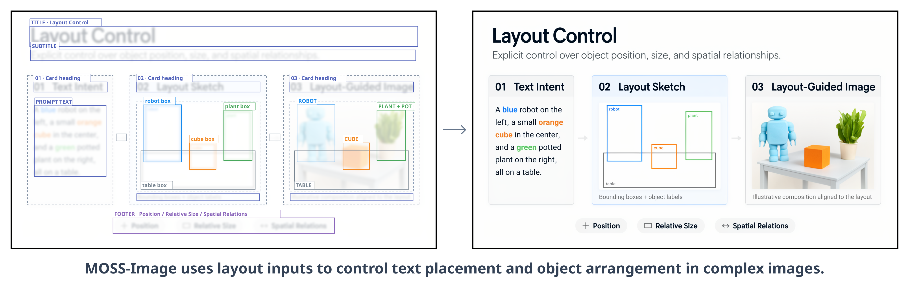
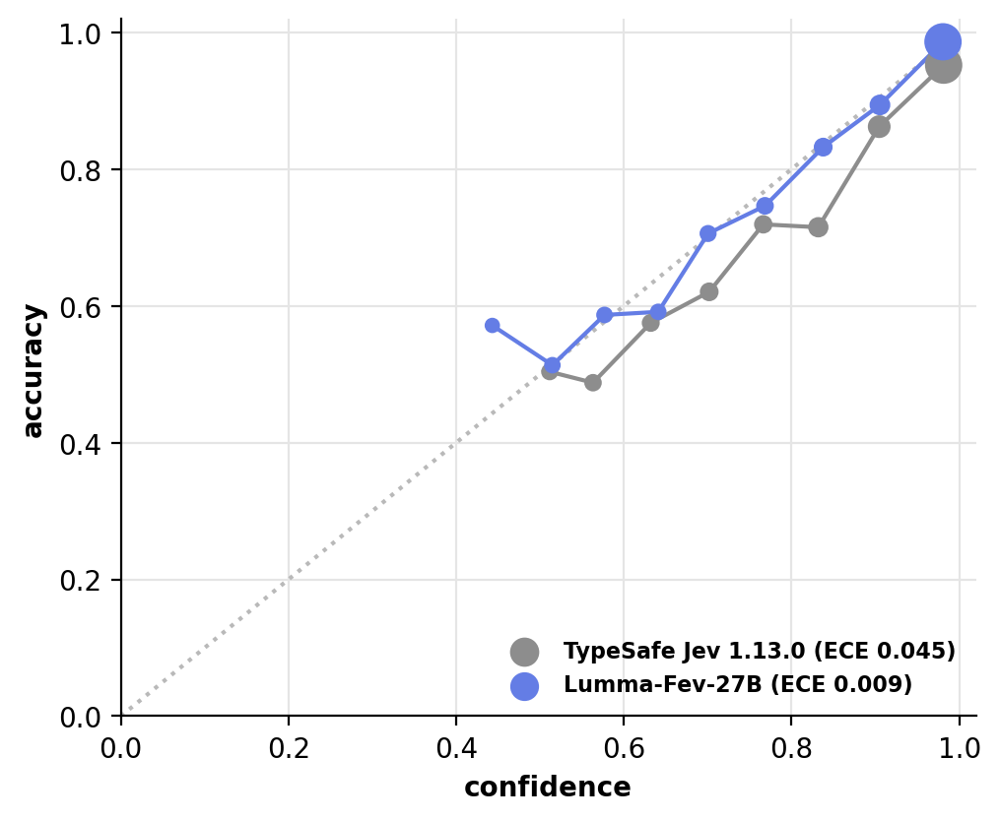

# 开源模型与开放权重

六个独立系列。这里保留栏目名称，但逐项区分标准开源许可、带限制的开放权重与尚未公开的训练方法。除 Apertus 的新技术披露外，原始日期为10月14—16日；没有把近期文件修改当成首次发布。

## 01 · MOSS-Image：用结构化布局约束图像生成

原始日期：2026-10-16；开放范围：Apache 2.0；随附组件各依原许可。

MOSS-Image 将文字描述与结构化布局结合，Base 与 SFT 合并为一个系列介绍。除了自然语言，示例还用 JSON 表达对象和位置；输入不只是一段模糊愿望，而是更明确的版面安排，输出仍是图片。仓库 10 月 16 日发布材料，模型仓库创建于 10 月 11 日，两个日期不混用。

OpenMOSS 仓库原图，Apache 2.0。先看框的位置，再看图中对象是否对应；这是作者示例，不保证每次生成都严格满足坐标（[来源原图](https://github.com/OpenMOSS/MOSS-Image)；[查看原尺寸](images/moss-layout.webp)。）

官方给出 Transformers、Diffusers 与 CUDA 路径，示例依赖 Python 3.10、PyTorch 2.9，包含 BF16 组件与 FP32 VAE 等精度安排；部署前要核对各组件和显存。代码与主权重采用 Apache 2.0，随附 FLUX.2 VAE 需另看原条款。

为什么现在值得看：**新近实用；官方输入输出示例与代码，本站未生成，热度待验证**。适合研究布局遵循、图文组合等任务；示例图不能证明普遍精确排版能力，更不能把栅格图片等同于可编辑设计文件。

[官方模型卡与文件](https://huggingface.co/OpenMOSS-Team/MOSS-Image-SFT)。

## 02 · Timestral：把预测区间也作为时间序列输出

原始日期：2026-10-14；开放范围：修改版 MIT，含收入门槛。

Timestral 提供 5M、28M、123M、209M 四种规模，本期以 209M 为入口，系列只计一次。它接收时间序列，可处理多变量、协变量与缺失值，输出未来预测和分位数；32 个时间步组成一个 patch，文档给出最长 32768 个历史位置与单次 1024 步预测范围。更长预测通过递推扩展，误差也可能累积。

Mistral 模型卡原图，按仓库附带修改版 MIT 条款引用。横轴是参数量（对数刻度），不是耗时；六个面板的纵轴误差均为越低越好。结合任务和规模读点位，不能据此推出实测推理速度；结果来自作者协议，并非本站测试（[来源原图](https://huggingface.co/mistralai/Timestral-209M)；[查看原尺寸](images/timestral.png)。）

最小路径需要 Python 3.10 以上和 PyTorch 2.4 以上，可用 CPU 或 GPU。许可并非标准 MIT：公司或雇主全球合并月收入超过 2000 万美元时，条款要求另行获得商业许可，不能直接按无条件商用推荐。

为什么现在值得看：**新近实用；官方基准和示例，本站未运行，热度待验证**。对需要不确定性区间的预测任务，比只输出一个点更便于后续决策；仍须检查时间泄漏、领域偏移以及递推误差。[许可原文](https://huggingface.co/mistralai/Timestral-209M/blob/main/LICENSE)。

[官方模型卡与文件](https://huggingface.co/mistralai/Timestral-209M)。

## 03 · Granite Switch 4.1：基础模型、决策适配器和语音组件分开用

原始日期：2026-10-14；开放范围：Apache 2.0。

Granite Switch 4.1 提供 8B 与 30B 路线及 128K 文本上下文，重点是让基础模型与不同用途的适配器配合。决策组件输出选择概率，Guardian 组件返回结构化判断；另有英语语音编码器进入级联流程，不能因为组合支持音频，就把主模型写成端到端联合训练的语音模型。

输入可以是待分类的文本或需要检查的请求，输出依所用适配器而变。官方环境明确涉及 PyTorch 2.11、Transformers 5.16—5.17 及特定 vLLM 范围；先按配套版本搭通一种用途，再扩展其他组件。英语转写还有大小写、标点等输出约定。

为什么现在值得看：**新近实用；模型卡、组件文件与示例核验，本站未部署，热度待验证**。同一基础模型服务多种明确任务，有助于研究模块化部署，但适配器不能随意互换，128K 也不意味着所有输入形式都能无损工作。主模型按 Apache 2.0 开放；显存仍取决于精度、批量和上下文。

[官方模型卡与文件](https://huggingface.co/ibm-granite/granite-switch-4.1-8b)。

## 04 · Lumma-fev-27B：为多语言任务返回选择概率

原始日期：2026-10-14；开放范围：Apache 2.0。

Lumma 在 Qwen3.8-27B 基础上用约十万条样本进行全参数训练，覆盖英语、印地语、泰米尔语、卡纳达语。它的目标是对候选选择作决策，一次前向返回概率，适用于路由、分类和过滤；并非一个新的通用长文聊天模型。模型文件创建于 10 月 13 日，技术介绍发布于 10 月 14 日。

作者在 4454 条保留决策样本上报告 90.7% 的准确率，对照 Jev 1.13 为 83.9%，并给出校准结果；另一组推理任务并非全面领先。应先看任务分布，再判断这个提升是否适合自己的数据。

FrontiersMind 官方文章原图，仅引用此校准图作研究解读，保留完整坐标与图例；图的单独再分发许可未明确，模型的 Apache 2.0 不自动延伸为博客图授权。沿置信度分组读实际表现；接近对角线意味着该评测分布上更一致，不是对单条答案的正确保证（[来源原图](https://huggingface.co/blog/FrontiersMind/lumma-fev-27b)；[查看原尺寸](images/lumma.png)。）

为什么现在值得看：**新近实用；作者保留集实验与模型卡，本站未运行，热度待验证**。官方给出约 55GB 可用显存、80GB 级 GPU 的部署建议，输入长度约 8192；需要配套 lumma-fev 包。仅输出概率也需承担大模型前向成本，低校准误差不能保证遇到新领域仍可靠。

[官方模型卡与文件](https://huggingface.co/FrontiersMind/Lumma-fev-27B)。

## 05 · Apertus v1.5：旧权重新增训练配方与技术报告

原始日期：2026-07-24；开放范围：Apache 2.0。

Apertus v1.5 的模型仓库创建于 7 月 24 日；本次入选依据是 10 月中旬技术报告与 10 月 15 日发布说明补齐的训练细节，绝不是“本周刚发布权重”。8B、70B 系列通过离散图像和音频表示融合输入，主要生成文本，音频能力仍有实验性质。

新材料解释继续预训练的阶段安排，以及 SFT、长上下文训练、可验证奖励、偏好优化等后训练步骤，还提供数据混合与训练资料。对研究者，新价值是能把模型表现和具体配方联系起来，而不只是重新下载旧检查点。

为什么现在值得看：**新近实用、新近创新的技术披露；官方报告与配方说明，本站未训练，热度待验证**。模型元数据标注 Apache 2.0；本次直接读取受限模型卡失败，使用公开官方技术文章核对，未宣称所有门控文件均已读到。262144 文本上下文和多模态组件意味着更高资源需求，不能由 8B 名称推断普通电脑即可处理最长输入。[10 月 15 日官方技术说明](https://huggingface.co/blog/swiss-ai/apertus-v15-release-notes)。

[官方模型卡与文件](https://huggingface.co/swiss-ai/Apertus-v1.5-8B)。

## 06 · VKORE-46M-NPU：一个训练于推理 NPU 的实验检查点

原始日期：2026-10-14；开放范围：Apache 2.0；训练关键方法尚未公开。

VKORE 发布约 4580 万参数的字节级小模型，用于短英文故事生成。模型卡称前向和反向计算运行在 32 颗 Rebellions ATOM-Max 上，并提供检查点及逐参数梯度比较记录。其公开证据主要是作者数值校验，不足以认定“全球首次”或证明 NPU 普遍优于 GPU。

该模型只有 256 位置上下文，训练使用 TinyStoriesV2-GPT4 的 validation 划分，因此不能再把同一划分成绩当作未见数据泛化。NPU 与 B200 对照采用不同同步方式，训练损失也不同；约相近的吞吐不构成严格成本或质量等价比较。

为什么现在值得看：**新近创新线索；作者数值实验与权重文件，本站未复现，热度待验证**。它给研究硬件反向计算的人提供可检查的梯度材料；但关键训练方法正在申请专利、待论文披露，当前无法完整复现。Apache 2.0 检查点不等于训练系统全部开源，上手示例仅加载文件，距离完整推理应用还有实现门槛。

[官方模型卡与文件](https://huggingface.co/FINAL-Bench/VKORE-46M-NPU)。
