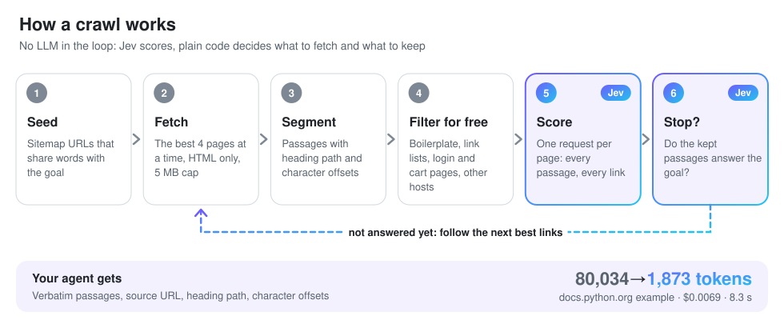
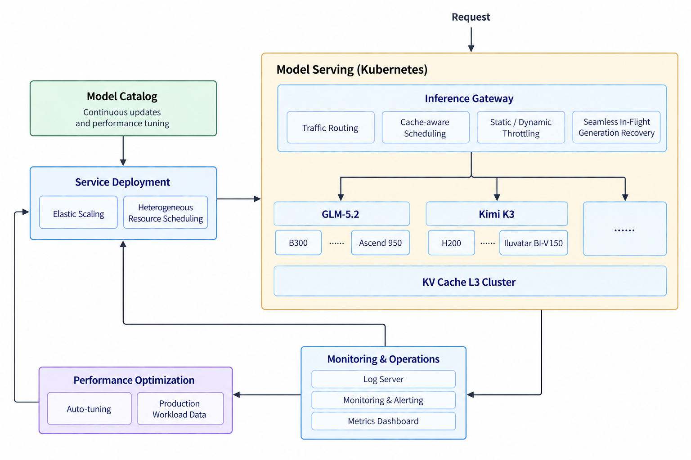
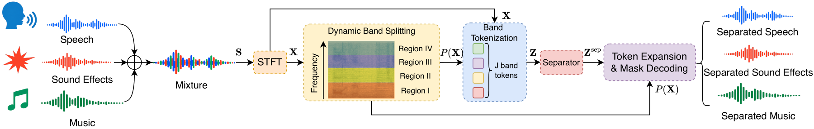
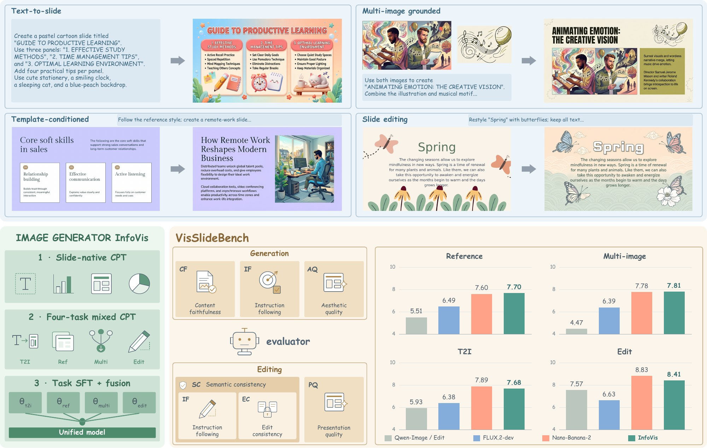
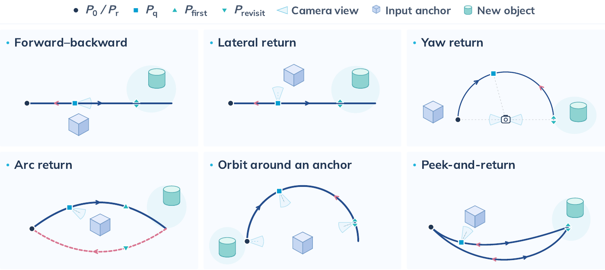

# 开源项目

比较超过15个候选后选择10项。来源包括开发者社区、作者发布、代码版本与Hugging Face论文线索；本期不把总Star当作近期热度。以下均核验代码、说明与许可，未在本站安装运行；已完成的本机小实验单独放在技术实践。

| 任务 | 项目 |
| --- | --- |
| 网页资料收集 | jevcrawl |
| 远程开发 | mosh-rs |
| 模型服务运维 | modelsphere |
| 空间决策推理 | MJev-Spatial |
| 交互空间评测 | RoTA-Bench |
| 音频分离 | Dynamic-Band-Splitting |
| 可编辑三维内容 | 3dcodeverse |
| 视觉内容创作 | InfoVis |
| 世界模型一致性评测 | orbia |
| 视觉序列评测 | WorldCast |

## 01 · Jevcrawl：为网页证据保留可回查的位置

本次新增事实日期：2026-10-13。

给定起始网址和具体目标，Jevcrawl 把网页内容整理成带 URL、标题路径、字符位置与摘要校验值的原文块。适合给问答系统准备可追溯证据；它避免把爬取和自由生成答案混成一件事。作者提供小规模 WebWalkerQA 对照，但样本、回答模型与网页处理条件有限，不能直接推广准确率。

作者仓库原图，Apache 2.0。按“起点→取页→分段→过滤→评分→停止判断”阅读；底部 token 数、费用和耗时只对应作者的 docs.python.org 单例，不是本站实测或普遍收益（[来源原图](https://github.com/RayenMlayeh/jevcrawl)；[查看原尺寸](images/jevcrawl.svg)。）

仓库创建于10月11日，10月13日UTC（北京时间14日）进入Show HN发现池。上手需Python3.11、uv和TypeSafe Jev服务凭据；动态网页另需Playwright/Chromium，外部服务可能计费。**新近实用；官方代码与作者对照，本站未运行，热度待验证**。不把来源哈希当成内容真实或防注入保证。

[规范仓库](https://github.com/RayenMlayeh/jevcrawl) · [Apache-2.0](https://github.com/RayenMlayeh/jevcrawl/blob/main/LICENSE)。

## 02 · mosh-rs：远程终端增加本地回滚与 Windows 客户端

本次新增事实日期：2026-10-13。

这个独立Rust移植保留mosh的UDP屏幕状态同步，支持与mosh1.4互通，并增加Windows原生客户端和可选本地历史回滚。研究者在不同网络间移动时，可以用它连接远程计算节点；但它不是端口转发工具，也不保证所有断网场景都无影响。

仓库10月13日创建，当前v0.1.3仍是pre-alpha。可下载对应平台二进制；回滚功能要求服务端也使用mosh-rs，普通连接可使用旧服务端。服务端限Unix，Windows ARM运行x86_64模拟版本；Mac应避开存在连接缺陷的v0.1.0。

**新近实用；作者互通与故障测试，本站未安装，热度待验证**。作者公开测试记录有复核价值，但尚无独立安全审计；终端缩放和历史缓存也有边界。

[规范仓库](https://github.com/Arunjay4213/mosh-rs) · [GPL-3.0](https://github.com/Arunjay4213/mosh-rs/blob/main/LICENSE)。

## 03 · ModelSphere：把模型路由、扩缩容和观察接到 Kubernetes

本次新增事实日期：2026-10-15。

ModelSphere 面向已有集群，把模型部署、缓存感知路由、SLO扩缩容和故障观察组织为可配置组件。输入是环境配置与模型服务定义，输出是可访问的推理服务和运维视图，适合多副本服务管理，不是单机聊天界面。

ModelSphere 仓库原图，Apache 2.0。先找请求入口，再看模型后端与控制组件；架构可用性不等于已在本站完成部署（[来源原图](https://github.com/modelsphere/modelsphere)；[查看原尺寸](images/modelsphere.png)。）

仓库原始日期9月27日，本次依据是10月15日v0.1.0实质发布。需要Kubernetes、kubectl、Helm、Helmfile及相应插件，按环境配置执行helm-apply，再部署SGLang或vLLM chart。**新近实用；正式标签、安装文档与代码核验，本站未部署，热度待验证**。GPU、存储、网络和认证均需配置，AutoTune仍属预览，不能把宣传收益直接套用。

[规范仓库](https://github.com/modelsphere/modelsphere) · [Apache-2.0](https://github.com/modelsphere/modelsphere/blob/main/LICENSE)。

## 04 · MJev-Spatial：让空间选择任务复用模型的注意力计算

本次新增事实日期：2026-10-15。

MJev-Spatial 复用Qwen3.5-4B的原生Q/K匹配，为候选答案给分，公开推理、训练与评测入口。输入是带图像的空间问题和候选，输出决策分数或解码后结果；适合研究选择题与点位定位，减少把答案写成长文本的需求。

仓库9月24日已创建，10月15日新论文与实现说明构成本次进展。Python3.10、CUDA和配套权重是主要前置条件，按inf或train可选依赖安装。分类是一次决策；数值要粗到细，点位定位会经过三轮网格细分与裁图，不能把所有任务都写成一次前向结束。

**新近创新、新近实用；作者实验、公开接口与代码，本站未运行，热度待验证**。改善来自任务表达与推理方式，仍依赖候选设计、图像质量和基础模型能力。

[规范仓库](https://github.com/Fr0zenCrane/MJev-Spatial) · [Apache-2.0](https://github.com/Fr0zenCrane/MJev-Spatial/blob/main/LICENSE)。

## 05 · RoTA-Bench：通过转动物体检验三维空间推理

本次新增事实日期：2026-10-13。

RoTA-Bench给Agent目标轮廓、辅助视图和当前投影，要求逐步选择三维旋转，使投影与目标对齐。它有实际环境、任务浏览器和评测代码，能检查模型是否在交互中修正空间判断，而不只回答一张静态图片。

公开集为674项；原676项中有两项因图标版权移除，不能继续报告676项全部可下载。正式评测使用冻结的100任务子集，需要Git LFS、CUDA版PyTorch及兼容模型端点，配置最多48步并明确是否给指标反馈。

**新近实用、新近创新；10月13日论文与代码，作者实验，本站未运行，热度待验证**。适合复核旋转操作和目标对齐；模型API费用、GPU渲染与任务子集会影响复现，交互演示不能替代完整基准。

[规范仓库](https://github.com/MAC-AutoML/RoTA-Bench) · [Apache-2.0](https://github.com/MAC-AutoML/RoTA-Bench/blob/main/LICENSE)。

## 06 · Dynamic Band Splitting：按当前混音决定频带边界

本次新增事实日期：2026-10-10。

DBS不是始终使用一组固定频带，而是根据当前混音预测切分位置，保持固定数量的频带token，再交给原有分离骨干。输入一段音频，示例输出音乐、音效和语音，也可返回动态边界用于观察。

清华团队仓库方法原图，Apache 2.0。看频带边界随输入变化，而token数量保持固定；图示不意味着所有骨干使用相同切分规则（[来源原图](https://github.com/JusperLee/Dynamic-Band-Splitting)；[查看原尺寸](images/dbs.png)。）

10月10日已发布代码、权重和演示；README的10月15日新闻日期不替代arXiv原始日期。上手需Python3.11、PyTorch及配套依赖，官方示例用44.1kHz音频；BSRNN与TIGER的分块窗口不同。**新近实用、新近创新；作者数据集实验与可运行接口，本站未分离音频，热度待验证**。真实录音、立体声处理与分块边界仍需单独验证。

[规范仓库](https://github.com/JusperLee/Dynamic-Band-Splitting) · [Apache-2.0](https://github.com/JusperLee/Dynamic-Band-Splitting/blob/main/LICENSE)。

## 07 · 3DCodeVerse：把三维生成变成执行、测量与修复循环

本次新增事实日期：2026-10-15。

3DCodeVerse让编码Agent产生Blender、Three.js等原始程序，再执行、测量尺寸与碰撞、渲染并用视觉评判反馈修复。输出是程序和运行记录，适合希望修改几何关系而不只获得一张渲染图的人。

仓库早于本周，8月23日创建；10月15日论文与约200万可执行程序生态的公开材料是新增依据。官方最小路径以Linux、Python3.13、Node20.6以上为基础，调用厂商编码CLI和对应渲染器；生成与评判可能消耗模型额度。代码Apache2.0，数据另有非商用条款。

**新近实用、新近创新；作者执行基准和公开harness，本站未运行，热度待验证**。执行成功不保证几何正确，视觉评分也不等于工程验收；其测量反馈恰好用于补足这两类差别。

[规范仓库](https://github.com/gaoypeng/3dcodeverse) · [Apache-2.0](https://github.com/gaoypeng/3dcodeverse/blob/main/LICENSE)。

## 08 · InfoVis：生成和编辑幻灯片图片的统一实现

本次新增事实日期：2026-10-12。

InfoVis围绕9B图像模型统一文字生成、模板引导、多参考图和编辑任务，输出幻灯片样式的栅格图片。它不输出可编辑PowerPoint对象；若需要修改图表数据或文字框结构，仍需另一套文档工作流。

VectorSpaceLab 仓库原图；代码Apache2.0，模型与数据另有非商用限制。本图仅用于说明论文中的输入输出任务；细节请打开原尺寸（[来源原图](https://github.com/VectorSpaceLab/InfoVis)；[查看原尺寸](images/info-vis.jpg)。）

10月12日论文，仓库10月9日创建。推理脚本接收prompt、图像、宽高与权重路径，环境示例是Python3.12、PyTorch2.7.1/CUDA12.6。**新近实用；官方演示与实验，本站未生成，热度待验证**。代码许可不能覆盖权重：FLUX相关权重按非商用条款，数据CC BY-NC4.0，需按自己的用途分别检查。

[规范仓库](https://github.com/VectorSpaceLab/InfoVis) · [Apache-2.0](https://github.com/VectorSpaceLab/InfoVis/blob/main/LICENSE)。

## 09 · Orbia：镜头转回来，场景是否仍然一致

本次新增事实日期：2026-10-14。

Orbia给生成模型输入图像、描述和相机轨迹，让镜头探索、重访并回到起点。720个案例分别检查输入内容保留、新生成内容持续性和三维自洽性，将“画面好看”与“世界一致”拆开。

作者仓库轨迹原图，Apache 2.0。箭头表达控制路径，彩色位置说明同一区域何时被再次看见；不是模型生成画面的实测结果（[来源原图](https://github.com/worldbench/orbia)；[查看原尺寸](images/orbia.png)。）

10月14日论文，代码含模型适配器和评价入口。需Conda、FFmpeg、CUDA12.8及评测权重，接入适配器后先生成视频，再运行evaluate.py输出分层分数。**新近实用；作者27模型比较与公开实现，本站未运行，热度待验证**。代码Apache2.0，数据CC BY-NC-SA4.0且继承来源限制；估计的深度、相机与跟踪误差也会影响分数。

[规范仓库](https://github.com/worldbench/orbia) · [Apache-2.0](https://github.com/worldbench/Orbia/blob/main/LICENSE)。

## 10 · WorldCast：统一检查图像与视频里的状态变化

本次新增事实日期：2026-10-12。

WorldCast把320个人工设计案例、1352个视觉状态组织为八类任务。模型输出网格图、连续图片或视频后，适配器整理成有序关键帧，再由GPT-5.5结合人工标注的HINTS评判。输入模型不能看到这些评判提示，否则会产生答案泄漏。

代码与数据工具10月12日公开，论文10月14日提交。Python3.10以上安装后可用worldcast download、split-grids和run；视频转帧还需要FFmpeg与已认证的Codex CLI。评判调用会消耗API额度，本站没有发起付费运行。

**新近实用；官方案例、适配器与作者评测，本站未复现，热度待验证**。统一格式便于比较，但帧选择、评判模型偏差和人工提示质量仍会改变分数；所谓能力层级是作者框架，不是通用认证。

[规范仓库](https://github.com/teal024/WorldCast) · [MIT](https://github.com/teal024/WorldCast/blob/main/LICENSE)。
