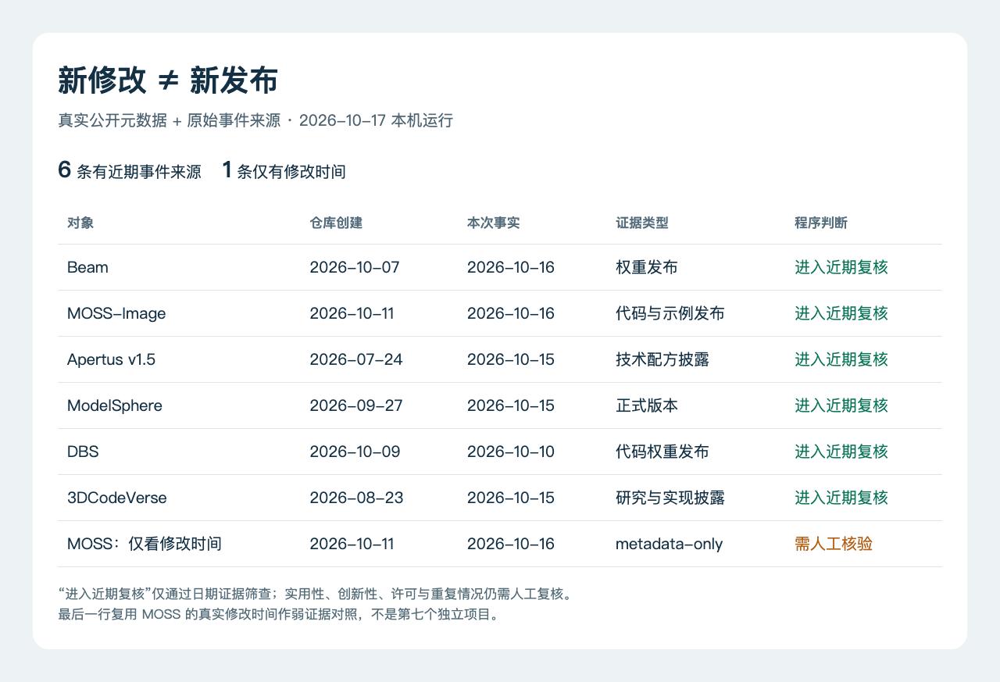

# 技术实践：为“新进展”保留两种日期

**已运行验证。** 这次做一个很小的日期检查器：输入对象的原始日期、这次新增事实的日期和原始来源，输出是否进入近期人工复核。它不判断论文好坏，也不自动决定某条新闻应该入选。

## 为什么不能只看最后修改时间

模型仓库可能提前创建，稍后才正式开放；老项目也可能在几个月后公开新的研究材料。相反，README 改一个拼写就会刷新修改时间，不能据此称它为新产品。本期就有两个不同例子：Beam 仓库创建于 10 月 7 日，权重公告在 10 月 16 日；Apertus v1.5 的仓库日期是 7 月 24 日，但 10 月 15 日新增了技术配方说明。

这里的 `originalDate` 对本组样例明确指仓库创建日期，**不自动等同于首发日期**；`newFactDate` 指已经人工查过原始来源的新增事实日期。两者都要保留自己的含义，不能互相覆盖。

## 输入、实现与运行方式

附件包括 [输入记录](code/date-inputs.json)、[完整 Python 脚本](code/date-provenance.py)、[本机结果](code/date-results.json) 和 [结果图的 HTML/JS 源码](code/date-results.html)。Python 3.10 及以上即可，不需要第三方包、API key 或网络请求。本次运行环境是 macOS（Darwin）、Python 3.14.3。

下载前三个文件并放在同一目录，执行：

```bash
python3 date-provenance.py
```

程序以 2026-10-17 为本次执行日期，核心判断如下：

```python
age = (ISSUE_DATE - date.fromisoformat(row["newFactDate"])).days
if row["evidenceType"] == "metadata-only":
    status = "需人工核验"
elif not row.get("eventSource"):
    status = "需人工核验"
elif age < 0:
    status = "日期异常"
elif age <= 7:
    status = "进入近期复核"
else:
    status = "超出7天"
```

输入中的前六项来自本期已经读取的公告、仓库和元数据。第七项特意只保留 MOSS-Image 的同一份真实修改日期，作为**弱证据对照**：没有给它补上发布公告，程序就不能把修改时间解释成新进展。它不是第二个项目，也不是伪造的发布事件。

## 实际输出

2026-10-17 北京时间 07:55 的本机运行得到：**6 项进入近期复核，1 项需人工核验**，网络调用数为 0。下面的表图由实际 `date-results.json` 渲染，显示的是规则执行结果；“进入近期复核”不是选题通过率或事实准确率。



制作方式：HTML/JS 忠实呈现本机输出；无来源原图能表示这次运行，生成图也不适合准确复写逐项日期和状态。[结果数据](code/date-results.json) · [可复现源码](code/date-results.html) · [查看原尺寸](images/date-results.png)。手机上可按下表阅读日期，完整图用于核对运行输出。

| 对象 | 仓库创建日期 | 新增事实日期 | 实际输出 |
| --- | --- | --- | --- |
| Beam | 10-07 | 10-16，权重开放 | 进入近期复核 |
| MOSS-Image | 10-11 | 10-16，代码与示例发布 | 进入近期复核 |
| Apertus v1.5 | 07-24 | 10-15，技术配方披露 | 进入近期复核 |
| ModelSphere | 09-27 | 10-15，v0.1.0 正式版本 | 进入近期复核 |
| DBS | 10-09 | 10-10，代码权重公开 | 进入近期复核 |
| 3DCodeVerse | 08-23 | 10-15，研究与实现披露 | 进入近期复核 |
| MOSS 弱证据对照 | 10-11 | 仅有 10-16 修改记录 | 需人工核验 |

## 这个结果不能证明什么

脚本信任人工填入的日期和证据类型，不读取链接、不验证内容是否真实，也不处理带时区的小时级时间窗。这里的近 7 天按日期差计算，包含差值为 7 的边界；用于优先 24 小时的新闻时，需要另加具体时间和时区规则。

真正的下一步仍是打开原始材料，判断变化是否实质、证据是否足够、近 7/30 天是否已介绍过。若将它用于自己的文献收集器，先保留这些字段和原始链接，再考虑自动排序；不要让一个更新时间字段替代阅读与判断。
