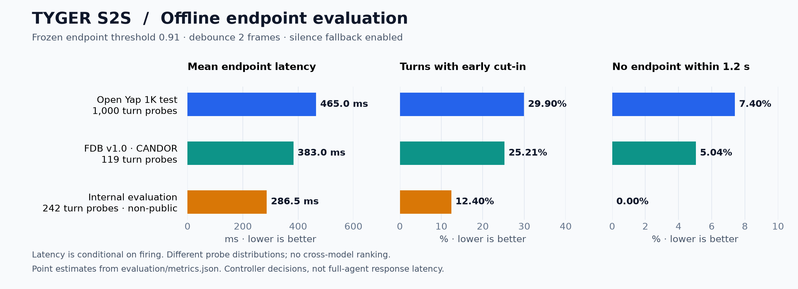
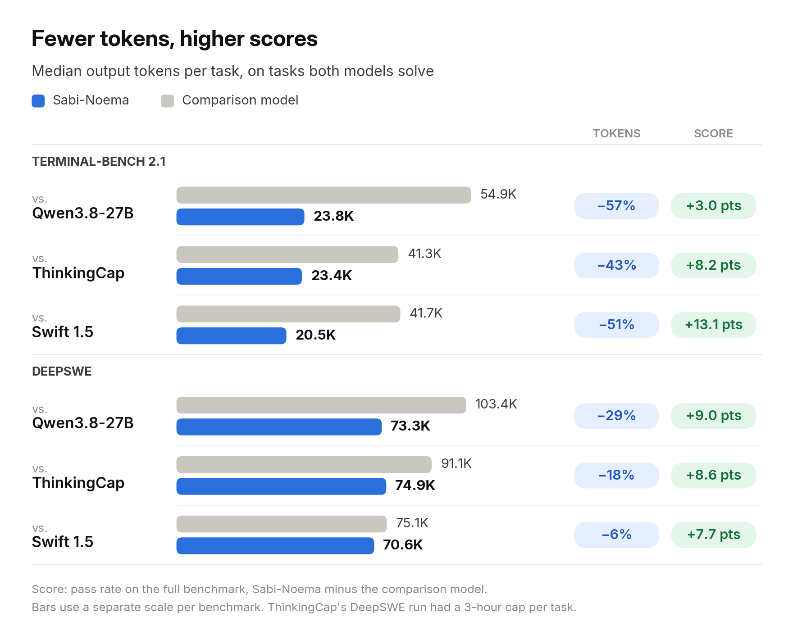

# 六个开放模型：循环计算、类型化判断与交互控制

本栏原日期为 2026-10-12 至 2026-10-16，均为近 7 天补充；不与新闻栏的 DeepSeek、Decider 重复推荐。所有项目均核对实际权重文件清单，本站未运行这些模型。不同数据、硬件和 harness 的分数不作统一排行榜。

## 01 · Dory 1.0 4B：重复使用同一组层，按任务分配计算

**2026-10-16｜近期补充｜新近实用 / 新近创新｜OpenMDW-1.1**

Dory 的输入仍是文本，输出仍是文本；变化藏在中间：它让一组共享参数的层反复执行，使用 1、2、4 次循环等不同计算预算。模型约 4B 参数，卡片给出输入、循环、输出三段结构。对读者来说，核心直觉是“多想一轮”可以复用已有参数，不必每轮新增一整套网络。

这种设计也改变 KV cache 的处理。官方实现提供只保存最后一轮缓存的策略，以减轻缓存随循环次数扩大的问题；这不等于所有内存开销都与循环次数无关。下图应先看中间重复出现的 R，再看最右侧输出，避免把循环层看成多个独立模型串联。

开放 BF16 权重和运行说明，许可为 OpenMDW-1.1，模型卡标注英语、256K 上下文。推理说明依赖适配的 vLLM 分支，不能直接假定任意稳定版 Transformers / vLLM 都已支持。本站没有下载运行 4B 权重，循环次数与延迟的实际收益须在目标设备、目标题目上比较。

为什么现在值得看：10 月 16 日公开的新检查点让“固定参数、可变推理计算”有了可检查的实现。能力依据为官方模型卡与实验；热度待验证，不能把少量任务上的更多计算收益推成普遍规律。

中文读图：I 是输入段，R 是共享循环段，O 是输出段。重复出现的 R 表示同一组权重多次执行，不是多个独立模型。NVIDIA 模型卡原图；循环预算和缓存策略需与运行配置一起记录。（[来源原图](https://huggingface.co/nvidia/NVIDIA-Nemotron-Labs-Dory1.0-4B-BF16)；[查看原尺寸](images/dory.png)。）

[模型卡、文件与部署说明](https://huggingface.co/nvidia/NVIDIA-Nemotron-Labs-Dory1.0-4B-BF16)。

## 02 · span-02：为类型化决策准备的 Blackwell 推理包

**2026-10-13｜近期补充｜新近实用 / 新近创新｜Apache-2.0**

span-02 面向选择、是非、分数等结构化判断，也能接收有限数量的图片。应用可以把工单、候选答案和约束交给它，直接得到类型明确的决策，减少自由文本解析。它基于 Gemma 4 26B-A4B，并采用约 16.4 GB 的 NVFP4 / FP8 部署形式。

要特别留意运行环境：这是配套 Rust / CUDA 引擎的发布包，面向 Blackwell，例如 RTX 5090、RTX PRO 6000；不能把小体积等同于普通笔记本可直接加载，也不能假定兼容常规 Transformers 或 vLLM 路径。官方在一张 RTX PRO 6000 上报告 DecisionIndex 分数及延迟，输入分布和服务设置共同决定结果，本文不与不同硬件模型横排速度榜。

模型卡标注 Apache-2.0，配套引擎另有源码与许可入口；本次独立 LICENSE 文件入口未成功取得，开放范围以已读取的模型卡声明及上游声明为依据。本站未运行。为什么现在值得看：10 月 13 日公开的权重把类型化判断与特定硬件部署一起交付；验证程度为官方说明与作者基准，独立采用和热度仍待验证。

[模型卡、文件与部署说明](https://huggingface.co/respanai/span-02)。

## 03 · Tyger：听懂何时接话，而不只识别说了什么

**2026-10-12｜近期补充｜新近实用 / 新近创新｜OpenMDW-1.1（权重）；Apache-2.0（代码）**

语音 Agent 既要避免打断用户，也不能在人已经讲完后等太久。Tyger 接收对齐的用户音频和 Agent 播放音频，预测 listen、hold、speak、backchannel 等交互状态。它不是一个直接生成语音的大模型，而是可插入实时语音栈的回合控制器。

结构约 652M 参数，其中大部分是冻结的语音编码器，另有较小的 GRU 控制层。输入是 16 kHz 单声道，特征与推理窗口具有明确时间步长；接入时必须处理播放音频与麦克风音频的对齐。权重约 2.61 GB FP32，模型采用 OpenMDW-1.1，`tyger-s2s` 代码采用 Apache-2.0。

作者在 OpenYap 的 1,000 个回合探针上给出延迟与打断率。图中固定阈值条件下，约 465 ms 的延迟伴随 29.90% 的过早结束率，还有 7.4% 在 1.2 秒内未形成结束点。看起来快，不代表交互已经自然。阈值一变，等待与打断的权衡也会变；不要把这项延迟写成完整语音 Agent 的端到端响应时间。

为什么现在值得看：10 月 12 日公开了可复用控制权重与代码，直接对应实时交互的一个难点。验证为作者离线实验；英语与自动生成的回合标签限制了外推，本站未做麦克风实测，热度待验证。

中文读图：三幅图分别展示等待、提前截断及未检测到结束点；必须一起看。OpenYap 的作者离线实验，固定阈值条件，不是本站语音对话测试，也不是不同系统的端到端速度排行榜。（[来源原图](https://huggingface.co/nineninesix/tyger)；[查看原尺寸](images/tyger.png)。）

[模型卡、文件与部署说明](https://huggingface.co/nineninesix/tyger)。

## 04 · Sabi Noema：少用 token 的收益，要先问统计了哪些题

**2026-10-13｜近期补充｜新近实用 / 新近创新｜Apache-2.0**

Sabi Noema 是在 Qwen3.8-27B 上进行强化学习的编码模型，公开 BF16 权重约 55 GB，模型卡给出 vLLM 0.31 和长上下文配置。它面向终端、软件修复任务，输入代码仓库与问题，输出多步工具使用和修改建议；这些工具仍需由外部 harness 执行。

作者报告 Terminal-Bench 2.1 为 76，对照基础模型为 73；DeepSWE 为 47.5，对照为 38.5。评测使用特定 H100、张量并行和并发设置，并排除了基础设施故障。更容易误读的是 token 节省图：它只对两个模型都解决的题统计消耗，不能把“约 2.3 倍更省”套到所有题、所有失败轨迹或实际账单。

下图把任务成绩和共同成功题上的资源用量放在一起。读右侧分数差时看全套任务，读左侧 token 柱条时换成共同成功子集；上下两个任务组还采用不同刻度。它提供了一个值得复查的后训练取舍，但不构成独立复现。

为什么现在值得看：10 月 13 日的新权重公开了减少冗余推理的可核对结果。Apache-2.0；需要大显存及工具执行环境，本站未运行，热度待验证。适合先用自己的固定任务和失败统计复测，再决定是否替换服务。

中文读图：任务成绩与 token 用量的分母不同。节省统计限定为两个模型共同解出的题，且各任务组的 token 横向刻度不同；不能按柱长直接跨任务比较。Sabicap 官方评测原图，非本站实测。（[来源原图](https://huggingface.co/sabicap/sabi-noema)；[查看原尺寸](images/sabi.png)。）

[模型卡、文件与部署说明](https://huggingface.co/sabicap/sabi-noema)。

## 05 · trim-1：用小型树模型裁剪上下文，保留原句也可能丢证据

**2026-10-14｜近期补充｜新近实用 / 新近创新｜Apache-2.0**

trim-1 是约 1.2 MB、712 棵树的 LightGBM 模型，不是聊天基础模型。它接收问题和长文本，判断哪些行应保留，输出仍使用原文措辞并标记省略处。它可在 CPU 上执行，适合放在大模型前面，减少发送上下文的长度。

它的保护规则值得一起看：空问题、很短输入、超过体积或行数上限、节省不足等情况会放弃裁剪。即使没有改写任何句子，被删掉的行也可能恰好是必要证据。作者的 balanced 设置在部分多跳与长文本集合上保留较高证据比例，但针在草堆任务的证据保留约为 75%，对应下游问答准确率从完整输入的 91.7% 降到约 70%。

为什么现在值得看：10 月 14 日公开的轻量模型把“省 token”变成可量化、可回退的预处理任务。Apache-2.0，配套 `caveman-ai/trim-1`；本站未运行，依据为作者测试与规则文档。真实使用应同时记录节省率、证据召回和最终答案质量，不能只把输出短当成成功，热度待验证。

[模型卡、文件与部署说明](https://huggingface.co/caveman-so/trim-1)。

## 06 · Amos-1-large：把多个决策头接到同一份上下文

**2026-10-12｜近期补充｜新近实用 / 新近创新｜Apache-2.0**

Amos-1-large 基于 Qwen3.8-27B，为同一上下文添加多个类型化决策头。文本、JSON 或图片进入共享模型后，不同头可以各自返回选择或分数，适合把路由、筛选和属性判断合并。公开内容包含权重、决策头、校准材料及服务实现，而不是仅提供一个托管演示。

官方模型卡给出约 80 GB GPU、Python 3.12、PyTorch 2.14 以及 131,072 上下文的运行条件。作者在 2,000 个类型化决策测试上报告零样本约 76.1%，其同表对照 pplx v1.1 约 73.9%；经过先验拟合的约 80.25% 是另一种条件，不能与零样本混在一起。不同数据集、校准方式也使它无法直接与本期其他决策模型做无条件排名。

为什么现在值得看：10 月 12 日公开的模型展示了多头决策的具体实现与校准取舍。Apache-2.0，本站核验文件和说明，未运行或独立复现。读者可以先比较“共享上下文后会不会相互干扰”和校准迁移成本，热度待验证。

[模型卡、文件与部署说明](https://huggingface.co/mukaddamzaid/amos-1-large)。
