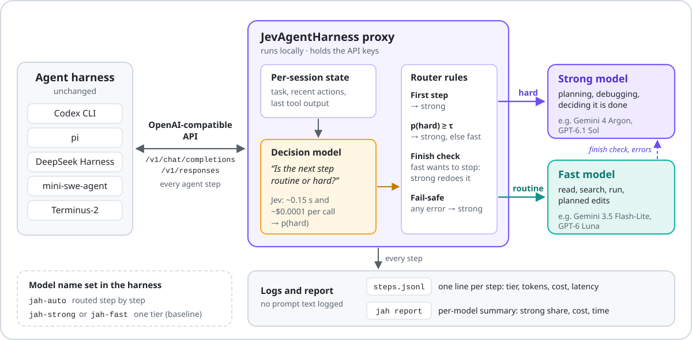
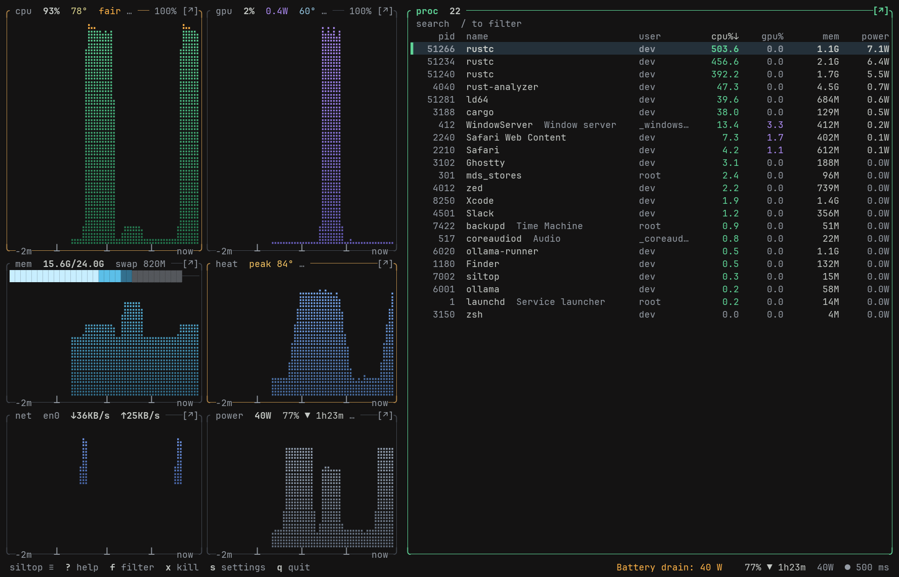
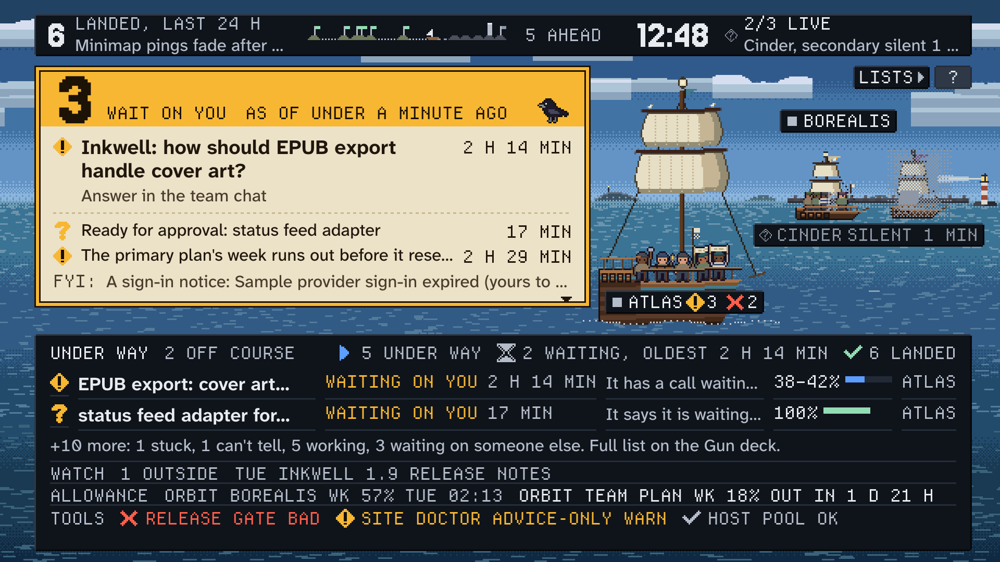

# 十个开源项目：先看任务，再看工具

本期核验规范仓库、许可文件、发布记录和最近提交，并与近 7 / 30 天内容按仓库去重。以下均未在本机安装运行；演示和实验归属分别说明。单次讨论与总 Star 不构成“近期热门”的充分证据，热度待验证。

|任务|项目|门槛|
|---|---|---|
|稀疏注意力实验|FlashMask|匹配的 NVIDIA GPU 与框架|
|Agent逐步路由|JevAgentHarness|Python、模型后端|
|本地推理观测|siltop|Apple Silicon|
|定时任务状态看板|Weatherdeck|Python 3.9+|
|编码任务工作区|Orca|桌面端、已有Agent|
|硬件容量与速度预估|LLM Speed|浏览器；结果是估算|
|视频配音与检查|dub-anything|音视频工具与模型|
|二进制重编译研究|ps2-web-recomp|编译链、自有合法镜像|
|阅读与开发窗口组织|TinyWM|macOS、辅助功能权限|
|固件初步验证|esp32sim|浏览器或Rust工具链|

## 01 · FlashMask：把复杂 attention mask 交给稀疏内核

**2026-10-14｜近期补充｜新近实用；原方法2024；README版本日期2026-09-25；独立实现库2026-10-14公开，相关新论文10月13日。**

输入列式描述的 mask，输出对应的稀疏注意力计算，适合长上下文训练与特殊可见性模式。近期价值是方法与独立实现的结合：不要把 10 月 14 日建库日期写成算法首发。仓库区分 Ampere、Hopper、Blackwell 对应实现，部分内核采用 CuTe DSL，并提供 Paddle / PyTorch 接口；先按显卡架构选择安装路径，再跑仓库最小 mask 示例。论文速度收益依赖稀疏形状、头维度与硬件，不等于任何 Transformer 都能直接获得同等提升。维护主体为 PaddlePaddle，当前仓库活跃；本期核对实现与作者实验，未编译 GPU 内核。

为什么现在值得看：实现自定义注意力模式，减少稠密mask存储。

中文读图：不同层次分别处理 mask 表示、稀疏计算及分布式调度，不能把整个系统的收益只归给一个 kernel。PaddlePaddle 仓库原图，BSD-3-Clause。（[来源原图](https://github.com/PaddlePaddle/FlashMask)；[查看原尺寸](images/flashmask.jpg)。）

[规范仓库](https://github.com/PaddlePaddle/FlashMask) · 许可：[BSD-3-Clause](https://github.com/PaddlePaddle/FlashMask/blob/main/LICENSE)。

## 02 · JevAgentHarness：在代理入口切换强弱模型

**2026-10-15｜近期补充｜新近实用；10月15日公开alpha代理实现及论文。**

它在 OpenAI 兼容代理层路由请求：关键起始或结束环节使用较强模型，中间步骤可走较快模型，决策出错时回退。输入既有 Agent 请求，输出仍保持兼容格式，适合在不重写工具客户端的情况下比较路由策略。最小路径为 Python 3.10+ 环境安装源码，执行 jah init、jah serve，再配置模型入口；真实后端可能需要 Gemini、OpenRouter 等服务凭据或本地规则。作者在 74 个留出终端任务上报告不同配置节省成本和时间，成功率也随配置变化。当前为 alpha；本站核验文档、实现与论文，未运行付费后端。

为什么现在值得看：用固定工具客户端比较逐步路由与费用取舍。

中文读图：模型选择发生在请求代理层，结束判断和异常路径会回到强模型。图中费用属于作者设定，不能套用为今日服务报价；MIT 仓库原图。（[来源原图](https://github.com/JevAgentHarness/JevAgentHarness)；[查看原尺寸](images/jev.svg)。）

[规范仓库](https://github.com/JevAgentHarness/JevAgentHarness) · 许可：[MIT](https://github.com/JevAgentHarness/JevAgentHarness/blob/main/LICENSE)。

## 03 · siltop：在 Apple Silicon 上同时看负载、功耗和温度

**2026-10-16｜近期补充｜新近实用；10月16日新仓库及1.2系列发布。**

运行本地推理时，单看 CPU 百分比常看不出 GPU 是否真的工作。siltop 将 Apple Silicon 的计算负载、功耗、温度和进程信息放在终端，输入是系统传感器，输出是可持续观察的面板。官方提供 Homebrew 安装及 macOS ARM 二进制，源码要求 Rust 1.98+；无需 root 读取相关接口，但系统版本可能改变传感器行为。作者还记录过陈旧读数，面板显示数据年龄比把旧数值当实时值更重要。下图是仓库演示，不是本机跑模型的结果。项目刚公开、维护历史短，本站未安装，热度待验证。

为什么现在值得看：定位本地模型任务在CPU还是GPU受限。

中文读图：演示画面中 CPU 与 GPU 负载不同，说明只看总占用可能误判瓶颈。图中百分比、功耗均是作者演示数据，不是本机测量；MIT / Apache-2.0 仓库原图。（[来源原图](https://github.com/CLoaKY233/siltop)；[查看原尺寸](images/siltop.png)。）

[规范仓库](https://github.com/CLoaKY233/siltop) · 许可：[MIT OR Apache-2.0](https://github.com/CLoaKY233/siltop/blob/master/LICENSE-APACHE)。

## 04 · Weatherdeck：把没有上报的数据明确显示为未知

**2026-10-16｜近期补充｜新近实用；10月16日新公开看板及v0.10.0。**

各任务通过 HTTP 发送 JSON 状态，Weatherdeck 用 SQLite 保存并生成手机或大屏看板。适合日报抓取、训练作业或人工交接：任务长时间没上报时显示过期、静默，避免把“没有新错误”当成正常。它使用 Python 3.9+ 标准库；从源码或发布包运行 python3 bin/weatherdeck run --demo，当前不支持 pip install。演示使用三个人造来源，会故意让其中一个停止上报。它提供状态可见性，不能自动代替告警策略和故障恢复。10 月 16 日首次公开，维护者与历史规模仍小；本站核验代码入口和官方演示，未运行服务。

为什么现在值得看：把定时作业和人工交接的状态放到同一个轻看板。

中文读图：Live 的数量和 Silent 标记同时出现，离线来源没有被画成健康。截图来自作者的虚构演示数据，示范的是状态表达，非真实生产事故；MIT 原图。（[来源原图](https://github.com/Moshik21/weatherdeck)；[查看原尺寸](images/weatherdeck.png)。）

[规范仓库](https://github.com/Moshik21/weatherdeck) · 许可：[MIT](https://github.com/Moshik21/weatherdeck/blob/main/LICENSE)。

## 05 · Orca：把多种编码 Agent 的任务放进桌面工作区

**2026-10-17｜近期补充｜新近实用；项目始于3月，10月17日v1.4.229增加原生聊天、行内编辑、技能等实质能力。**

Orca 是已有项目，本次依据 v1.4.229 的实质更新入选：原生聊天、行内编辑与技能支持等改动让任务编辑和执行反馈更贴近代码工作区。使用者可以连接现有编码 Agent，组织仓库与任务，不必在多个终端窗口间反复搬运上下文。最短路径是官方桌面发布包，再配置自己已有的 Agent CLI 或服务账号；下载客户端不会自动带来模型额度。仓库 MIT，第三方模型和账户另行授权。[9 月 18 日已介绍过桌面会话管理](../../09/2026-09-18/04-开源项目.md)，这次增加的是上述具体版本能力。当前仍密集发布，应固定版本并用小仓库验证行为；本站只核对版本说明与实现入口，未把功能清单当成生产可靠性证明。

为什么现在值得看：在一个桌面入口组织多仓库和多Agent开发任务。

[规范仓库](https://github.com/stablyai/orca) · 许可：[MIT](https://github.com/stablyai/orca/blob/main/LICENSE)。

## 06 · LLM Speed：选本地硬件前，先分清估算和实测

**2026-10-17｜近期补充｜新近实用；原项目8月28日；10月17日Show HN重新出现实质讨论，模型与硬件目录持续更新。**

输入模型、量化和硬件选择，页面模拟首字等待与连续输出，帮助读者在买设备或下载大权重前形成大致预期。它混合已测、推导、预测等不同置信度的数据；浏览器动画不是正在运行所选模型。近期讨论中有用户指出自己的设备速度与估算不符，这正说明应核对来源与条件。源码使用 Vite / Preact，可按 README 的 npm 路径本地启动，不需要为动画接入模型 API。10 月 17 日 HN 讨论被观察到，但缺第二类独立热度证据，因此标热度待验证；本站未复现硬件基准。

为什么现在值得看：比较本地模型的容量与交互延迟估算。

[规范仓库](https://github.com/nicorobinreal/llmspeed) · 许可：[MIT](https://github.com/nicorobinreal/llmspeed/blob/main/LICENSE)。

[10 月 17 日的实际讨论](https://news.ycombinator.com/item?id=50127979)。

## 07 · dub-anything：给配音流程加一轮回译式质量检查

**2026-10-07｜近期补充｜新近实用；10月7日新项目，10月14日社区发布；近30天补充。**

视频和目标语言进入流程后，工具组织翻译、逐行配音与合成，产出包含原声、配音和字幕轨的文件；再把生成音频转写回来，辅助发现遗漏或错读。这是可检查的创作流水线，不应仅以声音相似判断翻译正确。它依赖 ffmpeg、VoiceStudio 与模型文件，文档建议准备约 40 GB 模型空间；可走 NVIDIA 或 Mac MPS 路径，实际速度受设备影响。主仓库 MIT，部分补丁 AGPL-3.0，声音模型和输入素材许可还需分别核对。本站没有生成配音，依据为官方示例和实现；热度待验证。

为什么现在值得看：视频翻译配音后再转写输出，检查漏句与错读。

[规范仓库](https://github.com/swax/dub-anything) · 许可：[MIT；补丁 AGPL-3.0](https://github.com/swax/dub-anything/blob/main/LICENSE)。

## 08 · ps2-web-recomp：从二进制到浏览器的静态重编译实验

**2026-10-08｜近期补充｜新近实用；10月8日新仓库，10月12日Show HN讨论；近30天补充。**

项目把 PS2 程序的机器码转换为 C++，再构建 WebAssembly / WebGPU 运行版本。它与 AI 学习的连接在于可执行程序分析、工具链和运行时工程，适合研究编译与验证的读者，不是一个新的 AI 模型。官方路径从自有合法光盘镜像运行 port.sh，再用提供的服务器打开生成结果；依赖较新 Bash、CMake、Ninja、Python 和 Emscripten，首次构建还会准备工具链。MIT 只覆盖项目代码，不附带游戏资产授权；兼容性逐游戏验证，官方展示的帧率不能推广到所有硬件。本站未运行重编译。

为什么现在值得看：观察旧程序如何经C++和Wasm在现代图形后端运行。

[规范仓库](https://github.com/snuri00/ps2-web-recomp) · 许可：[MIT](https://github.com/snuri00/ps2-web-recomp/blob/main/LICENSE)。

## 09 · TinyWM：用滚动窗口布局组织阅读与开发

**2026-10-14｜近期补充｜新近实用；10月14日新公开macOS窗口管理器。**

TinyWM 为 macOS 提供可滚动的平铺布局：窗口按任务排成可移动的队列，减少手工拖动和叠放。对并排看论文、代码与终端的场景，输出是更稳定的工作布局，而不是自动理解任务的 Agent。可以使用官方发布包，或按仓库说明用 Xcode 构建；控制窗口需要辅助功能授权，部分功能可选屏幕录制权限。全屏空间、不能调整大小的窗口等仍有特殊行为，需要看文档而非假定所有应用一致。GPL-3.0，项目刚公开，长期稳定性尚未形成证据；本站未安装，核验程度为源码入口和官方演示。

为什么现在值得看：让论文、终端和浏览器保持可预测位置。

[规范仓库](https://github.com/bbodi/tinywm) · 许可：[GPL-3.0](https://github.com/bbodi/tinywm/blob/main/LICENSE)。

## 10 · esp32sim：让固件测试先在浏览器或 CI 里跑一遍

**2026-10-17｜近期补充｜新近实用；原项目8月25日，v0.2在9月；10月17日Show HN出现固件/CI实质讨论。**

esp32sim 将芯片核心、外设和板级状态分层，运行固件并提供串口、面板等输出。近期讨论关注真实固件和 CI 的连接，故作为重新出现讨论的旧项目补充；本期没有把 9 月版本改写成 10 月新发布。最短体验是作者浏览器演示，深入使用可构建 Rust 原生或 Wasm 目标；真实启动还涉及来自 ESP-IDF 的 ROM 等外部材料，许可必须分开核对。模拟不是周期精确，也不能代替电气与时序的硬件测试。HN 只是一个近期信号，不足以认定热门；本站未运行固件或复现演示。

为什么现在值得看：为嵌入式任务提供不用先接实体板的验证入口。

[规范仓库](https://github.com/mikroverk/esp32sim) · 许可：[MIT](https://github.com/mikroverk/esp32sim/blob/main/LICENSE)。

[10 月 17 日的实际讨论](https://news.ycombinator.com/item?id=50131189)。
