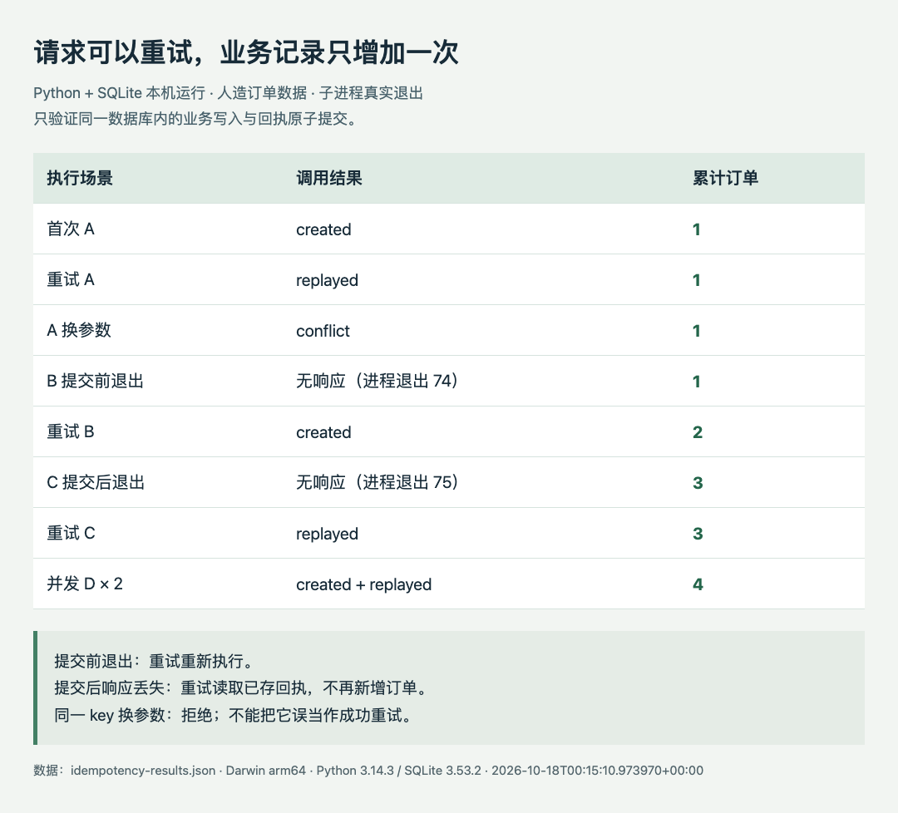

# 一次响应丢了，怎样避免把写操作再做一次？

**本机已运行验证。** 这是 Python 标准库与 SQLite 的小实验，使用人造订单数据。没有调用模型、购买服务或写入任何外部系统。环境：macOS arm64，Python 3.14.3，SQLite 3.53.2；实际运行时间 2026-10-18T00:15:10.973970+00:00。

## 问题发生在“提交成功，却没收到回答”

Agent 调用一个写工具，超时后往往不知道操作有没有完成。盲目重试可能重复创建记录；完全不重试又可能丢任务。一个小而实用的做法是给同一次业务意图固定 `request_key`，同时保存输入摘要与结果回执。重试时先看已有回执，而不是重新执行。

关键不是单独建一张去重表。业务记录和回执必须放进**同一个数据库事务**：要么一起提交，要么一起撤销。如果先写订单、再写回执，中间退出仍然会留下“已经执行却查不到回执”的空隙。[SQLite 的事务语义](https://www.sqlite.org/lang_transaction.html)支持这类原子边界；[原子提交说明](https://www.sqlite.org/atomiccommit.html)同时说明了存储与故障假设。

## 最小实现做了什么

`orders` 保存业务记录，`receipts` 用请求 key 作主键，保存规范化输入的 SHA-256 和结果 JSON。子进程先执行 `BEGIN IMMEDIATE`，再查回执。相同 key、相同输入返回原结果；相同 key、不同输入返回冲突；找不到回执才创建业务记录并同时保存回执。

```python
conn.execute('BEGIN IMMEDIATE')
prior = conn.execute(
    'SELECT payload_hash, result FROM receipts WHERE request_key=?',
    (key,),
).fetchone()
# 已存在：核对输入摘要，返回回执或报告冲突。
# 不存在：业务 INSERT 与回执 INSERT 都在此事务中执行。
conn.commit()
```

完整实现还包含异常回滚、参数绑定、等待写锁的超时和进程退出注入。这个例子只规范化固定字段 `amount`，真实工具还要把用户、业务范围、版本和有意义的输入纳入 key / 摘要设计；不能随意重排有语义的数组，也不能在每次重试时生成新的 key。

## 实际验证结果

程序发出 9 次调用，涉及 4 个不同 key，最终只有 4 条业务记录。先后检查了正常执行、重复请求、同 key 改参数、提交前退出、提交后响应丢失，以及两个进程并发调用同一 key。



中文读图：B 在提交前退出，记录没有增加，重试才增加；C 在提交后退出，记录已经存在，重试读取原回执。并发 D 的两个调用分别得到 created 和 replayed，最终只新增一条。图表由 HTML/JS 直接读取本机结果 JSON 导出，人造业务数据、真实进程退出；不是性能基准。（[原尺寸](images/idempotency-results.png) · [数据](code/idempotency-results.json) · [图表源码](code/idempotency-results.html)。）

复现：保存 [完整 Python 源码](code/idempotency_demo.py)，在有 Python 3 的目录执行：

```sh
python3 idempotency_demo.py > idempotency-results.json
```

它在临时目录创建数据库，结束后清理。结果 JSON 会记录你实际使用的 Python / SQLite 版本；无需第三方包。非零的 74、75 是实验刻意注入的子进程退出，外层脚本继续检查持久化状态；检查失败会抛出异常。

## 能保证的范围

这次验证的是同一个本地 SQLite 数据库里的原子写入与回执。它没有测试断电、文件系统损坏或网络数据库，也没有证明跨服务“恰好一次”。如果业务写入是第三方 API、邮件或文件上传，SQLite 回执不能把外部操作纳入本地事务；应使用对方的幂等键、可查询的操作编号或补偿协议。

并发写入在本例中由 SQLite 串行化，超时仍可能发生；生产系统需要明确重试策略和回执保留期限。这个实验的价值，是让“响应是否收到”和“业务是否提交”成为两个可以分别观察的事实。
