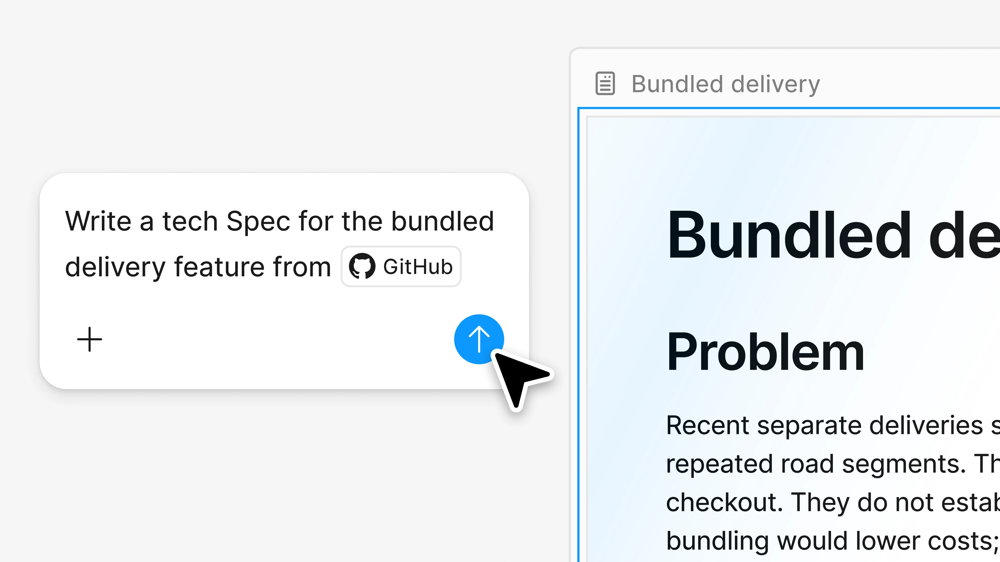
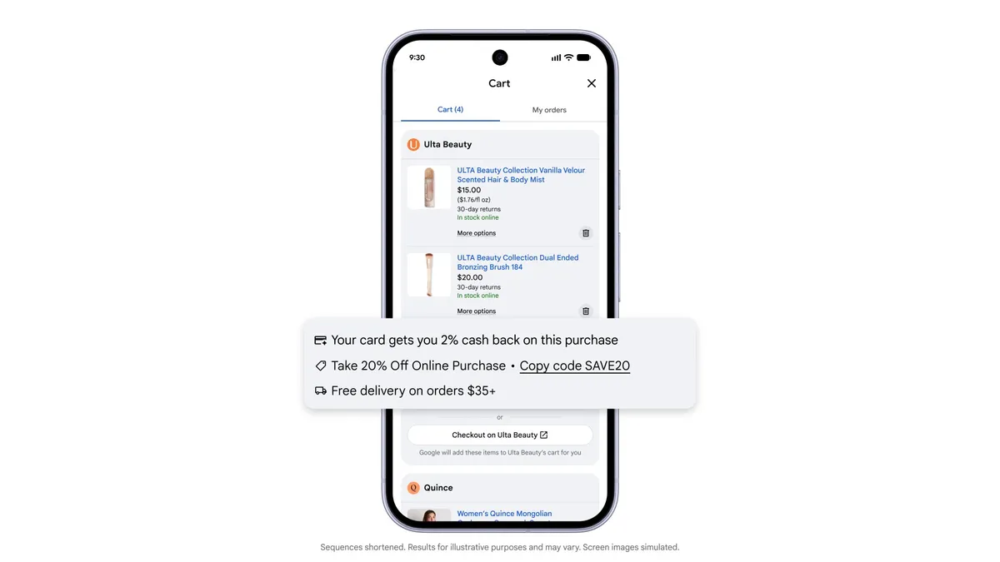

# AI 动态

本期 15 条：前 5 条重点详解，后 10 条速读。近 24 小时的新事件不足，逐步补入近 72 小时与近 7 天未收录的重要进展；日期为来源原日期，已知时区单列。所有热度标签保持待验证，产品与研究均未冒充本站实测。

## 01 · Glimpse 把视觉信息留在推理过程中

事件日期：2026-10-16｜近期补充

Elorian 发布 Glimpse 研究预览，提供聊天入口与 API。它要改善的问题是：模型看完图片后，如果主要靠文字继续推理，细小的空间关系与运动线索可能被过早压缩掉。团队描述的方向是在思考中继续保留、操作和回看视觉表示，让图像不只充当开场输入。公告没有公开基础模型名称，也没有宣布开放权重；“基于开放模型后训练”不能写成 Glimpse 本身已经开源。

这种工作方式与只给图片写一次说明有区别。系统可以写代码、裁切图像、回放视频，并让子代理交换视觉材料。对“列车是否正在减速”这类问题，重要线索是多个时刻的位置变化；对工具开合和遮挡关系，关键是回到局部看细节。官方视频展示了列车进站分析，但页面中的轮胎、钳子静态示例同时含经过整理的参考答案，不能把它们当作完整、逐步记录的真实模型思维轨迹。

概念读图：重点看视觉材料与推理之间的回看关系。这是 AI 生成概念示意，不是 Glimpse 界面、模型轨迹或性能证据。（[事实依据](https://elorian.ai/blog/introducing-glimpse)；[查看原尺寸](images/glimpse-concept.webp)。）

基准表也需要按任务看。以官方最高思考强度、各模型原生运行框架为条件，Glimpse 在 WGO 为 42.70，表中 GPT-6 Astra 为 39.42；在 VideoMME v2 则是 56.68 对 64.06。这里没有一个“全面领先”的结论。不同框架、推理预算和题型都会改变成绩，当前证据是团队自己的比较，还不是本站复现或独立统一评测。

开发者可以把它看成视觉调查工具的候选：先保留图片或视频原件，再检查回答能否定位到具体帧、区域和证据。官方机器人案例把它接入 π0.5，用一个任务比较规划成本；单个演示不足以证明通用机器人能力，直接输出机器人动作仍被列为后续方向。它也不意味着用户可以省去环境验证与动作安全约束。

为什么现在值得看：新模型把“视觉信息在推理中何时丢失”变成了可检查的工程问题。官方 API 单价为每百万输入/输出 token 0.60/3 美元，但团队也承认 token 效率仍要改进，单价低不能直接推出一次复杂任务更便宜。适合先做小规模、有标准答案的视觉任务比较。标签：新近创新；验证程度：官方基准和演示，热度待验证。

[原始来源](https://elorian.ai/blog/introducing-glimpse)。

## 02 · Figma Specs 把需求、画布与代码上下文放到同一处

事件日期：2026-10-15｜近期补充

Figma 推出 Specs，试图解决设计与编码代理之间最常见的断层：人看得到画布和讨论，代理拿到的却只有几句文字，随后靠猜测补全交互。Specs 是放在协作画布中的 Markdown 文档，可以保留需求、决策、评论，并嵌入设计画框、FigJam 内容与其他节点。它的价值在于让设计背景与实现任务之间有可反复更新的具体连接。

一种可理解的流程是：先把产品约束和交互细节写入 spec，嵌入关键界面，再请代理读取已有实现、生成改动并把疑问写回评论。公告展示通过 GitHub 连接器组织技术说明、用 Hex 分析数据并留下评论，以及从说明创建组件。这里的截图是官方操作示例；并不证明所有仓库、数据源或复杂设计系统都能一次成功，也不等于本站已经跑过整条链路。

读图：左边是带 GitHub 上下文的请求，右边是生成的 spec。它说明需求文档与代码来源的连接，不代表生产代码已经验证。Figma 官方界面原图，仅作本条产品评述引用。（[来源原图](https://www.figma.com/blog/introducing-figma-specs/)；[查看原尺寸](images/figma-specs.webp)。）

Specs 与此前纯文本提示的区别，在于文档可以指向具体设计对象，协作者能在同一位置修订要求。编码代理通过 MCP 获取关联上下文，之后仍需要核对实际组件、状态、权限与数据接口。对于“看起来像”的界面生成，最容易漏掉的是加载、空状态、失败重试以及已有组件约束；把这些放进可定位的 spec，比只追加一句“保持风格一致”更容易检查。

同轮发布还包括进入开放测试的 code layers：代码生成的交互内容可以出现在设计环境中。这里把它们合并为一次设计与代码协作更新，不拆成两条新闻。Specs 不是自动把所有设计稿变成可上线软件的保证；代码层的交互效果、真实项目依赖与生产环境集成仍是不同阶段。使用前应核对当前账号、连接器权限和测试版入口。

为什么现在值得看：它为设计师和开发者提供了一个能持续维护的交接物，而不是一次性导出截图。读者可以用一个含两个页面、一个失败状态的小任务测试：修改 spec 后，代理是否真的更新对应实现，评论能否回到原设计位置。标签：新近实用；验证程度：官方说明与界面演示。公开材料尚不足以证明团队效率提升幅度，热度待验证。

[原始来源](https://www.figma.com/blog/introducing-figma-specs/)。

## 03 · Goodfire 重新检查“一个神经元混装多个概念”的解释

事件日期：2026-10-15｜近期补充

Goodfire 的 Nick Cammarata 发表研究随笔《Neural Networks Are Already Clean》，重新审视机制可解释性中的一个常见判断：单个神经元看起来响应不相干对象，是否就说明模型把大量独立概念任意叠放在同一位置？作者认为，一部分经典例子可能是对共同视觉结构、递归泛化或模型架构问题的误读。这是一篇明确标为工作假说的研究随笔，不是“可解释性已经解决”的公告。

直觉上，观察到同一神经元对猫和汽车都活跃，还不能确定它分别存了一个“猫概念”和一个“车概念”。它也可能响应两类图像共有的形状。作者重新检查著名例子，提出尖锐与圆润形状等解释，并强调同时检查强正激活、负激活以及上下游连接。只挑几张最强响应图，很容易让解释迎合观察者的命名习惯。

随笔还讨论对 InceptionV1 与不同尺度卷积网络的重新训练。作者把早期网络后层的混乱，与架构限制和分析工具不足联系起来；加入较现代的结构后，报告同等模型规模、训练数据条件下有更清晰的解释。这里的判断依赖作者如何定义“可理解”、检查哪些激活与如何验证假说，不能把视觉网络中的例子直接推广为所有语言模型都不存在叠加表示。

语言模型部分尤其需要保留限定。文章给出 Qwen3-32B 的初步审计估计：约九成神经元极性具有一个主要作用，另有相关的多重作用和未理解部分。作者同时说明强激活阈值与审计方式会影响结果，配套技术论文尚待发布。因此，百分比适合当作待复核的研究线索，不能当作模型安全性或完整可解释程度的认证。

对研究读者，最有用的是实验路线的改变：先提出神经元或电路的具体解释，再用新输入、因果干预与上下游检查寻找反例，而不是只展示一组“看起来符合”的样本。为什么现在值得看：它挑战了常用分析工具背后的诊断前提，提出了可比较的新问题。标签：新近创新；验证程度：作者实验与初步审计，尚缺本期独立复现；热度待验证。

[原始来源](https://already-clean.goodfire.com/)。

## 04 · Google 统一购物车开始在美国 Search 与 Gemini 推出

事件日期：2026-10-15｜近期补充

Google 宣布统一购物车开始在美国的 Search 与 Gemini 推出。这个功能曾在 5 月预告，本次值得记录的是进入推出阶段，而不是把旧预告再写成新产品。用户在搜索或对话中找到商品后，可以保存到同一个购物车，稍后接着比较、检查价格和库存，再选择完成购买的位置。地区与商家支持范围仍有限，不能写成全球所有商店都已接通。

它把过去分散的购物步骤连在一起：发现商品、跨商家保存、跟踪变化、查看可用优惠，再到结账。Google 表示购物图谱提供价格和库存信息，购物车还可展示与 Wallet 中支付卡相关的权益及促销。对用户而言，关键不只是“让 AI 推荐一件商品”，而是过几天回来时，先前选择、商家与当前状态仍能对上。

读图：优惠提示附着在购物车上，用户仍需确认条件与结账。Google 官方界面原图，仅作功能说明引用；示例优惠不是本站实测节省。（[来源原图](https://blog.google/products-and-platforms/products/shopping/universal-cart-launch/)；[查看原尺寸](images/cart.webp)。）

官方截图展示优惠与卡片权益出现在购物车附近。读图时应注意这些是待用户确认的具体优惠条件，不能把示例金额当成所有订单都能获得的节省。价格、可售状态、优惠有效期以及最终运费也可能变化；列表中出现商品并不代表它已经被购买。只有把最后结账环节核对清楚，保存购物意图才真正变成可完成的交易。

结账可以通过支持商家的 Google Pay 流程，也可以转到商家完成。相关连接依赖 Universal Commerce Protocol；商家仍是销售方，订单确认与售后也有相应归属。这个边界很重要：统一界面并不自动改变履约责任，也不是让代理无条件地替人自主消费。对于研究 Agent 工作流的人，这提供了一个观察“搜索结果、持续状态、授权动作”如何连接的实际产品案例。

为什么现在值得看：购物代理开始把一次性回答变成可延续的任务状态，同时保留用户确认和商家结账入口。适合关注消费型 Agent 的产品设计、状态同步与授权边界。标签：新近实用；验证程度：官方推出说明与界面演示，本站没有下单实测，也没有验证节省金额或覆盖全部商家；热度待验证。

[原始来源](https://blog.google/products-and-platforms/products/shopping/universal-cart-launch/)。

## 05 · Amazon Bee 新设备把随身记录与服务连接分成不同层级

事件日期：2026-10-15｜近期补充

Amazon 介绍 Bee Frontier 与 Bee Eclipse 两款个人 AI 设备。Frontier 可以佩戴或夹在衣物上，官方标注 IP67、最长七天续航和 USB-C 充电，价格 74.99 美元，已提供购买入口。Eclipse 则是贴在手机上的磁吸形态，标注最长二十一天续航、99.99 美元，但状态是即将上市。把两者都写成“已发售”会误导读者。

这类设备的基本用途是把日常谈话整理成转录、摘要和待办，再供用户回看。一个具体场景是会议结束后找出承诺的动作和时间，而不是从录音头尾重新听一遍。这里仍然要区分记录、提取和执行：系统整理出待办，不代表它已替用户完成，也不代表摘要不会遗漏条件。文章中的使用情境来自官方介绍，本期没有录音或识别质量实测。

收费层级也影响实际能力。基本摘要、回顾与十四天记忆包含在基础体验中；可选 Bee Pro 为每月 11.99 美元，提供更丰富的记忆与 Alexa+、Amazon.com 等连接，并有试用安排。若读者只想整理对话，不应把需要订阅的跨服务能力算作设备默认功能。连接服务前也需要逐项理解账号授权与可执行动作。

隐私说明是本次产品阅读中必须保留的一部分。Amazon 表示原始音频在实时处理后删除，转录涉及设备密钥，用户可以删除记录，并通过麦克风按钮与指示状态控制采集。这里转述的是厂商设计与承诺，不能延伸成“整个处理都在本机”“任何内容都不保存”或“已经通过本站独立隐私审计”。转录与音频是不同的数据对象。

为什么现在值得看：新硬件把随身记录扩展到不同佩戴方式，但最值得比较的是采集控制、记忆期限、服务连接和当前可用状态。对于研究长时记忆 Agent 的读者，它展示了数据获取与行动授权之间仍需明确分层。标签：新近实用；验证程度：官方规格与说明，续航、识别准确率及隐私实现未独立验证，热度待验证。

[原始来源](https://www.aboutamazon.com/news/devices/amazon-personal-ai-bee-frontier-bee-eclipse)。

## 06 · Anthropic 计划为公共利益基金划拨股份

事件日期：2026-10-18

Anthropic 公布公共利益基金安排：拟划拨公司 5% 股份，仍需股东批准；当估值超过基线并增长时，董事会还可按条件追加。基金是全资有限责任公司，不能直接称作免税非营利基金会。与创始人既有捐赠承诺合计的约两成权益，也不是本次已到账的现金。为什么现在值得看：AI 公司的收益分配开始进入具体股权安排，但批准、执行和未来用途仍要分别追踪。标签：新近实用；验证程度：官方承诺，尚待落实，热度待验证。

[原始来源](https://www.anthropic.com/news/public-benefit-fund)。

## 07 · OpenCode 披露影响部分 Console 用户的安全事件

事件日期：2026-10-18

OpenCode 在 UTC 10月17日18:08（北京时间2026-10-18 02:08）更新说明，安全事件影响约 1.4% 的 Console 用户，涉及部分绑定外部提供方的用户；官方称已邮件通知受影响者，正与 Anthropic、OpenAI、Google 处理，事件尚未结束。“与大规模蒸馏攻击有关”是官方当前描述，不是已经公开验证的完整根因。为什么现在值得看：托管控制台保存的外部服务连接有独立风险边界，不能把此事泛化为所有本地 CLI 用户均受影响或已经修复。标签：新近实用；验证程度：官方阶段性通报。

[原始来源](https://twitter.com/opencode/status/2111519637049319818)。

## 08 · YouTube Music 开始标识主要由 AI 创作的音乐

事件日期：2026-10-14｜近期补充

YouTube Music 宣布为主要由 AI 生成的音乐增加标识，涉及主要由 AI 制作的作曲与人声，用户可以在播放界面进一步查看。平台结合合作方信息与检测工具推进，后续还计划扩展到主 YouTube。为什么现在值得看：生成音乐的分发开始要求更清楚的来源披露；标识不等于证明歌曲的权利状态，也不能覆盖一切 AI 辅助制作。标签：新近实用；验证程度：官方产品说明，检测准确率与完整覆盖尚无本期独立证据。

[原始来源](https://blog.youtube/news-and-events/youtube-music-ai-labels/)。

## 09 · X 推出连接 Grok、GrokBot 与 Cursor 的订阅方案

事件日期：2026-10-12｜近期补充

xAI 公布连接 Grok、GrokBot、Cursor 与 X 的订阅方案，Grok 用量可在相应产品间共享。新用户自公告日开始采用新方案，既有用户可以保留现有安排或按推出进度切换；第三方模型并非都包含在共享额度内，相关用量另有规则。为什么现在值得看：编码工具与通用助手开始共享订阅入口，选套餐需要按实际模型与任务核算。标签：新近实用；验证程度：官方方案，全球推出进度与单用户权益以账号页面为准，热度待验证。

[原始来源](https://x.ai/news/x-subscription)。

## 10 · Meta 披露 Forum 的 AI 原生工程流程

事件日期：2026-10-15｜近期补充

Meta 发布 Forum 工程复盘，介绍规则、技能、命令和 hooks 如何组织代理开发，并把构建、测试、界面检查与人工确认连成验收流程。Forum 应用此前已经推出，本次新事实是工程方法披露。为什么现在值得看：代理产出代码后，团队仍需定义什么算完成，以及谁能批准上线。文章是内部实践总结，不能从中推出所有团队的开发效率倍数，也不能把自主开发目标当成已实现的无人流程。标签：新近实用；验证程度：官方工程案例。

[原始来源](https://engineering.fb.com/2026/10/15/ml-applications/how-meta-built-forum-ai-native-engineering/)。

## 11 · Meta 用空闲推理容量扩大候选或切换大模型

事件日期：2026-10-12｜近期补充

Meta 介绍如何把短暂空闲容量用于广告推荐：RMA 让更多候选进入排序，需要 CPU 与 GPU；SBM 在候选量不变时切换更大模型，主要消耗额外 GPU。系统通过隔离基础容量、负载反馈与及时回收避免影响常规服务。为什么现在值得看：额外算力的价值取决于瓶颈位置，不能只看 GPU 是否空闲。标签：新近实用；验证程度：官方系统报告，本站未复现，也不把内部收益直接套到其他推荐或大模型服务。

[原始来源](https://engineering.fb.com/2026/10/12/ml-applications/turning-opportunistic-ai-inference-capacity-into-better-ads-recommendations/)。

## 12 · NVIDIA 与奔驰扩大下一代自动驾驶合作

事件日期：2026-10-16｜近期补充

奔驰与 NVIDIA 宣布扩大合作，把 MB.OS、Hyperion 计算与传感平台、Alpamayo 推理栈和 Halos 安全体系纳入下一代自动驾驶路线。公告涉及未来高度自动化车辆及 L4 出行场景规划。为什么现在值得看：推理模型正在进入整车系统设计，但模型能力只是感知、控制、冗余和监管条件中的一部分。这是合作与研发路线，不能写成新系统已经获准在所有道路无人运营。标签：新近实用；验证程度：联合公告，后续交付待验证。

[原始来源](https://nvidianews.nvidia.com/news/mercedes-benz-and-nvidia-expand-strategic-partnership-to-advance-safe-highly-automated-driving-in-the-next-decade)。

## 13 · GitHub Apps 拆出创建仓库和管理安装范围的权限

事件日期：2026-10-13｜近期补充

GitHub Apps 新增 repository_creation:write 等更细权限，使创建仓库不必同时取得包含删除、转移在内的宽泛管理能力；安装仓库范围管理也有独立权限，并补充短期令牌迁移选项。为什么现在值得看：给编码代理或内部平台授权时，可以按真正需要的动作拆分权限，而不是为了一个创建操作授予完整管理员能力。标签：新近实用；验证程度：官方发布说明，实际组织权限与 GitHub Enterprise Server 版本仍需核对。

[原始来源](https://github.blog/changelog/2026-10-13-github-app-improvements-for-least-privilege-and-management)。

## 14 · GitHub 扩展 Anthropic 密钥的推送保护

事件日期：2026-10-13｜近期补充

GitHub 为新的 Anthropic 服务与用户密钥格式启用默认推送保护，并扩展 Cloudsmith 检测及 Salesforce 合作。适用前提是仓库已启用相应 secret scanning；免费公共仓库包含在相关覆盖内，不能说所有未启用功能的私有仓库都会自动拦截。为什么现在值得看：AI 开发仓库中的令牌格式在变化，检测规则也要跟上。标签：新近实用；验证程度：官方说明。推送拦截是泄露前防线，不能代替已泄露密钥的撤销与轮换。

[原始来源](https://github.blog/changelog/2026-10-13-secret-scanning-blocks-anthropic-keys-by-default-adds-salesforce)。

## 15 · BSP 披露 Codex 支持信贷资料分析的内部案例

事件日期：2026-10-16｜近期补充

OpenAI 发布 Benefit Street Partners 的客户案例：团队用公开 SEC 文件制作贷款估值比较看板，也用内部工具分析三百页以上的信贷协议。客户报告首轮分析约二十分钟，之后仍需一小时以上人工审阅；持续监控整个组合仍是后续目标。为什么现在值得看：长文档工具的价值可以落在资料归并与追问响应，最终判断仍有明确人工环节。标签：新近实用；验证程度：厂商发布的客户自报案例，无独立对照，不能外推为投资收益或普遍节省比例。

[原始来源](https://openai.com/index/benefit-street-partners)。
