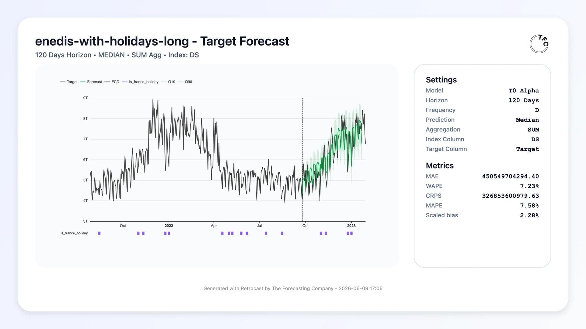
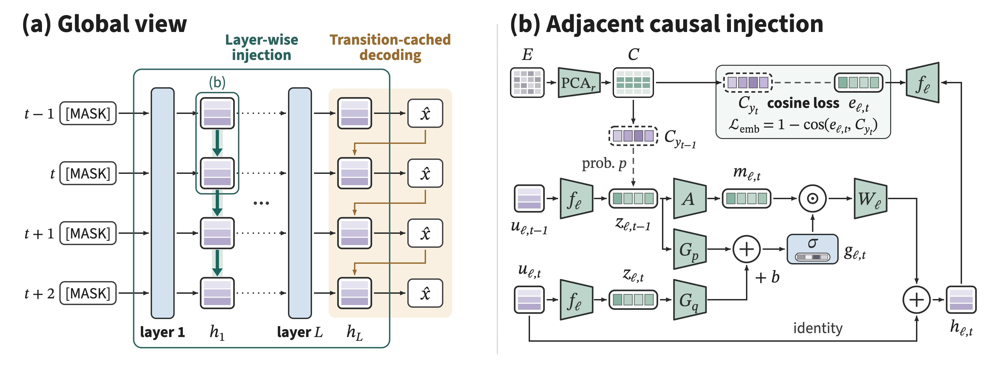

# 六个开放模型：从概率预测到小步决策

原始开放日期为 10 月 10—16 日；10 月 10 日为近 30 天近期补充。各项均核对权重文件，本站没有运行这些模型。非商业权重与开源代码分别标注；不同硬件、数据和任务之间不做统一分数排名。

## 01 · t0-gamma：把未来已知条件也放进时间序列预测

**2026-10-12｜近期补充｜新近实用 / 新近创新｜Apache-2.0**

预测用电量时，过去的负荷不是唯一输入：未来是否放假、日历和其他已知条件也会改变曲线。t0-gamma 是约 256M 参数的时序模型，可接收多变量历史序列及未来已知协变量，输出多步预测和 21 个分位数。分位数表达不同概率位置，不能当成保证覆盖真实值的承诺。

其默认预测跨度为 1,024；更长范围需要自回归延展，误差也可能逐步累积。配套 `tfc-t0[torch]>=0.6` 依赖 Python 3.10+、PyTorch 2.4+，另有 Apple Silicon 的 MLX 路径。公开权重与代码不代表任意长序列都能在笔记本实时运行，仍须按批量、变量数和设备测试。

为什么现在值得看：10 月 12 日公开的 gamma 检查点把概率预测与已知未来条件一并提供，适合先在自己的滚动验证集上比较“只看历史”与“加入日历”。本站核验模型卡、权重文件与代码说明，未运行；榜单自报分数未作为独立验证，热度待验证。下图来自同家族的 Alpha 演示，只解释输入输出，不能当成 gamma 的实验成绩。

中文读图：同一段负荷历史，在加入假日信息后，未来曲线的形状可以变化；阴影是预测区间。The Forecasting Company 的 t0 Alpha 示例原图（Apache-2.0），用于解释家族的协变量接口，不是 t0-gamma 的新评测。（[来源原图](https://huggingface.co/theforecastingcompany/t0-gamma)；[查看原尺寸](images/t0.webp)。）

[模型卡、权重与部署说明](https://huggingface.co/theforecastingcompany/t0-gamma)。

## 02 · DSpine-b16：让草稿模型借用目标模型的多层信息

**2026-10-16｜近期补充｜新近实用 / 新近创新｜Apache-2.0**

这个检查点是配合 Qwen3-8B 使用的推测解码草稿模型，不是一个可独立聊天的 8B 模型。它从目标模型不同深度取得前一步的因果特征，传给草稿网络，并行提出一组 16 个 token，再交由目标模型验证。可把它理解为：草稿不是只看一份最后的摘要，而是参考多个处理阶段留下的信息。

作者在 OpenPerfectBlend 的匹配设置下比较 DSpark、DFlash2。温度 0 时，DSpine 的平均接受长度为 7.83，对照为 7.55 与 7.44；温度 1 时分别为 6.98、6.53 与 6.65。这些是接受长度，不能直接改写成吞吐提升百分比，更不能忽略验证、通信及并发开销。

为什么现在值得看：10 月 16 日公开了具体草稿权重与 SGLang 适配推理路径，使多层特征的取舍可以复查。要同时准备匹配的目标模型、专用插件和 CUDA 环境；模型卡的示例涉及 BF16、FA3 等设置，并非任意稳定版框架即装即用。推理代码已公开，训练流程仍有后续开放计划。本站未运行，依据为作者实验，热度待验证。

中文读图：左侧是目标模型各层，中部把上一时刻不同深度的特征送入草稿网络，右侧展示并行提出 token 的位置。腾讯 DSpine 官方结构图；它解释信息如何传递，不代表同等比例的端到端加速。（[来源原图](https://huggingface.co/tencent/Qwen3-8B-DSpine-b16)；[查看原尺寸](images/dspine.jpg)。）

[模型卡、权重与部署说明](https://huggingface.co/tencent/Qwen3-8B-DSpine-b16)。

## 03 · UniForge3D：把看得见的表面和看不见的补全放在一起

**2026-10-10｜近期补充｜新近实用 / 新近创新｜CC-BY-NC-4.0（权重）；MIT（代码）**

输入几张没有精确相机位姿的物体照片，系统既要重建可见表面，也要猜测背面。UniForge3D 将几何重建与三维生成连接起来：用共享的锚定空间组织视角，使点图与稀疏体素双向交换信息，再由结构引导局部外观生成。这样，“哪里已经有观测”与“哪里需要生成”不必完全割裂。

锚定过程包含物体方向等假设，遮挡区域的补全仍是推断，不是扫描得到的真值。作者在 Toys4K、GSO 等物体集合报告效果；本文不把项目页的最佳成绩主张扩展到任意真实物体，也不将美观视图当成尺寸准确的工程模型。

为什么现在值得看：10 月 10 日公开模型，作为近 30 天的近期补充，提供了可检查的联合实现与权重。安装脚本使用 Python 3.10、PyTorch 2.6 / CUDA 12.4、FlashAttention，并编译 TRELLIS.2、CuMesh 等依赖，属于 GPU 研究环境。代码 MIT 与权重 CC BY-NC 4.0 必须分开看；相关背景去除模型还需遵循其独立条款。本站未运行，依据为作者方法与演示，热度待验证。

[模型卡、权重与部署说明](https://huggingface.co/xibushu/UniForge3D)。

## 04 · Ahenk：土耳其语语音适配，收益要与速度一起看

**2026-10-16｜近期补充｜新近实用 / 新近创新｜CC-BY-4.0（适配权重）；Apache-2.0（基础与辅助代码）**

Ahenk 在 VoxCPM2 2B 上训练约 36.2M 参数的 LoRA，面向土耳其语单一合成女声，输出 48 kHz 音频，覆盖若干情绪及笑声。文字需要先经过 `trnorm` 规范化，再按模型卡关闭模型内部重复规范化；号码、缩写及某些开头字符有专门注意事项。

作者的困难句集合上，155 个样本的字词识别评估中 WER 为 2.54%，对照 Trendyol 为 3.98%；但在另一个 20 条长句集合，分别为 0.82% 与 0.68%，并非全部胜出。A100 80 GB 上报告的实时因子为 2.28，意味着生成耗时超过音频时长，不能宣传为低延迟实时语音。UTMOS 是模型估计，不是真人听感调查。

为什么现在值得看：10 月 16 日的公开适配权重提供了语言规范化、情绪和语音生成的完整检查对象。单人、10 例的盲听偏好仅能作初步线索；无疑问助词的问句语调、缩写及英文控制指令仍有失败。本站未合成音频，验证程度为作者实验与模型卡，热度待验证。

[模型卡、权重与部署说明](https://huggingface.co/ozgurguler/ahenk-tts-tr)。

## 05 · MicroTurn Duplex LoRA：让语言模型每小步决定说话还是等待

**2026-10-12｜近期补充｜新近实用 / 新近创新｜Apache-2.0**

MicroTurn 不是直接听声音的模型。外部语音识别每约 0.6 秒给出一段临时转写，LoRA 适配后的 Qwen3.6-35B-A3B 决定继续听，或输出最多几个词给语音合成器。它把打断、短答与停止说话放进小步交互，依赖 ASR、LLM、TTS 和状态管理共同工作。

适配器约 3.83M 参数、15 MB，但不能因此认为整个系统只要 15 MB：还需要基础模型。作者在 RTX 3060 12 GB 配合量化和 CPU 专家卸载时报告约 230 ms 的中位处理步长，第一次可听见输出约 3 秒；两项统计回答不同问题。训练使用 564 段模拟通话，留出 28 段测试，尚不能代表真实电话环境。

为什么现在值得看：10 月 12 日开放的小型适配器把“该不该开口”写进可复用控制输出。测试中仍出现打断失败；公开说明还披露训练数据审计后删除了不安全样本。适合做受控语音实验，不应直接当作可靠的无人值守通话系统。本站未运行，依据为作者模拟实验，热度待验证。

[模型卡、权重与部署说明](https://huggingface.co/codacus/Qwen3.6-35B-A3B-MicroTurn-Duplex-LoRA)。

## 06 · EmbeddingGemma 2 typed-decision：将结构化选择接到嵌入模型

**2026-10-12｜近期补充｜新近实用 / 新近创新｜Apache-2.0**

输入由状态、问题与候选选项组成，模型输出选项的概率，而非一段解释。该检查点在 EmbeddingGemma 2 的 768 维表示上增加约 0.5M 参数的决策头，先冻结主干训练，再进行完整微调。它适合试验轻量路由、筛选等任务，但只在定义好的选项空间内作答。

作者在本地的类型化决策数据上报告准确率由 67.7% 提高到 76.4%，Brier 分数由 0.113 降至 0.065。模型卡同时说明调参参考了测试划分，因此这些数字可能偏乐观，不能当作严格未见测试的泛化结论。概率接近标注者判断的分布，也不自动成为现实事件发生概率。

为什么现在值得看：北京时间 10 月 12 日的适配检查点，给出了两阶段训练与结构化输出的具体实现。运行应遵循 BF16 / FP32 说明，FP16 可能出现数值问题；使用远程自定义代码前需检查实现。本站未运行或独立复现，热度待验证。它与同名基础嵌入模型是不同的适配对象。

[模型卡、权重与部署说明](https://huggingface.co/mrm8488/embeddinggemma-2-ft-typed-decision)。
