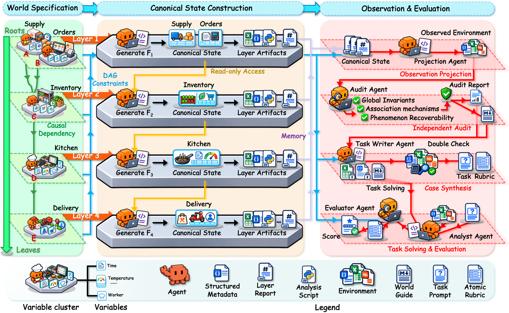

# 六篇论文：数据、委托与多步信用

比较 12 篇近期候选后，选择以下六篇 10 月 13—15 日的 v1 预印本。已读核心方法、主要实验、基线与限制；不宣称录用或独立复现。入选依据为新近创新，近期热度仍待两类独立信号验证。

## 01 · AutoSFT：把训练数据调整变成可检查的实验循环

**2026-10-15｜近期补充｜新近创新｜作者实验，本站未复现。**

让 Agent 改训练数据，容易退化成只调各类样本的比例。AutoSFT 把操作扩展到配比、筛除、修复、替换、合成和顺序调整，并将主规划、执行、分析及合成分开：执行器返回产物路径，多种分析视角提出建议，主循环再决定下一轮修改。这样，训练日志不必一直占满决策上下文。

每轮从同一个 Qwen3-1.7B 基础模型重新训练，避免把前一轮额外训练的收益算到数据策略上。分析实验固定 3M token、3 个 epoch；加入分析后，30 轮搜索的最佳 IFEval 为 67.10，对照为 60.60。更长的单 Agent 搜索跑到 50 轮、用时接近，仍为 62.35。这里比较的是搜索过程找到的最佳配方，不是一个配方重复独立训练后的均值。

合成实验改用 100M token 预算，IFEval 为 81.58 对 78.15，IFBench 为 51.95 对 49.02；不能将它与前面的 3M token 结果直接连成同预算提升曲线。代码任务还做了迁移，但依然是有限基础模型、有限时间预算下的研究。

为什么现在值得看：它提出的不只是“多开几个 Agent”，而是让不同数据修改动作真正进入可检验循环。本站读方法、主要对照和预算说明，未训练复现；实现仓库可读，但本次未找到正式 LICENSE，不能把公开源码写成已确认的宽松开源项目。

图中从数据配方到训练、评估再回到配方，表示每轮可以更换数据操作；不是沿同一个检查点无限续训。He 等，AutoSFT 原图，CC BY 4.0。中文说明与图分开，保留完整原图。（[来源原图](https://arxiv.org/abs/2610.22194)；[查看原尺寸](images/autosft.webp)。）

[原始论文](https://arxiv.org/abs/2610.22194) · [站内阅读卡](../../../../papers/frontiers/2610.22194/00-阅读卡.md)。

## 02 · EdgeWise：把难步骤交给云端，但别漏算本地成本

**2026-10-13｜近期补充｜新近创新｜作者实验，本站未复现。**

长任务不是每一步都需要最强模型。EdgeWise 先让本地 Qwen3.5-9B 执行，只在关键步骤委托云端；训练同时优化任务动作和委托决策。外部评判器用于研究哪些委托策略有效，但训练后的自主委托路径不需要再挂一个额外评判模型。云端拿到多少历史上下文，是效果能否保留的重要条件。

训练先使用约 2,000 条 SWE-Smith 样本做 SFT，再进行步骤级强化学习。评测包含 Terminal-Bench 2.1 与 SWE-ReBench，使用特定工具执行框架、最多 80 轮，并分别配对 GPT-5.5 与 Claude Opus 4.8。任务、云模型、采样次数都要与表格对应。

例如 GPT 对照下，Terminal-Bench 的 Pass@1 从 74.16 降到 71.91，Pass@3 则同为 82.02，云端费用从 279.73 降到 181.88。SWE 设置中 Pass@3 从 63.64 到 66.36，费用从 598.08 到 283.02；换成 Opus 时，部分成本收益伴随成功率下降。不能只摘最高节省值，再配上另一组的最高成功率。

为什么现在值得看：它给出了可训练的委托机制及本地工作站部署实验。但论文费用只计云端 API，未把本地设备、运行电耗与训练成本全部算入；“少付云账单”不等于“总成本同幅下降”。本站未复现，结果为作者实验。

中文读图：本地模型是默认执行者，委托发生在它判断需要帮助的步骤；云端回复又回到同一任务上下文。Shi 等，EdgeWise 方法图，CC BY 4.0。箭头表示协作过程，不表示所有步骤都经过两个模型。（[来源原图](https://arxiv.org/abs/2610.17560)；[查看原尺寸](images/edgewise.webp)。）

[原始论文](https://arxiv.org/abs/2610.17560) · [站内阅读卡](../../../../papers/frontiers/2610.17560/00-阅读卡.md)。

## 03 · InfiniSplat v2：先固定几何，再改善大视角变化下的外观

**2026-10-14｜近期补充｜新近创新｜作者实验，本站未复现。**

从几张照片直接生成三维高斯，难点不只在点放在哪里，也在颜色、透明度等属性如何适应新视角。InfiniSplat v2 冻结 DA3 几何分支，保留预测中心，由另一路学习属性；训练时使用真实相机对齐，并加入角度变化更大的目标视图监督。后续细化器只更新属性，不重新移动高斯中心。

作者在六个数据集上测试同一训练模型，包含室内、物体和更大场景，使用 4、8、16 张输入与保留视图。已知位姿条件下，平均 LPIPS 为 0.2472，对照 ReSplat 的 0.3333，下降约 25.8%；DISTS 为 0.1163，对照 WorldMirror2 的 0.1734，下降约 32.9%。两个百分比的最强对照不是同一个方法，不能省去基线名字。

细化也不是总有帮助：无位姿条件下，某项平均 DISTS 从 0.1341 到 0.1379，反而变差。感知指标变好不保证真实几何更准确，冻结几何分支也会继承其误差。

为什么现在值得看：论文把训练对齐、监督角度和属性建模分开分析，适合研究“图看着更好”和“几何真的更对”之间的差别。本站读原文方法、主表与细化结果，未复现；预印本原图可在原文查看，本期用文字保留关键条件。

[原始论文](https://arxiv.org/abs/2610.20341) · [站内阅读卡](../../../../papers/frontiers/2610.20341/00-阅读卡.md)。

## 04 · Data World：先造出数据背后的世界，再生成文件

**2026-10-15｜近期补充｜新近创新｜作者实验，本站未复现。**

直接让模型编造表格，再编一个“正确答案”，很容易产生自相矛盾的训练题。Data World 先定义机制图和世界契约，用确定性脚本生成不可变真值，再投影成存在缺失值、单位差异和关联键的观测文件。独立审计器只读检查：题目要求的目标能否从这些文件恢复。任务和评分规则在这套结构上生成。

最终保留 1,087 个世界，其中 1,037 个世界形成 2,135 道训练题；50 个独立世界、16 个领域构成 100 道测试题。训练和测试按世界隔离，比随机拆同一世界的问题更能减少结构泄漏。评估还把计算正确与发现洞见分开，避免会跑代码就被认定理解了数据。

以 Qwen3.6-35B-A3B 进行 RL-zero，使用自身轨迹而非教师解题轨迹蒸馏后，DataWorld-Bench 从 37.64 到 44.70，DAComp 从 53.72 到 68.00，DABstep-Hard 从 25.66 到 46.56。这些是整个训练方案的效果；即使部分对照使用同一主干，也不能把全部差异单独归因于数据引擎。推理轮数和 token 用量也会增加，未保持同等推理成本。

为什么现在值得看：明确的生成机制让合成任务有了可以审查的真值与可恢复性约束。仍需警惕合成世界与真实业务分布的差异、模型评判偏差，以及评分规则不能囊括所有合理洞见。本站未训练复现。

图 2，Li 等，Data World 原图，CC BY-NC-ND 4.0。先沿上方看机制与真值，再看观测文件、审计及任务；审计器不回写真值。图片未经修改，用于本站非商业研究讲解；密集标签请打开原尺寸，中文解读在图外。（[来源原图](https://arxiv.org/abs/2610.21656)；[查看原尺寸](images/dataworld.webp)。）

[原始论文](https://arxiv.org/abs/2610.21656) · [站内阅读卡](../../../../papers/frontiers/2610.21656/00-阅读卡.md)。

## 05 · DeltaTTG：用剩余工作量分配每一步的信用

**2026-10-13｜近期补充｜新近创新｜作者实验，本站未复现。**

一次多步任务成功了，哪些动作真正推动了进展？DeltaTTG 用已有轨迹中的“还要生成多少 token 才能完成”训练进度估计器。训练 Agent 时冻结估计器，比较动作前后剩余工作量的变化，再把最后的优势值重新分配给各步。

这不是简单地给所有“剩余 token 变少”的动作加分。成功轨迹更关注推进，负优势轨迹更关注退步；权重仍为非负，从而保留整条轨迹优势的正负号。归一化按每步实际 token 数计算，加上上限与超额再分配，防止长步骤悄悄改变总尺度。全部进度信号为零时回退到均匀权重。

作者以 Qwen3-4B 与 Llama-3.1-8B 在 ALFWorld、PaperSearchQA、BFCLv3 等设置比较，平均相对 GRPO 提高约 5.7 和 7.2 分，部分子项却有下降。估计器按领域训练，通用性仍依赖轨迹分布。论文的误差条来自同一训练检查点的重复评测，不是多次独立训练的方差。

为什么现在值得看：它把稀疏终局反馈变成可复用的步骤信号，同时约束尺度。Actor 训练 GPU 小时比较纳入估计器推理，却未纳入预先训练估计器的开销；例如另有约 10.45 GPU 小时的估计器训练。本站未复现论文训练；本期技术实践只检验一个合成的归一化算例。

[原始论文](https://arxiv.org/abs/2610.17666) · [站内阅读卡](../../../../papers/frontiers/2610.17666/00-阅读卡.md)。

## 06 · MPT：让多个 Agent 学会争取行动，也学会分担结果

**2026-10-15｜近期补充｜新近创新｜作者实验，本站未复现。**

MPT 给三个独立参数的专长 Agent 各自的行动策略和出价策略。每一步出价最高者行动，平局随机处理；没有中央调度模型预先指定完整流程。任务结束后，结果沿行动序列向前传递：每个 Agent 留下与自己出价有关的一部分信用，其余交给前面的参与者。

行动策略使用分配后的信用更新；出价策略通过反事实分支学习。系统恢复某一步的环境状态，改变出价、让另一个 Agent 接手，再比较后续结果。它因此需要能够重放、恢复状态的实验环境，也会引入额外 rollout 开销，不能理解为免费增加几个对话窗口。

作者在 Minecraft、导航和深度研究上比较，并把出价、行动、反事实采样及更新纳入匹配的训练 FLOPs。保留测试中，合成任务成功率约从 20.3% 到 41.5%，深度研究约从 9.0% 到 21.0%；后者只有 50 个问题，每项做三次运行。训练曲线与保留测试的分数不同，不能混写。

为什么现在值得看：它把“谁行动”与“怎么行动”一起学习，而非只手工固定角色顺序。实验仍以三个角色和有限环境为主，扩群与抗掉线结果不等于真实开放任务上的普遍可靠性。代码与训练模型有作者入口；本站核对原文，未运行或独立验证部署。

[原始论文](https://arxiv.org/abs/2610.22322) · [站内阅读卡](../../../../papers/frontiers/2610.22322/00-阅读卡.md)。
