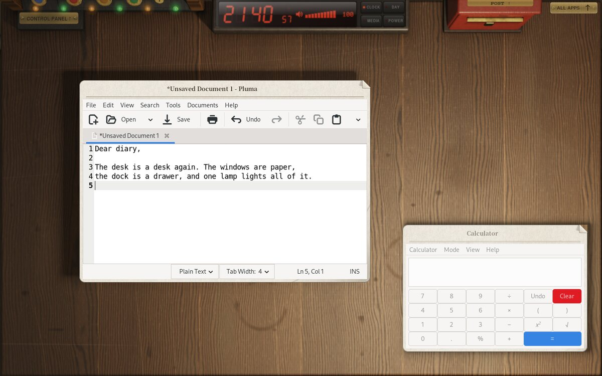
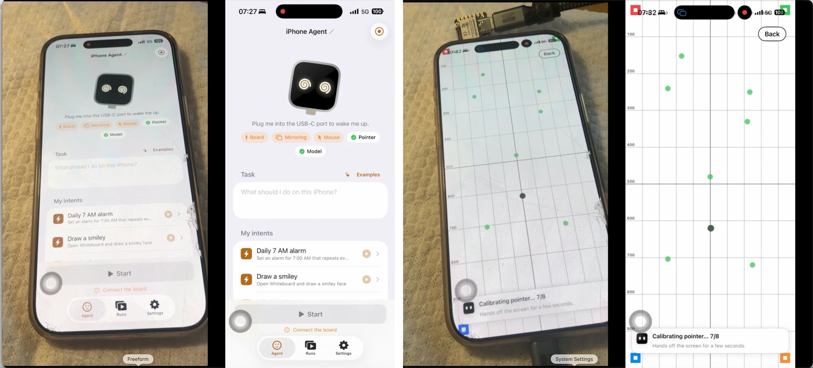

# 十个开源工具：按实际任务挑选

跨代码仓库、发布说明、项目页及开发者社区比较候选。下列项目均检查 LICENSE、源码树与上手依赖；本站未安装运行，不把维护者演示写成本机实测。近期热度缺少独立的第二类信号，因此以新近实用或创新依据入选。日期按可获得的时间戳换算北京时间；仓库创建时间与正式发布分别说明。

| 具体任务 | 工具 | 主要门槛 |
| --- | --- | --- |
| 检查自己是否理解 AI 写出的代码 | Sphinx | 模型CLI与全局Git hook |
| 在笔记或 Agent 输出旁预览结构图 | Pele | JS集成与API兼容 |
| 从自己的消息里查找约定、地址或文件线索 | WhatsApp MCP | Cloudflare付费方案与非官方协议 |
| 为授权电话设置可接管的语音留言与分类流程 | CallSitter | 电话服务、模型及人工接管 |
| 观察桌面信息如何组织及怎样被视觉系统识别 | DEsk | Linux Wayland测试环境 |
| 减少多 Agent 工作区重复传输并管理提交落地 | git-ai | Go/C构建与服务管理 |
| 理解程序操作与矩阵计算的对应关系 | Handwired | 受限语法与浏览器WebGPU |
| 从文档、音视频与照片中找回本机资料 | DigUp | 本地模型、首次索引与beta版本 |
| 研究实体手机的视觉观察、坐标校准与动作回放 | ESP32 iPhone Agent | 刷板、签名、视觉模型 |
| 给自己的应用跟踪商店变化并准备可人工审核的回复 | AsoBeast | Docker与数据库维护 |

## 01 · Sphinx：推送代码前，先回答一个理解问题

**新近实用 / 新近创新｜验证：维护者文档、公开实现或演示。**

Sphinx 在 `git push` 前读取待推送的代码，让一个不继承原对话的审阅模型提问。回答不充分时先解释，再换个场景追问；通过后才继续推送。它面向“代码能跑，但作者解释不清修改”的学习问题，不能替代测试或安全审查。

需要 Node 22.19+、macOS / Linux / WSL，以及受支持的模型 CLI 或 API。文档路径是安装 `sphinx-understand`、运行 `sphinx install` 后初始化仓库；安装会修改全局 hooksPath 并衔接已有 hook，试用前应先检查当前配置。代码可能发送给所选模型服务，且有调用费用。本站没有安装或修改 Git hook。

为什么现在值得看：仓库于北京时间 10 月 15 日创建，已有执行脚本与官方问答演示，提供一种可操作的代码理解练习。HN 讨论是单一近期信号，尚不足认定热门；验证程度为公开实现与维护者演示。

[规范仓库](https://github.com/parthh01/sphinx) · [MIT](https://github.com/parthh01/sphinx/blob/main/LICENSE)。

## 02 · Pele：把 Mermaid 文本渲染成可嵌入的 SVG

**新近实用 / 新近创新｜验证：维护者文档、公开实现或演示。**

Pele 接收 Mermaid 风格图表文本，输出 SVG；`render` 用于直接生成，`mount` 用于随编辑更新。它提供自己的布局与主题变量，无运行时依赖，适合笔记编辑器或 Agent 生成文档的预览区。兼容语法不等于每种图的像素布局都与 Mermaid 完全相同。

最小路径是安装 npm 包 `pele`，给容器传入源文本。10 月 17 日北京时间发布的 1.6.0 将解析错误显示在图内，保留并淡化上一张成功结果，同时增加 source / error 状态；错误处理 API 也有变化，升级需查看回调行为。主体 MIT，所带 Lucide 图标另遵循 ISC。

为什么现在值得看：这是近期新公开的渲染实现，最新版本解决实时编辑时错误反馈的问题。仓库始于 10 月 6 日，作为近 30 天近期补充；本站读源码树、README 与发布说明，未执行渲染，热度待验证。

[规范仓库](https://github.com/obsidianmd/pele) · [MIT](https://github.com/obsidianmd/pele/blob/main/LICENSE)。

## 03 · WhatsApp MCP：把聊天记录变成只读查询接口

**新近实用 / 新近创新｜验证：维护者文档、公开实现或演示。**

把授权同步的聊天记录写入 Cloudflare Durable Object 的 SQLite，再通过全文搜索和 MCP 提供给客户端：例如查找上次讨论租约时约定的日期。当前接口侧重读取和搜索，不提供发消息；媒体只保留线索，并不自动下载或转写全部音视频。

项目于北京时间 10 月 19 日创建。部署需要 Node 20、Cloudflare Workers 付费方案、存储及 OAuth 配置，再用手机关联；它使用 Baileys 非官方 WhatsApp 协议，兼容性和平台条款都是实际门槛。历史同步可能不完整，查询结果还会进入你连接的模型客户端，不能称为“数据完全不离设备”。

为什么现在值得看：公开 Worker、数据库及认证实现给个人资料检索提供了具体路径。当前证据为维护者文档与代码，本站未关联账号、未购买服务、未验证真实消息同步；热度待验证。

[规范仓库](https://github.com/finereli/whatsapp-mcp) · [MIT](https://github.com/finereli/whatsapp-mcp/blob/main/LICENSE)。

## 04 · CallSitter：用固定流程接住 AI 电话分类

**新近实用 / 新近创新｜验证：维护者文档、公开实现或演示。**

CallSitter 将电话接入、语音模型、分类器和确定性 YAML 流程分开。语音模型负责交谈，分类器随转写增长判断来电类型，流程引擎决定下一步；流程代码明确控制状态转换、调用时机和结束条件。一个可检查的用途是接待未能接听的来电，留下摘要，再由本人判断是否回拨。

运行依赖 Bun、Telnyx 号码与转接、OpenAI 接口，通知渠道还需自行配置。文档提供录音回放和 fake 路径，适合先做离线流程检查，不能以成功回放替代真实电话可靠性测试。代码 Apache-2.0，演示素材另保留权利，不随代码许可任意使用。

为什么现在值得看：9 月 26 日创建的近期补充项目提供了可执行流程与回放入口，10 月 18 日出现新的展示讨论。本站未通话；误分类、语音延迟及人工接管仍需按具体场景验证，热度待验证。

[规范仓库](https://github.com/szerintedmi/callsitter) · [Apache-2.0](https://github.com/szerintedmi/callsitter/blob/main/LICENSE)。

## 05 · DEsk：研究桌面 Agent 时，也可以换一种界面组织

**新近实用 / 新近创新｜验证：维护者文档、公开实现或演示。**

DEsk 是 Linux Wayland 桌面实验：窗口像纸张，应用像活页夹，通知像便签，停靠区像抽屉。它将真实窗口与带光照的桌面合成，提供 GLES 渲染及回退路径；对视觉 Agent 研究者，价值是一个与常见扁平桌面不同的交互对象，而非已证明能提升操作成功率。

仓库和首版在 10 月 10 日公开，本期作为近 30 天近期补充；0.1.2 于 10 月 15 日增加 Fedora 支持等适配。支持的发行版和安装脚本需逐项核对，涉及系统会话和权限，建议先在隔离测试环境尝试。它仍是早期桌面项目，不能把作者日常使用等同广泛稳定性验证。

为什么现在值得看：已有窗口合成实现和真实桌面截图，能直接讨论界面层级与视觉线索的取舍。本站未安装或运行，验证为维护者演示与源码，热度待验证。

中文读图：纸张样式是实际窗口，抽屉是应用入口，便签呈现通知。DEsk 维护者提供的真实桌面截图，MIT；用于说明界面组织，不是本站运行结果，也不证明 Agent 操作效果。（[来源原图](https://github.com/fyzugx/DEsk)；[查看原尺寸](images/desk.jpg)。）

[规范仓库](https://github.com/fyzugx/DEsk) · [MIT](https://github.com/fyzugx/DEsk/blob/main/LICENSE)。

## 06 · git-ai：为多个编码 Agent 提供共享仓库服务

**新近实用 / 新近创新｜验证：维护者文档、公开实现或演示。**

git-ai 把仓库服务、稀疏取用、派生缓存和提交落地集中到一个服务端。各 Agent 取得自己的工作视图和凭据，提交先进入落地流程，再按配置测试、定位失败或回退。它是独立的社区项目，不能因借鉴其他系统就当成相应公司的官方产品。

仓库于 10 月 15 日创建，v0.2.0 在北京时间 10 月 19 日发布。源码构建需要 Go 1.26、C 工具链、Meson、Ninja；仓库的 quickstart 可在临时目录展示两个 Agent 的工作流。真实服务还要选择数据库、对象存储和测试策略，冲突不会因用了缓存自动消失。

为什么现在值得看：公开的 RPC、存储与示例让多工作区同步问题有具体实现可读。核心 MIT；LICENSE 对可能存在的 ee 目录另设例外，使用时应按路径检查。本站未运行服务，也不采信未复测的加速宣传数值，热度待验证。

[规范仓库](https://github.com/feder-cr/git-ai) · [MIT](https://github.com/feder-cr/git-ai/blob/main/LICENSE)。

## 07 · Handwired：不训练，直接把一部分程序接成神经网络

**新近实用 / 新近创新｜验证：维护者文档、公开实现或演示。**

Handwired 将受支持的 JavaScript 运算编译为矩阵乘法和 ReGLU 等网络操作，权重由程序结构直接构造，不经过数据训练。输入程序与输入值，输出是网络执行的结果；适合做编译和神经计算教学，比较一个条件判断如何落到数值运算。

仓库于 10 月 15 日创建，提供源码、浏览器演示及 `bun install`、`bun start` 的本地入口。语法范围与数值边界都受实现限制，不能把几个演示推成“任意 JavaScript 都能被精确编译成通用大模型”。WebGPU 可用性也取决于浏览器与设备。

为什么现在值得看：它给出了不用训练构造网络的公开实现，允许读者追踪中间表示。下图是作者的玩具 HandwiredOS 演示界面，用于说明可交互输出，不能用来证明任意操作系统功能等价。本站未运行，热度待验证。

Handwired 作者的 HandwiredOS 演示截图，MIT。图中是受限演示程序的可交互输出；不是通用操作系统移植成功的证据，也不是本站测试。（[来源原图](https://github.com/chenglou/handwired)；[查看原尺寸](images/handwired.webp)。）

[规范仓库](https://github.com/chenglou/handwired) · [MIT](https://github.com/chenglou/handwired/blob/main/LICENSE)。

## 08 · DigUp：在本机文件里同时查词和查意思

**新近实用 / 新近创新｜验证：维护者文档、公开实现或演示。**

DigUp 将关键词检索与本地向量检索结合，返回文件、PDF 页或音视频时间位置。它使用 SQLite 管理索引，嵌入模型在本机运行；一个典型任务是凭模糊记忆找出提过某个方案的文档，再跳回原文件核对，而非让模型凭记忆编答案。

仓库始于北京时间 10 月 9 日，本期作为近 30 天近期补充；10 月 18 日发布 0.7.0-beta.2。文档列出 Apple Silicon macOS 14+、Windows 10/11 x64、Linux x64 路径，跨平台版本仍处于 beta。模型约 865 MB，首次大规模索引可能很久；选择哪些目录和代码文件进入索引也需要明确配置。

为什么现在值得看：已提供可下载应用、检索实现和本地运行路径。核心 MIT，嵌入模型遵循其独立许可；本站未安装、未对私人目录建索引，也没有独立召回率测试，热度待验证。

[规范仓库](https://github.com/ARahim3/DigUp) · [MIT](https://github.com/ARahim3/DigUp/blob/main/LICENSE)。

## 09 · ESP32 iPhone Agent：板子负责看与点，手机 App 负责推理

**新近实用 / 新近创新｜验证：维护者文档、公开实现或演示。**

当前主分支让 ESP32-S3 接收 iPhone 的 AirPlay 镜像，再经 BLE 转给同一手机上的 App；App 解码、调用视觉模型，把操作指令送回板子，由 USB HID 执行点击与键盘动作。它保留运行回放和指针校准，比只看最终截图更便于定位操作失败。

仓库始于北京时间 10 月 12 日。10 月 15 日的旧 v0.1.0 仍需电脑，本文介绍的“运行时不需电脑”属于当前主分支。首次刷板和构建仍需 Mac / Xcode、带 PSRAM 的 ESP32-S3、iOS 18+及模型端点；免费签名需定期重签。主体 MIT，但 AirPlay 移植部分 GPL-3.0，链接它的固件按 GPL-3.0 分发。

为什么现在值得看：公开的镜像、校准、动作与轨迹导出实现提供了研究入口。当前仍限竖屏、ASCII 输入，截图发往所选模型，模型调用有成本；本站未操控手机，验证为维护者演示与代码，热度待验证。

作者真实 App 截图：对照手机画面与经板子镜像后 Agent 收到的画面，再看指针校准。主体图片随 MIT 项目资料引用；固件的 GPL-3.0 范围另述。它展示观察链路，不是本站执行手机任务的记录。（[来源原图](https://github.com/onehumanbeing/esp32-iphone-agent)；[查看原尺寸](images/esp32.webp)。）

[规范仓库](https://github.com/onehumanbeing/esp32-iphone-agent) · [MIT（主体）；GPL-3.0（AirPlay固件部分）](https://github.com/onehumanbeing/esp32-iphone-agent/blob/main/LICENSE)。

## 10 · AsoBeast：把商店榜单变化与评论回复放进自托管工具

**新近实用 / 新近创新｜验证：维护者文档、公开实现或演示。**

这不是新诞生的项目：仓库始于 8 月 24 日，本次选择依据是北京时间 10 月 17 日的 v1.11.0。版本新增按商店、地区、类别查看榜单及跟踪变化，并提供评论回复编辑器；可选 AI 只生成草稿，不直接替用户发布回复。

自托管使用 Docker Compose，包含 PostgreSQL 18、Redis 8、前后端，文档建议至少 2 GB 内存、5 GB 磁盘。公开商店查询与 AI 服务是不同依赖：前者不要求购买 ASO API，后者如启用仍需模型配置及费用。升级包含数据库迁移，现有使用者应先备份。

为什么现在值得看：这次实质更新把“看见应用市场变化”接到“准备具体回应”的工作流，且核心以 AGPL-3.0 提供。榜单、评分变化不是因果归因，抓取覆盖也受商店接口限制。本站读发布说明与实现目录，未部署，热度待验证。

[规范仓库](https://github.com/AsoBeast/asobeast) · [AGPL-3.0](https://github.com/AsoBeast/asobeast/blob/main/LICENSE)。
