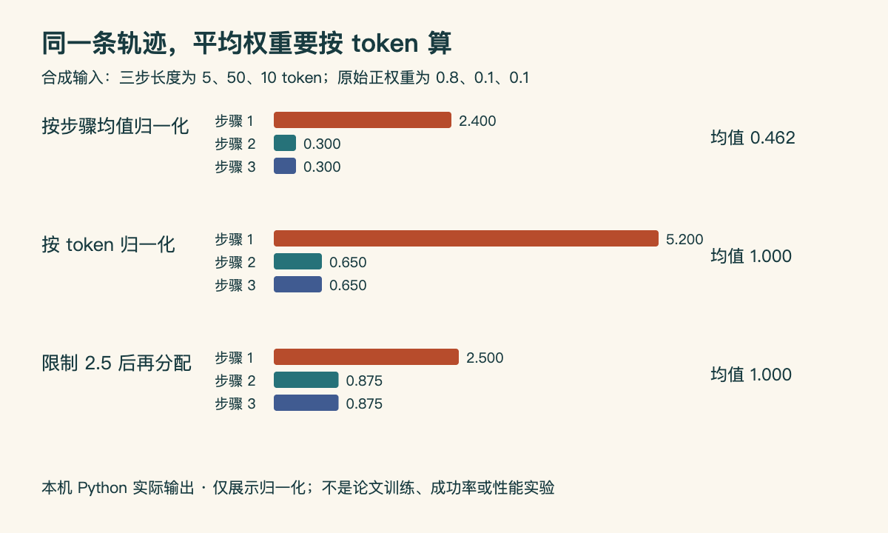

# 为什么步骤权重的平均值是 1，整条轨迹却被缩小了？

**已在本机运行：Python 3.14.3，仅标准库。** 本文使用手工指定的三步合成数据，检验按 token 加权归一化、权重上限与优势符号。它受到本期 DeltaTTG 论文的尺度约束启发，未训练进度估计器，也未复现论文的强化学习结果。

## 问题藏在每一步的长度里

假设三个动作分别输出 5、50、10 个 token。某个上游模块给出正权重 0.8、0.1、0.1，我们希望把权重乘到原优势值上，但不改变这条轨迹按 token 计算的平均尺度。

如果除以三个数的普通平均值，得到 2.4、0.3、0.3，按步骤平均确实为 1。可是第二步长达 50 个 token，大部分位置只乘了 0.3。实际平均为：

```text
(5 × 2.4 + 50 × 0.3 + 10 × 0.3) / 65 = 0.461538...
```

它改变的不只是“哪一步更重要”，还把整条轨迹的平均尺度缩到不到一半。

## 正确分母与上限再分配

先按长度计算原权重均值，再逐项相除，得到 5.2、0.65、0.65。这时 token 加权平均为 1，但第一步的放大过强。给权重设置 2.5 的上限后，不能只截断就结束；被截掉的部分还需重新分配给未到上限的位置。

本例的总预算是 65。第一步固定为 2.5，消耗 5 × 2.5 = 12.5；剩余 52.5 分给另外 60 个 token，权重成为 0.875。最终得到 2.5、0.875、0.875，加权平均再次等于 1。



中文读图：第一行虽然按步骤平均为 1，右侧按 token 的平均只有 0.462；第二行修正尺度，但第一步权重超过上限；第三行截断后再分配。图由本机 Python 输出的合成数据经 HTML/JS 导出，非模型性能或训练实验。[原尺寸](images/normalization.png) · [原始输出](code/normalization-result.json) · [可复现 HTML](code/normalization.html)。

## 运行与检查

将附件放在同一目录，执行：

```bash
python3 normalize_credit.py
node render-normalization.mjs
```

Python 生成 JSON，Node 根据该 JSON 生成 SVG 与 HTML。用浏览器打开 HTML，即可复查图中数字；脚本不访问网络，不需要模型或 GPU。

```python
def mean_token(values, lengths):
    return sum(v * n for v, n in zip(values, lengths)) / sum(lengths)
```

完整实现使用逐步固定超限位置的方法，重新计算剩余预算；不能反复“截断再除平均”而不检查是否又越过上限。本机五个算例检查通过：包含普通分配、均匀权重、全部为零的回退，以及极端不均衡输入，均满足上限和 token 加权平均约为 1。

原优势为 +2 时，三步得到 +5、+1.75、+1.75；原优势为 −2 时，得到 −5、−1.75、−1.75。权重非负，因此符号保留；加权平均分别仍为 +2、−2。

## 这个实验没有证明什么

合成权重是人为给定的，不能证明它正确衡量任务进度；保持尺度也不保证训练更稳定或成功率更高。这里的上限取 2.5，仅方便看算例，并非照搬论文超参数。论文还包含按优势符号选择进展方向、均匀混合及进度估计器训练，这些没有在本例实现。真实训练还必须明确 padding、截断和 loss 的聚合方式，不能把本例分母直接套到所有训练框架。

[完整 Python](code/normalize_credit.py) · [渲染源码](code/render-normalization.mjs) · [DeltaTTG 原文](https://arxiv.org/abs/2610.17666) · [本期论文解释](03-论文精选.md)。
