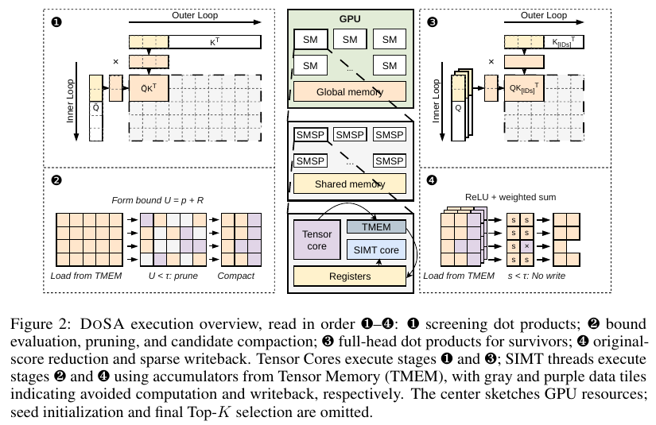

# DoSA：证明进不了 Top-K 的候选，可以少算

英文标题：DoSA: Dots Sparse Attention。作者：Meng, Fanxu、Fang, Taosong。原始提交：2026-09-26；版本 v1；本期核验未确认正式录用，按预印本处理。

[arXiv 原始记录](https://arxiv.org/abs/2610.13990)；[原始 PDF](https://arxiv.org/pdf/2610.13990v1)。

[站内原文 PDF](2610.13990v1.pdf)。

归档许可：CC BY 4.0。已保存未修改 PDF；图的裁切另有说明。

稀疏注意力只访问少量 key，但为了找到这些 key，索引器可能仍要对每个候选计算完整分数。DoSA 的切入点是：排除一个候选不一定需要知道它的精确得分，只要能证明它的上界低于一个可靠阈值。

方法先从种子候选中获得真实 Top-K 阈值的下界；再用部分头的精确结果、正贡献的界和负贡献的保守处理，计算候选的分数上界。如果上界仍不足以过线，就可以排除。剩余候选才完成全部头的计算，并进入精确选择。这里的无损来自数学条件和数值处理，不能简单删除小权重头来冒充。

Meng 与 Fang，Figure 2，CC BY 4.0；从 PDF 第 3 页忠实截取完整图与原图注。按 ①—④ 读，灰色区域表示省去的计算；种子初始化和最终 Top-K 在原图中省略（[来源原图](https://arxiv.org/abs/2610.13990)；[查看原尺寸](../../../frontiers/2026/10/2026-10-15/images/dosa-method.png)。）

作者在 GLM-5.2 与 DeepSeek-V3.2 的长上下文中，对比 SGLang 0.5.18 和 LiteTopK。覆盖英文、中文与代码，索引器最大加速为相对 SGLang 的 2.74 倍；端到端首 token 时间最大改善为 1.94 倍。两者分母不同，不能把局部索引速度写成生成全过程吞吐。实验涉及 128k 到约 1M 上下文及多卡配置，解码阶段的改善也较小。

为什么现在值得看：这是精确候选筛选的可复用思路，**新近创新；已读证书条件、实现说明和实验，本站未运行，热度待验证**。arXiv 编号虽然是 2610，页面原始提交日期实际为 **2026-09-26**，本期明确列为近期补充。论文 CC BY 4.0，但关联代码仓库未见明确 LICENSE，不能把论文许可套到代码；低精度保守界与回退路径也是复现重点。
