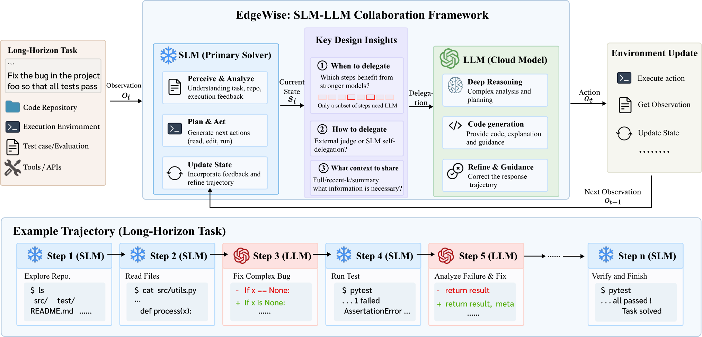

# EdgeWise：把难步骤交给云端，但别漏算本地成本

**EdgeWise: Bringing Long-Horizon Agents to the Edge via Selective Cloud Delegation**

作者：Shi, Zeru、Jiang, Jindong、Hachiuma, Ryo、Fu, Yonggan、Lee, Byung-Kwan、Belcak, Peter、Muralidharan, Saurav、Agarwal, Ayush、Tang, Ruixiang、Dantrey, Ambrish、Molchanov, Pavlo、Patney, Anjul、Radhakrishnan, Subhashree。arXiv:2610.17560，v1，2026-10-13。预印本，未宣称录用。

研究摘要（编辑归纳）：训练本地模型自己决定何时委托云端，并检查上下文保留与成本边界。

长任务不是每一步都需要最强模型。EdgeWise 先让本地 Qwen3.5-9B 执行，只在关键步骤委托云端；训练同时优化任务动作和委托决策。外部评判器用于研究哪些委托策略有效，但训练后的自主委托路径不需要再挂一个额外评判模型。云端拿到多少历史上下文，是效果能否保留的重要条件。

训练先使用约 2,000 条 SWE-Smith 样本做 SFT，再进行步骤级强化学习。评测包含 Terminal-Bench 2.1 与 SWE-ReBench，使用特定工具执行框架、最多 80 轮，并分别配对 GPT-5.5 与 Claude Opus 4.8。任务、云模型、采样次数都要与表格对应。

例如 GPT 对照下，Terminal-Bench 的 Pass@1 从 74.16 降到 71.91，Pass@3 则同为 82.02，云端费用从 279.73 降到 181.88。SWE 设置中 Pass@3 从 63.64 到 66.36，费用从 598.08 到 283.02；换成 Opus 时，部分成本收益伴随成功率下降。不能只摘最高节省值，再配上另一组的最高成功率。

为什么现在值得看：它给出了可训练的委托机制及本地工作站部署实验。但论文费用只计云端 API，未把本地设备、运行电耗与训练成本全部算入；“少付云账单”不等于“总成本同幅下降”。本站未复现，结果为作者实验。

中文读图：本地模型是默认执行者，委托发生在它判断需要帮助的步骤；云端回复又回到同一任务上下文。Shi 等，EdgeWise 方法图，CC BY 4.0。箭头表示协作过程，不表示所有步骤都经过两个模型。（[来源原图](https://arxiv.org/abs/2610.17560)；[查看原尺寸](../../../frontiers/2026/10/2026-10-19/images/edgewise.webp)。）

[原文](https://arxiv.org/abs/2610.17560) · [原始 PDF](https://arxiv.org/pdf/2610.17560v1) · [版本许可](https://creativecommons.org/licenses/by/4.0/)。

本版采用 CC BY 4.0。网站现有附件已接近 1 GB 部署上限，本期归档原创阅读卡与必要方法图，完整 PDF 保留作者原始入口。

[返回本期论文精选](../../../frontiers/2026/10/2026-10-19/03-论文精选.md)。
