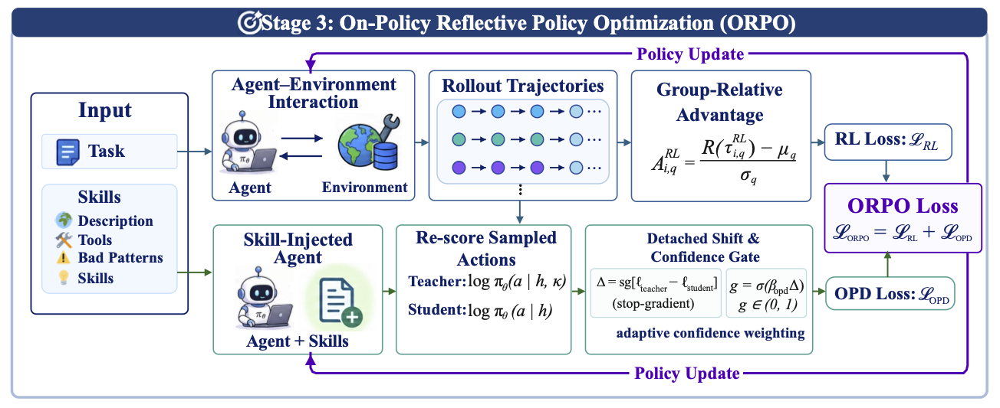

# Agent-Reflex：教 Agent 从工具错误中恢复

英文标题：Agent-Reflex: Teaching Language Agents to Act Reflectively。作者：Dong, Guanting、Yang, Xinyu、Jin, Jiajie、Hu, Yuyang、Song, Xiaoshuai、Chen, Yifei、Li, Xiaoxi、Tan, Jiejun、Zhu, Yutao、Chua, Tat-Seng、Wen, Ji-Rong、Dou, Zhicheng。原始提交：2026-10-13；版本 v1；本期核验未确认正式录用，按预印本处理。

[arXiv 原始记录](https://arxiv.org/abs/2610.17953)；[原始 PDF](https://arxiv.org/pdf/2610.17953v1)。

归档许可：arXiv 非独占分发许可；未确认本站可再分发PDF。本站仅存原创阅读卡；配图采用另有 MIT 许可的作者代码仓库 Figure 3。

工具返回格式不对、结果缺字段或环境状态改变时，只会沿着原计划继续的 Agent 很容易扩大错误。Agent-Reflex 把“先判断出了什么问题，再选择恢复技能”作为训练对象，建立 557 个 MCP 环境，采集工具返回与错误，并将可验证的扰动分成八类。

方法有三个环节：从错误中归纳反思技能，用监督数据练习修复、恢复和纠正，再通过带噪环境中的 on-policy 训练加强行为。文中的 ORPO 指 **On-Policy Reflective Policy Optimization**，不是另一个常见同名偏好优化算法。教师结合技能提示重新评价学生已经采取的动作，并按置信度调节学习信号。

RUC-NLPIR 团队仓库 Figure 3 原图，MIT。图展示第三阶段 ORPO，不能当作全部三个阶段；关注教师看到的技能信息与学生实际执行动作之间的区别（[来源原图](https://github.com/RUC-NLPIR/Agent-Reflex)；[查看原尺寸](../../../frontiers/2026/10/2026-10-15/images/reflex.png)。）

作者以 Qwen3-8B 为基础，在 BFCL、ACEBench、ToolSandbox、τ² 和 Vita 等任务上评估。噪声条件下的平均成绩为 29.1，对照 NoisyAgent 为 25.9，未做相应训练的基座为 12.3；不同任务差异很大，例如 τ² 为 45.9，Vita 仅 12.3。消融在相同 100 步 RL 预算下比较，有助于辨别技能与优化环节的作用，但成绩仍来自作者实验。

为什么现在值得看：2026-10-13 的新预印本给出可检验的错误恢复训练路径，**新近实用、新近创新；已读方法、实验与消融，本站未训练，热度待验证**。人工噪声不能代表所有真实 API 故障；复现时应单独统计错误检测、恢复动作和最终任务完成率，不能只看平均分。
