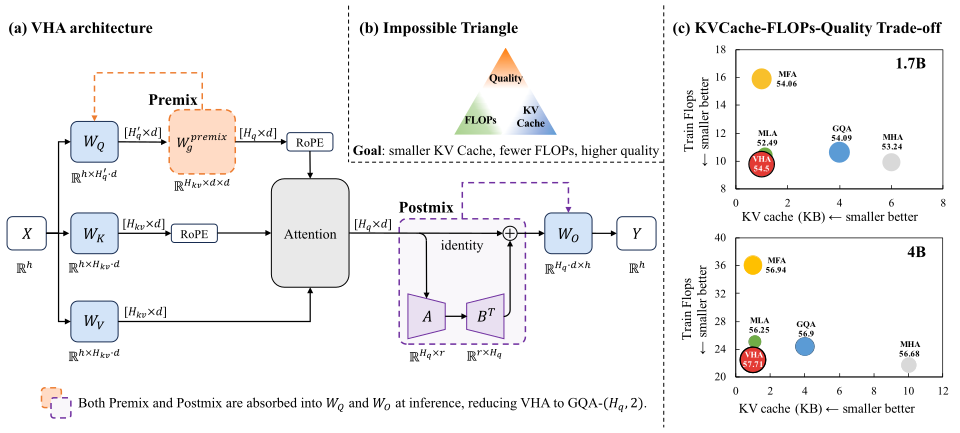

# Virtual Head Attention：训练时更灵活，部署时折叠回紧凑注意力

**Virtual Head Attention**

作者：Ding, Xibo、Wang, Guoxia、Zeng, Jinle、Yang, Jiabin、Tao, Sirui、Yang, Chao、Yu, Dianhai。arXiv:2610.17959，v1，2026-10-13。预印本，未宣称录用。

研究摘要（编辑归纳）：将虚拟头表达折叠到推理投影，明确缓存节省的不同分母。

VHA 想保留较多查询头的表达能力，同时减少实际读取的 KV 头。它把物理查询头通过线性组合映射成虚拟头，再混合输出；部署时将这些线性变换折叠进查询与输出投影。直觉上，训练可以使用更灵活的组合，推理不用永久保存一套额外激活结构。

节省对象主要是 KV cache。论文相对 GQA8 报告四倍缓存缩减，相对不同 MoE 配置的 GQA4 则是两倍，不能写成所有模型、所有显存都缩减四倍。小模型实验使用 50B token；更大 MoE 的对照又采用另一训练规模，结果不能混成一张不带条件的排行榜。

长上下文实验也存在取舍：匹配的 10B-A1B 设置中，RULER 平均约 84.4 对 73，但 InfiniteBench 为 31.5 对 31.8。为什么现在值得看：它给出了可以折叠的注意力参数化，而非单纯换大模型。实现见 PaddlePaddle/VHA；训练语料及全部过程不等于完全开放复现，本站未运行。

图 1，Ding 等。先看查询头的 pre-mix，再看输出的 post-mix；折叠发生在投影权重里。原图用于解释线性关系，不表示所有训练和推理开销都消失。有限方法评述引用，完整论文见原始链接。（[来源原图](https://arxiv.org/abs/2610.17959)；[查看原尺寸](../../../frontiers/2026/10/2026-10-18/images/vha.svg)。）

[原文](https://arxiv.org/abs/2610.17959) · [原始 PDF](https://arxiv.org/pdf/2610.17959v1) · [版本许可](https://arxiv.org/licenses/nonexclusive-distrib/1.0/)。

该版本采用 arXiv 非独占分发许可，未取得本站整篇再分发依据，因此仅归档原创阅读卡与原始链接。方法图限于紧邻的研究评述，不将公开可读等同任意转载。

[返回本期论文精选](../../../frontiers/2026/10/2026-10-18/03-论文精选.md)。
