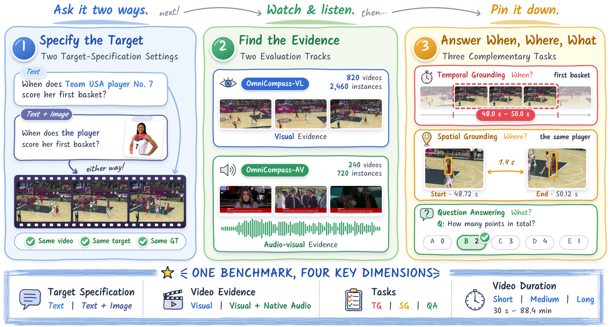

# OmniCompass：同一目标换一种问法，模型还能定位一致吗

英文标题：OmniCompass: A Holistic Benchmark for Omni-Modal Video Grounding and Understanding。作者：Liu, Xuyang、Wang, Shihao、Wei, Xinyu、Li, Minghan、Wang, Zeqing、Yang, Zuhao、Wen, Zichen、Zhang, Lei。原始提交：2026-10-13，版本 v1。未确认正式录用，按预印本处理。

[arXiv 原始记录](https://arxiv.org/abs/2610.18829) · [原文 PDF](https://arxiv.org/pdf/2610.18829v1)。许可：CC BY 4.0。[站内原文 PDF](2610.18829v1.pdf)。

OmniCompass 为同一视频、同一目标和同一标注建立两种提问：纯文字，以及文字加目标图像。模型分别回答“什么时候”“在哪里”和“是什么”。核心不只是两次回答相同，还要求两次都正确，并在时间或空间定位上相互一致，避免模型稳定地答错也获得一致性奖励。

基准含 820 段视频、2460 个视觉任务；其中 240 段另有音视频轨道，共 720 个任务。作者比较 50 个模型，但大、小模型和部分接口的采帧数不同，不能视为完全相同计算预算。最佳视觉综合一致性分数为 42.8，问答明显比时间、空间定位更容易；图片提示也不是总能改善结果。

论文基准总览，CC BY 4.0，从作者 TeX 附图忠实渲染；视频画面仅随论文图作研究解读引用。先看左侧 Same target，再看右侧三类答案：目标相同不代表任务相同（[来源原图](https://arxiv.org/abs/2610.18829)；[查看原尺寸](../../../frontiers/2026/10/2026-10-17/images/omnicompass.png)。）

为什么现在值得看：**新近实用、新近创新；已读方法、采帧条件、结果及时间戳消融，作者实验，本站未复现，热度待验证**。适合设计视频检索和多模态 Agent 的一致性评测。局限包括模型接口差异、有限视频与任务覆盖；分数不应推广成真实世界所有视频的理解率。

[返回本期论文精选](../../../frontiers/2026/10/2026-10-17/03-论文精选.md)。
