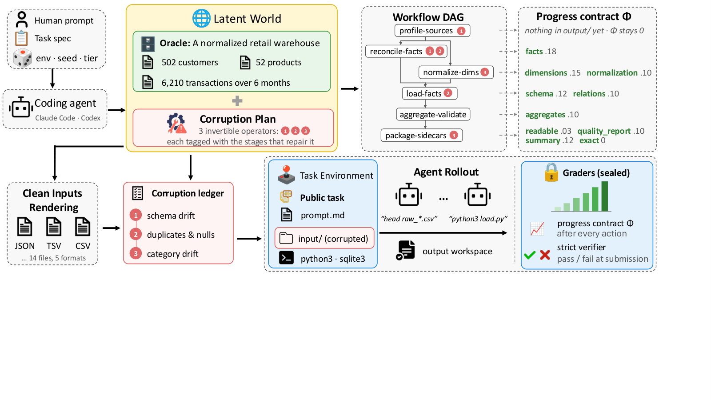

# Tev：先造可验证的世界，再生成长程任务

英文标题：Tev: Scaling Long-Horizon Agentic Environments with Dense Progress Rewards。作者：Hu, Wenbo、Pramanick, Shraman、Singh, Krishna Kumar、Peng, Nanyun、Chang, Kai-Wei、Lee, Yong Jae。原始提交：2026-10-13；版本 v1；本期核验未确认正式录用，按预印本处理。

[arXiv 原始记录](https://arxiv.org/abs/2610.18868)；[原始 PDF](https://arxiv.org/pdf/2610.18868v1)。

[站内原文 PDF](2610.18868v1.pdf)。

归档许可：CC BY 4.0。已保存未修改 PDF；图的裁切另有说明。

长程 Agent 训练不只缺题目，还缺能自动判断“做到哪一步”的环境。Tev 从潜在世界状态生成工作流，再渲染成文件或界面材料，通过可逆的破坏操作制造任务。系统保留隐藏的正确状态与验证器，代理只看到公开任务，因此可以比只在最后判对错更细地给出进度信号。

它用工作流依赖关系组织步骤，设计基于进度势函数的奖励 PPRS，并对渲染和恢复过程做一致性检查。这种做法的实用点是让任务生成、答案和中间进展来自同一个已知世界；限制也在这里：生成器覆盖不了的真实混乱，不会自动进入训练分布。

Tev 作者 Figure 3，CC BY 4.0。读图时分清代理可见的任务与隐藏的判分信息；原图下方留白保留，没有删改流程或标签（[来源原图](https://arxiv.org/abs/2610.18868)；[查看原尺寸](../../../frontiers/2026/10/2026-10-15/images/tev.png)。）

论文构建 1170 个环境、覆盖七类领域，训练 Qwen3.5-9B 和 Qwen3.8-27B 等模型。小模型使用的是 264 任务子集，不能与完整训练混为一谈。27B 模型在 ALE-CM 的 pass@5 从 0.17 到 0.28，对照 Claude Fable 5 为 0.33；这说明训练有收益，仍存在能力差距。部分 Terminal-Bench 子集仅 22 或 18 题，且筛选有特定条件，不宜泛化成全榜成绩。

为什么现在值得看：2026-10-13 的预印本给出环境与密集奖励共同设计的路线，**新近实用、新近创新；核心方法与实验已读，本站未训练，热度待验证**。训练涉及多节点高端 GPU、较长上下文和工具调用预算；验证器泄漏、合成任务的代表性与真实迁移，比单个平均分更需要检查。
