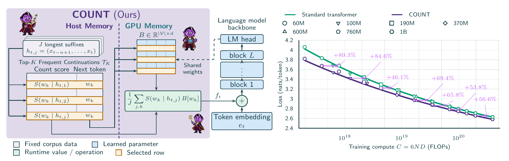

# COUNT：把语料计数放进主机内存，给模型补一条输入

英文标题：The COUNT: Counting N-grams Unlocks Scaling on Host Memory and Training-Free Adaptation。作者：Magnusson, Ian、Smith, Noah A.、Koh, Pang Wei。原始提交：2026-10-14；版本 v1；未确认正式录用，按预印本处理。

[arXiv 原始记录](https://arxiv.org/abs/2610.20456)；[原始 PDF](https://arxiv.org/pdf/2610.20456v1)。许可：CC BY 4.0。

[站内原文 PDF](2610.20456v1.pdf)。

COUNT 重新利用语料中的 n-gram 统计：给定当前前缀，从 CPU 主机内存中的固定表查找常见后续 token，再从模型已有输出矩阵取相应行，以计数分数加权，作为额外输入加到 token embedding 上。它没有新增需要学习的参数，但确实增加了一张可能很大的外部统计表。

与单纯在输出概率上融合计数相比，这个输入会经过后续 Transformer 层，使模型能在内部结合统计线索和上下文。作者还比较从头学习的 n-gram embedding，并测试替换领域计数表。这样的结构让领域数据能够影响预测，但迁移效果仍须逐任务评估。

Magnusson 等，Figure 1 原图，CC BY 4.0。左侧虚线分开主机与GPU内存；右侧紫色百分数是达到相同验证损失所需的额外基线计算，不是生成速度或准确率提升（[来源原图](https://arxiv.org/abs/2610.20456)；[查看原尺寸](../../../frontiers/2026/10/2026-10-16/images/count.webp)。）

实验覆盖 60M 至 1B 模型、Dolma 3 语料和不同数据/参数比；计数表从约 17.1GB 到 797GB。作者拟合验证损失前沿，得到相当于标准模型多用约 46–89% 训练计算的收益。训练吞吐约为基线的 93.1–97.8%，并非完全没有运行代价；领域替换在损失上有收益，准确率并非全部一致改善。

为什么现在值得看：**新近实用、新近创新；2026-10-14 预印本，已读方法、匹配比较、领域实验与吞吐结果，本站未训练，热度待验证**。对于 GPU 显存紧、主机 RAM 较宽裕的实验环境，这是一种值得核算的取舍；不能把“零新增可学习参数”误写为“零额外内存”，也不能忽略计数表构建、传输和数据来源。

## 摘要与阅读范围

上文为本站中文归纳。已核对原文核心方法、实验设置、结果和限制；未运行论文实验。论文作者的结论与本站验证分开。

[返回本期论文精选](../../../frontiers/2026/10/2026-10-16/03-论文精选.md)。
