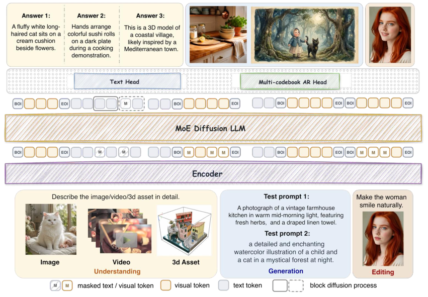

# Intern Lumina U2：并行扩散位置，逐码本恢复视觉细节

**Intern Lumina U2: A Multi-Codebook Diffusion Large Language Model for Omni-Visual Understanding and Image Generation**

作者：Yu, Qian、Qiu, Zongyang、Yan, Juncheng、Li, Hongliang、Qin, Qi、Wang, Keqi、Luo, Siqi、Ju, Junkui、Mi, Yapeng、Lu, Tiantian、Liu, Tian、Xie, Pengyu、Ji, Chenhao、Zhang, Minghui、Zhao, Yiang、Yan, Siyu、Xu, Haiying、Wang, Yanbo、Shen, Jianghan、Pu, Yuandong、Lei, Jiayi、Zhang, Borui、Shi, Jinxin、Zhang, Bo、Zang, Yuhang、Ye, Shenglong、Gu, Lixin、Zhang, Hongjie、Liu, Linghan、Chen, Xinyuan、Cao, Yuewen、Zhang, Lihe、Liu, Xiaohong、He, Junjun、Liu, Qiangwei、Zhang, Qi、Cheng, Yu、Xue, Tianfan、Xiong, Hui、Xu, Chang、Qiao, Yu、Liu, Yihao、Fu, Bin。arXiv:2610.20818，v1，2026-10-14。预印本，未宣称录用。

研究摘要（编辑归纳）：把多码本视觉表征、扩散解码与缓存策略放在可对照实验中。

U2 用多个视觉码本表示图像，并把两种生成顺序结合：不同位置可以并行扩散，同一位置内的多个码本按顺序恢复。这样既保留扩散的并行性，也能处理一个位置需要多份离散信息的情况。它还研究隐藏状态缓存、揭示顺序和验证策略，减少每轮重复计算。

输入侧涵盖图像、视频和三维信息，输出侧重点是文本与图像生成、编辑；能理解视频不等于公开了视频生成能力。方法图里的输入编码器与输出头要分开读。

Table 4 在同一检查点、1,024² 图像、553 个 GenEval 提示和固定采样条件下，报告从 96 步、159.9 秒到平均 60.4 步、35.9 秒，分数从 86.6 到 89.3。该表使用单图设置，不能和主表多种子结果直接拼接；本文没有确认完整可迁移的硬件计时基线。

为什么现在值得看：多码本与推理策略共同展示了视觉扩散语言模型的具体取舍。部分生成多样性指标仍有下降；本站读核心方法及实验，未复现。

方法总览，Yu 等，CC BY 4.0。底部不同模态进入共享骨干，顶部的文本与视觉头承担不同输出；图像位置的并行生成与位置内的码本顺序不是同一维度。保留完整原图，手机请打开原尺寸结合正文阅读。（[来源原图](https://arxiv.org/abs/2610.20818)；[查看原尺寸](../../../frontiers/2026/10/2026-10-18/images/u2.png)。）

[原文](https://arxiv.org/abs/2610.20818) · [原始 PDF](https://arxiv.org/pdf/2610.20818v1) · [版本许可](https://creativecommons.org/licenses/by/4.0/)。

本版 CC BY 4.0 允许再分发；原始 PDF 约 23.5 MB。本网站构建体积已接近部署上限，本期保存阅读卡与必要原图，完整 PDF 从作者原始入口阅读，不降低图片数字或截取论文结果冒充全文。

[返回本期论文精选](../../../frontiers/2026/10/2026-10-18/03-论文精选.md)。
