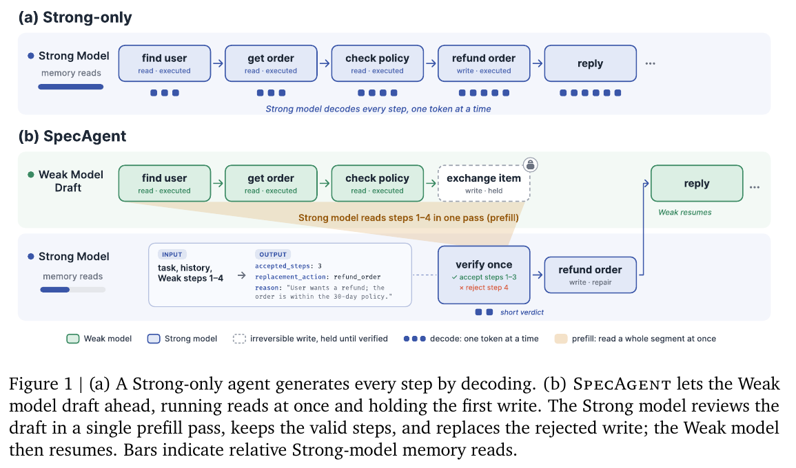

# SpecAgent：小模型先走只读步骤，大模型在写操作前检查

**Trajectory-Level Speculation with Semantic Verification for Tool-Using Agents**

作者：Wang, Zilin、Liu, Yinhong、Chen, Chao、Liu, Qun、Guo, Zhijiang。arXiv:2610.21463，v1，2026-10-15。预印本，未宣称录用。

研究摘要（编辑归纳）：轨迹级语义验证降低大模型逐步生成成本，同时明确工具写入假设。

SpecAgent 让小模型先执行只读工具、拿到真实观察，并暂缓第一次写操作。大模型一次读入整段轨迹，判断最长的语义有效前缀，必要时修复被拒绝的动作。它不要求小模型逐字模仿大模型的每一步，而是检查这条路径是否在语义上可接受。

重要边界是：只有只读步骤的短块可以直接推进，并非每次读操作都经大模型审核；修复动作也有自己的执行规则。系统依赖工具适配器对“只读/写入”的划分，语义检查本身不是安全证明。

论文以 Qwen3.5-397B 与 4B 配对。τ² Airline 中成功率同为 86%，墙钟时间从 305.2 降至 126.2 秒；Retail 略降，其他任务也有明显精度损失。估算显存流量降低的同时，计算量会上升，不能把它写成每种成本都下降。

为什么现在值得看：它把推测执行扩到真实工具轨迹，并公开呈现效率与成功率的交换。本文采用论文实验，未运行 Agent；CC BY 4.0 原始 PDF 已站内归档。

图 1，Wang 等，CC BY 4.0。绿色先执行查询，虚线框把首次写入留住，蓝色模型在一次检查中接受前三步并修复第四步。采用 PDF 第 3 页原图及图注的忠实裁切；未修改数值或连接关系，原尺寸入口与完整 PDF 均保留。（[来源原图](https://arxiv.org/abs/2610.21463)；[查看原尺寸](../../../frontiers/2026/10/2026-10-18/images/specagent.png)。）

[原文](https://arxiv.org/abs/2610.21463) · [原始 PDF](https://arxiv.org/pdf/2610.21463v1) · [版本许可](https://creativecommons.org/licenses/by/4.0/)。

本版为 CC BY 4.0，已保存未经修改的 [原始 PDF](2610.21463v1.pdf)；保留作者、版本和许可。

[返回本期论文精选](../../../frontiers/2026/10/2026-10-18/03-论文精选.md)。
