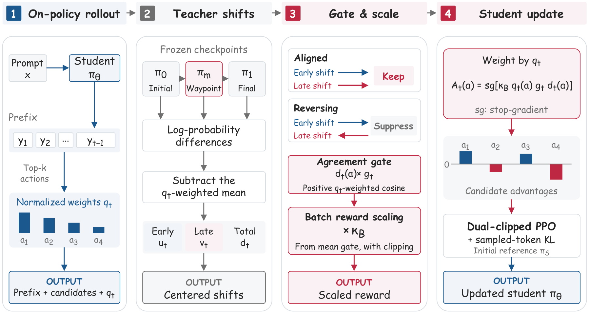

# Waypoint-OPD：教师训练途中提供方向检查，而非第二个模仿目标

英文标题：Waypoint-OPD: Transferring RL-Induced Policy Shifts via Gated On-Policy Distillation。作者：Hou, Bingxi、Jiang, Guochao、Quan, Guofeng、Li, Weiqing、Feng, Wenfeng、Liu, Guohua、Zhang, Yuewei。原始提交：2026-10-15，版本 v1。未确认正式录用，按预印本处理。

[arXiv 原始记录](https://arxiv.org/abs/2610.21601) · [原文 PDF](https://arxiv.org/pdf/2610.21601v1)。许可：CC BY 4.0。[站内原文 PDF](2610.21601v1.pdf)。

直接蒸馏通常只看教师最终输出。Waypoint-OPD 多保留一个训练中途的教师检查点，观察初始→中途、中途→最终两段概率变化是否同向。对学生采样位置的候选动作先去掉加权均值，再用正的加权余弦一致性调节最终变化信号；反向变化被抑制，批次尺度也会重新校准。中途模型并不是要求学生额外模仿的目标。

教师是 Qwen3-4B 的初始、600 步和1200步检查点，学生为8B、14B、30B-A3B。相对直接 OPD，七项数学均分增加约1.59—2.18点，五项代码均分增加约1.19—2.66点，各任务并非全部领先。数学按32次、代码按8次采样统计；AIME2024还参与检查点选择，解读该项结果需留意选择偏差。

作者方法原图，CC BY 4.0。重点看第三列：同向保留，反向抑制；第二列中途检查点只是计算方向变化，不是新增监督答案（[来源原图](https://arxiv.org/abs/2610.21601)；[查看原尺寸](../../../frontiers/2026/10/2026-10-17/images/waypoint.png)。）

为什么现在值得看：**新近创新；已读门控、消融、基线与效率设置，作者实验，本站未训练，热度待验证**。额外教师前向不是免费：8张H20的100步计时从8分02秒到8分21秒，且不含评估。价值是利用训练轨迹判断蒸馏信号，限制是需要中途检查点、同族教师条件和额外计算。

[返回本期论文精选](../../../frontiers/2026/10/2026-10-17/03-论文精选.md)。
