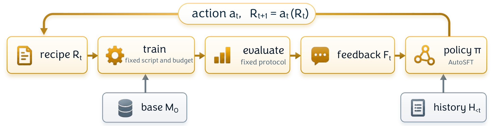

# AutoSFT：把训练数据调整变成可检查的实验循环

**AutoSFT: An Agentic System for Automated Data Research in Supervised Fine-Tuning**

作者：He, Bingxiang、Sun, Pengqi、Peng, Shihao、Li, Shaoxuan、Xiao, Huiyu、Shi, Hongjian、Fu, Zixuan、Qiao, Ziqing、Zuo, Yuxin、Qian, Cheng、Yu, Xinqiang、Li, Jiayi、Chen, Xiusi、Song, Yizhen、Wang, Xiangyang、Lei, Iofai、Wang, Yudong、Ding, Ning、Liu, Zhiyuan、Wang, Xiaozhi、Xiao, Chaojun。arXiv:2610.22194，v1，2026-10-15。预印本，未宣称录用。

研究摘要（编辑归纳）：分离执行、分析与合成，扩大自动SFT可探索的数据操作范围。

让 Agent 改训练数据，容易退化成只调各类样本的比例。AutoSFT 把操作扩展到配比、筛除、修复、替换、合成和顺序调整，并将主规划、执行、分析及合成分开：执行器返回产物路径，多种分析视角提出建议，主循环再决定下一轮修改。这样，训练日志不必一直占满决策上下文。

每轮从同一个 Qwen3-1.7B 基础模型重新训练，避免把前一轮额外训练的收益算到数据策略上。分析实验固定 3M token、3 个 epoch；加入分析后，30 轮搜索的最佳 IFEval 为 67.10，对照为 60.60。更长的单 Agent 搜索跑到 50 轮、用时接近，仍为 62.35。这里比较的是搜索过程找到的最佳配方，不是一个配方重复独立训练后的均值。

合成实验改用 100M token 预算，IFEval 为 81.58 对 78.15，IFBench 为 51.95 对 49.02；不能将它与前面的 3M token 结果直接连成同预算提升曲线。代码任务还做了迁移，但依然是有限基础模型、有限时间预算下的研究。

为什么现在值得看：它提出的不只是“多开几个 Agent”，而是让不同数据修改动作真正进入可检验循环。本站读方法、主要对照和预算说明，未训练复现；实现仓库可读，但本次未找到正式 LICENSE，不能把公开源码写成已确认的宽松开源项目。

图中从数据配方到训练、评估再回到配方，表示每轮可以更换数据操作；不是沿同一个检查点无限续训。He 等，AutoSFT 原图，CC BY 4.0。中文说明与图分开，保留完整原图。（[来源原图](https://arxiv.org/abs/2610.22194)；[查看原尺寸](../../../frontiers/2026/10/2026-10-19/images/autosft.webp)。）

[原文](https://arxiv.org/abs/2610.22194) · [原始 PDF](https://arxiv.org/pdf/2610.22194v1) · [版本许可](https://creativecommons.org/licenses/by/4.0/)。

本版采用 CC BY 4.0。网站现有附件已接近 1 GB 部署上限，本期归档原创阅读卡与必要方法图，完整 PDF 保留作者原始入口。

[返回本期论文精选](../../../frontiers/2026/10/2026-10-19/03-论文精选.md)。
