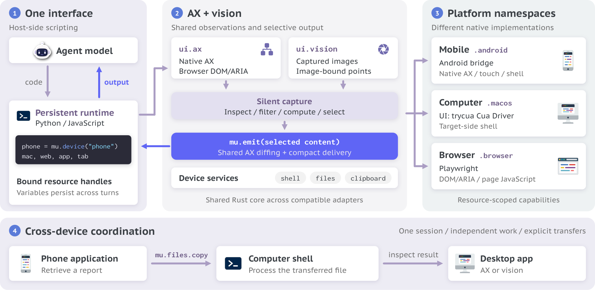

# OpenGCUA：让模型选择观察与控制方式，而非固定每一步点击

英文标题：OpenGCUA: Toward a Fully Open Stack for Generalist Computer Use。作者：Zhou, Hanzhang、Li, Long、Kong, Quyu、Wang, Lei、Tong, Panrong、Chen, Long、Xia, Tianyu、Zhang, Gongjie、Zhang, Xu、Liu, Chen、Zhang, Jianan、Cai, Chenglin、Zeng, Zhengwen、Hoi, Steven、Wang, Yue。原始提交：2026-10-15，版本 v1。未确认正式录用，按预印本处理。

[arXiv 原始记录](https://arxiv.org/abs/2610.22200) · [原文 PDF](https://arxiv.org/pdf/2610.22200v1)。许可：CC BY 4.0。[站内原文 PDF](2610.22200v1.pdf)。

OpenGCUA 研究通用计算机操作的外围系统，而不是发布一个新训练的模型。它让 Agent 在持续脚本运行环境中选择视觉、可访问性树、GUI 或命令行等接口，用条件分支和循环组织操作，并只把所需观察送回模型。这样可以减少重复往返，但也改变了工具与观察范围。

作者在 OSWorld2.1 的82个离线任务上比较8个模型，排除26个依赖互联网的任务。平均部分任务得分从45.3到64.9，提高19.6点；相对步数平均减少53%。这里的得分不是完整成功率，步数也不是总时延：API、带宽和真实设备速度会影响耗时。另有四个macOS真实任务的小规模演示，不能据此建立全面设备排名。

作者 SDK 架构原图，CC BY 4.0。中间的选择性输出是重点：采集、筛选和返回给模型是不同步骤；下方跨设备例子是设计示意（[来源原图](https://arxiv.org/abs/2610.22200)；[查看原尺寸](../../../frontiers/2026/10/2026-10-17/images/opengcua.png)。）

为什么现在值得看：**新近实用、新近创新；已读控制设计、离线任务选择及结果，作者实验，本站未复现，热度待验证**。做电脑 Agent 时可以比较“固定动作列表”与“可编程控制”的差异。限制是工具权限、评测子集和较小真实设备实验；不能把外围系统收益说成基础模型本身提升。

[返回本期论文精选](../../../frontiers/2026/10/2026-10-17/03-论文精选.md)。
