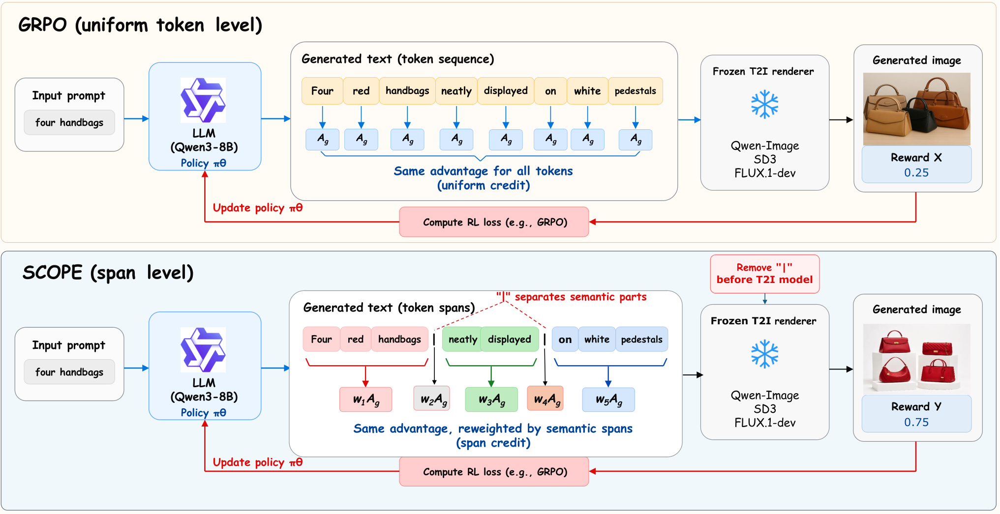

# SCOPE：改写画图提示词时，按语义片段分配信用

**SCOPE: Semantic Bounded Credit Optimization for Prompt Engineering in Text-to-image Generation**

作者：Jiao, Yufei、Huang, Jinfa、Xue, Zeyue、Xie, Tianyu、Ma, Yuexiao、Ji, Rongrong、Zheng, Xiawu、Luo, Jiebo。arXiv:2610.22264，v1，2026-10-15。预印本，未宣称录用。

研究摘要（编辑归纳）：语义片段级提示优化具有基线与分组消融，代码许可缺口明确。

SCOPE 训练一个提示词改写器，同时输出改写后的提示和语义片段。它将当前与旧策略之间的概率变化汇总到片段层面，用于分配同一个最终图像奖励；片段边界比把整句话或任意几个 token 一起奖励更贴近对象、属性及关系。

作者以 Qwen3-8B 为改写器，冻结 Qwen-Image、SD3、FLUX.1-dev 等图像模型，使用合成提示数据训练。GenEval 上，相对 GRPO 的结果分别从 0.91 到 0.95、0.74 到 0.84、0.76 到 0.84。论文的 9.48% 是平均相对改善，不能写成所有模型统一增加 9.48 个百分点。

随机片段、固定长度片段及取消聚合的消融更弱，支持“片段如何划分”确实重要。但基准对组合语义的检查不能覆盖人类对所有画面质量的判断。图里的 0.25/0.75 奖励是机制例子，不是总体成绩。

为什么现在值得看：它把提示词优化从整句奖励推进到语义局部，且有匹配基线和消融。代码仓库已公开可读，但本次未找到正式 LICENSE，不能宣称实现具备明确的宽松开源许可；论文为 CC BY 4.0，本站未复现。

图 2，Jiao 等，CC BY 4.0。上方整句更新与下方语义片段更新形成对照；颜色表示分配区域，0.25 与 0.75 只是图示奖励，不可当成实验平均值。（[来源原图](https://arxiv.org/abs/2610.22264)；[查看原尺寸](../../../frontiers/2026/10/2026-10-18/images/scope.png)。）

[原文](https://arxiv.org/abs/2610.22264) · [原始 PDF](https://arxiv.org/pdf/2610.22264v1) · [版本许可](https://creativecommons.org/licenses/by/4.0/)。

本版 CC BY 4.0 允许再分发；原始 PDF 约 19.3 MB。本网站构建体积已接近部署上限，本期保存阅读卡与必要原图，完整 PDF 从作者原始入口阅读，不降低图片数字或截取论文结果冒充全文。

[返回本期论文精选](../../../frontiers/2026/10/2026-10-18/03-论文精选.md)。
