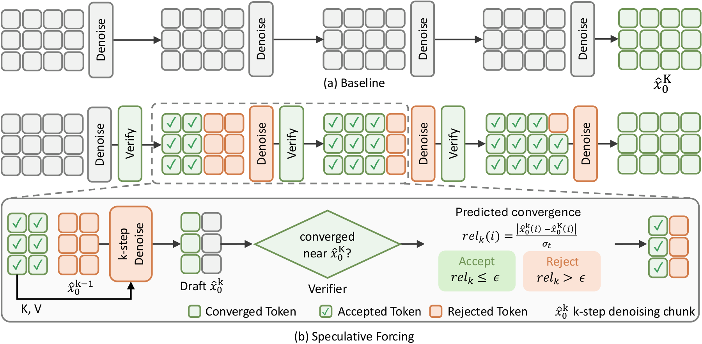

# Speculative Forcing：视频中已稳定的位置，提前停止去噪

英文标题：Speculative Forcing for Efficient Autoregressive Video Generation。作者：Choi, Hyunwook、Kim, Seungryong、Han, Dongyoon、Yun, Sangdoo。原始提交：2026-10-15，版本 v1。未确认正式录用，按预印本处理。

[arXiv 原始记录](https://arxiv.org/abs/2610.22347) · [原文 PDF](https://arxiv.org/pdf/2610.22347v1)。许可：CC BY 4.0。[站内原文 PDF](2610.22347v1.pdf)。

四步自回归视频生成每一轮都处理全部位置，并不意味着每个位置都还需要同样多的计算。Speculative Forcing 检查当前草稿中哪些 token 已接近最终结果，提前提交这些位置与缓存，只让剩余部分继续去噪，并用最后的干净前向刷新后续块需要的状态。方法冻结基础视频模型，有免训练规则和学习验证器两条路线。

实验使用LongLive和LingBot-World-2的1.3B因果版本。在H100、30秒LongLive生成设置下，学习验证器平均约1.72步、37.8FPS；原四步为24.5FPS，VBench-Long汇总接近，但个别一致性维度仍有变化。去噪步数减少比例不能当成端到端加速倍数，阈值也会改变质量与速度。

作者方法原图，CC BY 4.0。绿色代表已接受位置，橙色仍需计算；下方阈值判断表达近似质量取舍，不是严格无损保证（[来源原图](https://arxiv.org/abs/2610.22347)；[查看原尺寸](../../../frontiers/2026/10/2026-10-17/images/speculative-forcing.png)。）

为什么现在值得看：**新近实用、新近创新；已读验证规则、消融与计时条件，作者实验，本站未运行，热度待验证**。它把“哪些位置还值得算”变成可研究问题。局限是验证器误判、特定少步生成器与硬件条件；更高FPS不自动意味着交互系统总体延迟同比降低。

[返回本期论文精选](../../../frontiers/2026/10/2026-10-17/03-论文精选.md)。
